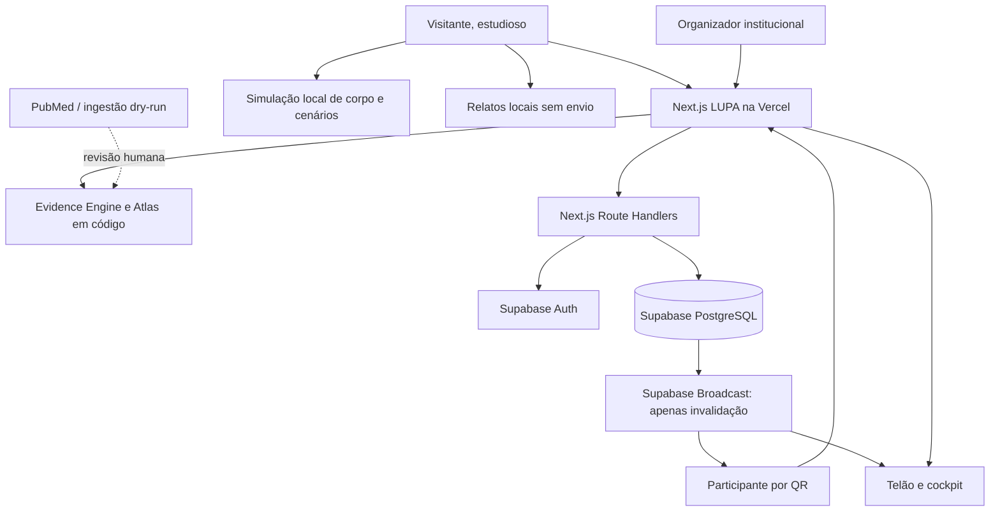
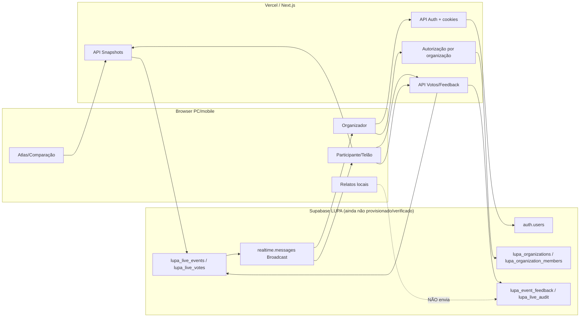
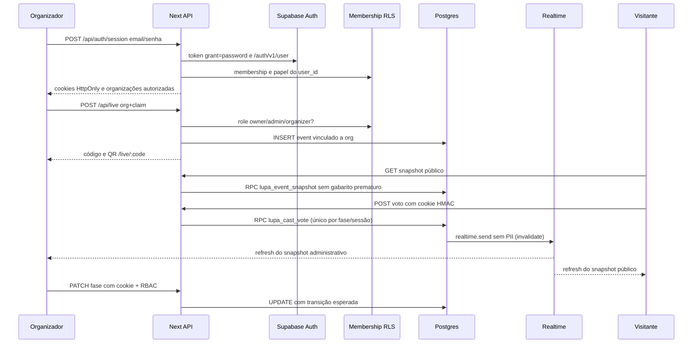
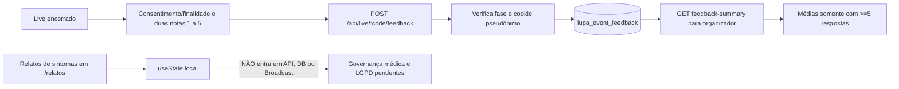

# LUPA SAÚDE — ARQUITETURA REAL, INVENTÁRIO E MATRIZ DE CONEXÕES

> **Documento as-built auditável**, baseado na árvore de arquivos e em módulos concretos do GitHub.  
> **Branch:** `feat/lupa-live-auth-realtime-go-live-20261113` · **Snapshot de código:** `e96a1fb3d1743fc28256df68826a83dd2391b21a` · **PR:** https://github.com/annygabb/Lupa/pull/8  
> **Código atual em produção:** NÃO CONFIRMADO para esta branch. **Banco Supabase dedicado:** NÃO LOCALIZADO nas conexões atuais.  
> **Inventário:** 325 arquivos rastreados, com classificação e links exatos abaixo.  
> **Critério:** diferença entre *implementado em código*, *validado em testes* e *comprovado em infraestrutura*.

## 1. Estado do projeto — não confundir plano com entrega

| Subsistema | Ligação e implementação observada | Estado responsável |
|---|---|---|
| Atlas, evidências, comparação, metodologia, cenários | `app/`, `components/`, `features/`; lógica local e catálogo científico | Em código anterior à branch; depende de revisão científica |
| Simulador corpo | `/corpo-evidencia` → `components/experience/body-evidence.tsx` → `features/experience/dynamic-scenario.ts` | Em código; resultados são cenários, não risco clínico |
| Relatos de medicação/sintomas | `/relatos` → `medicine-reflection.tsx` | SOMENTE local; não salva em servidor |
| Login institucional | `/login` → `/api/auth/session` → Supabase Auth + membership → cookies HttpOnly | Implementado em código NOVO; sem verificação com usuários reais |
| Recuperação de senha | `/recuperar-acesso` → `/api/auth/recover` e `/api/auth/password` | Em código; requer redirect de Auth e validação remota |
| RBAC por organização | `lupa_organization_members` + `lib/live/institutional-auth.ts` + APIs autorizadas | Em código e SQL; isolamento real NÃO TESTADO em DB |
| Eventos | `/api/live` cria/lista; `/api/live/:code` faz GET público/PATCH/DELETE autorizados | Código implementado; Supabase dedicado ausente |
| Votos | `/api/live/:code/vote` → HMAC cookie → RPC `lupa_cast_vote` | Código e migration existente; teste real não confirmado |
| QR/telão | `lib/live/qr.ts`, `components/live/presentation.tsx` | Em código; scanner físico não testado |
| Broadcast | `lib/live/realtime-client.ts` + triggers SQL `realtime.send` | Implementado como canal público **sem dados sensíveis** e sinal `invalidate`; entrega remota não comprovada |
| Feedback da experiência | `POST /api/live/:code/feedback` → `lupa_event_feedback` → endpoint de resumo → organizador | API, frontend, migration em código; sem migração aplicada |
| Multiquestões por evento | Estado Live `pre → reveal → post → closed`, UMA questão por evento | NÃO IMPLEMENTADO em formato de várias questões |
| Monitoramento/backup/MFA obrigatório | Health checa schema; outros mecanismos têm plano | PARCIAL / NÃO COMPROVADO |

**Não existe afirmação válida de “100% funcional em produção” sem executar migrations num Supabase exclusivo, conectar Auth/Realtime, verificar cookies, disparar votos/feedbacks reais e aprovar testes de segurança com duas organizações.**

## 2. Diagrama de arquitetura C4 — contexto

## 3. Diagrama de contêineres e fronteiras de dados

## 4. Sequência de autenticação, administração e votação

**Isolamento:** o backend verifica `auth/v1/user`, consulta a tabela protegida de membros e valida o papel associado à organização antes de mutações. A chave de serviço apenas no servidor pode contornar RLS; as verificações de tenant são, portanto, uma fronteira crítica a testar com contas reais.

## 5. Fluxo de feedback e dados sensíveis

## 6. Modelo de dados — DDL existente, ainda não aplicado no projeto LUPA

- **`lupa_live_events`** — declarada no SQL versionado; não há prova de criação remota.
- **`lupa_live_votes`** — declarada no SQL versionado; não há prova de criação remota.
- **`lupa_live_rate_limits`** — declarada no SQL versionado; não há prova de criação remota.
- **`lupa_organizations`** — declarada no SQL versionado; não há prova de criação remota.
- **`lupa_organization_members`** — declarada no SQL versionado; não há prova de criação remota.
- **`lupa_event_feedback`** — declarada no SQL versionado; não há prova de criação remota.
- **`lupa_live_audit`** — declarada no SQL versionado; não há prova de criação remota.

Funções/RPC encontradas em duas migrações: `lupa_event_snapshot`, `lupa_cast_vote`, `lupa_feedback_summary`, `lupa_notify_event_change`, `lupa_notify_vote_change`.

**Migrações:** [supabase/migrations/20261111162000_lupa_live.sql](https://github.com/annygabb/Lupa/blob/e96a1fb3d1743fc28256df68826a83dd2391b21a/supabase/migrations/20261111162000_lupa_live.sql); [supabase/migrations/20261113215500_lupa_institutions_feedback_broadcast.sql](https://github.com/annygabb/Lupa/blob/e96a1fb3d1743fc28256df68826a83dd2391b21a/supabase/migrations/20261113215500_lupa_institutions_feedback_broadcast.sql).

O banco persiste votos e feedbacks apenas depois de configurar as credenciais e aplicar as migrações no projeto dedicado. O SQL do Live inicia com eventos/contagens/limites e foi estendido com organizações, membros, feedback e auditoria. Os triggers enviam somente `{code,kind:'snapshot_updated'}` para `live:<code>`, com correspondência ao WebSocket do browser.

## 7. Rotas e telas reais — 34 entradas

| Tipo | URL / endpoint | Métodos (quando API) | Arquivo e origem |
|---|---|---|---|
| API | `/api/auth/password` | POST | [app/api/auth/password/route.ts](https://github.com/annygabb/Lupa/blob/e96a1fb3d1743fc28256df68826a83dd2391b21a/app/api/auth/password/route.ts) |
| API | `/api/auth/recover` | POST | [app/api/auth/recover/route.ts](https://github.com/annygabb/Lupa/blob/e96a1fb3d1743fc28256df68826a83dd2391b21a/app/api/auth/recover/route.ts) |
| API | `/api/auth/session` | GET / POST / DELETE | [app/api/auth/session/route.ts](https://github.com/annygabb/Lupa/blob/e96a1fb3d1743fc28256df68826a83dd2391b21a/app/api/auth/session/route.ts) |
| API | `/api/health` | GET | [app/api/health/route.ts](https://github.com/annygabb/Lupa/blob/e96a1fb3d1743fc28256df68826a83dd2391b21a/app/api/health/route.ts) |
| API | `/api/interpretar` | POST | [app/api/interpretar/route.ts](https://github.com/annygabb/Lupa/blob/e96a1fb3d1743fc28256df68826a83dd2391b21a/app/api/interpretar/route.ts) |
| API | `/api/live/:code/admin` | GET | [app/api/live/[code]/admin/route.ts](https://github.com/annygabb/Lupa/blob/e96a1fb3d1743fc28256df68826a83dd2391b21a/app/api/live/[code]/admin/route.ts) |
| API | `/api/live/:code/feedback-summary` | GET | [app/api/live/[code]/feedback-summary/route.ts](https://github.com/annygabb/Lupa/blob/e96a1fb3d1743fc28256df68826a83dd2391b21a/app/api/live/[code]/feedback-summary/route.ts) |
| API | `/api/live/:code/feedback` | POST | [app/api/live/[code]/feedback/route.ts](https://github.com/annygabb/Lupa/blob/e96a1fb3d1743fc28256df68826a83dd2391b21a/app/api/live/[code]/feedback/route.ts) |
| API | `/api/live/:code/qr` | GET | [app/api/live/[code]/qr/route.ts](https://github.com/annygabb/Lupa/blob/e96a1fb3d1743fc28256df68826a83dd2391b21a/app/api/live/[code]/qr/route.ts) |
| API | `/api/live/:code` | GET / PATCH / DELETE | [app/api/live/[code]/route.ts](https://github.com/annygabb/Lupa/blob/e96a1fb3d1743fc28256df68826a83dd2391b21a/app/api/live/[code]/route.ts) |
| API | `/api/live/:code/vote` | POST | [app/api/live/[code]/vote/route.ts](https://github.com/annygabb/Lupa/blob/e96a1fb3d1743fc28256df68826a83dd2391b21a/app/api/live/[code]/vote/route.ts) |
| API | `/api/live/health` | GET | [app/api/live/health/route.ts](https://github.com/annygabb/Lupa/blob/e96a1fb3d1743fc28256df68826a83dd2391b21a/app/api/live/health/route.ts) |
| API | `/api/live` | GET / POST | [app/api/live/route.ts](https://github.com/annygabb/Lupa/blob/e96a1fb3d1743fc28256df68826a83dd2391b21a/app/api/live/route.ts) |
| API | `/api/me` | GET | [app/api/me/route.ts](https://github.com/annygabb/Lupa/blob/e96a1fb3d1743fc28256df68826a83dd2391b21a/app/api/me/route.ts) |
| Página | `/comparar` | — | [app/comparar/page.tsx](https://github.com/annygabb/Lupa/blob/e96a1fb3d1743fc28256df68826a83dd2391b21a/app/comparar/page.tsx) |
| Página | `/corpo-evidencia` | — | [app/corpo-evidencia/page.tsx](https://github.com/annygabb/Lupa/blob/e96a1fb3d1743fc28256df68826a83dd2391b21a/app/corpo-evidencia/page.tsx) |
| Página | `/desafio` | — | [app/desafio/page.tsx](https://github.com/annygabb/Lupa/blob/e96a1fb3d1743fc28256df68826a83dd2391b21a/app/desafio/page.tsx) |
| Página | `/dossie` | — | [app/dossie/page.tsx](https://github.com/annygabb/Lupa/blob/e96a1fb3d1743fc28256df68826a83dd2391b21a/app/dossie/page.tsx) |
| Página | `/evidencias/:id` | — | [app/evidencias/[id]/page.tsx](https://github.com/annygabb/Lupa/blob/e96a1fb3d1743fc28256df68826a83dd2391b21a/app/evidencias/[id]/page.tsx) |
| Página | `/evidencias` | — | [app/evidencias/page.tsx](https://github.com/annygabb/Lupa/blob/e96a1fb3d1743fc28256df68826a83dd2391b21a/app/evidencias/page.tsx) |
| Página | `/experiencias` | — | [app/experiencias/page.tsx](https://github.com/annygabb/Lupa/blob/e96a1fb3d1743fc28256df68826a83dd2391b21a/app/experiencias/page.tsx) |
| Página | `/impacto` | — | [app/impacto/page.tsx](https://github.com/annygabb/Lupa/blob/e96a1fb3d1743fc28256df68826a83dd2391b21a/app/impacto/page.tsx) |
| Página | `/live/:code` | — | [app/live/[code]/page.tsx](https://github.com/annygabb/Lupa/blob/e96a1fb3d1743fc28256df68826a83dd2391b21a/app/live/[code]/page.tsx) |
| Página | `/live/apresentacao/:code` | — | [app/live/apresentacao/[code]/page.tsx](https://github.com/annygabb/Lupa/blob/e96a1fb3d1743fc28256df68826a83dd2391b21a/app/live/apresentacao/[code]/page.tsx) |
| Página | `/live/organizador` | — | [app/live/organizador/page.tsx](https://github.com/annygabb/Lupa/blob/e96a1fb3d1743fc28256df68826a83dd2391b21a/app/live/organizador/page.tsx) |
| Página | `/live` | — | [app/live/page.tsx](https://github.com/annygabb/Lupa/blob/e96a1fb3d1743fc28256df68826a83dd2391b21a/app/live/page.tsx) |
| Página | `/login` | — | [app/login/page.tsx](https://github.com/annygabb/Lupa/blob/e96a1fb3d1743fc28256df68826a83dd2391b21a/app/login/page.tsx) |
| Página | `/metodologia` | — | [app/metodologia/page.tsx](https://github.com/annygabb/Lupa/blob/e96a1fb3d1743fc28256df68826a83dd2391b21a/app/metodologia/page.tsx) |
| Página | `/musculos-uti` | — | [app/musculos-uti/page.tsx](https://github.com/annygabb/Lupa/blob/e96a1fb3d1743fc28256df68826a83dd2391b21a/app/musculos-uti/page.tsx) |
| Página | `/page.tsx` | — | [app/page.tsx](https://github.com/annygabb/Lupa/blob/e96a1fb3d1743fc28256df68826a83dd2391b21a/app/page.tsx) |
| Página | `/projecoes` | — | [app/projecoes/page.tsx](https://github.com/annygabb/Lupa/blob/e96a1fb3d1743fc28256df68826a83dd2391b21a/app/projecoes/page.tsx) |
| Página | `/recuperar-acesso` | — | [app/recuperar-acesso/page.tsx](https://github.com/annygabb/Lupa/blob/e96a1fb3d1743fc28256df68826a83dd2391b21a/app/recuperar-acesso/page.tsx) |
| Página | `/relatos` | — | [app/relatos/page.tsx](https://github.com/annygabb/Lupa/blob/e96a1fb3d1743fc28256df68826a83dd2391b21a/app/relatos/page.tsx) |
| Página | `/saude-mental` | — | [app/saude-mental/page.tsx](https://github.com/annygabb/Lupa/blob/e96a1fb3d1743fc28256df68826a83dd2391b21a/app/saude-mental/page.tsx) |

## 8. Ligações por implementação (origens/destinos)

| Funcionalidade | Arquivo onde começa | Para onde liga | Como foi construída |
|---|---|---|---|
| Homepage | [app/page.tsx](https://github.com/annygabb/Lupa/blob/e96a1fb3d1743fc28256df68826a83dd2391b21a/app/page.tsx) | `components/atlas`, `components/home`, `features/evidence` | composição React/Next e assets cianotipia |
| Evidências | [app/evidencias/page.tsx](https://github.com/annygabb/Lupa/blob/e96a1fb3d1743fc28256df68826a83dd2391b21a/app/evidencias/page.tsx) | `components/routes/evidencias`, `features/evidence` | catálogo curado, fichas, pesquisa |
| Comparador | [app/comparar/page.tsx](https://github.com/annygabb/Lupa/blob/e96a1fb3d1743fc28256df68826a83dd2391b21a/app/comparar/page.tsx) | `features/comparison`, `components/comparison` | verificação de compatibilidade sem pooling indevido |
| Músculo / UTI | [app/musculos-uti/page.tsx](https://github.com/annygabb/Lupa/blob/e96a1fb3d1743fc28256df68826a83dd2391b21a/app/musculos-uti/page.tsx) | `components/muscle`, `features/muscle` | evidências/causalidade, sem risco pessoal |
| Projeções | [app/projecoes/page.tsx](https://github.com/annygabb/Lupa/blob/e96a1fb3d1743fc28256df68826a83dd2391b21a/app/projecoes/page.tsx) | `features/scenarios`, gráficos, sensibilidade | hipóteses matemáticas e exportações |
| Corpo | [app/corpo-evidencia/page.tsx](https://github.com/annygabb/Lupa/blob/e96a1fb3d1743fc28256df68826a83dd2391b21a/app/corpo-evidencia/page.tsx) | `body-evidence.tsx` → `dynamic-scenario.ts` | estado editável + SVG + função pura |
| Relatos | [app/relatos/page.tsx](https://github.com/annygabb/Lupa/blob/e96a1fb3d1743fc28256df68826a83dd2391b21a/app/relatos/page.tsx) | `medicine-reflection.tsx` | perguntas condicionais em memória do browser |
| Live | [app/live/page.tsx](https://github.com/annygabb/Lupa/blob/e96a1fb3d1743fc28256df68826a83dd2391b21a/app/live/page.tsx) | `components/live/join.tsx` | entrada por código/QR |
| Organizador | [app/live/organizador/page.tsx](https://github.com/annygabb/Lupa/blob/e96a1fb3d1743fc28256df68826a83dd2391b21a/app/live/organizador/page.tsx) | `components/live/organizer.tsx` → `/api/me`, `/api/live`, `/api/live/:code/admin` | painel conectado à Auth institucional |
| Votação | [app/live/[code]/page.tsx](https://github.com/annygabb/Lupa/blob/e96a1fb3d1743fc28256df68826a83dd2391b21a/app/live/[code]/page.tsx) | `components/live/participant.tsx` → `/api/live/:code/vote` | cookie pseudônimo + RPC transacional |
| Telão | [app/live/apresentacao/[code]/page.tsx](https://github.com/annygabb/Lupa/blob/e96a1fb3d1743fc28256df68826a83dd2391b21a/app/live/apresentacao/[code]/page.tsx) | `components/live/presentation.tsx`, QR e snapshot | projeção e Broadcast de invalidação |
| Autenticação | [app/login/page.tsx](https://github.com/annygabb/Lupa/blob/e96a1fb3d1743fc28256df68826a83dd2391b21a/app/login/page.tsx) | `institutional-login.tsx` → `/api/auth/session` → `/auth/v1/user` | cookies HttpOnly + verificação remota |
| Senha | [app/recuperar-acesso/page.tsx](https://github.com/annygabb/Lupa/blob/e96a1fb3d1743fc28256df68826a83dd2391b21a/app/recuperar-acesso/page.tsx) | `institutional-recovery.tsx`, `/api/auth/recover`, `/api/auth/password` | link Supabase Auth, alteração verificada por token |
| Feedback | [app/api/live/[code]/feedback/route.ts](https://github.com/annygabb/Lupa/blob/e96a1fb3d1743fc28256df68826a83dd2391b21a/app/api/live/[code]/feedback/route.ts) | `lupa_event_feedback` → `feedback-summary` | insert + unique + confirmação HTTP |
| Broadcast | [lib/live/realtime-client.ts](https://github.com/annygabb/Lupa/blob/e96a1fb3d1743fc28256df68826a83dd2391b21a/lib/live/realtime-client.ts) | Supabase WebSocket `realtime:live:<code>` | Phoenix v1, invalidação, reconexão e fallback |
| PubMed | [scripts/sync-pubmed.mjs](https://github.com/annygabb/Lupa/blob/e96a1fb3d1743fc28256df68826a83dd2391b21a/scripts/sync-pubmed.mjs) | `features/ingestion` | dry-run + revisão, sem promover candidatos automaticamente |

### Imports locais lidos diretamente no snapshot (amostra verificável)

- **[app/page.tsx](https://github.com/annygabb/Lupa/blob/e96a1fb3d1743fc28256df68826a83dd2391b21a/app/page.tsx):** `@/components/atlas/hero`, `@/components/atlas/headline-marquee`, `@/components/atlas/lens-headlines`, `@/components/atlas/composition-scrolly`, `@/components/atlas/conclusion-chain`, `@/components/atlas/archive-field`, `@/components/atlas/plates-index`, `@/components/atlas/chapter-bar`, `@/components/insights/clinical-chart`, `@/components/atlas/motion`
- **[app/experiencias/page.tsx](https://github.com/annygabb/Lupa/blob/e96a1fb3d1743fc28256df68826a83dd2391b21a/app/experiencias/page.tsx):** `../experiencias.css`
- **[app/relatos/page.tsx](https://github.com/annygabb/Lupa/blob/e96a1fb3d1743fc28256df68826a83dd2391b21a/app/relatos/page.tsx):** `@/components/experience/medicine-reflection`, `../experiencias.css`
- **[app/corpo-evidencia/page.tsx](https://github.com/annygabb/Lupa/blob/e96a1fb3d1743fc28256df68826a83dd2391b21a/app/corpo-evidencia/page.tsx):** `@/components/experience/body-evidence`, `../experiencias.css`
- **[app/live/organizador/page.tsx](https://github.com/annygabb/Lupa/blob/e96a1fb3d1743fc28256df68826a83dd2391b21a/app/live/organizador/page.tsx):** `@/components/live/organizer`, `../../experiencias.css`
- **[app/login/page.tsx](https://github.com/annygabb/Lupa/blob/e96a1fb3d1743fc28256df68826a83dd2391b21a/app/login/page.tsx):** `@/components/live/institutional-login`, `../experiencias.css`
- **[app/api/live/route.ts](https://github.com/annygabb/Lupa/blob/e96a1fb3d1743fc28256df68826a83dd2391b21a/app/api/live/route.ts):** `@/lib/live/db`, `@/lib/live/content`, `@/lib/live/institutional-auth`
- **[lib/live/institutional-auth.ts](https://github.com/annygabb/Lupa/blob/e96a1fb3d1743fc28256df68826a83dd2391b21a/lib/live/institutional-auth.ts):** `@/lib/live/db`

**Limite de auditoria:** a tabela acima é uma amostra de imports lidos, não afirma ter varrido todos os 203 arquivos TS/JS. O **inventário de arquivos abaixo é completo** para o snapshot Git; os fluxos entre módulos baseiam-se nas rotas e nos arquivos inspecionados. Dependências dinâmicas, CSS e imports transitivos podem existir além desta seleção.

## 9. Arquivos alterados/criados especificamente no PR #8 (31)

| Operação GitHub | Arquivo | + / - linhas |
|---|---|---|
| modified | [.env.example](https://github.com/annygabb/Lupa/blob/e96a1fb3d1743fc28256df68826a83dd2391b21a/.env.example) | +20 / -12 |
| modified | [README.md](https://github.com/annygabb/Lupa/blob/e96a1fb3d1743fc28256df68826a83dd2391b21a/README.md) | +12 / -2 |
| added | [app/api/auth/password/route.ts](https://github.com/annygabb/Lupa/blob/e96a1fb3d1743fc28256df68826a83dd2391b21a/app/api/auth/password/route.ts) | +31 / -0 |
| added | [app/api/auth/recover/route.ts](https://github.com/annygabb/Lupa/blob/e96a1fb3d1743fc28256df68826a83dd2391b21a/app/api/auth/recover/route.ts) | +29 / -0 |
| added | [app/api/auth/session/route.ts](https://github.com/annygabb/Lupa/blob/e96a1fb3d1743fc28256df68826a83dd2391b21a/app/api/auth/session/route.ts) | +43 / -0 |
| added | [app/api/live/[code]/admin/route.ts](https://github.com/annygabb/Lupa/blob/e96a1fb3d1743fc28256df68826a83dd2391b21a/app/api/live/[code]/admin/route.ts) | +27 / -0 |
| added | [app/api/live/[code]/feedback-summary/route.ts](https://github.com/annygabb/Lupa/blob/e96a1fb3d1743fc28256df68826a83dd2391b21a/app/api/live/[code]/feedback-summary/route.ts) | +21 / -0 |
| added | [app/api/live/[code]/feedback/route.ts](https://github.com/annygabb/Lupa/blob/e96a1fb3d1743fc28256df68826a83dd2391b21a/app/api/live/[code]/feedback/route.ts) | +54 / -0 |
| modified | [app/api/live/[code]/route.ts](https://github.com/annygabb/Lupa/blob/e96a1fb3d1743fc28256df68826a83dd2391b21a/app/api/live/[code]/route.ts) | +49 / -90 |
| modified | [app/api/live/[code]/vote/route.ts](https://github.com/annygabb/Lupa/blob/e96a1fb3d1743fc28256df68826a83dd2391b21a/app/api/live/[code]/vote/route.ts) | +3 / -3 |
| modified | [app/api/live/health/route.ts](https://github.com/annygabb/Lupa/blob/e96a1fb3d1743fc28256df68826a83dd2391b21a/app/api/live/health/route.ts) | +16 / -7 |
| modified | [app/api/live/route.ts](https://github.com/annygabb/Lupa/blob/e96a1fb3d1743fc28256df68826a83dd2391b21a/app/api/live/route.ts) | +58 / -62 |
| added | [app/api/me/route.ts](https://github.com/annygabb/Lupa/blob/e96a1fb3d1743fc28256df68826a83dd2391b21a/app/api/me/route.ts) | +24 / -0 |
| added | [app/login/page.tsx](https://github.com/annygabb/Lupa/blob/e96a1fb3d1743fc28256df68826a83dd2391b21a/app/login/page.tsx) | +6 / -0 |
| added | [app/recuperar-acesso/page.tsx](https://github.com/annygabb/Lupa/blob/e96a1fb3d1743fc28256df68826a83dd2391b21a/app/recuperar-acesso/page.tsx) | +5 / -0 |
| added | [components/live/institutional-login.tsx](https://github.com/annygabb/Lupa/blob/e96a1fb3d1743fc28256df68826a83dd2391b21a/components/live/institutional-login.tsx) | +59 / -0 |
| added | [components/live/institutional-recovery.tsx](https://github.com/annygabb/Lupa/blob/e96a1fb3d1743fc28256df68826a83dd2391b21a/components/live/institutional-recovery.tsx) | +51 / -0 |
| modified | [components/live/join.tsx](https://github.com/annygabb/Lupa/blob/e96a1fb3d1743fc28256df68826a83dd2391b21a/components/live/join.tsx) | +3 / -3 |
| modified | [components/live/organizer.tsx](https://github.com/annygabb/Lupa/blob/e96a1fb3d1743fc28256df68826a83dd2391b21a/components/live/organizer.tsx) | +81 / -28 |
| modified | [components/live/participant.tsx](https://github.com/annygabb/Lupa/blob/e96a1fb3d1743fc28256df68826a83dd2391b21a/components/live/participant.tsx) | +35 / -5 |
| modified | [components/live/presentation.tsx](https://github.com/annygabb/Lupa/blob/e96a1fb3d1743fc28256df68826a83dd2391b21a/components/live/presentation.tsx) | +4 / -1 |
| added | [docs/ARQUITETURA_AS_BUILT_INTEGRAL_2026-11-13.md](https://github.com/annygabb/Lupa/blob/e96a1fb3d1743fc28256df68826a83dd2391b21a/docs/ARQUITETURA_AS_BUILT_INTEGRAL_2026-11-13.md) | +604 / -0 |
| added | [docs/GO_LIVE_RUNBOOK_INSTALACAO_2026-11-13.md](https://github.com/annygabb/Lupa/blob/e96a1fb3d1743fc28256df68826a83dd2391b21a/docs/GO_LIVE_RUNBOOK_INSTALACAO_2026-11-13.md) | +88 / -0 |
| modified | [lib/live/db.ts](https://github.com/annygabb/Lupa/blob/e96a1fb3d1743fc28256df68826a83dd2391b21a/lib/live/db.ts) | +9 / -4 |
| added | [lib/live/institutional-auth.ts](https://github.com/annygabb/Lupa/blob/e96a1fb3d1743fc28256df68826a83dd2391b21a/lib/live/institutional-auth.ts) | +173 / -0 |
| added | [lib/live/realtime-client.ts](https://github.com/annygabb/Lupa/blob/e96a1fb3d1743fc28256df68826a83dd2391b21a/lib/live/realtime-client.ts) | +90 / -0 |
| modified | [lib/live/security.ts](https://github.com/annygabb/Lupa/blob/e96a1fb3d1743fc28256df68826a83dd2391b21a/lib/live/security.ts) | +1 / -11 |
| modified | [next.config.ts](https://github.com/annygabb/Lupa/blob/e96a1fb3d1743fc28256df68826a83dd2391b21a/next.config.ts) | +1 / -1 |
| added | [supabase/migrations/20261113215500_lupa_institutions_feedback_broadcast.sql](https://github.com/annygabb/Lupa/blob/e96a1fb3d1743fc28256df68826a83dd2391b21a/supabase/migrations/20261113215500_lupa_institutions_feedback_broadcast.sql) | +159 / -0 |
| added | [tests/unit/live-institutional-rbac.test.ts](https://github.com/annygabb/Lupa/blob/e96a1fb3d1743fc28256df68826a83dd2391b21a/tests/unit/live-institutional-rbac.test.ts) | +45 / -0 |
| added | [tests/unit/live-realtime.test.ts](https://github.com/annygabb/Lupa/blob/e96a1fb3d1743fc28256df68826a83dd2391b21a/tests/unit/live-realtime.test.ts) | +21 / -0 |

**Como foram construídos:** a classificação GitHub distingue criação/modificação; regras são TS, UI usa React/Next App Router, persistência usa SQL/PostgREST e triggers, testes usam Vitest/Playwright. Isto não determina a autoria histórica de arquivos pré-existentes.

## 10. Inventário COMPLETO de arquivos rastreados no snapshot (325)

| Nº | Categoria | Arquivo versionado |
|---:|---|---|
| 1 | Configuração | [.env.example](https://github.com/annygabb/Lupa/blob/e96a1fb3d1743fc28256df68826a83dd2391b21a/.env.example) |
| 2 | CI | [.github/workflows/ci.yml](https://github.com/annygabb/Lupa/blob/e96a1fb3d1743fc28256df68826a83dd2391b21a/.github/workflows/ci.yml) |
| 3 | CI | [.github/workflows/design-skills-graph.yml](https://github.com/annygabb/Lupa/blob/e96a1fb3d1743fc28256df68826a83dd2391b21a/.github/workflows/design-skills-graph.yml) |
| 4 | CI | [.github/workflows/pubmed-dry-run.yml](https://github.com/annygabb/Lupa/blob/e96a1fb3d1743fc28256df68826a83dd2391b21a/.github/workflows/pubmed-dry-run.yml) |
| 5 | Configuração | [.gitignore](https://github.com/annygabb/Lupa/blob/e96a1fb3d1743fc28256df68826a83dd2391b21a/.gitignore) |
| 6 | Configuração | [.nvmrc](https://github.com/annygabb/Lupa/blob/e96a1fb3d1743fc28256df68826a83dd2391b21a/.nvmrc) |
| 7 | Configuração | [.vscode/mcp.json](https://github.com/annygabb/Lupa/blob/e96a1fb3d1743fc28256df68826a83dd2391b21a/.vscode/mcp.json) |
| 8 | Configuração | [AGENTS.md](https://github.com/annygabb/Lupa/blob/e96a1fb3d1743fc28256df68826a83dd2391b21a/AGENTS.md) |
| 9 | API | [app/api/auth/password/route.ts](https://github.com/annygabb/Lupa/blob/e96a1fb3d1743fc28256df68826a83dd2391b21a/app/api/auth/password/route.ts) |
| 10 | API | [app/api/auth/recover/route.ts](https://github.com/annygabb/Lupa/blob/e96a1fb3d1743fc28256df68826a83dd2391b21a/app/api/auth/recover/route.ts) |
| 11 | API | [app/api/auth/session/route.ts](https://github.com/annygabb/Lupa/blob/e96a1fb3d1743fc28256df68826a83dd2391b21a/app/api/auth/session/route.ts) |
| 12 | API | [app/api/health/route.ts](https://github.com/annygabb/Lupa/blob/e96a1fb3d1743fc28256df68826a83dd2391b21a/app/api/health/route.ts) |
| 13 | API | [app/api/interpretar/route.ts](https://github.com/annygabb/Lupa/blob/e96a1fb3d1743fc28256df68826a83dd2391b21a/app/api/interpretar/route.ts) |
| 14 | API | [app/api/live/[code]/admin/route.ts](https://github.com/annygabb/Lupa/blob/e96a1fb3d1743fc28256df68826a83dd2391b21a/app/api/live/[code]/admin/route.ts) |
| 15 | API | [app/api/live/[code]/feedback-summary/route.ts](https://github.com/annygabb/Lupa/blob/e96a1fb3d1743fc28256df68826a83dd2391b21a/app/api/live/[code]/feedback-summary/route.ts) |
| 16 | API | [app/api/live/[code]/feedback/route.ts](https://github.com/annygabb/Lupa/blob/e96a1fb3d1743fc28256df68826a83dd2391b21a/app/api/live/[code]/feedback/route.ts) |
| 17 | API | [app/api/live/[code]/qr/route.ts](https://github.com/annygabb/Lupa/blob/e96a1fb3d1743fc28256df68826a83dd2391b21a/app/api/live/[code]/qr/route.ts) |
| 18 | API | [app/api/live/[code]/route.ts](https://github.com/annygabb/Lupa/blob/e96a1fb3d1743fc28256df68826a83dd2391b21a/app/api/live/[code]/route.ts) |
| 19 | API | [app/api/live/[code]/vote/route.ts](https://github.com/annygabb/Lupa/blob/e96a1fb3d1743fc28256df68826a83dd2391b21a/app/api/live/[code]/vote/route.ts) |
| 20 | API | [app/api/live/health/route.ts](https://github.com/annygabb/Lupa/blob/e96a1fb3d1743fc28256df68826a83dd2391b21a/app/api/live/health/route.ts) |
| 21 | API | [app/api/live/route.ts](https://github.com/annygabb/Lupa/blob/e96a1fb3d1743fc28256df68826a83dd2391b21a/app/api/live/route.ts) |
| 22 | API | [app/api/me/route.ts](https://github.com/annygabb/Lupa/blob/e96a1fb3d1743fc28256df68826a83dd2391b21a/app/api/me/route.ts) |
| 23 | CSS | [app/atlas-system.css](https://github.com/annygabb/Lupa/blob/e96a1fb3d1743fc28256df68826a83dd2391b21a/app/atlas-system.css) |
| 24 | CSS | [app/atlas.css](https://github.com/annygabb/Lupa/blob/e96a1fb3d1743fc28256df68826a83dd2391b21a/app/atlas.css) |
| 25 | CSS | [app/clinical-chart.css](https://github.com/annygabb/Lupa/blob/e96a1fb3d1743fc28256df68826a83dd2391b21a/app/clinical-chart.css) |
| 26 | CSS | [app/comparar/comparar.css](https://github.com/annygabb/Lupa/blob/e96a1fb3d1743fc28256df68826a83dd2391b21a/app/comparar/comparar.css) |
| 27 | Página | [app/comparar/page.tsx](https://github.com/annygabb/Lupa/blob/e96a1fb3d1743fc28256df68826a83dd2391b21a/app/comparar/page.tsx) |
| 28 | Página | [app/corpo-evidencia/page.tsx](https://github.com/annygabb/Lupa/blob/e96a1fb3d1743fc28256df68826a83dd2391b21a/app/corpo-evidencia/page.tsx) |
| 29 | Página | [app/desafio/page.tsx](https://github.com/annygabb/Lupa/blob/e96a1fb3d1743fc28256df68826a83dd2391b21a/app/desafio/page.tsx) |
| 30 | Página | [app/dossie/page.tsx](https://github.com/annygabb/Lupa/blob/e96a1fb3d1743fc28256df68826a83dd2391b21a/app/dossie/page.tsx) |
| 31 | CSS | [app/editorial.css](https://github.com/annygabb/Lupa/blob/e96a1fb3d1743fc28256df68826a83dd2391b21a/app/editorial.css) |
| 32 | Página | [app/evidencias/[id]/page.tsx](https://github.com/annygabb/Lupa/blob/e96a1fb3d1743fc28256df68826a83dd2391b21a/app/evidencias/[id]/page.tsx) |
| 33 | CSS | [app/evidencias/evidencias.css](https://github.com/annygabb/Lupa/blob/e96a1fb3d1743fc28256df68826a83dd2391b21a/app/evidencias/evidencias.css) |
| 34 | Página | [app/evidencias/page.tsx](https://github.com/annygabb/Lupa/blob/e96a1fb3d1743fc28256df68826a83dd2391b21a/app/evidencias/page.tsx) |
| 35 | CSS | [app/experiencias.css](https://github.com/annygabb/Lupa/blob/e96a1fb3d1743fc28256df68826a83dd2391b21a/app/experiencias.css) |
| 36 | Página | [app/experiencias/page.tsx](https://github.com/annygabb/Lupa/blob/e96a1fb3d1743fc28256df68826a83dd2391b21a/app/experiencias/page.tsx) |
| 37 | App/Layout | [app/fonts.ts](https://github.com/annygabb/Lupa/blob/e96a1fb3d1743fc28256df68826a83dd2391b21a/app/fonts.ts) |
| 38 | CSS | [app/globals.css](https://github.com/annygabb/Lupa/blob/e96a1fb3d1743fc28256df68826a83dd2391b21a/app/globals.css) |
| 39 | App/Layout | [app/icon.svg](https://github.com/annygabb/Lupa/blob/e96a1fb3d1743fc28256df68826a83dd2391b21a/app/icon.svg) |
| 40 | Página | [app/impacto/page.tsx](https://github.com/annygabb/Lupa/blob/e96a1fb3d1743fc28256df68826a83dd2391b21a/app/impacto/page.tsx) |
| 41 | App/Layout | [app/layout.tsx](https://github.com/annygabb/Lupa/blob/e96a1fb3d1743fc28256df68826a83dd2391b21a/app/layout.tsx) |
| 42 | Página | [app/live/[code]/page.tsx](https://github.com/annygabb/Lupa/blob/e96a1fb3d1743fc28256df68826a83dd2391b21a/app/live/[code]/page.tsx) |
| 43 | Página | [app/live/apresentacao/[code]/page.tsx](https://github.com/annygabb/Lupa/blob/e96a1fb3d1743fc28256df68826a83dd2391b21a/app/live/apresentacao/[code]/page.tsx) |
| 44 | Página | [app/live/organizador/page.tsx](https://github.com/annygabb/Lupa/blob/e96a1fb3d1743fc28256df68826a83dd2391b21a/app/live/organizador/page.tsx) |
| 45 | Página | [app/live/page.tsx](https://github.com/annygabb/Lupa/blob/e96a1fb3d1743fc28256df68826a83dd2391b21a/app/live/page.tsx) |
| 46 | Página | [app/login/page.tsx](https://github.com/annygabb/Lupa/blob/e96a1fb3d1743fc28256df68826a83dd2391b21a/app/login/page.tsx) |
| 47 | CSS | [app/lupa-premium.css](https://github.com/annygabb/Lupa/blob/e96a1fb3d1743fc28256df68826a83dd2391b21a/app/lupa-premium.css) |
| 48 | CSS | [app/metodologia/metodologia.css](https://github.com/annygabb/Lupa/blob/e96a1fb3d1743fc28256df68826a83dd2391b21a/app/metodologia/metodologia.css) |
| 49 | Página | [app/metodologia/page.tsx](https://github.com/annygabb/Lupa/blob/e96a1fb3d1743fc28256df68826a83dd2391b21a/app/metodologia/page.tsx) |
| 50 | CSS | [app/musculos-uti/musculos.css](https://github.com/annygabb/Lupa/blob/e96a1fb3d1743fc28256df68826a83dd2391b21a/app/musculos-uti/musculos.css) |
| 51 | Página | [app/musculos-uti/page.tsx](https://github.com/annygabb/Lupa/blob/e96a1fb3d1743fc28256df68826a83dd2391b21a/app/musculos-uti/page.tsx) |
| 52 | Página | [app/page.tsx](https://github.com/annygabb/Lupa/blob/e96a1fb3d1743fc28256df68826a83dd2391b21a/app/page.tsx) |
| 53 | Página | [app/projecoes/page.tsx](https://github.com/annygabb/Lupa/blob/e96a1fb3d1743fc28256df68826a83dd2391b21a/app/projecoes/page.tsx) |
| 54 | CSS | [app/projecoes/projecoes.css](https://github.com/annygabb/Lupa/blob/e96a1fb3d1743fc28256df68826a83dd2391b21a/app/projecoes/projecoes.css) |
| 55 | Página | [app/recuperar-acesso/page.tsx](https://github.com/annygabb/Lupa/blob/e96a1fb3d1743fc28256df68826a83dd2391b21a/app/recuperar-acesso/page.tsx) |
| 56 | Página | [app/relatos/page.tsx](https://github.com/annygabb/Lupa/blob/e96a1fb3d1743fc28256df68826a83dd2391b21a/app/relatos/page.tsx) |
| 57 | CSS | [app/saude-mental/mental.css](https://github.com/annygabb/Lupa/blob/e96a1fb3d1743fc28256df68826a83dd2391b21a/app/saude-mental/mental.css) |
| 58 | Página | [app/saude-mental/page.tsx](https://github.com/annygabb/Lupa/blob/e96a1fb3d1743fc28256df68826a83dd2391b21a/app/saude-mental/page.tsx) |
| 59 | App/Layout | [app/template.tsx](https://github.com/annygabb/Lupa/blob/e96a1fb3d1743fc28256df68826a83dd2391b21a/app/template.tsx) |
| 60 | Configuração | [components.json](https://github.com/annygabb/Lupa/blob/e96a1fb3d1743fc28256df68826a83dd2391b21a/components.json) |
| 61 | Componente | [components/atlas/archive-field.tsx](https://github.com/annygabb/Lupa/blob/e96a1fb3d1743fc28256df68826a83dd2391b21a/components/atlas/archive-field.tsx) |
| 62 | Componente | [components/atlas/chapter-bar.tsx](https://github.com/annygabb/Lupa/blob/e96a1fb3d1743fc28256df68826a83dd2391b21a/components/atlas/chapter-bar.tsx) |
| 63 | Componente | [components/atlas/composition-scrolly.tsx](https://github.com/annygabb/Lupa/blob/e96a1fb3d1743fc28256df68826a83dd2391b21a/components/atlas/composition-scrolly.tsx) |
| 64 | Componente | [components/atlas/conclusion-chain.tsx](https://github.com/annygabb/Lupa/blob/e96a1fb3d1743fc28256df68826a83dd2391b21a/components/atlas/conclusion-chain.tsx) |
| 65 | Componente | [components/atlas/cyanotype-plate.tsx](https://github.com/annygabb/Lupa/blob/e96a1fb3d1743fc28256df68826a83dd2391b21a/components/atlas/cyanotype-plate.tsx) |
| 66 | Componente | [components/atlas/headline-marquee.tsx](https://github.com/annygabb/Lupa/blob/e96a1fb3d1743fc28256df68826a83dd2391b21a/components/atlas/headline-marquee.tsx) |
| 67 | Componente | [components/atlas/hero.tsx](https://github.com/annygabb/Lupa/blob/e96a1fb3d1743fc28256df68826a83dd2391b21a/components/atlas/hero.tsx) |
| 68 | Componente | [components/atlas/lens-headlines.tsx](https://github.com/annygabb/Lupa/blob/e96a1fb3d1743fc28256df68826a83dd2391b21a/components/atlas/lens-headlines.tsx) |
| 69 | Componente | [components/atlas/motion.tsx](https://github.com/annygabb/Lupa/blob/e96a1fb3d1743fc28256df68826a83dd2391b21a/components/atlas/motion.tsx) |
| 70 | Componente | [components/atlas/page-plate.tsx](https://github.com/annygabb/Lupa/blob/e96a1fb3d1743fc28256df68826a83dd2391b21a/components/atlas/page-plate.tsx) |
| 71 | Componente | [components/atlas/plates-index.tsx](https://github.com/annygabb/Lupa/blob/e96a1fb3d1743fc28256df68826a83dd2391b21a/components/atlas/plates-index.tsx) |
| 72 | Componente | [components/atlas/plates.ts](https://github.com/annygabb/Lupa/blob/e96a1fb3d1743fc28256df68826a83dd2391b21a/components/atlas/plates.ts) |
| 73 | Componente | [components/atlas/README.md](https://github.com/annygabb/Lupa/blob/e96a1fb3d1743fc28256df68826a83dd2391b21a/components/atlas/README.md) |
| 74 | Componente | [components/atlas/smooth-scroll.tsx](https://github.com/annygabb/Lupa/blob/e96a1fb3d1743fc28256df68826a83dd2391b21a/components/atlas/smooth-scroll.tsx) |
| 75 | Componente | [components/atlas/ui.tsx](https://github.com/annygabb/Lupa/blob/e96a1fb3d1743fc28256df68826a83dd2391b21a/components/atlas/ui.tsx) |
| 76 | Componente | [components/comparison/comparison-bar-plot.tsx](https://github.com/annygabb/Lupa/blob/e96a1fb3d1743fc28256df68826a83dd2391b21a/components/comparison/comparison-bar-plot.tsx) |
| 77 | Componente | [components/comparison/compatibility-panel.tsx](https://github.com/annygabb/Lupa/blob/e96a1fb3d1743fc28256df68826a83dd2391b21a/components/comparison/compatibility-panel.tsx) |
| 78 | Componente | [components/comparison/evidence-orbit.tsx](https://github.com/annygabb/Lupa/blob/e96a1fb3d1743fc28256df68826a83dd2391b21a/components/comparison/evidence-orbit.tsx) |
| 79 | Componente | [components/comparison/metric-chart.tsx](https://github.com/annygabb/Lupa/blob/e96a1fb3d1743fc28256df68826a83dd2391b21a/components/comparison/metric-chart.tsx) |
| 80 | Componente | [components/comparison/studio-study-card.tsx](https://github.com/annygabb/Lupa/blob/e96a1fb3d1743fc28256df68826a83dd2391b21a/components/comparison/studio-study-card.tsx) |
| 81 | Componente | [components/comparison/study-comparator.tsx](https://github.com/annygabb/Lupa/blob/e96a1fb3d1743fc28256df68826a83dd2391b21a/components/comparison/study-comparator.tsx) |
| 82 | Componente | [components/evidence/evidence-card.tsx](https://github.com/annygabb/Lupa/blob/e96a1fb3d1743fc28256df68826a83dd2391b21a/components/evidence/evidence-card.tsx) |
| 83 | Componente | [components/evidence/evidence-explorer.tsx](https://github.com/annygabb/Lupa/blob/e96a1fb3d1743fc28256df68826a83dd2391b21a/components/evidence/evidence-explorer.tsx) |
| 84 | Componente | [components/experience/body-evidence.tsx](https://github.com/annygabb/Lupa/blob/e96a1fb3d1743fc28256df68826a83dd2391b21a/components/experience/body-evidence.tsx) |
| 85 | Componente | [components/experience/challenge.tsx](https://github.com/annygabb/Lupa/blob/e96a1fb3d1743fc28256df68826a83dd2391b21a/components/experience/challenge.tsx) |
| 86 | Componente | [components/experience/dossier.tsx](https://github.com/annygabb/Lupa/blob/e96a1fb3d1743fc28256df68826a83dd2391b21a/components/experience/dossier.tsx) |
| 87 | Componente | [components/experience/impact.tsx](https://github.com/annygabb/Lupa/blob/e96a1fb3d1743fc28256df68826a83dd2391b21a/components/experience/impact.tsx) |
| 88 | Componente | [components/experience/medicine-reflection.tsx](https://github.com/annygabb/Lupa/blob/e96a1fb3d1743fc28256df68826a83dd2391b21a/components/experience/medicine-reflection.tsx) |
| 89 | Componente | [components/home/source-spotlight.tsx](https://github.com/annygabb/Lupa/blob/e96a1fb3d1743fc28256df68826a83dd2391b21a/components/home/source-spotlight.tsx) |
| 90 | Componente | [components/home/weight-composition.tsx](https://github.com/annygabb/Lupa/blob/e96a1fb3d1743fc28256df68826a83dd2391b21a/components/home/weight-composition.tsx) |
| 91 | Componente | [components/insights/clinical-chart.tsx](https://github.com/annygabb/Lupa/blob/e96a1fb3d1743fc28256df68826a83dd2391b21a/components/insights/clinical-chart.tsx) |
| 92 | Componente | [components/insights/country-outlook.tsx](https://github.com/annygabb/Lupa/blob/e96a1fb3d1743fc28256df68826a83dd2391b21a/components/insights/country-outlook.tsx) |
| 93 | Componente | [components/insights/evidence-faq.tsx](https://github.com/annygabb/Lupa/blob/e96a1fb3d1743fc28256df68826a83dd2391b21a/components/insights/evidence-faq.tsx) |
| 94 | Componente | [components/insights/metric-detail.tsx](https://github.com/annygabb/Lupa/blob/e96a1fb3d1743fc28256df68826a83dd2391b21a/components/insights/metric-detail.tsx) |
| 95 | Componente | [components/live/institutional-login.tsx](https://github.com/annygabb/Lupa/blob/e96a1fb3d1743fc28256df68826a83dd2391b21a/components/live/institutional-login.tsx) |
| 96 | Componente | [components/live/institutional-recovery.tsx](https://github.com/annygabb/Lupa/blob/e96a1fb3d1743fc28256df68826a83dd2391b21a/components/live/institutional-recovery.tsx) |
| 97 | Componente | [components/live/join.tsx](https://github.com/annygabb/Lupa/blob/e96a1fb3d1743fc28256df68826a83dd2391b21a/components/live/join.tsx) |
| 98 | Componente | [components/live/organizer.tsx](https://github.com/annygabb/Lupa/blob/e96a1fb3d1743fc28256df68826a83dd2391b21a/components/live/organizer.tsx) |
| 99 | Componente | [components/live/participant.tsx](https://github.com/annygabb/Lupa/blob/e96a1fb3d1743fc28256df68826a83dd2391b21a/components/live/participant.tsx) |
| 100 | Componente | [components/live/presentation.tsx](https://github.com/annygabb/Lupa/blob/e96a1fb3d1743fc28256df68826a83dd2391b21a/components/live/presentation.tsx) |
| 101 | Componente | [components/methodology/methodology-page.tsx](https://github.com/annygabb/Lupa/blob/e96a1fb3d1743fc28256df68826a83dd2391b21a/components/methodology/methodology-page.tsx) |
| 102 | Componente | [components/module-preview.tsx](https://github.com/annygabb/Lupa/blob/e96a1fb3d1743fc28256df68826a83dd2391b21a/components/module-preview.tsx) |
| 103 | Componente | [components/motion/animated-number.tsx](https://github.com/annygabb/Lupa/blob/e96a1fb3d1743fc28256df68826a83dd2391b21a/components/motion/animated-number.tsx) |
| 104 | Componente | [components/motion/scroll-reveals.tsx](https://github.com/annygabb/Lupa/blob/e96a1fb3d1743fc28256df68826a83dd2391b21a/components/motion/scroll-reveals.tsx) |
| 105 | Componente | [components/muscle/muscle-research.tsx](https://github.com/annygabb/Lupa/blob/e96a1fb3d1743fc28256df68826a83dd2391b21a/components/muscle/muscle-research.tsx) |
| 106 | Componente | [components/routes/comparar/balance-beam.tsx](https://github.com/annygabb/Lupa/blob/e96a1fb3d1743fc28256df68826a83dd2391b21a/components/routes/comparar/balance-beam.tsx) |
| 107 | Componente | [components/routes/comparar/compare-bench-url.tsx](https://github.com/annygabb/Lupa/blob/e96a1fb3d1743fc28256df68826a83dd2391b21a/components/routes/comparar/compare-bench-url.tsx) |
| 108 | Componente | [components/routes/comparar/compare-bench.tsx](https://github.com/annygabb/Lupa/blob/e96a1fb3d1743fc28256df68826a83dd2391b21a/components/routes/comparar/compare-bench.tsx) |
| 109 | Componente | [components/routes/comparar/data.ts](https://github.com/annygabb/Lupa/blob/e96a1fb3d1743fc28256df68826a83dd2391b21a/components/routes/comparar/data.ts) |
| 110 | Componente | [components/routes/comparar/herbarium-sheet.tsx](https://github.com/annygabb/Lupa/blob/e96a1fb3d1743fc28256df68826a83dd2391b21a/components/routes/comparar/herbarium-sheet.tsx) |
| 111 | Componente | [components/routes/comparar/limits-plates.tsx](https://github.com/annygabb/Lupa/blob/e96a1fb3d1743fc28256df68826a83dd2391b21a/components/routes/comparar/limits-plates.tsx) |
| 112 | Componente | [components/routes/comparar/metric-explorer.tsx](https://github.com/annygabb/Lupa/blob/e96a1fb3d1743fc28256df68826a83dd2391b21a/components/routes/comparar/metric-explorer.tsx) |
| 113 | Componente | [components/routes/comparar/metric-ruler.tsx](https://github.com/annygabb/Lupa/blob/e96a1fb3d1743fc28256df68826a83dd2391b21a/components/routes/comparar/metric-ruler.tsx) |
| 114 | Componente | [components/routes/comparar/verdict-panel.tsx](https://github.com/annygabb/Lupa/blob/e96a1fb3d1743fc28256df68826a83dd2391b21a/components/routes/comparar/verdict-panel.tsx) |
| 115 | Componente | [components/routes/evidencias/data.ts](https://github.com/annygabb/Lupa/blob/e96a1fb3d1743fc28256df68826a83dd2391b21a/components/routes/evidencias/data.ts) |
| 116 | Componente | [components/routes/evidencias/herbarium-explorer.tsx](https://github.com/annygabb/Lupa/blob/e96a1fb3d1743fc28256df68826a83dd2391b21a/components/routes/evidencias/herbarium-explorer.tsx) |
| 117 | Componente | [components/routes/evidencias/passport-actions.tsx](https://github.com/annygabb/Lupa/blob/e96a1fb3d1743fc28256df68826a83dd2391b21a/components/routes/evidencias/passport-actions.tsx) |
| 118 | Componente | [components/routes/evidencias/sheet.tsx](https://github.com/annygabb/Lupa/blob/e96a1fb3d1743fc28256df68826a83dd2391b21a/components/routes/evidencias/sheet.tsx) |
| 119 | Componente | [components/routes/evidencias/specimen-card.tsx](https://github.com/annygabb/Lupa/blob/e96a1fb3d1743fc28256df68826a83dd2391b21a/components/routes/evidencias/specimen-card.tsx) |
| 120 | Componente | [components/routes/metodologia/blocker-example.ts](https://github.com/annygabb/Lupa/blob/e96a1fb3d1743fc28256df68826a83dd2391b21a/components/routes/metodologia/blocker-example.ts) |
| 121 | Componente | [components/routes/metodologia/data.ts](https://github.com/annygabb/Lupa/blob/e96a1fb3d1743fc28256df68826a83dd2391b21a/components/routes/metodologia/data.ts) |
| 122 | Componente | [components/routes/metodologia/metodologia-page.tsx](https://github.com/annygabb/Lupa/blob/e96a1fb3d1743fc28256df68826a83dd2391b21a/components/routes/metodologia/metodologia-page.tsx) |
| 123 | Componente | [components/routes/metodologia/protocol-timeline.tsx](https://github.com/annygabb/Lupa/blob/e96a1fb3d1743fc28256df68826a83dd2391b21a/components/routes/metodologia/protocol-timeline.tsx) |
| 124 | Componente | [components/routes/musculos-uti/causal-chain.tsx](https://github.com/annygabb/Lupa/blob/e96a1fb3d1743fc28256df68826a83dd2391b21a/components/routes/musculos-uti/causal-chain.tsx) |
| 125 | Componente | [components/routes/musculos-uti/data.ts](https://github.com/annygabb/Lupa/blob/e96a1fb3d1743fc28256df68826a83dd2391b21a/components/routes/musculos-uti/data.ts) |
| 126 | Componente | [components/routes/musculos-uti/evidence-bars.tsx](https://github.com/annygabb/Lupa/blob/e96a1fb3d1743fc28256df68826a83dd2391b21a/components/routes/musculos-uti/evidence-bars.tsx) |
| 127 | Componente | [components/routes/musculos-uti/guided-inquiry.tsx](https://github.com/annygabb/Lupa/blob/e96a1fb3d1743fc28256df68826a83dd2391b21a/components/routes/musculos-uti/guided-inquiry.tsx) |
| 128 | Componente | [components/routes/projecoes/data.ts](https://github.com/annygabb/Lupa/blob/e96a1fb3d1743fc28256df68826a83dd2391b21a/components/routes/projecoes/data.ts) |
| 129 | Componente | [components/routes/projecoes/evidence-plate.tsx](https://github.com/annygabb/Lupa/blob/e96a1fb3d1743fc28256df68826a83dd2391b21a/components/routes/projecoes/evidence-plate.tsx) |
| 130 | Componente | [components/routes/projecoes/evidence-questions.tsx](https://github.com/annygabb/Lupa/blob/e96a1fb3d1743fc28256df68826a83dd2391b21a/components/routes/projecoes/evidence-questions.tsx) |
| 131 | Componente | [components/routes/projecoes/gap-ledger.tsx](https://github.com/annygabb/Lupa/blob/e96a1fb3d1743fc28256df68826a83dd2391b21a/components/routes/projecoes/gap-ledger.tsx) |
| 132 | Componente | [components/routes/projecoes/gap-observatory.tsx](https://github.com/annygabb/Lupa/blob/e96a1fb3d1743fc28256df68826a83dd2391b21a/components/routes/projecoes/gap-observatory.tsx) |
| 133 | Componente | [components/routes/projecoes/hypothesis-chain.tsx](https://github.com/annygabb/Lupa/blob/e96a1fb3d1743fc28256df68826a83dd2391b21a/components/routes/projecoes/hypothesis-chain.tsx) |
| 134 | Componente | [components/routes/projecoes/point-panel.tsx](https://github.com/annygabb/Lupa/blob/e96a1fb3d1743fc28256df68826a83dd2391b21a/components/routes/projecoes/point-panel.tsx) |
| 135 | Componente | [components/routes/projecoes/projecoes-page.tsx](https://github.com/annygabb/Lupa/blob/e96a1fb3d1743fc28256df68826a83dd2391b21a/components/routes/projecoes/projecoes-page.tsx) |
| 136 | Componente | [components/routes/projecoes/scenario-export.ts](https://github.com/annygabb/Lupa/blob/e96a1fb3d1743fc28256df68826a83dd2391b21a/components/routes/projecoes/scenario-export.ts) |
| 137 | Componente | [components/routes/projecoes/scenario-lab.tsx](https://github.com/annygabb/Lupa/blob/e96a1fb3d1743fc28256df68826a83dd2391b21a/components/routes/projecoes/scenario-lab.tsx) |
| 138 | Componente | [components/routes/projecoes/sensitivity-panel.tsx](https://github.com/annygabb/Lupa/blob/e96a1fb3d1743fc28256df68826a83dd2391b21a/components/routes/projecoes/sensitivity-panel.tsx) |
| 139 | Componente | [components/routes/projecoes/trace-chart.tsx](https://github.com/annygabb/Lupa/blob/e96a1fb3d1743fc28256df68826a83dd2391b21a/components/routes/projecoes/trace-chart.tsx) |
| 140 | Componente | [components/routes/projecoes/tween-number.tsx](https://github.com/annygabb/Lupa/blob/e96a1fb3d1743fc28256df68826a83dd2391b21a/components/routes/projecoes/tween-number.tsx) |
| 141 | Componente | [components/routes/saude-mental/phq-chart.tsx](https://github.com/annygabb/Lupa/blob/e96a1fb3d1743fc28256df68826a83dd2391b21a/components/routes/saude-mental/phq-chart.tsx) |
| 142 | Componente | [components/routes/saude-mental/scale-lens.tsx](https://github.com/annygabb/Lupa/blob/e96a1fb3d1743fc28256df68826a83dd2391b21a/components/routes/saude-mental/scale-lens.tsx) |
| 143 | Componente | [components/scenarios/scenario-dashboard.tsx](https://github.com/annygabb/Lupa/blob/e96a1fb3d1743fc28256df68826a83dd2391b21a/components/scenarios/scenario-dashboard.tsx) |
| 144 | Componente | [components/site-footer.tsx](https://github.com/annygabb/Lupa/blob/e96a1fb3d1743fc28256df68826a83dd2391b21a/components/site-footer.tsx) |
| 145 | Componente | [components/site-header.tsx](https://github.com/annygabb/Lupa/blob/e96a1fb3d1743fc28256df68826a83dd2391b21a/components/site-header.tsx) |
| 146 | Componente | [components/ui/button.tsx](https://github.com/annygabb/Lupa/blob/e96a1fb3d1743fc28256df68826a83dd2391b21a/components/ui/button.tsx) |
| 147 | Componente | [components/ui/card.tsx](https://github.com/annygabb/Lupa/blob/e96a1fb3d1743fc28256df68826a83dd2391b21a/components/ui/card.tsx) |
| 148 | Componente | [components/ui/line-chart.tsx](https://github.com/annygabb/Lupa/blob/e96a1fb3d1743fc28256df68826a83dd2391b21a/components/ui/line-chart.tsx) |
| 149 | Documentação | [docs/adr/0001-monolito-modular.md](https://github.com/annygabb/Lupa/blob/e96a1fb3d1743fc28256df68826a83dd2391b21a/docs/adr/0001-monolito-modular.md) |
| 150 | Documentação | [docs/adr/0002-interpretacao-deterministica.md](https://github.com/annygabb/Lupa/blob/e96a1fb3d1743fc28256df68826a83dd2391b21a/docs/adr/0002-interpretacao-deterministica.md) |
| 151 | Documentação | [docs/ARCHITECTURE.md](https://github.com/annygabb/Lupa/blob/e96a1fb3d1743fc28256df68826a83dd2391b21a/docs/ARCHITECTURE.md) |
| 152 | Documentação | [docs/ARQUITETURA_AS_BUILT_INTEGRAL_2026-11-13.md](https://github.com/annygabb/Lupa/blob/e96a1fb3d1743fc28256df68826a83dd2391b21a/docs/ARQUITETURA_AS_BUILT_INTEGRAL_2026-11-13.md) |
| 153 | Documentação | [docs/assets-referencia/diagrama_limites_uti.svg](https://github.com/annygabb/Lupa/blob/e96a1fb3d1743fc28256df68826a83dd2391b21a/docs/assets-referencia/diagrama_limites_uti.svg) |
| 154 | Documentação | [docs/assets-referencia/grafico_exemplo_75_25.png](https://github.com/annygabb/Lupa/blob/e96a1fb3d1743fc28256df68826a83dd2391b21a/docs/assets-referencia/grafico_exemplo_75_25.png) |
| 155 | Documentação | [docs/assets-referencia/referencia_atlas_interativo.png](https://github.com/annygabb/Lupa/blob/e96a1fb3d1743fc28256df68826a83dd2391b21a/docs/assets-referencia/referencia_atlas_interativo.png) |
| 156 | Documentação | [docs/assets-referencia/referencia_corpo_uti_modulos.png](https://github.com/annygabb/Lupa/blob/e96a1fb3d1743fc28256df68826a83dd2391b21a/docs/assets-referencia/referencia_corpo_uti_modulos.png) |
| 157 | Documentação | [docs/COPY_LUPA_HUMANIZADO.md](https://github.com/annygabb/Lupa/blob/e96a1fb3d1743fc28256df68826a83dd2391b21a/docs/COPY_LUPA_HUMANIZADO.md) |
| 158 | Documentação | [docs/DEPLOY_AMBIENTES_LUPA_LIVE.md](https://github.com/annygabb/Lupa/blob/e96a1fb3d1743fc28256df68826a83dd2391b21a/docs/DEPLOY_AMBIENTES_LUPA_LIVE.md) |
| 159 | Documentação | [docs/DESIGN_LUPA_2026.md](https://github.com/annygabb/Lupa/blob/e96a1fb3d1743fc28256df68826a83dd2391b21a/docs/DESIGN_LUPA_2026.md) |
| 160 | Documentação | [docs/DOCUMENTACAO_MESTRA_LUPA.md](https://github.com/annygabb/Lupa/blob/e96a1fb3d1743fc28256df68826a83dd2391b21a/docs/DOCUMENTACAO_MESTRA_LUPA.md) |
| 161 | Documentação | [docs/ETAPA2_CONTRATOS.md](https://github.com/annygabb/Lupa/blob/e96a1fb3d1743fc28256df68826a83dd2391b21a/docs/ETAPA2_CONTRATOS.md) |
| 162 | Documentação | [docs/ETAPA3A_CURADORIA.md](https://github.com/annygabb/Lupa/blob/e96a1fb3d1743fc28256df68826a83dd2391b21a/docs/ETAPA3A_CURADORIA.md) |
| 163 | Documentação | [docs/ETAPA3B_INTERFACE.md](https://github.com/annygabb/Lupa/blob/e96a1fb3d1743fc28256df68826a83dd2391b21a/docs/ETAPA3B_INTERFACE.md) |
| 164 | Documentação | [docs/ETAPA4_COMPARADOR.md](https://github.com/annygabb/Lupa/blob/e96a1fb3d1743fc28256df68826a83dd2391b21a/docs/ETAPA4_COMPARADOR.md) |
| 165 | Documentação | [docs/ETAPA4B_DESIGN_SYSTEM_UX_UI.md](https://github.com/annygabb/Lupa/blob/e96a1fb3d1743fc28256df68826a83dd2391b21a/docs/ETAPA4B_DESIGN_SYSTEM_UX_UI.md) |
| 166 | Documentação | [docs/ETAPA4C_DASHBOARD_PREMIUM.md](https://github.com/annygabb/Lupa/blob/e96a1fb3d1743fc28256df68826a83dd2391b21a/docs/ETAPA4C_DASHBOARD_PREMIUM.md) |
| 167 | Documentação | [docs/ETAPA5_6_7_MVP_FUNCIONAL.md](https://github.com/annygabb/Lupa/blob/e96a1fb3d1743fc28256df68826a83dd2391b21a/docs/ETAPA5_6_7_MVP_FUNCIONAL.md) |
| 168 | Documentação | [docs/evidence-review/README.md](https://github.com/annygabb/Lupa/blob/e96a1fb3d1743fc28256df68826a83dd2391b21a/docs/evidence-review/README.md) |
| 169 | Documentação | [docs/GO_LIVE_RUNBOOK_INSTALACAO_2026-11-13.md](https://github.com/annygabb/Lupa/blob/e96a1fb3d1743fc28256df68826a83dd2391b21a/docs/GO_LIVE_RUNBOOK_INSTALACAO_2026-11-13.md) |
| 170 | Documentação | [docs/HACKATHON_NARRATIVA_EVIDENCIAS_2026-11-07.md](https://github.com/annygabb/Lupa/blob/e96a1fb3d1743fc28256df68826a83dd2391b21a/docs/HACKATHON_NARRATIVA_EVIDENCIAS_2026-11-07.md) |
| 171 | Documentação | [docs/ingestion/PUBMED_DRY_RUN.md](https://github.com/annygabb/Lupa/blob/e96a1fb3d1743fc28256df68826a83dd2391b21a/docs/ingestion/PUBMED_DRY_RUN.md) |
| 172 | Documentação | [docs/LEIA_PRIMEIRO.md](https://github.com/annygabb/Lupa/blob/e96a1fb3d1743fc28256df68826a83dd2391b21a/docs/LEIA_PRIMEIRO.md) |
| 173 | Documentação | [docs/LUPA_BACKLOG_SEGURANCA_RELATOS_CORPO_PUBMED_2026-11-13.md](https://github.com/annygabb/Lupa/blob/e96a1fb3d1743fc28256df68826a83dd2391b21a/docs/LUPA_BACKLOG_SEGURANCA_RELATOS_CORPO_PUBMED_2026-11-13.md) |
| 174 | Documentação | [docs/LUPA_SAUDE_DOCUMENTACAO_COMPLETA_IMPLEMENTACAO_100_POR_CENTO_2026.md](https://github.com/annygabb/Lupa/blob/e96a1fb3d1743fc28256df68826a83dd2391b21a/docs/LUPA_SAUDE_DOCUMENTACAO_COMPLETA_IMPLEMENTACAO_100_POR_CENTO_2026.md) |
| 175 | Documentação | [docs/MAPA_CONHECIMENTO_LUPA.md](https://github.com/annygabb/Lupa/blob/e96a1fb3d1743fc28256df68826a83dd2391b21a/docs/MAPA_CONHECIMENTO_LUPA.md) |
| 176 | Documentação | [docs/METHODOLOGY.md](https://github.com/annygabb/Lupa/blob/e96a1fb3d1743fc28256df68826a83dd2391b21a/docs/METHODOLOGY.md) |
| 177 | Documentação | [docs/pitch/PERGUNTAS_DIFICEIS.md](https://github.com/annygabb/Lupa/blob/e96a1fb3d1743fc28256df68826a83dd2391b21a/docs/pitch/PERGUNTAS_DIFICEIS.md) |
| 178 | Documentação | [docs/pitch/ROTEIRO_3_MIN.md](https://github.com/annygabb/Lupa/blob/e96a1fb3d1743fc28256df68826a83dd2391b21a/docs/pitch/ROTEIRO_3_MIN.md) |
| 179 | Documentação | [docs/PLANO_REVISAO_CLINICA_PRIORITARIA.md](https://github.com/annygabb/Lupa/blob/e96a1fb3d1743fc28256df68826a83dd2391b21a/docs/PLANO_REVISAO_CLINICA_PRIORITARIA.md) |
| 180 | Documentação | [docs/PROMPT_MESTRE_SKILLS_LUPA.md](https://github.com/annygabb/Lupa/blob/e96a1fb3d1743fc28256df68826a83dd2391b21a/docs/PROMPT_MESTRE_SKILLS_LUPA.md) |
| 181 | Documentação | [docs/QA_TESTES_BROWSER_ACESSIBILIDADE.md](https://github.com/annygabb/Lupa/blob/e96a1fb3d1743fc28256df68826a83dd2391b21a/docs/QA_TESTES_BROWSER_ACESSIBILIDADE.md) |
| 182 | Documentação | [docs/release/CHANGELOG.md](https://github.com/annygabb/Lupa/blob/e96a1fb3d1743fc28256df68826a83dd2391b21a/docs/release/CHANGELOG.md) |
| 183 | Documentação | [docs/STATUS.md](https://github.com/annygabb/Lupa/blob/e96a1fb3d1743fc28256df68826a83dd2391b21a/docs/STATUS.md) |
| 184 | Documentação | [docs/superpowers/plans/2026-11-07-lupa-impact.md](https://github.com/annygabb/Lupa/blob/e96a1fb3d1743fc28256df68826a83dd2391b21a/docs/superpowers/plans/2026-11-07-lupa-impact.md) |
| 185 | Documentação | [docs/updates/2026-11-08-blue-motion-polish.md](https://github.com/annygabb/Lupa/blob/e96a1fb3d1743fc28256df68826a83dd2391b21a/docs/updates/2026-11-08-blue-motion-polish.md) |
| 186 | Documentação | [docs/updates/2026-11-08-clean-evidence-design.md](https://github.com/annygabb/Lupa/blob/e96a1fb3d1743fc28256df68826a83dd2391b21a/docs/updates/2026-11-08-clean-evidence-design.md) |
| 187 | Documentação | [docs/UX_PRINCIPLES.md](https://github.com/annygabb/Lupa/blob/e96a1fb3d1743fc28256df68826a83dd2391b21a/docs/UX_PRINCIPLES.md) |
| 188 | Documentação | [docs/validation/protocolo-teste-compreensao.md](https://github.com/annygabb/Lupa/blob/e96a1fb3d1743fc28256df68826a83dd2391b21a/docs/validation/protocolo-teste-compreensao.md) |
| 189 | Configuração | [eslint.config.mjs](https://github.com/annygabb/Lupa/blob/e96a1fb3d1743fc28256df68826a83dd2391b21a/eslint.config.mjs) |
| 190 | Regra/domínio | [features/comparison/compatibility-copy.ts](https://github.com/annygabb/Lupa/blob/e96a1fb3d1743fc28256df68826a83dd2391b21a/features/comparison/compatibility-copy.ts) |
| 191 | Regra/domínio | [features/comparison/compatibility.ts](https://github.com/annygabb/Lupa/blob/e96a1fb3d1743fc28256df68826a83dd2391b21a/features/comparison/compatibility.ts) |
| 192 | Regra/domínio | [features/comparison/params.ts](https://github.com/annygabb/Lupa/blob/e96a1fb3d1743fc28256df68826a83dd2391b21a/features/comparison/params.ts) |
| 193 | Regra/domínio | [features/comparison/reviewed-metrics.ts](https://github.com/annygabb/Lupa/blob/e96a1fb3d1743fc28256df68826a83dd2391b21a/features/comparison/reviewed-metrics.ts) |
| 194 | Regra/domínio | [features/evidence/catalog.seed.json](https://github.com/annygabb/Lupa/blob/e96a1fb3d1743fc28256df68826a83dd2391b21a/features/evidence/catalog.seed.json) |
| 195 | Regra/domínio | [features/evidence/catalog.ts](https://github.com/annygabb/Lupa/blob/e96a1fb3d1743fc28256df68826a83dd2391b21a/features/evidence/catalog.ts) |
| 196 | Regra/domínio | [features/evidence/contracts.ts](https://github.com/annygabb/Lupa/blob/e96a1fb3d1743fc28256df68826a83dd2391b21a/features/evidence/contracts.ts) |
| 197 | Regra/domínio | [features/evidence/normalization.ts](https://github.com/annygabb/Lupa/blob/e96a1fb3d1743fc28256df68826a83dd2391b21a/features/evidence/normalization.ts) |
| 198 | Regra/domínio | [features/evidence/passport.ts](https://github.com/annygabb/Lupa/blob/e96a1fb3d1743fc28256df68826a83dd2391b21a/features/evidence/passport.ts) |
| 199 | Regra/domínio | [features/evidence/priorities.ts](https://github.com/annygabb/Lupa/blob/e96a1fb3d1743fc28256df68826a83dd2391b21a/features/evidence/priorities.ts) |
| 200 | Regra/domínio | [features/evidence/projection-guard.ts](https://github.com/annygabb/Lupa/blob/e96a1fb3d1743fc28256df68826a83dd2391b21a/features/evidence/projection-guard.ts) |
| 201 | Regra/domínio | [features/evidence/search.ts](https://github.com/annygabb/Lupa/blob/e96a1fb3d1743fc28256df68826a83dd2391b21a/features/evidence/search.ts) |
| 202 | Regra/domínio | [features/evidence/supplemental.seed.json](https://github.com/annygabb/Lupa/blob/e96a1fb3d1743fc28256df68826a83dd2391b21a/features/evidence/supplemental.seed.json) |
| 203 | Regra/domínio | [features/evidence/supplemental.ts](https://github.com/annygabb/Lupa/blob/e96a1fb3d1743fc28256df68826a83dd2391b21a/features/evidence/supplemental.ts) |
| 204 | Regra/domínio | [features/evidence/unified-catalog.ts](https://github.com/annygabb/Lupa/blob/e96a1fb3d1743fc28256df68826a83dd2391b21a/features/evidence/unified-catalog.ts) |
| 205 | Regra/domínio | [features/experience/composition.ts](https://github.com/annygabb/Lupa/blob/e96a1fb3d1743fc28256df68826a83dd2391b21a/features/experience/composition.ts) |
| 206 | Regra/domínio | [features/experience/dynamic-scenario.ts](https://github.com/annygabb/Lupa/blob/e96a1fb3d1743fc28256df68826a83dd2391b21a/features/experience/dynamic-scenario.ts) |
| 207 | Regra/domínio | [features/ingestion/dedupe.ts](https://github.com/annygabb/Lupa/blob/e96a1fb3d1743fc28256df68826a83dd2391b21a/features/ingestion/dedupe.ts) |
| 208 | Regra/domínio | [features/ingestion/errors.ts](https://github.com/annygabb/Lupa/blob/e96a1fb3d1743fc28256df68826a83dd2391b21a/features/ingestion/errors.ts) |
| 209 | Regra/domínio | [features/ingestion/normalize.ts](https://github.com/annygabb/Lupa/blob/e96a1fb3d1743fc28256df68826a83dd2391b21a/features/ingestion/normalize.ts) |
| 210 | Regra/domínio | [features/ingestion/pubmed-client.ts](https://github.com/annygabb/Lupa/blob/e96a1fb3d1743fc28256df68826a83dd2391b21a/features/ingestion/pubmed-client.ts) |
| 211 | Regra/domínio | [features/ingestion/report.ts](https://github.com/annygabb/Lupa/blob/e96a1fb3d1743fc28256df68826a83dd2391b21a/features/ingestion/report.ts) |
| 212 | Regra/domínio | [features/ingestion/run.ts](https://github.com/annygabb/Lupa/blob/e96a1fb3d1743fc28256df68826a83dd2391b21a/features/ingestion/run.ts) |
| 213 | Regra/domínio | [features/insights/evidence.ts](https://github.com/annygabb/Lupa/blob/e96a1fb3d1743fc28256df68826a83dd2391b21a/features/insights/evidence.ts) |
| 214 | Regra/domínio | [features/insights/questions.ts](https://github.com/annygabb/Lupa/blob/e96a1fb3d1743fc28256df68826a83dd2391b21a/features/insights/questions.ts) |
| 215 | Regra/domínio | [features/interpretation/blocker-copy.ts](https://github.com/annygabb/Lupa/blob/e96a1fb3d1743fc28256df68826a83dd2391b21a/features/interpretation/blocker-copy.ts) |
| 216 | Regra/domínio | [features/interpretation/claims.ts](https://github.com/annygabb/Lupa/blob/e96a1fb3d1743fc28256df68826a83dd2391b21a/features/interpretation/claims.ts) |
| 217 | Regra/domínio | [features/interpretation/interpret-claim.ts](https://github.com/annygabb/Lupa/blob/e96a1fb3d1743fc28256df68826a83dd2391b21a/features/interpretation/interpret-claim.ts) |
| 218 | Regra/domínio | [features/muscle/evidence-map.ts](https://github.com/annygabb/Lupa/blob/e96a1fb3d1743fc28256df68826a83dd2391b21a/features/muscle/evidence-map.ts) |
| 219 | Regra/domínio | [features/scenarios/engine.ts](https://github.com/annygabb/Lupa/blob/e96a1fb3d1743fc28256df68826a83dd2391b21a/features/scenarios/engine.ts) |
| 220 | Regra/domínio | [features/scenarios/sensitivity.ts](https://github.com/annygabb/Lupa/blob/e96a1fb3d1743fc28256df68826a83dd2391b21a/features/scenarios/sensitivity.ts) |
| 221 | Backend/Util | [lib/evidence-presentation.ts](https://github.com/annygabb/Lupa/blob/e96a1fb3d1743fc28256df68826a83dd2391b21a/lib/evidence-presentation.ts) |
| 222 | Backend/Util | [lib/health.ts](https://github.com/annygabb/Lupa/blob/e96a1fb3d1743fc28256df68826a83dd2391b21a/lib/health.ts) |
| 223 | Backend/Util | [lib/live/content.ts](https://github.com/annygabb/Lupa/blob/e96a1fb3d1743fc28256df68826a83dd2391b21a/lib/live/content.ts) |
| 224 | Backend/Util | [lib/live/db.ts](https://github.com/annygabb/Lupa/blob/e96a1fb3d1743fc28256df68826a83dd2391b21a/lib/live/db.ts) |
| 225 | Backend/Util | [lib/live/institutional-auth.ts](https://github.com/annygabb/Lupa/blob/e96a1fb3d1743fc28256df68826a83dd2391b21a/lib/live/institutional-auth.ts) |
| 226 | Backend/Util | [lib/live/qr.ts](https://github.com/annygabb/Lupa/blob/e96a1fb3d1743fc28256df68826a83dd2391b21a/lib/live/qr.ts) |
| 227 | Backend/Util | [lib/live/realtime-client.ts](https://github.com/annygabb/Lupa/blob/e96a1fb3d1743fc28256df68826a83dd2391b21a/lib/live/realtime-client.ts) |
| 228 | Backend/Util | [lib/live/security.ts](https://github.com/annygabb/Lupa/blob/e96a1fb3d1743fc28256df68826a83dd2391b21a/lib/live/security.ts) |
| 229 | Backend/Util | [lib/utils.ts](https://github.com/annygabb/Lupa/blob/e96a1fb3d1743fc28256df68826a83dd2391b21a/lib/utils.ts) |
| 230 | Configuração | [next-env.d.ts](https://github.com/annygabb/Lupa/blob/e96a1fb3d1743fc28256df68826a83dd2391b21a/next-env.d.ts) |
| 231 | Configuração | [next.config.ts](https://github.com/annygabb/Lupa/blob/e96a1fb3d1743fc28256df68826a83dd2391b21a/next.config.ts) |
| 232 | Configuração | [package.json](https://github.com/annygabb/Lupa/blob/e96a1fb3d1743fc28256df68826a83dd2391b21a/package.json) |
| 233 | Configuração | [playwright.config.ts](https://github.com/annygabb/Lupa/blob/e96a1fb3d1743fc28256df68826a83dd2391b21a/playwright.config.ts) |
| 234 | Configuração | [pnpm-lock.yaml](https://github.com/annygabb/Lupa/blob/e96a1fb3d1743fc28256df68826a83dd2391b21a/pnpm-lock.yaml) |
| 235 | Configuração | [postcss.config.mjs](https://github.com/annygabb/Lupa/blob/e96a1fb3d1743fc28256df68826a83dd2391b21a/postcss.config.mjs) |
| 236 | Asset | [public/assets/images/cianotipia/balanca-1.webp](https://github.com/annygabb/Lupa/blob/e96a1fb3d1743fc28256df68826a83dd2391b21a/public/assets/images/cianotipia/balanca-1.webp) |
| 237 | Asset | [public/assets/images/cianotipia/canetas-1.webp](https://github.com/annygabb/Lupa/blob/e96a1fb3d1743fc28256df68826a83dd2391b21a/public/assets/images/cianotipia/canetas-1.webp) |
| 238 | Asset | [public/assets/images/cianotipia/cerebro.webp](https://github.com/annygabb/Lupa/blob/e96a1fb3d1743fc28256df68826a83dd2391b21a/public/assets/images/cianotipia/cerebro.webp) |
| 239 | Asset | [public/assets/images/cianotipia/comparar.webp](https://github.com/annygabb/Lupa/blob/e96a1fb3d1743fc28256df68826a83dd2391b21a/public/assets/images/cianotipia/comparar.webp) |
| 240 | Asset | [public/assets/images/cianotipia/coracao.webp](https://github.com/annygabb/Lupa/blob/e96a1fb3d1743fc28256df68826a83dd2391b21a/public/assets/images/cianotipia/coracao.webp) |
| 241 | Asset | [public/assets/images/cianotipia/corpo-composicao.webp](https://github.com/annygabb/Lupa/blob/e96a1fb3d1743fc28256df68826a83dd2391b21a/public/assets/images/cianotipia/corpo-composicao.webp) |
| 242 | Asset | [public/assets/images/cianotipia/estudos-1.webp](https://github.com/annygabb/Lupa/blob/e96a1fb3d1743fc28256df68826a83dd2391b21a/public/assets/images/cianotipia/estudos-1.webp) |
| 243 | Asset | [public/assets/images/cianotipia/globo.webp](https://github.com/annygabb/Lupa/blob/e96a1fb3d1743fc28256df68826a83dd2391b21a/public/assets/images/cianotipia/globo.webp) |
| 244 | Asset | [public/assets/images/cianotipia/laboratorio-2.webp](https://github.com/annygabb/Lupa/blob/e96a1fb3d1743fc28256df68826a83dd2391b21a/public/assets/images/cianotipia/laboratorio-2.webp) |
| 245 | Asset | [public/assets/images/cianotipia/lupa-caneta-2.webp](https://github.com/annygabb/Lupa/blob/e96a1fb3d1743fc28256df68826a83dd2391b21a/public/assets/images/cianotipia/lupa-caneta-2.webp) |
| 246 | Asset | [public/assets/images/cianotipia/musculo.webp](https://github.com/annygabb/Lupa/blob/e96a1fb3d1743fc28256df68826a83dd2391b21a/public/assets/images/cianotipia/musculo.webp) |
| 247 | Asset | [public/assets/images/cianotipia/orgaos-1.webp](https://github.com/annygabb/Lupa/blob/e96a1fb3d1743fc28256df68826a83dd2391b21a/public/assets/images/cianotipia/orgaos-1.webp) |
| 248 | Asset | [public/assets/images/cianotipia/sementes.webp](https://github.com/annygabb/Lupa/blob/e96a1fb3d1743fc28256df68826a83dd2391b21a/public/assets/images/cianotipia/sementes.webp) |
| 249 | Asset | [public/assets/images/cianotipia/uti.webp](https://github.com/annygabb/Lupa/blob/e96a1fb3d1743fc28256df68826a83dd2391b21a/public/assets/images/cianotipia/uti.webp) |
| 250 | Asset | [public/assets/images/diagrama_limites_uti.svg](https://github.com/annygabb/Lupa/blob/e96a1fb3d1743fc28256df68826a83dd2391b21a/public/assets/images/diagrama_limites_uti.svg) |
| 251 | Asset | [public/assets/images/grafico_exemplo_75_25.png](https://github.com/annygabb/Lupa/blob/e96a1fb3d1743fc28256df68826a83dd2391b21a/public/assets/images/grafico_exemplo_75_25.png) |
| 252 | Asset | [public/assets/images/recortes/caneta-branco.webp](https://github.com/annygabb/Lupa/blob/e96a1fb3d1743fc28256df68826a83dd2391b21a/public/assets/images/recortes/caneta-branco.webp) |
| 253 | Asset | [public/assets/images/recortes/caneta.webp](https://github.com/annygabb/Lupa/blob/e96a1fb3d1743fc28256df68826a83dd2391b21a/public/assets/images/recortes/caneta.webp) |
| 254 | Asset | [public/assets/images/recortes/comprimidos-branco.webp](https://github.com/annygabb/Lupa/blob/e96a1fb3d1743fc28256df68826a83dd2391b21a/public/assets/images/recortes/comprimidos-branco.webp) |
| 255 | Asset | [public/assets/images/recortes/comprimidos.webp](https://github.com/annygabb/Lupa/blob/e96a1fb3d1743fc28256df68826a83dd2391b21a/public/assets/images/recortes/comprimidos.webp) |
| 256 | Asset | [public/assets/images/recortes/dente-de-leao-branco.webp](https://github.com/annygabb/Lupa/blob/e96a1fb3d1743fc28256df68826a83dd2391b21a/public/assets/images/recortes/dente-de-leao-branco.webp) |
| 257 | Asset | [public/assets/images/recortes/dente-de-leao.webp](https://github.com/annygabb/Lupa/blob/e96a1fb3d1743fc28256df68826a83dd2391b21a/public/assets/images/recortes/dente-de-leao.webp) |
| 258 | Asset | [public/assets/images/recortes/eucalipto-branco.webp](https://github.com/annygabb/Lupa/blob/e96a1fb3d1743fc28256df68826a83dd2391b21a/public/assets/images/recortes/eucalipto-branco.webp) |
| 259 | Asset | [public/assets/images/recortes/eucalipto.webp](https://github.com/annygabb/Lupa/blob/e96a1fb3d1743fc28256df68826a83dd2391b21a/public/assets/images/recortes/eucalipto.webp) |
| 260 | Asset | [public/assets/images/recortes/folhas-soltas-branco.webp](https://github.com/annygabb/Lupa/blob/e96a1fb3d1743fc28256df68826a83dd2391b21a/public/assets/images/recortes/folhas-soltas-branco.webp) |
| 261 | Asset | [public/assets/images/recortes/folhas-soltas.webp](https://github.com/annygabb/Lupa/blob/e96a1fb3d1743fc28256df68826a83dd2391b21a/public/assets/images/recortes/folhas-soltas.webp) |
| 262 | Asset | [public/assets/images/recortes/ginkgo-branco.webp](https://github.com/annygabb/Lupa/blob/e96a1fb3d1743fc28256df68826a83dd2391b21a/public/assets/images/recortes/ginkgo-branco.webp) |
| 263 | Asset | [public/assets/images/recortes/ginkgo.webp](https://github.com/annygabb/Lupa/blob/e96a1fb3d1743fc28256df68826a83dd2391b21a/public/assets/images/recortes/ginkgo.webp) |
| 264 | Asset | [public/assets/images/recortes/lupa-branco.webp](https://github.com/annygabb/Lupa/blob/e96a1fb3d1743fc28256df68826a83dd2391b21a/public/assets/images/recortes/lupa-branco.webp) |
| 265 | Asset | [public/assets/images/recortes/lupa.webp](https://github.com/annygabb/Lupa/blob/e96a1fb3d1743fc28256df68826a83dd2391b21a/public/assets/images/recortes/lupa.webp) |
| 266 | Asset | [public/assets/images/recortes/samambaia-alta-branco.webp](https://github.com/annygabb/Lupa/blob/e96a1fb3d1743fc28256df68826a83dd2391b21a/public/assets/images/recortes/samambaia-alta-branco.webp) |
| 267 | Asset | [public/assets/images/recortes/samambaia-alta.webp](https://github.com/annygabb/Lupa/blob/e96a1fb3d1743fc28256df68826a83dd2391b21a/public/assets/images/recortes/samambaia-alta.webp) |
| 268 | Asset | [public/assets/images/recortes/samambaia-curta-branco.webp](https://github.com/annygabb/Lupa/blob/e96a1fb3d1743fc28256df68826a83dd2391b21a/public/assets/images/recortes/samambaia-curta-branco.webp) |
| 269 | Asset | [public/assets/images/recortes/samambaia-curta.webp](https://github.com/annygabb/Lupa/blob/e96a1fb3d1743fc28256df68826a83dd2391b21a/public/assets/images/recortes/samambaia-curta.webp) |
| 270 | Asset | [public/assets/images/recortes/semente-alada-branco.webp](https://github.com/annygabb/Lupa/blob/e96a1fb3d1743fc28256df68826a83dd2391b21a/public/assets/images/recortes/semente-alada-branco.webp) |
| 271 | Asset | [public/assets/images/recortes/semente-alada.webp](https://github.com/annygabb/Lupa/blob/e96a1fb3d1743fc28256df68826a83dd2391b21a/public/assets/images/recortes/semente-alada.webp) |
| 272 | Asset | [public/assets/images/referencia_atlas_interativo.png](https://github.com/annygabb/Lupa/blob/e96a1fb3d1743fc28256df68826a83dd2391b21a/public/assets/images/referencia_atlas_interativo.png) |
| 273 | Asset | [public/assets/images/referencia_corpo_uti_modulos.png](https://github.com/annygabb/Lupa/blob/e96a1fb3d1743fc28256df68826a83dd2391b21a/public/assets/images/referencia_corpo_uti_modulos.png) |
| 274 | Asset | [public/assets/textures/papel-cianotipia_albedo.webp](https://github.com/annygabb/Lupa/blob/e96a1fb3d1743fc28256df68826a83dd2391b21a/public/assets/textures/papel-cianotipia_albedo.webp) |
| 275 | Asset | [public/images/canetas-3d-azul.webp](https://github.com/annygabb/Lupa/blob/e96a1fb3d1743fc28256df68826a83dd2391b21a/public/images/canetas-3d-azul.webp) |
| 276 | Asset | [public/images/canetas-3d.webp](https://github.com/annygabb/Lupa/blob/e96a1fb3d1743fc28256df68826a83dd2391b21a/public/images/canetas-3d.webp) |
| 277 | Asset | [public/og-image.png](https://github.com/annygabb/Lupa/blob/e96a1fb3d1743fc28256df68826a83dd2391b21a/public/og-image.png) |
| 278 | Configuração | [README.md](https://github.com/annygabb/Lupa/blob/e96a1fb3d1743fc28256df68826a83dd2391b21a/README.md) |
| 279 | Script | [scripts/dev.mjs](https://github.com/annygabb/Lupa/blob/e96a1fb3d1743fc28256df68826a83dd2391b21a/scripts/dev.mjs) |
| 280 | Script | [scripts/probe-playwright-mcp.mjs](https://github.com/annygabb/Lupa/blob/e96a1fb3d1743fc28256df68826a83dd2391b21a/scripts/probe-playwright-mcp.mjs) |
| 281 | Script | [scripts/setup-design-stack.ps1](https://github.com/annygabb/Lupa/blob/e96a1fb3d1743fc28256df68826a83dd2391b21a/scripts/setup-design-stack.ps1) |
| 282 | Script | [scripts/smoke.mjs](https://github.com/annygabb/Lupa/blob/e96a1fb3d1743fc28256df68826a83dd2391b21a/scripts/smoke.mjs) |
| 283 | Script | [scripts/sync-pubmed.mjs](https://github.com/annygabb/Lupa/blob/e96a1fb3d1743fc28256df68826a83dd2391b21a/scripts/sync-pubmed.mjs) |
| 284 | Migração SQL | [supabase/migrations/20261111162000_lupa_live.sql](https://github.com/annygabb/Lupa/blob/e96a1fb3d1743fc28256df68826a83dd2391b21a/supabase/migrations/20261111162000_lupa_live.sql) |
| 285 | Migração SQL | [supabase/migrations/20261113215500_lupa_institutions_feedback_broadcast.sql](https://github.com/annygabb/Lupa/blob/e96a1fb3d1743fc28256df68826a83dd2391b21a/supabase/migrations/20261113215500_lupa_institutions_feedback_broadcast.sql) |
| 286 | Teste | [tests/e2e/accessibility.spec.ts](https://github.com/annygabb/Lupa/blob/e96a1fb3d1743fc28256df68826a83dd2391b21a/tests/e2e/accessibility.spec.ts) |
| 287 | Teste | [tests/e2e/dynamic-body-and-reflection.spec.ts](https://github.com/annygabb/Lupa/blob/e96a1fb3d1743fc28256df68826a83dd2391b21a/tests/e2e/dynamic-body-and-reflection.spec.ts) |
| 288 | Teste | [tests/e2e/evidence-lens.spec.ts](https://github.com/annygabb/Lupa/blob/e96a1fb3d1743fc28256df68826a83dd2391b21a/tests/e2e/evidence-lens.spec.ts) |
| 289 | Teste | [tests/e2e/experiences.spec.ts](https://github.com/annygabb/Lupa/blob/e96a1fb3d1743fc28256df68826a83dd2391b21a/tests/e2e/experiences.spec.ts) |
| 290 | Teste | [tests/e2e/hackathon.spec.ts](https://github.com/annygabb/Lupa/blob/e96a1fb3d1743fc28256df68826a83dd2391b21a/tests/e2e/hackathon.spec.ts) |
| 291 | Teste | [tests/e2e/motion.spec.ts](https://github.com/annygabb/Lupa/blob/e96a1fb3d1743fc28256df68826a83dd2391b21a/tests/e2e/motion.spec.ts) |
| 292 | Teste | [tests/e2e/mvp.spec.ts](https://github.com/annygabb/Lupa/blob/e96a1fb3d1743fc28256df68826a83dd2391b21a/tests/e2e/mvp.spec.ts) |
| 293 | Teste | [tests/e2e/passport.spec.ts](https://github.com/annygabb/Lupa/blob/e96a1fb3d1743fc28256df68826a83dd2391b21a/tests/e2e/passport.spec.ts) |
| 294 | Teste | [tests/e2e/sensitivity.spec.ts](https://github.com/annygabb/Lupa/blob/e96a1fb3d1743fc28256df68826a83dd2391b21a/tests/e2e/sensitivity.spec.ts) |
| 295 | Teste | [tests/e2e/ux-principles.spec.ts](https://github.com/annygabb/Lupa/blob/e96a1fb3d1743fc28256df68826a83dd2391b21a/tests/e2e/ux-principles.spec.ts) |
| 296 | Teste | [tests/e2e/visual.spec.ts](https://github.com/annygabb/Lupa/blob/e96a1fb3d1743fc28256df68826a83dd2391b21a/tests/e2e/visual.spec.ts) |
| 297 | Teste | [tests/integration/interpretar-api.test.ts](https://github.com/annygabb/Lupa/blob/e96a1fb3d1743fc28256df68826a83dd2391b21a/tests/integration/interpretar-api.test.ts) |
| 298 | Teste | [tests/unit/blocker-copy.test.ts](https://github.com/annygabb/Lupa/blob/e96a1fb3d1743fc28256df68826a83dd2391b21a/tests/unit/blocker-copy.test.ts) |
| 299 | Teste | [tests/unit/compare-params.test.ts](https://github.com/annygabb/Lupa/blob/e96a1fb3d1743fc28256df68826a83dd2391b21a/tests/unit/compare-params.test.ts) |
| 300 | Teste | [tests/unit/comparison-premium.test.ts](https://github.com/annygabb/Lupa/blob/e96a1fb3d1743fc28256df68826a83dd2391b21a/tests/unit/comparison-premium.test.ts) |
| 301 | Teste | [tests/unit/comparison-ui-4b.test.ts](https://github.com/annygabb/Lupa/blob/e96a1fb3d1743fc28256df68826a83dd2391b21a/tests/unit/comparison-ui-4b.test.ts) |
| 302 | Teste | [tests/unit/comparison.test.ts](https://github.com/annygabb/Lupa/blob/e96a1fb3d1743fc28256df68826a83dd2391b21a/tests/unit/comparison.test.ts) |
| 303 | Teste | [tests/unit/dynamic-scenario.test.ts](https://github.com/annygabb/Lupa/blob/e96a1fb3d1743fc28256df68826a83dd2391b21a/tests/unit/dynamic-scenario.test.ts) |
| 304 | Teste | [tests/unit/evidence-premium.test.ts](https://github.com/annygabb/Lupa/blob/e96a1fb3d1743fc28256df68826a83dd2391b21a/tests/unit/evidence-premium.test.ts) |
| 305 | Teste | [tests/unit/evidence-priorities.test.ts](https://github.com/annygabb/Lupa/blob/e96a1fb3d1743fc28256df68826a83dd2391b21a/tests/unit/evidence-priorities.test.ts) |
| 306 | Teste | [tests/unit/evidence-stage3a.test.ts](https://github.com/annygabb/Lupa/blob/e96a1fb3d1743fc28256df68826a83dd2391b21a/tests/unit/evidence-stage3a.test.ts) |
| 307 | Teste | [tests/unit/evidence-ui.test.ts](https://github.com/annygabb/Lupa/blob/e96a1fb3d1743fc28256df68826a83dd2391b21a/tests/unit/evidence-ui.test.ts) |
| 308 | Teste | [tests/unit/evidence.test.ts](https://github.com/annygabb/Lupa/blob/e96a1fb3d1743fc28256df68826a83dd2391b21a/tests/unit/evidence.test.ts) |
| 309 | Teste | [tests/unit/experience-composition.test.ts](https://github.com/annygabb/Lupa/blob/e96a1fb3d1743fc28256df68826a83dd2391b21a/tests/unit/experience-composition.test.ts) |
| 310 | Teste | [tests/unit/hackathon-evidence.test.ts](https://github.com/annygabb/Lupa/blob/e96a1fb3d1743fc28256df68826a83dd2391b21a/tests/unit/hackathon-evidence.test.ts) |
| 311 | Teste | [tests/unit/health.test.ts](https://github.com/annygabb/Lupa/blob/e96a1fb3d1743fc28256df68826a83dd2391b21a/tests/unit/health.test.ts) |
| 312 | Teste | [tests/unit/home-spotlight.test.ts](https://github.com/annygabb/Lupa/blob/e96a1fb3d1743fc28256df68826a83dd2391b21a/tests/unit/home-spotlight.test.ts) |
| 313 | Teste | [tests/unit/ingestion.test.ts](https://github.com/annygabb/Lupa/blob/e96a1fb3d1743fc28256df68826a83dd2391b21a/tests/unit/ingestion.test.ts) |
| 314 | Teste | [tests/unit/interpretation.test.ts](https://github.com/annygabb/Lupa/blob/e96a1fb3d1743fc28256df68826a83dd2391b21a/tests/unit/interpretation.test.ts) |
| 315 | Teste | [tests/unit/live-content.test.ts](https://github.com/annygabb/Lupa/blob/e96a1fb3d1743fc28256df68826a83dd2391b21a/tests/unit/live-content.test.ts) |
| 316 | Teste | [tests/unit/live-db.test.ts](https://github.com/annygabb/Lupa/blob/e96a1fb3d1743fc28256df68826a83dd2391b21a/tests/unit/live-db.test.ts) |
| 317 | Teste | [tests/unit/live-institutional-rbac.test.ts](https://github.com/annygabb/Lupa/blob/e96a1fb3d1743fc28256df68826a83dd2391b21a/tests/unit/live-institutional-rbac.test.ts) |
| 318 | Teste | [tests/unit/live-qr.test.ts](https://github.com/annygabb/Lupa/blob/e96a1fb3d1743fc28256df68826a83dd2391b21a/tests/unit/live-qr.test.ts) |
| 319 | Teste | [tests/unit/live-realtime.test.ts](https://github.com/annygabb/Lupa/blob/e96a1fb3d1743fc28256df68826a83dd2391b21a/tests/unit/live-realtime.test.ts) |
| 320 | Teste | [tests/unit/muscle-methodology.test.ts](https://github.com/annygabb/Lupa/blob/e96a1fb3d1743fc28256df68826a83dd2391b21a/tests/unit/muscle-methodology.test.ts) |
| 321 | Teste | [tests/unit/passport.test.ts](https://github.com/annygabb/Lupa/blob/e96a1fb3d1743fc28256df68826a83dd2391b21a/tests/unit/passport.test.ts) |
| 322 | Teste | [tests/unit/scenarios.test.ts](https://github.com/annygabb/Lupa/blob/e96a1fb3d1743fc28256df68826a83dd2391b21a/tests/unit/scenarios.test.ts) |
| 323 | Teste | [tests/unit/sensitivity.test.ts](https://github.com/annygabb/Lupa/blob/e96a1fb3d1743fc28256df68826a83dd2391b21a/tests/unit/sensitivity.test.ts) |
| 324 | Configuração | [tsconfig.json](https://github.com/annygabb/Lupa/blob/e96a1fb3d1743fc28256df68826a83dd2391b21a/tsconfig.json) |
| 325 | Configuração | [vitest.config.ts](https://github.com/annygabb/Lupa/blob/e96a1fb3d1743fc28256df68826a83dd2391b21a/vitest.config.ts) |

## 11. Segurança, qualidade, aceitação e pendências REAIS

- **Variáveis para configurar:** `NEXT_PUBLIC_SUPABASE_URL`, `NEXT_PUBLIC_SUPABASE_PUBLISHABLE_KEY`, `SUPABASE_SECRET_KEY`, `LUPA_LIVE_SIGNING_SECRET`, `LUPA_APP_BASE_URL`. Nenhuma credencial é parte do inventário.
- **RLS:** ligado para tabelas novas; membros têm leitura limitada ao próprio `auth.uid()`; somente API server-side usa elevated key e deve validar instituição/papel.
- **Sessões:** Auth remoto de usuário antes de operação privilegiada; JWT/refresh nos cookies HttpOnly, SameSite=Lax, Secure em produção. MFA ainda precisa configuração e teste real.
- **Votação:** limite transacional em SQL com UNIQUE por evento/fase/session_hash; **não impede o mesmo indivíduo de usar dois navegadores**. Multiquestão por sessão requer outro modelo de dados e não está pronta.
- **Broadcast:** notificação sanitizada pública `invalidate`; não há difusão de linhas do banco. Verificar na prática subscrição e rollback após desconexão. Dados médicos nunca são enviados em Broadcast.
- **Feedback:** notas somente com concordância explícita sobre finalidade educativa; tentativas repetidas bloqueadas por sessão, resultado agregado oculto abaixo de cinco. Falta gestão completa de retenção/erasure e proteção antifraude multi-dispositivo.
- **Relatos clínicos:** permanecem em memória local, sem coleta de saúde; requer base legal específica, aviso, prazo de retenção, projeto ético e revisão LGPD para eventual futuro.
- **CI:** `.github/workflows/ci.yml` cobre lint, TypeScript, Vitest, Next build, smoke, Playwright+axe e auditoria de dependências; passar em CI não comprova serviço externo.
- **P0 pendentes:** Supabase dedicado e migrações *aplicadas*, first institutional owner provisionado, env Vercel por ambiente, teste BOLA org A↔B, WebSocket e voto real em dispositivos físicos, cookies/Auth recovery, e back-up/restore.
- **P1 pendentes:** multiquestões, feedback audit/retention automatizados, monitoramento/alerta, carga 100-500 participantes, políticas MFA, RLS e função SQL no banco real, curadoria médica independente.
- **Deploy:** não realizar merge de branch sem CI verde e sem testar DB staging; não confundir deploy Vercel anterior da `main` com implantação desta branch.

## 12. Roteiro de aceite de go-live

1. Confirmar conta Vercel/equipe e projeto Supabase **do próprio LUPA** (não reutilizar Borali, UaiConta etc.).
2. Provisionar staging e produção, backups e ambiente seguro de variáveis.
3. Rodar SQL em staging e inspecionar DDL, grants, RLS, trigger `realtime.send`, `/api/live/health`.
4. Criar usuários em Supabase Auth, vincular `organization_members` por UUIDs reais, testar 2 instituições.
5. Abrir `/login`, entrar, criar evento, fechar/abrir rodadas, votar, atualizar telão, recarregar e reconectar.
6. Encerrar, consentir avaliação, validar persistência e agregado; verificar que `/relatos` NÃO envia sintomas.
7. Testar duplicidade e abuso (cookies diferentes, concurrent votes, invalid phase), refresh JWT, reset senha, erro de DB, CSP, QR iOS/Android.
8. Verificar execução completa CI e revisão clínica/LGPD; migrar produção após aprovação, verificar deploy SHA, logs, restore e rollback.

**Critério de conclusão:** somente declarar **"100% funcional dentro do escopo aprovado"** se houver evidências de execução destas etapas no ambiente de produção, e se as lacunas excluídas estiverem explicitamente documentadas.
