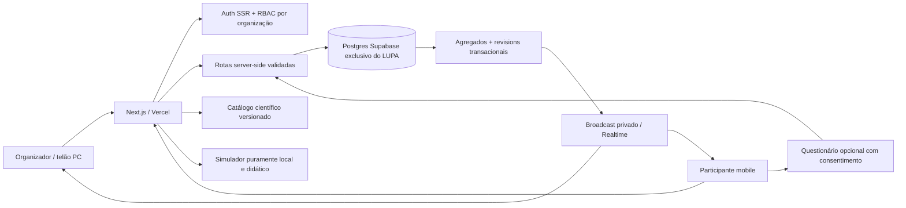

# LUPA SAÚDE — DOCUMENTAÇÃO DE CORREÇÕES, PESQUISA E IMPLEMENTAÇÃO

**Versão:** 1.0 · **Data-base:** 13/11/2026 (BRT) · **Status:** especificação técnica para implementação e validação; **NÃO** é atestado de implantação.  
**Repositório:** https://github.com/annygabb/Lupa · **Branch auditada:** `main` · **Commit:** `2c8b900d3dee7d2a9f3e89b8cac5b2331df53112`  
**Escopo:** pendências confirmadas ou não verificadas do LUPA Saúde + questionário optativo + corpo ilustrativo + leitura científica sobre tirzepatida, composição corporal, sarcopenia, cirurgia e UTI.  
**Bases fornecidas:** `LUPA_SAUDE_DOCUMENTACAO_COMPLETA_IMPLEMENTACAO_100_POR_CENTO_2026 (1).md`, pacote de documentação/imagens e `AUDITORIA_LUPA_GITHUB_MAIN_2026-11-13.md`.  
**Destinatários:** engenharia frontend/backend, design, QA, segurança, responsáveis pela LGPD e curadoria/revisão científica.

> **REGRA DE VERACIDADE:** `IMPLEMENTADO` só com código e teste; `VALIDADO EM PRODUÇÃO` só com SHA, URL, banco, registros e testes reais confirmados. **Uma ideia descrita neste documento não é funcionalidade existente.** Um dado em estudo não é previsão do que acontecerá com uma pessoa. Não publicar a coleta de dados de saúde antes da revisão de privacidade e segurança.

---

## 0. RESUMO EXECUTIVO E DECISÕES INEGOCIÁVEIS

### 0.1 Situação do repositório em 13/11/2026

- PR #6 **mesclado** à `main`: https://github.com/annygabb/Lupa/pull/6.
- CI da `main`: https://github.com/annygabb/Lupa/actions/runs/43459482796 — **199 testes unitários aprovados, build/lint/tipagem/smoke aprovados; 301 testes Playwright aprovados e 4 falhas de acessibilidade mobile**. A pipeline geral ficou **vermelha**.
- Existem componentes para `/experiencias`, `/corpo-evidencia`, `/desafio`, `/impacto`, `/dossie`, `/live`, `/live/[code]`, `/live/organizador`, `/live/apresentacao/[code]`; QR em SVG e um gerador de Data URI PNG; APIs básicas de evento/voto/health.
- **Não foi demonstrada** a ligação efetiva e confiável entre votação, Postgres e publicação em produção. A migração SQL presente está malformada; o backend possui fallback silencioso para memória volátil.
- Existe **credencial administrativa padrão embutida em código público** e aceita no backend, inclusive quando há outra configurada. Tratar como incidente de controle de acesso; revogar/remover a credencial, restringir as rotas e revisar registros antes de abrir o Live.
- A conexão Supabase acessível na auditoria não mostrou banco identificado como LUPA; o projeto `lupaa` na Vercel não foi localizado no escopo autenticado consultado. Isso **não prova inexistência em outras contas**; prova que deploy, ambiente e DB **não foram validados**.
- O link do TikTok **não havia sido enviado** até a redação desta versão. A análise do conteúdo do vídeo fica `BLOQUEADA — DEPENDE DO LINK`. **Não reutilizar vídeo, áudio ou imagens**: importar somente referências científicas verificadas no PubMed, com metadados e revisão.

### 0.2 As quatro fronteiras do novo recurso

1. **Questionário de experiências**: relato voluntário e anônimo sobre uso, efeitos **percebidos** ou conhecimento de terceiros; não é diagnóstico, estudo causal nem sistema de farmacovigilância oficial.
2. **Simulador**: usa peso/altura/idade e uma silhueta escolhida **apenas como representação ilustrativa**. Sem DXA, exame físico ou avaliação funcional, não sabe a massa magra, massa muscular, força ou sarcopenia reais.
3. **Tirzepatida (Mounjaro®)**: um subestudo observou cerca de **75% da perda de peso em massa gorda e 25% em massa magra**, em um grupo específico e na **semana 72**. O intervalo `20–25%` solicitado pode aparecer como **banda didática escolhida**, não como intervalo clinicamente garantido; a literatura apresenta heterogeneidade e valores fora dela.
4. **UTI/cirurgia**: há associação entre baixa musculatura/sarcopenia e piores desfechos em outras populações. **Não está comprovada uma função que converta “perda de massa magra pela tirzepatida” em “probabilidade de complicação, ventilação, recuperação ou morte na UTI/cirurgia”.** Não construir essa função.

---

## 1. MATRIZ DE LACUNAS — O QUE ESTÁ PARCIAL, AUSENTE, INSEGURO OU NÃO COMPROVADO

**Legenda:** `P0` bloqueia uso público seguro, integridade ou demonstração com dados reais; `P1` completa a experiência de hackathon com controle; `P2` expansão futura. `Código/parcial` significa funcionalidade presente mas insuficiente; `Não comprovado` não é sinônimo de ausente.

| ID | Prioridade | Requisito | Estado em `main` | Arquivos/evidências | Critério que encerra a pendência |
|---|---|---|---|---|---|
| SEC-01 | P0 | Remover token admin conhecido e hardcoded | **Inseguro** | `lib/live/security.ts`, `components/live/organizer.tsx` | nenhuma credencial padrão aceita; teste `401/403`; segredos revogados |
| SEC-02 | P0 | Autenticação e autorização de organizador | **Ausente** | `/live/organizador`, APIs `POST/PATCH/DELETE` | Auth SSR, dono/organização/role em cada rota, MFA para admin |
| SEC-03 | P0 | Retirar seed e fallback local de produção | **Inseguro/parcial** | `lib/live/db.ts` | erro DB produz `503`, sem voto/evento “salvo” em memória em prod |
| DB-01 | P0 | Corrigir sintaxe SQL | **Inválida** | `supabase/migrations/20261111162000_lupa_live.sql` | migração aplicada em DB teste com verificação de rollback |
| DB-02 | P0 | Persistência real de sessões e votos | **Não comprovada** | REST Supabase + RPC + fallback | criar → votar → reiniciar instância → confirmar mesma contagem no DB |
| DB-03 | P0 | Ambientes local/CI/STAGING/PROD isolados | **Não comprovado** | `.env.example`, documentação | IDs/URLs, migrations, health e segredo isolados verificados, sem expor tokens |
| SEC-04 | P0 | Gabarito e contagens protegidos até fase autorizada | **Inseguro/parcial** | `lib/live/db.ts`, `app/api/live/[code]/route.ts` | payload público não inclui resposta certa/post oculto, headers não elevam role |
| LIVE-01 | P0 | Modelo de múltiplas perguntas por sessão | **Ausente** | SQL armazena uma pergunta/evento | tabela de questões/versionamento + ordens/rodadas + endpoints e E2E |
| LIVE-02 | P0 | Pré/pós equivalentes com persistência no DB | **Parcial** | `lib/live/content.ts`, tabela `events` | pergunta pós persistida, devolvida apenas na fase correta e avaliada |
| LIVE-03 | P0 | Voto idempotente e atômico por pergunta/rodada | **Parcial** | `lupa_cast_vote`, memória local | request ID, UNIQUE, race test, 2 instâncias e transação real |
| LIVE-04 | P0 | Presença de QR com evento válido | **Parcial** | `lib/live/qr.ts`, rota QR | QR de evento existente/ativo, URL canônica confiável, teste iOS/Android |
| LIVE-05 | P1 | QR SVG, PNG, download e impressão | **Parcial** | SVG está pronto; PNG é helper | endpoint validado para PNG/SVG, download A4 e revogação |
| LIVE-06 | P0 | Atualização simultânea por Broadcast | **Não implementado** | polling 3s / 2,5s | canal privado, revision crescente, fallback e reconexão |
| LIVE-07 | P0 | Contagens sem exposição prematura | **Parcial** | `x-lupa-view` não autenticado | políticas por role/canal; teste adversarial |
| LIVE-08 | P0 | Feedback realmente registrado | **Não implementado** | participante só usa `setFeedbackSent(true)` | POST + tabela + validação, recibo e agregado confiável |
| LIVE-09 | P1 | Relatório completo de sessão | **Parcial** | download Markdown client-side | export agregado, N, horários, fontes, feedback e status de amostra |
| DATA-01 | P0 | Base e consentimento para relato de sintomas | **Novo/não implementado** | sem questionário de saúde no backend | coleta voluntária desativada até política LGPD/revisão |
| DATA-02 | P0 | Evitar coleta de dados identificáveis de terceiros | **Novo/não implementado** | fluxo “conhece alguém” | sem nome/contato; validação, aviso e remoção de identificadores |
| DATA-03 | P0 | Retenção, exclusão, backup, auditoria, solicitação titular | **Ausente** | SQL tem limpeza comentada | jobs e política, logs sem PII, restauração testada |
| BODY-01 | P1 | Silhueta contextual responsiva e não diagnóstica | **Parcial** | `body-evidence.tsx` | silhueta neutra/estilizada, consentimento para dados locais, sem inferir músculo |
| BODY-02 | P1 | Gráficos 1, 3, 5 meses e banda 20–25% | **Não implementado** | cálculo atual é único exemplo | cenários manuais rotulados, baseline e datas, tabela acessível |
| BODY-03 | P0 | Impedir “estimativa de risco de UTI” | **Parcial/bloqueio científico** | texto tem ressalva | nenhuma probabilidade/OR clínica gerada do exemplo |
| BODY-04 | P1 | Articular cirurgia/UTI/qualidade de vida | **Novo** | evidências separadas | cadeia comparativa de estudos com populações/medidas distintas |
| SCI-01 | P0 | Dicionário e revisão das fontes PubMed | **Parcial** | `features/evidence/*`, `content.ts` | fichas de evidência com fonte, amostra, método, limitações, revisão |
| SCI-02 | P1 | Vídeo TikTok → alegações → PubMed | **Aguardando link** | nenhuma URL fornecida | analisar alegações, conferir PMIDs, publicar apenas fontes aprovadas |
| SCI-03 | P1 | 9 objetivos de aprendizagem | **Parcial** | comentário promete 9; `SCIENTIFIC_OBJECTIVES` tem 6, `/desafio` tem 3 | catálogo de 9 com equivalentes revisados e gabaritos balanceados |
| UX-01 | P0 | Corrigir acessibilidade mobile do scroll | **Falha comprovada** | `.lx-table-wrap` em `/impacto` e `/live/organizador` | axe sem violações serious; teclado e leitor de tela testados |
| UX-02 | P1 | Aprovação visual PC-first e mobile | **Não comprovada** | imagens/conceitos no repo | screenshots 360/390/768/1440/1920, aceite por tela |
| DOC-01 | P1 | Dossiê PDF acessível | **Ausente** | export `.md` existe | PDF com fonte, data, limitações e verificação acessível |
| OPS-01 | P0 | CI verde no SHA liberado | **Falha** | run 43459482796 | unitários, E2E, axe e smoke com DB isolado todos verdes |
| OPS-02 | P0 | Confirmar Vercel produção ↔ commit | **Não comprovado** | conexão sem acesso ao projeto `lupaa` | log deploy, URL, SHA, target e health documentados |
| OPS-03 | P1 | 1.000 participantes simultâneos | **Não comprovado** | sem benchmark de DB/WS | simulação autorizada com p95/custos/erro/limites e escala |
| OPS-04 | P1 | Telemetria segura e recuperação | **Ausente/parcial** | health básico | SLO, requestId, logs sem sintomas/token, backup e rollback |
| EXP-01 | P2 | Academy, Verify, Radar, multi-tenant comercial | **Ausente** | só conceito | não iniciar antes do núcleo P0 |

**Proibição de “conclusão automática”:** nenhuma tarefa é `DONE` por página renderizar `HTTP 200`, pela existência de um botão ou pela passagem dos testes em memória.

---

## 2. FUNDAMENTAÇÃO CIENTÍFICA E ESTUDOS CONFERIDOS NO PUBMED

### 2.1 Distinções conceituais que precisam aparecer na interface

- **Peso total perdido**: diferença entre duas pesagens. Não equivale automaticamente a gordura perdida.
- **Massa gorda**: componente adiposo; estudos usam medidas específicas.
- **Massa magra (lean mass)**: compartimento estimado por DXA ou outra técnica; inclui água e outros tecidos não adiposos. **Não é sinônimo de massa muscular contrátil.**
- **Massa muscular esquelética**: tecido muscular avaliado por metodologias próprias; **não pode ser estimado com precisão só a partir de altura, peso, idade e silhueta**.
- **Força/função muscular**: precisam de avaliação apropriada (p.ex., força de preensão, teste funcional). **Sarcopenia não se diagnostica por proporção de massa magra perdida em um gráfico**.
- **Odds ratio (OR) de um estudo hospitalar**: medida de associação entre grupos daquele estudo; **não é probabilidade individual** e **não permite inferir causalidade sobre medicamentos não estudados**.
- **Relato voluntário de sintoma**: percepção da pessoa após/durante uso; **não é confirmação de reação adversa causada pelo fármaco**.

### 2.2 Estudo âncora: SURMOUNT-1 / composição corporal

**PMID 39996356 · Look et al. (2025)** — https://pubmed.ncbi.nlm.nih.gov/39996356/  
Subestudo com **160 participantes** com medidas DXA no início e na semana 72 (124 usando tirzepatida agrupada por doses e 36 placebo), provenientes de estudo de adultos com obesidade/sobrepeso. Peso basal médio da subamostra **102,5 kg**; IMC médio **38,0 kg/m²**. Mudança média com tirzepatida na semana 72: peso **−21,3%**, massa gorda **−33,9%**, massa magra **−10,9%**. **Cerca de 75% do peso perdido foi massa gorda e 25% massa magra**; para o placebo, proporção semelhante no subestudo. Isto **não prova dano muscular funcional**, nem prediz sarcopenia individual, nem autoriza aplicar essas proporções indistintamente a 1, 3 ou 5 meses.

**Aprovação editorial necessária:** destacar financiamento e conflitos de interesse; informar população e janela temporal. A porcentagem descreve **a composição da perda de peso**, não a redução de 25% do estoque muscular do corpo.

### 2.3 Evidências de peso ao longo do tratamento

1. **PMID 35658024 · SURMOUNT-1 (2022)** — https://pubmed.ncbi.nlm.nih.gov/35658024/  
   Ensaio com **2.539 participantes**, IMC ≥30 ou ≥27 com comorbidade relacionada ao peso, sem diabetes; média basal **104,8 kg**, IMC **38,0**. Na **semana 72**: mudanças médias **−15,0% (5 mg), −19,5% (10 mg), −20,9% (15 mg)**, versus **−3,1%** placebo. Houve **20 semanas de escalonamento de dose**. **Não usar resultados de 72 semanas como média de 1, 3, 5 meses** nem multiplicar automaticamente em alguém com 65 kg.
2. **PMID 40677091 · análise pós-hoc de resposta temporal (2025)** — https://pubmed.ncbi.nlm.nih.gov/40677091/  
   Em subgrupo aderente com medidas em 0, 12, 24 e 72 semanas, **18% tinham perdido <5% na semana 12**, mostrando heterogeneidade de resposta. Entre esses respondedores tardios, muitos atingiram metas mais tarde; **não é curva média por pessoa**.
3. **PMID 42806732 · revisão sobre tirzepatida e massa magra (2026)** — https://pubmed.ncbi.nlm.nih.gov/42806732/  
   Revisão narrativa de dez estudos relata frações de massa magra em geral **10–30% do peso perdido**, com grande heterogeneidade de populações/métodos e sem desfechos funcionais suficientes. **20–25% é uma hipótese didática útil dentro de uma faixa observada, não limite universal ou previsão.**
4. **PMID 40895971 · revisão de massa muscular com tirzepatida (2025)** — https://pubmed.ncbi.nlm.nih.gov/40895971/  
   Mostra redução predominantemente adiposa, com necessidade de mais estudos sobre função e efeitos prolongados; não sustenta determinação de risco individual.

### 2.4 Sarcopenia, UTI, cirurgias e função

5. **PMID 30312372 · EWGSOP2 (2019)** — https://pubmed.ncbi.nlm.nih.gov/30312372/  
   Consenso que prioriza **força muscular baixa** como característica principal; quantidade/qualidade muscular baixa confirma o diagnóstico e desempenho físico ajuda a definir gravidade. **Não rotular “sarcopenia” com base na silhueta ou em 25% da perda de peso.**
6. **PMID 40462133 · massa muscular medida por TC na UTI (2025)** — https://pubmed.ncbi.nlm.nih.gov/40462133/  
   Meta-análise de **35 estudos / 9.366 pacientes críticos**: menor massa muscular por TC na admissão foi associada à mortalidade de curto prazo (**OR 2,33; IC95% 1,90–2,87**) e longo prazo (**OR 2,67; IC95% 1,45–4,92**); populações heterogêneas, principalmente observacionais. **Não estudou efeito causal da tirzepatida sobre morte na UTI** e **não permite multiplicar esse OR por perda de massa magra**.
7. **PMID 37696253 · sarcopenia e cirurgia (2023)** — https://pubmed.ncbi.nlm.nih.gov/37696253/  
   Revisão/meta-análise de **294 estudos / 97.643 pacientes cirúrgicos**: sarcopenia pré-operatória associada a piores desfechos (complicações, mortalidade, internação e alta); heterogeneidade entre especialidades. **Associação prognóstica, não demonstra que emagrecer com GLP-1 causa complicações cirúrgicas**.
8. **PMID 42849901 · perda muscular no pós-operatório (2026)** — https://pubmed.ncbi.nlm.nih.gov/42849901/  
   Revisão/meta-análise de mudanças musculares nas semanas seguintes à cirurgia abdominal: massa e força podem diminuir após o procedimento; não fornece regra individual de risco derivada do uso de GLP-1.
9. **PMID 41405836 · pré-habilitação por exercício antes de cirurgia (2025)** — https://pubmed.ncbi.nlm.nih.gov/41405836/  
   Meta-análise de ensaios sugere benefícios de programas de exercício pré-operatórios em complicações/tempo de internação, conforme contexto e qualidade de evidência. Informar que **preparação funcional/nutricional é relevante**, sem prescrever plano ao usuário nem garantir desfechos.
10. **PMID 42283400 · pré-habilitação com exercício/nutrição (2026)** — https://pubmed.ncbi.nlm.nih.gov/42283400/  
    Síntese adicional que identifica benefícios médios em grupos cirúrgicos específicos; não é prescrição individual.

### 2.5 Sintomas/efeitos relatados e farmacovigilância

11. **PMID 40189856 · eventos gastrointestinais com semaglutida/tirzepatida (2025)** — https://pubmed.ncbi.nlm.nih.gov/40189856/  
    Revisão/meta-análise de **13 ensaios / 26.894 participantes sem diabetes** encontrou aumento de eventos gastrointestinais versus placebo, muitos leves. Sustenta oferecer categorias como náusea, vômito, diarreia, constipação/desconforto gastrointestinal. **Não utilizar relatos de usuários para calcular incidência populacional, nem afirmar causalidade de uma queixa individual.**
12. **PMID 42633386 · GLP-1 e músculo em adultos/idosos (2026)** — https://pubmed.ncbi.nlm.nih.gov/42633386/  
    Revisão narrativa mostra que alterações de massa, qualidade e força não são equivalentes; evidência em idosos é limitada e heterogênea.
13. **PMID 42321502 · revisão/metanálise de GLP-1 e saúde muscular (2026)** — https://pubmed.ncbi.nlm.nih.gov/42321502/  
    Redução absoluta de massa magra pode ocorrer simultaneamente a aumento **relativo** da proporção de massa magra no peso corporal; heterogeneidade alta. Não comparar medidas entre métodos como se fossem intercambiáveis.

**Revisão científica obrigatória antes de publicar:** reabrir o PubMed, checar versão/errata, desenho, população, doses, método de composição, intervalo de confiança, comparador, financiamento, limitações e se a alegação publicada é **observada, hipótese plausível ou não demonstrada**. Revisão não substitui avaliação médica ou comitê de ética quando aplicável.

### 2.6 Política de ingestão após receber o TikTok

**Ainda não verificado:** nenhum link, transcrição ou alegação do vídeo foi apresentado. Não deduzir o que a autora disse.

1. Registrar URL, data, autora/canal, contexto e trechos de alegações **em notas internas de auditoria**, sem replicar mídia no produto.
2. Extrair alegações verificáveis sobre sarcopenia, % de massa magra, diagnóstico, tempo de tratamento, recuperação, UTI ou cirurgia.
3. Para cada alegação, registrar `claim_id`, formulação precisa, PMID, estudo, população, método, limites e veredicto `suportada / parcialmente suportada / não suportada / não verificável`.
4. Checar literatura primária e revisões **no PubMed**; preferir estudos com medidas funcionais reais e não apenas gráficos de composição.
5. Se há contradição, exibir “o que a ciência permite dizer” versus “o que ainda não se sabe”; nunca popularizar efeito não demonstrado.
6. Inserir **somente os metadados, links e sínteses próprias das fontes PubMed**, não o vídeo, sua trilha sonora, imagens, transcrição integral ou dados pessoais da criadora.
7. Submeter a curador/revisor científico e registrar aceite antes de habilitar cards e questionários em produção.

---

## 3. NOVO QUESTIONÁRIO — USO DO MEDICAMENTO, RELATO E CONHECIMENTO

### 3.1 Posicionamento na jornada

- **Rota proposta:** `/experiencias/relatos` (acesso opcional a partir de `/experiencias`, `/corpo-evidencia` e de uma sessão Live **após** o conteúdo didático; não interromper votação científica).
- **Propósito:** escuta qualificada, compreensão de percepções do público e educação sobre limitações da evidência, não coleta clínica para tratamento.
- **Sem login de participante**, sem PII obrigatória; dados de saúde sensíveis exigem análise jurídica da base legal aplicável, consentimento específico quando adotado, minimização, canal de revogação/exclusão, transparência e limitação de finalidade.
- **Não implementar no mesmo banco/tabela de votos anônimos sem arquitetura de privacidade:** evitar vínculo entre relato sensível e voto.
- **No hackathon**, permitir demonstração **local sem envio**, com respostas fictícias explicitamente sinalizadas, enquanto persistência real de sintomas não estiver aprovada.

### 3.2 Texto inicial do questionário (microcopy pronta)

> **Sua experiência pode ajudar a formular perguntas melhores.** Este espaço reúne relatos voluntários sobre medicamentos para controle do peso. Respostas pessoais não comprovam que um medicamento causou um sintoma e não substituem atendimento médico. Você pode pular perguntas ou continuar apenas no modo educativo. Não informe nomes, contatos ou dados de outras pessoas.

**Tela de escolha 1 — “Você utiliza atualmente algum medicamento para controle do peso?”**

- `SIM_ATUALMENTE` — “Sim, utilizo atualmente”.
- `USEI_ANTES` — “Já utilizei, mas não utilizo agora”.
- `NAO_UTILIZO` — “Não utilizo”.
- `PREFIRO_NAO_RESPONDER` — “Prefiro não responder / continuar sem relatar”.

**Tela de escolha 2 — somente `SIM_ATUALMENTE` ou `USEI_ANTES`:**

1. “Qual medicamento você utiliza/utilizou?”: `tirzepatida (Mounjaro)`, `semaglutida`, `liraglutida`, `outro`, `não sei`, `prefiro não dizer`; campo opcional para outro, sem assumir dose.
2. “Durante o uso, você percebeu algum sintoma ou mudança?”: `sim`, `não`, `não tenho certeza`, `prefiro não dizer`.
3. Se `sim`: “Quais sintomas você percebeu **durante** o período de uso? Selecione os que quiser.” Checkboxes opcionais: `náusea`, `vômitos`, `diarreia`, `constipação`, `desconforto abdominal`, `redução de apetite`, `sensação de fraqueza/fadiga`, `outro`, `prefiro não dizer`. Categoria não equivale a efeito causal comprovado.
4. Campo opcional e limitado: “Se quiser, descreva em suas palavras como se sentiu (sem nomes, contatos, diagnóstico de terceiros ou detalhes que identifiquem pessoas).” Tamanho máximo sugerido **280 caracteres**; nunca mostrar texto livre bruto no telão.
5. “Esses sintomas foram avaliados por profissional de saúde?”: `sim`, `não`, `prefiro não dizer`; não solicitar laudo, diagnóstico ou prontuário.
6. “Deseja receber apenas materiais educativos e fontes científicas?”: abrir links no navegador, **sem pedir e-mail** nesta fase.

**Tela de escolha 3 — somente `NAO_UTILIZO`:**

1. “Você conhece alguém que utiliza ou já utilizou esses medicamentos?”: `sim`, `não`, `não sei`, `prefiro não responder`.
2. Se `sim`: “Quais efeitos ou sintomas você **ouviu essa pessoa comentar ou conhece por outras fontes**?” — mesmos checkboxes da lista acima, todos opcionais.
3. “De onde veio o que você conhece?”: `conversa com alguém`, `redes sociais`, `notícia/site`, `profissional de saúde`, `estudo científico`, `não lembro`, `outro`.
4. “Qual é sua principal dúvida sobre o tratamento, músculos ou recuperação?”: campo opcional, até 280 caracteres, sem dados de terceiros.
5. **Aviso:** “Você está compartilhando uma percepção indireta, não uma confirmação médica. Não informe o nome ou a identidade da pessoa.”

**Tela de escolha 4 — `PREFIRO_NAO_RESPONDER`:** permitir **“Explorar a ciência sem responder”**. Não contar silêncio como `não usa`.

**Consentimento separado antes do envio:** finalidade, dados coletados, agregação, prazo de retenção aprovado, possíveis destinatários, como excluir, voluntariedade e versão da política. Botão desabilitado até aceite explícito quando esse for o fundamento jurídico validado. O texto legal definitivo depende de revisão LGPD/ética; não inventar base legal pronta.

### 3.3 Telas e estados do questionário

| Estado | UI | Comportamento esperado |
|---|---|---|
| Não iniciado | apresentação e privacidade | iniciar ou ir para ciência |
| Escolha de uso | cartões/radio | branching condicionado |
| Usuário atual/anterior | lista de sintomas + texto opcional | validação local sem guardar automaticamente |
| Não usuário conhece alguém | pergunta de conhecimento indireto | vetar nomes/contatos e não alegar experiência pessoal |
| Sem respostas | educação | não enviar payload vazio como resposta válida |
| Revisão | resumo do que será enviado | editar ou desistir |
| Consentimento | checkbox separado | versionar aceite, remover se revogado |
| Envio em curso | loading de progresso | requestId idempotente, bloquear double submit |
| Sucesso | “Relato registrado” só com `201/200` verdadeiro | recibo aleatório não identificador |
| 400/413/429/503 | erro específico | não afirmar que salvou, preservar apenas estado local temporário |
| Finalizado | dados científicos sem score clínico | links PubMed, retorno ao atlas |

### 3.4 Dados pessoais, privacidade, estatística e ética

- **Dados relativos à saúde são sensíveis**. Se usuário informar uso de medicamento e sintomas, coletar apenas quando houver política de privacidade, base legal definida por responsável, análise de risco e infraestrutura realmente segura.
- **Não coletar automaticamente:** nome, CPF, celular, e-mail, foto, coordenadas, prontuário, dose exata, receita, informação genética, terceiro identificável, IP bruto em banco de respostas ou identificador persistente interligável a outras sessões.
- **Separar banco dos relatos sensíveis** do Live público; criptografia em trânsito e em repouso; acesso por contas autorizadas/auditadas; nenhum dado individual no frontend público.
- **Texto livre sensível**: moderação e prevenção de identificação antes de armazenamento; preferir tags estruturadas. Não enviar a serviços de IA externos sem avaliação de transferência, finalidade e consentimento específicos.
- **Idade mínima/público**: antes de receber relatos, implementar política para menores. Até decisão jurídica, **não coletar relatos pessoais de menores**; conteúdo educativo acessível sem relato.
- **Terceiros**: coletar somente que o respondente ouviu/conhece; nunca perguntar parentesco, nome ou identificação; impedir persistência de descrição que possa revelar a pessoa.
- **Agregados**: exibir apenas após limiar mínimo de tamanho de grupo aprovado (ex.: `k >= 10` como proposta técnica sujeita a avaliação), supressão de células pequenas e anti-differencing entre filtros. Nunca exibir texto original, diagnósticos ou “% de efeitos causados”.
- **Rótulo obrigatório dos dados**: `relatos voluntários da plataforma; amostra de conveniência; sem validação de causalidade e sem prevalência populacional`.
- **Retenção**: proposta a negociar e aprovar (ex.: respostas identificáveis/pseudônimas por até 90 dias; agregados com revisões e exclusão adequada); política e implementação devem coincidir.
- **Sinais de urgência**: microcopy educativa geral: “Se houver sintomas intensos ou persistentes, procure avaliação profissional. Em urgência, procure atendimento imediato.” **Não interpretar texto livre para diagnosticar ou classificar emergência automaticamente sem protocolo clínico.**

### 3.5 Perguntas educativas complementares (não clínicas)

No `/desafio` ou em Live, oferecer questões de compreensão distintas da coleta de sintomas:

- “Em um estudo, 25% **do peso perdido** foi massa magra. Isso quer dizer que a pessoa perdeu 25% dos músculos?” Resposta: **não**.
- “Sentir fraqueza após iniciar tratamento comprova sarcopenia causada pelo medicamento?” Resposta: **não**; é necessário avaliar contexto e função.
- “Um estudo de UTI que associa baixa musculatura a mortalidade permite prever risco de alguém que usa tirzepatida?” Resposta: **não**.
- “Por que a força muscular importa além da aparência?” Resposta: mobilidade, capacidade funcional e reserva para desafios, em contextos estudados.
- “Por que relato de conhecido não é taxa de evento adverso?” Resposta: amostra não representativa e ausência de confirmação causal.

**LUPA Live:** priorizar **9 objetivos educativos** da documentação antiga; a `main` possui seis objetos curados e o desafio local tem três questões. Completar os demais (Brasil/automedicação, revisão de fontes, comunicação responsável) com revisão do conteúdo, e variar posições corretas sem alterar sua semântica.

---

## 4. CORPO INTERATIVO E CENÁRIOS DE 1, 3 E 5 MESES

### 4.1 Objetivo correto da tela

**Rota existente a evoluir:** `/corpo-evidencia`. Pergunta central: **“Quando o peso diminui, quais tecidos podem compor essa mudança, e por que a função muscular merece atenção?”** Mostrar evidências sobre perda de composição e contextos de recuperação física **sem anunciar risco individual**.

### 4.2 Campos e como cada um afeta (ou não) o cálculo

| Campo de UI | Obrigatoriedade | Propósito | Pode entrar no cálculo? |
|---|---|---|---|
| Peso inicial (kg) | sim para exemplo | base aritmética | **sim**, apenas para peso final após perda hipotética |
| Altura (cm) | opcional | contextualização/escala visual | **não** para inferir músculo ou prognóstico; IMC apenas se justificado e rotulado |
| Idade (anos completos) | opcional | contexto educativo | **não** como ajuste clínico automático |
| Silhueta representativa | opcional | preferência visual `feminina`, `masculina`, `neutra`, `não escolher` | **não** para estimar composição por sexo, tecido ou risco |
| Medicamento | opcional | exibir evidência específica (`tirzepatida`, `semaglutida`, `outro/nenhum`) | **não** converter direto em previsão pessoal |
| Tempo da hipótese | 1, 3, 5 meses | eixo visual | só exibir valores fornecidos / aprovados por estudo correspondente |
| Perda hipotética (%) ou (kg) por marco | sim para simulação | controle manual | **sim**, exclusivamente para decomposição ilustrativa |
| Fração da perda atribuída à massa magra | default explicativo `20%–25%` | análise de sensibilidade | **sim**, apenas banda de cenário, não estimativa da pessoa |
| Avaliação real de composição/força | **não coletar** no MVP | exige profissional e governança | nenhuma inferência clínica a partir de campos acima |

**Nota inclusiva:** “silhueta escolhida” é preferência estética de visualização; **não é diagnóstico, sexo biológico ou identidade de gênero inferida**. Se uma pesquisa futura exigir estratificação biológica, fazer pergunta específica, separada, com justificativa científica e proteção de privacidade.

### 4.3 Aparência visual do corpo — diretrizes

- Desktop 1440 px: coluna esquerda **controles**, centro **silhueta vetorial estilizada** e linha temporal, direita **gráficos e cadeia de evidência**. Mobile 390 px: entrada → silhueta → gráfico → “o que se sabe / não se sabe” → PubMed.
- Silhueta deve parecer educativa, **sem estética de antes/depois corporal, julgamento de aparência, imagens de músculo “sumindo” como anatomia medida, nem variação visual proporcional supostamente personalizada**.
- Mudança visual permitida: leve mudança de contorno **abstrata e não quantitativa**, com legenda **“ilustração, não seu corpo real”**; um overlay de barras gorda/magra pertence ao gráfico, não a uma anatomia inventada.
- A altura muda somente a escala ilustrativa de referência, não o desenho de gordura. Peso não define onde há músculos nem percentual de gordura. Permitir desligar avatar e ver apenas números/tabela.
- Seguir paleta cianotipia existente (`#071a33`, `#0e2a4a`, `#1e5486`, `#d5e4f1`, `#f6f8fa`), preferência `reduced-motion`, labels e gráficos acessíveis.

### 4.4 Matemática permitida — somente cenário não clínico

**Entradas para cada instante `t`**:

- `W0` = peso inicial, kg; `L_t` = perda total **hipotética, informada manualmente** até `t`, kg; `q` = fração escolhida da perda classificada como massa magra (ex.: 0,20–0,25).
- `W_t = W0 − L_t`.
- `leanLoss_t_low = L_t × 0,20`; `leanLoss_t_high = L_t × 0,25`.
- `fatLoss_t_low = L_t × 0,75`; `fatLoss_t_high = L_t × 0,80`.
- `W0 > 0`; `0 ≤ L_t < W0`; tempos ordenados e perdas acumuladas não decrescentes **apenas para demonstração de perda contínua**. Se houver reganho, usar modelo explícito de ganho, não forçar monotonicidade.
- Não calcular **estoque** de músculo, massa magra absoluta da pessoa, diagnóstico de sarcopenia, risco de ventilação mecânica, dias de recuperação ou mortalidade.
- Não afirmar que a fração 20–25% é “faixa de confiança científica”; para tirzepatida, revisão narrativa recente descreve valores em estudos aproximadamente **10–30%**, dependendo de método/contexto (PMID 42806732).

### 4.5 Exemplo pedido: 65 kg + tirzepatida (Mounjaro) + 1/3/5 meses

**Atenção:** este é **um exercício com números escolhidos apenas para explicar a fórmula**. Não são “médias do Mounjaro”, expectativas de perda por mês, doses sugeridas, nem aconselhamento a uma pessoa de 65 kg. Elegibilidade para tratamento depende de avaliação clínica e contexto (incluindo IMC, condições associadas e contraindicações). Os estudos âncora apresentavam **peso médio inicial bem maior**.

> Exemplo: peso inicial de **65,0 kg**. O usuário ajusta hipoteticamente as perdas **acumuladas** para **1,0 kg no mês 1**, **3,0 kg no mês 3** e **5,0 kg no mês 5**, somente para entender a divisão matemática do peso perdido.

| Momento | Perda acumulada escolhida (não média) | Peso restante hipotético | Parte classificada como massa magra se q=20–25% | Parte como massa gorda se q=75–80% |
|---|---:|---:|---:|---:|
| Mês 0 | 0,0 kg | 65,0 kg | 0,0 kg | 0,0 kg |
| Mês 1 | 1,0 kg | 64,0 kg | 0,20–0,25 kg | 0,75–0,80 kg |
| Mês 3 | 3,0 kg | 62,0 kg | 0,60–0,75 kg | 2,25–2,40 kg |
| Mês 5 | 5,0 kg | 60,0 kg | 1,00–1,25 kg | 3,75–4,00 kg |

**Como falar disso em linguagem clara:** “Se, no exemplo, uma perda total de cinco quilos fosse distribuída com 20–25% na categoria de massa magra, isso corresponderia a 1,0–1,25 kg dessa categoria. **Não significa perder 1,0–1,25 kg de músculo esquelético nem perder 20–25% dos músculos existentes.** A distribuição real não é conhecida apenas com esses dados.”

**Modo ‘Média observada em estudos’**: só desbloquear quando curadoria preencher pontos **efetivamente extraídos** em 4/12/20 semanas ou meses definidos, para **mesma população, medicamento, grupo, dose/protocolo e estimando**, com intervalo de incerteza e revisão. Na ausência dessas médias por tempo, mostrar: **“Não dispomos de uma média validada para este mês e este perfil. Ajuste uma hipótese manual.”** Proibido interpolar linearmente o resultado de 72 semanas e chamá-lo de média.

### 4.6 Gráficos pedidos e seus títulos honestos

1. **Linha temporal do peso hipotético** — eixo X: mês 0/1/3/5; Y: kg; cada ponto marcado `HIPÓTESE MANUAL`; tabela equivalente; perda cumulativa explícita.
2. **De onde poderia vir a perda de peso?** — barras empilhadas de `massa gorda ilustrativa` e `massa magra ilustrativa`, com banda de 20–25% da perda; tooltip: referência SURMOUNT-1 n=160, semana 72, não estimativa individual.
3. **Composição da perda ≠ perda de músculo funcional** — infográfico simples de compartimentos: peso → gordura + massa magra (com água/outros componentes) → **força/função exigem avaliação específica**.
4. **Cadeia de evidências (não causal)** — três colunas sem seta causal direta: `A. Tirzepatida: variações de massa magra medidas em pessoas com obesidade/sobrepeso` | `B. UTI: baixa massa muscular por TC associada a desfechos em pacientes críticos` | `C. Cirurgia: sarcopenia pré-operatória associada a complicações em populações cirúrgicas`. Entre A→B/C desenhar **lacuna científica / populações distintas**, nunca linha de risco derivado.
5. **Por que preservar função muscular importa?** — cards narrativos de mobilidade, autonomia, capacidade funcional, preparo cirúrgico, e recuperação em doença grave, com citação e níveis de evidência.

### 4.7 O que nunca apresentar como resultado numérico

**PROIBIDO** exibir “sua chance de sarcopenia é X%”, “risco de UTI aumentou Y%”, “você recuperará em Z dias”, “vai perder 25% dos músculos”, “Mounjaro causa morte na UTI”, “você pode perder 5 kg em cinco meses”, ou “sua massa magra real é W”. Sem estudo direto validado, não há denominador/modelo individual para essas frases.

### 4.8 Exemplo de comunicação contextual da ponte cirurgia/UTI

**Card A — Observação**: “Em um subestudo de tirzepatida, aproximadamente um quarto do peso perdido foi classificado como massa magra na semana 72.” PMID 39996356.  
**Card B — Outra população**: “Em pacientes já internados em UTI, baixa massa muscular por TC esteve associada a pior prognóstico.” PMID 40462133.  
**Card C — Contexto cirúrgico**: “Em diferentes especialidades cirúrgicas, sarcopenia pré-operatória esteve associada a mais complicações.” PMID 37696253.  
**Card D — Pergunta científica**: “Como mudanças reais de composição **e função muscular** durante tratamento afetariam a reserva funcional em pessoas que precisam de cirurgia ou internação?” **Ainda não respondida pelos estudos acima.**

---

## 5. ARQUITETURA E CONTRATOS FUNCIONAIS

### 5.1 Desenho proposto



**Crucial:** respostas de saúde são uma fronteira de dados separada dos votos; o `SIM` calcula preferencialmente no navegador sem guardar antropometria. Não enviar peso/idade/altura para analytics, logs ou eventos Live.

### 5.2 APIs existentes — preservar e endurecer

| Método e rota | Hoje | Alteração/critério |
|---|---|---|
| `GET /api/health` | health genérico | manter + correlação por requestId sem revelar segredos |
| `GET /api/live/health` | informa disponibilidade | verificar DB real, schema, RPC; `503` se falha; não retornar `ready` por fallback |
| `POST /api/live` | cria uma sessão | autenticação RBAC + sessão com múltiplas questões versionadas + transação |
| `GET /api/live/{code}` | snapshot | DTO público por fase/role, sem gabarito antes de reveal |
| `PATCH /api/live/{code}` | troca fase | validação transacional `expectedRevision`, dono/role e trilha de auditoria |
| `DELETE /api/live/{code}` | exclui evento | RBAC, confirmação, política retenção/exclusão e auditoria |
| `POST /api/live/{code}/vote` | voto por cookie | autenticação de ingresso efêmera, `questionId`, `roundId`, `requestId`, UNIQUE transacional |
| `GET /api/live/{code}/qr` | SVG gerado | validar evento/estado, URL canônica fixa, formatos e expiração, sem header Host arbitrário |

### 5.3 APIs propostas — especificação para implementar, ainda NÃO existentes

| Endpoint | Método | Quem | Entrada | Saída/HTTP | Cuidados |
|---|---|---|---|---|---|
| `/api/v1/public/evidence/{id}` | GET | público | `id`, `version?` | ficha curada `200/404` | somente conteúdo publicado |
| `/api/v1/live/events` | POST | organizador RBAC | título, questionSetId, horário, idempotencyKey | eventId, code `201` | tenant e revisão; sem chave admin no browser |
| `/api/v1/live/events/{id}/questions` | POST | editor autorizado | ordem + versões curadas | `201/400/403/409` | congelar versões após votos |
| `/api/v1/live/events/{id}/advance` | PATCH | organizador | from/to, expectedRevision | snapshot + revision `200` | transação e auditoria |
| `/api/v1/live/{code}/join` | POST | visitante | código, aviso privacidade | cookie opaco + estado `200/410` | rate limit sem armazenar IP bruto |
| `/api/v1/live/{code}/snapshot` | GET | sessão válida | sinceRevision | DTO por papel | ETag, never correctAnswer pré-reveal |
| `/api/v1/live/{code}/votes` | POST | participante | questionId, roundId, optionId, requestId | accepted/duplicate `201/200/409` | voto atômico e idempotente |
| `/api/v1/live/{code}/report` | GET | organizador | formato `md/pdf/csv` | agregado com referências | tenant e acesso |
| `/api/v1/live/{code}/qr` | GET | público/organizador conforme estado | `format=svg/png` | QR válidos | nunca token admin |
| `/api/v1/experience/consent` | POST | participante com fluxo de relato | consentVersion, scope, nonce | recibo limitado | sem PII desnecessária |
| `/api/v1/experience/responses` | POST | consentido, 18+ conforme política | `responseId`, branch, campos opcionais | `201`, receipt, retentionInfo | estado/validação, PII redaction, rate limit |
| `/api/v1/experience/responses/{receipt}` | DELETE | titular autenticado pelo recibo seguro | prova de posse | `204/404` | revogação/exclusão auditada |
| `/api/v1/experience/aggregate` | GET | público | filtros agregados permitidos | n + contagem suprimida | limiar, anti-differencing, nunca texto livre |
| `/api/v1/live/{code}/feedback` | POST | participante consentido | clarity/usefulness, optional | `201/200` | sem associar a sintomas |

**Convenção de erro:** `{error:{code,message,requestId},status,revision?}`; `400/401/403/404/409/410/413/415/422/429/500/503`. Nunca retornar mensagem SQL, stacktrace, token, gabarito oculto nem texto sensível em logs. Todas as operações de escrita devem ter **validação no servidor**, limite de bytes, idempotência e controle de custo.

### 5.4 Contratos TypeScript ilustrativos — NÃO implementados

```ts
export type UseStatus = "current" | "past" | "never" | "prefer_not";
export type SymptomCategory =
  | "nausea" | "vomiting" | "diarrhea" | "constipation"
  | "abdominal_discomfort" | "reduced_appetite" | "fatigue_weakness"
  | "other" | "prefer_not";

export type RespondentBranch =
  | { useStatus: "current" | "past"; medication?: "tirzepatide" | "semaglutide" | "liraglutide" | "other" | "unknown" | "prefer_not";
      noticedSymptoms?: "yes" | "no" | "unsure" | "prefer_not";
      symptomCategories?: SymptomCategory[]; note?: string;
      assessedByClinician?: "yes" | "no" | "prefer_not" }
  | { useStatus: "never"; knowsUser?: "yes" | "no" | "unknown" | "prefer_not";
      heardCategories?: SymptomCategory[]; heardFrom?: "person" | "social" | "news" | "clinician" | "study" | "unknown" | "other";
      question?: string }
  | { useStatus: "prefer_not" };

export interface CompositionHypothesis {
  startWeightKg: number;  // não enviar ao backend
  heightCm?: number;      // ilustração contextual, não estima musculatura
  ageYears?: number;      // contexto, não estima força
  silhouette?: "feminine" | "masculine" | "neutral" | "none";
  medicationContext?: "tirzepatide" | "semaglutide" | "other" | "none";
  points: { month: 0 | 1 | 3 | 5; cumulativeLossKg: number }[];
  leanShareScenario: { min: 0.20; max: 0.25 };
  label: "HYPOTHETICAL_NOT_CLINICAL";
}
```

### 5.5 Dicionário de dados — alvo (somente propostas)

| Tabela | Colunas-chave | Restrições | Acesso |
|---|---|---|---|
| `lupa_organizations` | id, slug, name, created_at | PK/slug UNIQUE | admin tenant |
| `lupa_memberships` | org_id, user_id, role, active, created_at | UNIQUE(org,user), role enum | owner e RBAC |
| `lupa_events` | id, org_id, public_code, title, status, revision, expires_at | code UNIQUE, tenant FK | role por evento |
| `lupa_question_versions` | id, claim_id, version, stem, choices, correct_option, explanation, source_pmids, reviewed_at, status | imutável publicada | editor/revisor; resposta correta **não pública antes da fase** |
| `lupa_event_questions` | event_id, position, pre_question_version_id, post_question_version_id, current_phase, revision | UNIQUE(event, position) | organizador |
| `lupa_participant_sessions` | id, event_id, session_hash, issued_at, expires_at | hash pseudônimo, TTL | servidor |
| `lupa_votes` | id, event_id, question_id, round, session_hash, option_id, request_id, created_at | UNIQUE(question,round,session), UNIQUE(request_id,session) | servidor e agregação |
| `lupa_live_aggregates` | event_id, question_id, round, option_id, vote_count, revision | chave composta, consistente | projeções autorizadas |
| `lupa_event_outbox` | id, event_id, revision, type, payload_sanitized, published_at | outbox transacional | worker privado |
| `lupa_experience_consents` | id, pseudonymous_receipt_hash, version, purpose, granted_at, withdrawn_at | consentimento auditável | privacidade/servidor |
| `lupa_experience_responses` | id, consent_id, branch, medication_category?, symptoms_json?, note_sanitized?, hearsay_source?, created_at, delete_at | armazenamento criptografado/segregado, TTL, sem PII | serviço restrito, nunca navegador público |
| `lupa_event_feedback` | id, event_id, participant_hash, clarity?, usefulness?, created_at | UNIQUE(event, participant_hash) | privado agregado |
| `lupa_audit_log` | id, actor_id, tenant_id, target_type, action, request_id, occurred_at, sanitized_metadata | append-only, retenção | segurança/auditoria |
| `lupa_evidence_versions` | id, pmid, doi, claim_id, methods, population, results, limitations, reviewed_by, status, published_at | PMID+versão UNIQUE | curadoria pública somente após revisão |

**Dicionário de sintomas:** categorias codificadas com rótulos PT-BR, versão do questionário, período de coleta, distinção `self_report` versus `hearsay` e campo `causality_status = unassessed` (fixo até revisão especializada). **Não usar `caused_by_drug=true` inferido pelo texto.**

### 5.6 RLS, privacidade e migrações

1. Criar um projeto **Supabase exclusivo do LUPA**, separado de todos os outros projetos; DEV/STAGING e PROD com recursos e chaves diferentes.
2. Corrigir sintaxe do arquivo `20261111162000_lupa_live.sql`; se já foi aplicado em alguma instância, **não editar a história aplicada**: criar migração corretiva versionada compatível.
3. Executar migração em DB efêmero com transação, smoke de `service_role`, `anon`, `authenticated`, política RLS, grants e função RPC. `SECURITY DEFINER` demanda revisão de owner, `search_path` e privilégios.
4. Introduzir esquema expandido incrementalmente, com índices por `event_id`, `org_id`, `created_at`, `delete_at` e `revision`, evitando full scan em votação.
5. **Nenhuma `service_role` no browser.** Para leitura pública: DTO server-side filtrado; para organizações: sessão `auth.uid()` validada mais `membership` no banco (não confiar em user_metadata editável).
6. Pseudônimos/recibos imprevisíveis, rotacionáveis e com prazos; não cruzar dados de relato de saúde e votos.
7. Proteção contra enumerar QR, respostas e event IDs; rate-limit distribuído, WAF/anti-bot com controle de custo. Verificar comportamento em redes compartilhadas.
8. Configurar expurgo via rotina agendada/cron com testes de deleção e retenção; **não apagar dados públicos reais com script não revisado**.
9. Backups e restauração em ambiente isolado; DB como única fonte da verdade, sem fallback silencioso.
10. Confirmar em cada ambiente URL, SHA, versão de migration, resultado de health e smoke voto real.

---

## 6. SEGURANÇA — PLANO DE CORREÇÃO EM ORDEM E CRITÉRIOS

### P0-SEC-01. Revogar e remover autenticação administrativa padrão

- Remover `DEFAULT_DEV_TOKEN` em `components/live/organizer.tsx` e aceitação literal em `lib/live/security.ts`.
- Revogar/rotacionar qualquer credencial de desenvolvimento publicada; considerar que o segredo foi publicamente exposto, independentemente de ter sido usado.
- Até RBAC, desabilitar controles de criação/edição/deleção do Live público ou restringi-los de forma verificável.
- Criar testes negativos: sem login, sessão inválida, token antigo, role errado, tenant errado, tentativa de excluir evento alheio, replay e CSRF.
- Substituir `x-lupa-admin-token` por sessão autenticada de facilitador + checagem server-side de propriedade/role.

### P0-SEC-02. Gabarito e projeção protegidos por fase e role

- `eventSnapshot` deve construir modelos separados `PublicPre`, `PublicReveal`, `PublicPost`, `Organizer`, `Presentation`.
- Nunca devolver `correctIndex` de pré/pós nem `postQuestion.correctIndex` a participante antes de revelação respectiva, inclusive em JSON não renderizado.
- Cabeçalho arbitrário como `x-lupa-view=presentation` **não é autorização**. Garantir papel e política própria do telão; antes da revelação, publicar apenas total de participações quando necessário.
- Verificar acesso direto às APIs com navegador, DevTools e scripts sem cookies.

### P0-SEC-03. Garantir durabilidade de dados

- `liveDatabaseEnabled()` não pode ser sempre `true`.
- Em produção sem conexão, credencial, migration correta ou RPC, retornar `503 LIVE_DB_UNAVAILABLE` e desabilitar votação com informação honesta.
- O modo `DEMO_MODE` deve ser **explícito**, isolado, desligado em produção e com grande rótulo “DEMONSTRAÇÃO SEM DADOS REAIS”; nunca contá-lo como persistência.
- Testar reinício, multi-instância, concorrência, queda de conexão e transação abortada sem perda/duplicação silenciosa.

### P0-SEC-04. Proteção do questionário de saúde

- Executar análise de impacto de proteção de dados para uso e sintomas, revisar base jurídica LGPD, retenção e exercício de direitos; consultar especialista jurídico/privacidade.
- Não publicar coleta de saúde sem esses gates. Demo local com dados fictícios é alternativa segura.
- Proteger conteúdo livre de identificação, XSS, injeção, exposição em logs e vazamento em analytics, error reporting, backups, URLs, cache e export.
- Filtrar dados agregados por mínimo n e impedir reidentificação cruzada.
- Testar exclusão com recibo seguro e expurgo real; não produzir estatísticas de “frequência de efeitos colaterais na população” a partir de amostra voluntária.

### P0-SEC-05. Operação e supply chain

- CSP com progressão de `Report-Only` para enforcement após verificar bibliotecas/Next; headers de segurança já existentes não eliminam controles de API.
- `pnpm audit` high+ continua, complementar secret scanning, SAST, SQL lint, testes RLS, dependency lock e revisão de configuração.
- Rate limits por identidade/sessão/IP **com privacidade e redes compartilhadas**, mais proteção de automação; sem segredos em logs.
- Exigir checks de CI antes de merge e deploy; documentar rollback e contato de responsável.

---

## 7. UX/UI — PC-FIRST, MOBILE REAL, ACESSIBILIDADE E EVIDÊNCIA

### 7.1 Telas prioritárias

| Tela | Desktop PC | Mobile | Conteúdo mínimo e validação |
|---|---|---|---|
| `/corpo-evidencia` | formulário + silhueta + 3 gráficos | fluxo vertical legível | hipótese ≠ previsão, fonte a um clique, reset |
| `/experiencias/relatos` | formulário com branching, resumo e aviso | inputs de toque grandes | pode pular, consentir/revogar, formulário privado |
| `/live/organizador` | lista de questões, QR, controles e revisões | painel compacto | RBAC, export, status DB/WS, sem token no UI |
| `/live/[code]` | acessível em PC | votação simples por pergunta | confirm before submit, retry, fase atual, sem gabarito prévio |
| `/live/apresentacao/[code]` | QR grande 1920×1080, resultado autorizado | acesso alternativo | URL/código, conexão, fase, contagem real |
| `/dossie` | prévia + proveniência + export | prévia em cards | MD + PDF acessível após implementar |

### 7.2 Erros de acessibilidade comprovados na `main`

**CI 13/11, run 43459482796:** `.lx-table-wrap` em `/impacto` e `/live/organizador` tem região rolável sem acesso por teclado em `mobile-chromium` e `mobile-small-chromium`, regra axe `scrollable-region-focusable`, impacto **serious**. Corrigir foco (`tabIndex=0` quando apropriado), nome acessível, indicação de scroll e alternativa de tabela sem scroll horizontal; verificar se o conteúdo focável já resolve a regra. **Não usar `aria-hidden` para silenciar teste.** Rodar Playwright/axe + teste manual Tab/Shift+Tab, Enter/Space, VoiceOver e TalkBack.

### 7.3 Leis e identidade do projeto

Aplicar Hick (escolha simples), Fitts (área de toque ≥44 px), Jakob (padrões esperados), Miller (chunks), Von Restorff (uma ação principal), Proximidade (dados e fonte juntos), Tesler (complexidade no sistema), Zeigarnik (progresso sem manipulação), Doherty (feedback rápido) e Posição Serial (estrutura clara). Fonte visual: `app/atlas.css`, `app/atlas-system.css`, `docs/UX_PRINCIPLES.md` e referências do ZIP. Adaptar 360, 390, 430, 768, 1024, 1440, 1920 px. Nenhum dado científico deve ficar oculto apenas em hover.

**Aceite de layout:** screenshot real desktop e mobile, conferência responsiva, contraste, foco, animação reduzida, código sem overflow, revisão científica e registro de aprovação por tela. Mockup aprovado **não comprova** endpoints ou banco funcionando.

---

## 8. TESTES, MÉTRICAS E CRITÉRIOS DE ENTREGA

### 8.1 Matriz de testes automatizados e manuais

| Camada | Teste obrigatório | Evidência de aceite |
|---|---|---|
| Unidade/cálculo | q=20% e q=25%, peso 65, 1/3/5; pesos negativos/NaN; soma componentes | assertions de soma, limites e textos de aviso |
| Unidade/científico | nenhuma função calcula risco de UTI ou músculo real com esses inputs | tests que falham se resposta numérica clínica surgir |
| API/survey | branches atual/passado/nunca/prefiro, 280 chars, campos opcionais e consentimento | 201 real ou 503 sem DB; sem PII no log |
| API/Live | voto único por pergunta/rodada, 409 idempotente, 410 expirado | banco real e simultaneidade |
| SQL/RLS | migrações aplicam; `anon/authenticated` não acessam tabelas sensíveis; owner acessa apenas tenant | relatório SQL + grants/testes de policies |
| Segurança | token antigo bloqueado, IDOR, cabeçalho apresentação falso, gabarito oculto | 401/403, 0 vazamento em payload |
| Realtime | voto em 2+ celulares aparece no telão, reconexão e revision | p95 de atraso e timestamps, teste com DB real |
| Persistência | reiniciar servidor, trocar instância, verificar votos e evento | dados iguais após restart |
| A11y | teclado, labels, axe WCAG 2.2 A/AA, 360/390 px | 0 serious/critical, teste físico |
| Carga | ramp até 1.000 usuários simulados autorizados, 1+ eventos | latência p95, erro, CPU/DB/WS, custo |
| Teste humano | compreensão “25% do peso perdido” vs “25% dos músculos” | taxa de entendimento pré/pós; sem promessa de causalidade |
| Release | SHA, target Vercel, schema, env, health, rollback | gate de produção assinado |

### 8.2 Metas propostas (NÃO demonstradas)

- `vote_commit_p95_ms < 1000 ms` no cenário de carga acordado.
- `aggregate_to_screen_p95_ms < 2000 ms` após commit com Broadcast; fallback de polling exibe “atualização periódica”, nunca “instantâneo”.
- `duplicate_vote_accepted = 0` e `confirmed_vote_lost = 0` no conjunto de testes concorrentes.
- `public_sensitive_response_leaks = 0`, `public_correct_answer_before_reveal = 0`.
- `accessibility serious/critical = 0` nos breakpoints definidos; validar manualmente também.
- `1000 concurrent participants` é **meta de benchmark**, não garantia de serviço.
- `useRate`, `heardOfUseRate`, `reportedSymptomRate` sempre com **denominador explícito por ramo e amostra voluntária**; não mostrar taxas populacionais.
- Teste de compreensão mede aprendizagem, mas aumento do score pode refletir familiaridade: pares equivalentes, efeito de repetição e limites documentados.

### 8.3 Checklist de pronto — nenhum item pode ser presumido

- [ ] CI verde no SHA candidato, incluindo E2E/axe.
- [ ] Credencial default removida e revogada; Auth + RBAC verificados; sem escalada por cabeçalho.
- [ ] SQL sem erro aplicado em DB isolado; dados sobrevivem a reinício.
- [ ] PROD não usa memória local para votação; health confere DB real.
- [ ] Perguntas e rodadas versionadas no DB; votos deduplicados e agregados.
- [ ] Broadcast privado e fallback seguro; telão apresenta apenas dados autorizados.
- [ ] Questionário de saúde aprovado juridicamente, com consentimento, minimização, expurgo e testes; ou **desativado com DEMO local sinalizada**.
- [ ] Fontes PubMed mapeadas com revisões científicas e limites claros.
- [ ] Meses 1/3/5 exibem cenários manuais ou médias reais por tempo **revisadas**; sem extrapolação de semana 72.
- [ ] Nenhuma taxa de sarcopenia, UTI, cirurgia ou mortalidade individual é inferida.
- [ ] QR validado em Android/iPhone; SVG e PNG baixáveis conforme escopo; URL canônica segura.
- [ ] Teste de carga/custos; SLO/backup/rollback e ambiente de produção confirmados.
- [ ] Telas 1440/390/360/1920 aprovadas e compreensíveis pelo público-alvo.
- [ ] Link do vídeo analisado **quando fornecido**, sem reutilizar conteúdo audiovisual, e eventuais fontes adicionais aprovadas.

---

## 9. ORDEM DE EXECUÇÃO (TAREFAS CONCRETAS PARA O AGENTE DESENVOLVEDOR)

### Sprint 0 — contenção e baseline (P0, antes de evoluir telas)

- **T-001:** bloquear/remover token padrão, revogar segredo exposto, adicionar testes de não autorização (`security.ts`, `organizer.tsx`, APIs Live).
- **T-002:** fixar/validar SQL em DB temporário; corrigir regex e duplicação, conferir RPC e grants (`supabase/migrations/*`).
- **T-003:** retirar fallback de produção e seed; adotar `DEMO_MODE` isolado e health honesto (`lib/live/db.ts`).
- **T-004:** corrigir vazamento de `postQuestion.correctIndex`, `x-lupa-view` e gabarito por fase; API DTO restrita.
- **T-005:** corrigir `.lx-table-wrap`, executar E2E/axe e publicar execução verde; não apenas alterar expectativa do teste.

### Sprint 1 — base de produto confiável (P0)

- **T-006:** selecionar/criar Supabase exclusivo por ambiente com autorização para recursos externos; migrations, RLS, service secret server-side.
- **T-007:** Auth SSR, memberships, org, RBAC para organizador/revisor; rotas de login, recuperação, logout e controles por tenant.
- **T-008:** normalizar `events`, `question_versions`, `event_questions`, `rounds`, `votes`, `aggregates` e `outbox` com chaves e transações.
- **T-009:** persistir par pré/pós diferente em DB, escolher questão por evento e bloquear edição após votos.
- **T-010:** implementar Broadcast privado dos agregados, revisão monotônica, reconexão e fallback explícito.
- **T-011:** revisar QR: evento existe/ativo, imagem SVG+PNG, política de cache/expiração, URL canônica.

### Sprint 2 — novas telas educativas e privacidade (P0/P1)

- **T-012:** evoluir `/corpo-evidencia`: silhueta inclusiva, formulário, tabela e gráficos temporais com cenários **manuais**, avisos e PubMed.
- **T-013:** incluir os quatro cards científicos com “observado / associado / não demonstrado”; cirurgia + UTI + função, sem risco clínico individual.
- **T-014:** construir `/experiencias/relatos` com branching detalhado, opt-out e estado local de demonstração, revisão legal antes de habilitar envio real.
- **T-015:** após aprovação LGPD, schema isolado, consentimento versionado, POST, DELETE, retenção e agregados suprimidos.
- **T-016:** persistir feedback opcional simples de Live e produzir relatório auditável sem textos de saúde ou PII.
- **T-017:** completar nove objetivos de aprendizagem; revisar fonte de cada um; gerar pares pré/pós equivalentes e ordem de alternativas balanceada.
- **T-018:** dossiê PDF acessível com proveniência e carimbo de versionamento.

### Sprint 3 — ciência, testes e release (P0/P1)

- **T-019:** criar/atualizar fichas de evidência baseadas nos PMIDs da seção 2; revisão clínica independente e status claro.
- **T-020:** aguardar URL do TikTok; analisar cada alegação e atualizar só com estudos PubMed verificáveis.
- **T-021:** E2E com 2+ navegadores e DB real, Playwright mobile/desktop, axe e aparelhos físicos; 1000 usuários em carga autorizada.
- **T-022:** confirmar Vercel/aliases/SHAs, migration, health, backup/rollback, latência e custos; só liberar após aceite.

### Sprint 4 — futuro (P2; NÃO antecipar)

- Academy, Verify, Radar, Multi-tenant comercial, API B2B, modelos validados de composição individual **somente se existirem dados e aprovações clínicas apropriados**.

---

## 10. CONTRATO DO EXECUTOR / DEFINITION OF DONE POR PR

1. Começar cada PR lendo `AGENTS.md`, `docs/UX_PRINCIPLES.md`, `docs/STATUS.md`, especificação vigente, arquivos modificados e testes.
2. Registrar `TASK-ID`, **estado antes/depois**, componentes e interfaces afetados, migrações, risco de segurança/LGPD, teste correspondente, screenshot mobile/desktop e limitação científica.
3. Separar **código** de **deploi/dependências externas**; não pedir acesso a contas de outros sistemas nem reaproveitar banco de projetos diferentes.
4. Nunca dizer “funciona 100%” sem evidência de `POST` persistente, consulta direta à base isolada, reconexão e testes de acesso.
5. Não inventar artigo, média mensal, causalidade, risco de cirurgia/UTI ou diagnóstico; sempre anexar PMID com população/desfecho/metodologia.
6. Não inserir credencial, nome, relato pessoal, áudio ou vídeo em commit; o TikTok é **pista de pesquisa**, não evidência científica.
7. Para novas telas, compartilhar designs desktop e mobile para revisão antes de alterações profundas da identidade; para segurança P0, corrigir imediatamente com testes sem postergar para mockups.
8. Adotar `P0` como gate de release: sem autorização, integridade, SQL, LGPD e acessibilidade validados, funcionalidades sensíveis ficam desabilitadas.
9. Terminar PR com tabela de rastreabilidade + links `CI`, `Vercel preview`, `migration`, `PMIDs`, `test report`, `screenshots`, `rollback` e **pendências restantes**, sem declarar concluído o que não foi executado.

---

## 11. ÍNDICE DE REFERÊNCIAS PUBMED (SOMENTE LINKS DE FONTES, SEM CÓPIAS DE VÍDEO)

| Chave | Tema | PMID | Link | Uso autorizado após revisão |
|---|---|---|---|---|
| PUB-01 | SURMOUNT-1 composição (DXA, 72 semanas, 75/25) | 39996356 | https://pubmed.ncbi.nlm.nih.gov/39996356/ | quadro “composição da perda” |
| PUB-02 | SURMOUNT-1 emagrecimento (72 semanas) | 35658024 | https://pubmed.ncbi.nlm.nih.gov/35658024/ | contexto, **não curva individual de 1/3/5 meses** |
| PUB-03 | Variação da resposta temporal | 40677091 | https://pubmed.ncbi.nlm.nih.gov/40677091/ | explicar heterogeneidade |
| PUB-04 | Revisão tirzepatida massa magra | 42806732 | https://pubmed.ncbi.nlm.nih.gov/42806732/ | contexto 10–30%, métodos heterogêneos |
| PUB-05 | Revisão músculo tirzepatida | 40895971 | https://pubmed.ncbi.nlm.nih.gov/40895971/ | limites funcionais |
| PUB-06 | Consenso sarcopenia | 30312372 | https://pubmed.ncbi.nlm.nih.gov/30312372/ | separar força, massa e função |
| PUB-07 | Massa muscular em UTI | 40462133 | https://pubmed.ncbi.nlm.nih.gov/40462133/ | **associação em outra população** |
| PUB-08 | Sarcopenia e cirurgia | 37696253 | https://pubmed.ncbi.nlm.nih.gov/37696253/ | associação pré-operatória |
| PUB-09 | Perda muscular pós-operatória | 42849901 | https://pubmed.ncbi.nlm.nih.gov/42849901/ | recuperação/variação observada |
| PUB-10 | Pré-habilitação com exercício | 41405836 | https://pubmed.ncbi.nlm.nih.gov/41405836/ | preparo funcional / incerteza |
| PUB-11 | Pré-habilitação nutrição/exercício | 42283400 | https://pubmed.ncbi.nlm.nih.gov/42283400/ | educação sobre reserva funcional |
| PUB-12 | Efeitos gastrointestinais GLP-1 | 40189856 | https://pubmed.ncbi.nlm.nih.gov/40189856/ | categorias de relatos sem causalidade individual |
| PUB-13 | GLP-1 e músculo em idosos | 42633386 | https://pubmed.ncbi.nlm.nih.gov/42633386/ | incerteza de massa/força |
| PUB-14 | Meta-análise GLP-1 massa magra | 42321502 | https://pubmed.ncbi.nlm.nih.gov/42321502/ | peso relativo vs absoluto |

**Referências internas de implementação:**
- Auditoria da `main`: `AUDITORIA_LUPA_GITHUB_MAIN_2026-11-13.md` (entregue separadamente); no repositório, revalidar em SHA atual.
- Base inicial do usuário: `docs/LUPA_SAUDE_DOCUMENTACAO_COMPLETA_IMPLEMENTACAO_100_POR_CENTO_2026.md` e referências visuais já existentes em `docs/assets-referencia/`.
- Conferências obrigatórias: `docs/UX_PRINCIPLES.md`, `docs/PLANO_REVISAO_CLINICA_PRIORITARIA.md`, `tests/e2e/accessibility.spec.ts`, `supabase/migrations/*`.

### Resultado esperado

> Uma plataforma que ajuda a compreender **o que se observou**, **quais perguntas ainda não têm resposta** e **por que massa magra, músculo e função não são sinônimos**. O LUPA pode mostrar um exemplo corporal de 65 kg, perdas hipotéticas em 1/3/5 meses, diferentes proporções ilustrativas da perda, e o papel da musculatura em estudos de UTI/cirurgia **sem fingir estimar o risco da pessoa**. O questionário acolhe relatos pessoais/indiretos com privacidade; esses relatos nunca viram prova causal. A liberação depende dos gates reais de backend, banco, segurança, LGPD, UX e revisão científica.
