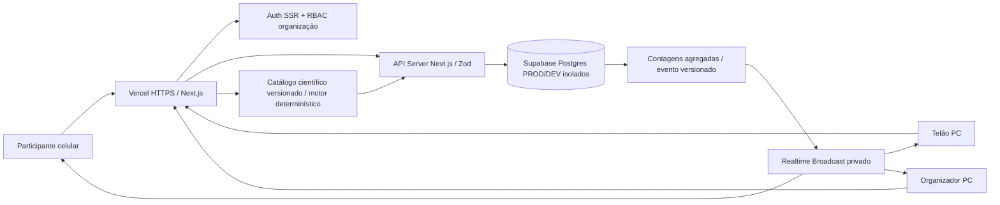
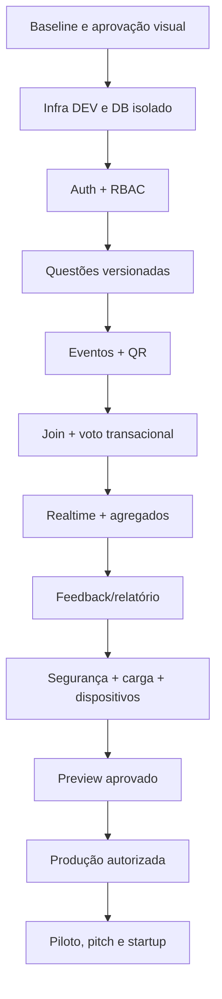
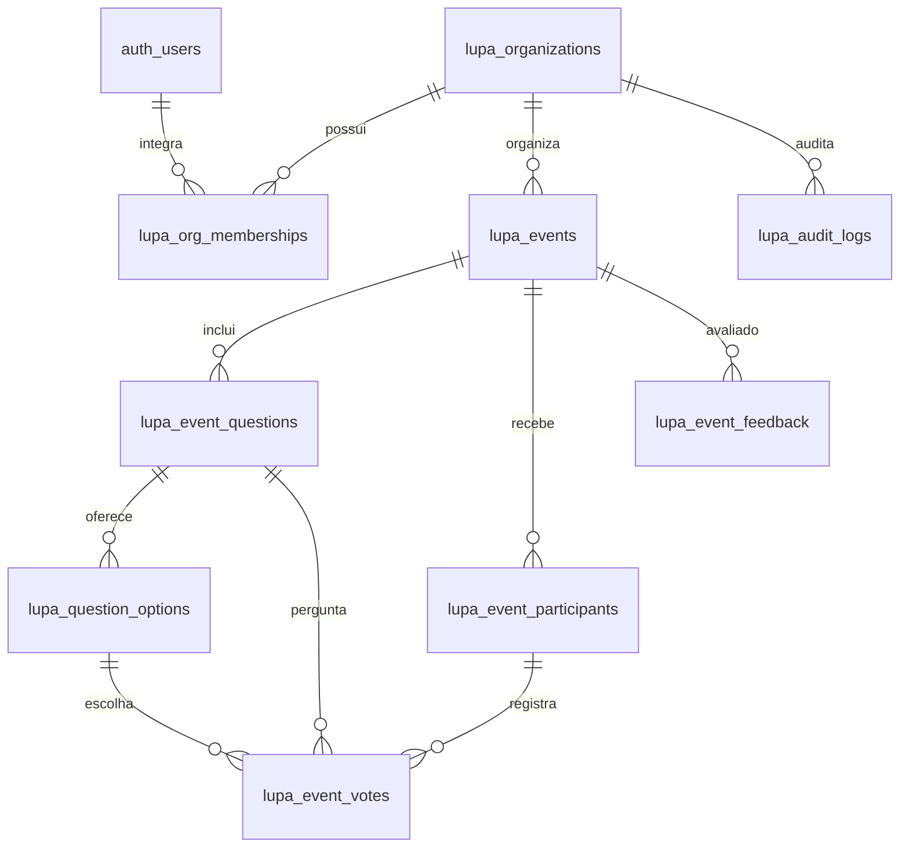
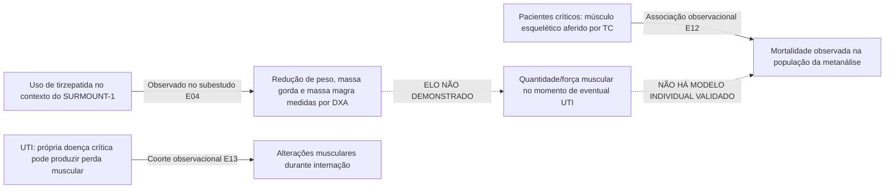
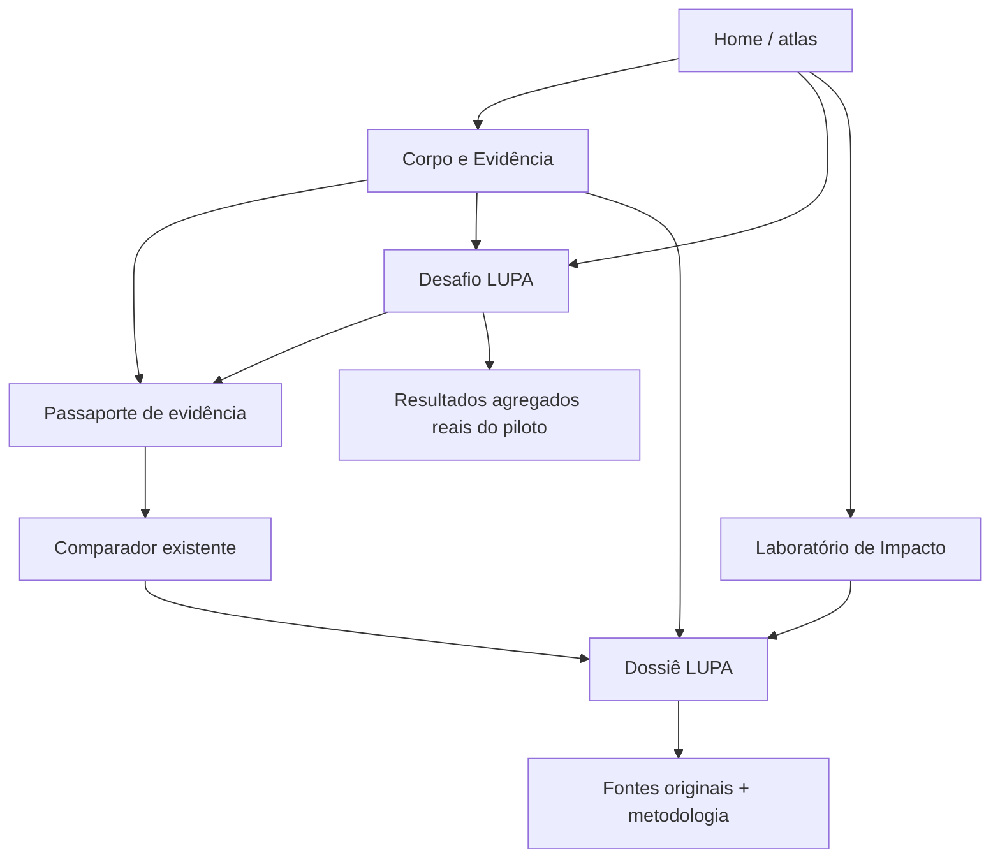

# LUPA SAÚDE — DOCUMENTAÇÃO MESTRE DE ENTREGA 100% VERIFICÁVEL
## Auditoria do que existe · Pendências reais · Frontend · Backend · PostgreSQL/Supabase · APIs · QR Code · Realtime · Segurança · UX/UI · Métricas · Testes · Infraestrutura · Hackathon e Startup

**Revisão factual:** 11 de novembro de 2026 (America/Sao_Paulo)  
**Fonte de código:** https://github.com/annygabb/Lupa  
**Branch de produção na auditoria:** `main` @ `ba4b3c80c23669aea2f958617c1944d7d23e9cd8`  
**Branch com novidades:** `feat/lupa-live-fullstack-foundation-2026` @ `c8310255712b98e76ed5936665c3f182ff0b56a7`  
**PR:** https://github.com/annygabb/Lupa/pull/6 — **OPEN / DRAFT / NÃO MERGEADO**  
**Público principal:** desktop/PC (investigação, organização, telão, edição); **público participante:** celular (QR, voto, feedback, leitura e resultados)  
**Prazo do hackathon informado no projeto:** 30/11/2026  
**Regra:** esta é a especificação executável do trabalho necessário; **não equivale à declaração de que o sistema já está 100% operacional**.

---

# 00. LEIA PRIMEIRO: VERDADE, ESCOPO E ORDEM DE EXECUÇÃO

## 00.1 O que significa entregar “100% funcional”

A expressão significa que **todos os fluxos P0 aprovados** possuem evidências de: (1) UI desktop/mobile utilizável; (2) API/back real; (3) banco DEV/STAGING/PROD corretamente isolado; (4) autenticação e autorização adequadas; (5) estados/erros tratados; (6) sincronização real e recuperação de rede; (7) testes automatizados, físicos e de segurança; (8) carga conforme requisito validado; (9) deploy com commit, URL e health reais; (10) aceite de produto, engenharia e revisão científica quando aplicável.

Não significa ausência absoluta de bugs, risco zero, 100% de cobertura automática nem aprovação médica ou regulatória. Registrar riscos residuais com responsável e prazo.

**Definições de status obrigatórias:**

- **IMPLEMENTADO / TESTADO:** código presente, teste correspondente verificado com SHA da execução.
- **IMPLEMENTADO / NÃO VALIDADO E2E:** código presente, faltam integrações/browsers/dispositivos.
- **PROPOSTO / NÃO IMPLEMENTADO:** somente projeto/documentação.
- **BLOQUEADO EXTERNAMENTE:** autorização, credenciais, recursos pagos, acesso à Vercel ou dados indisponíveis.
- **EM PRODUÇÃO:** verificação do ambiente e SHA publicada; não deduzir a partir do GitHub.

## 00.2 Evidências verificadas em 11/11/2026

- `main` permanece no commit do PR #5; **PR #6 está em rascunho**, não mergeado.
- PR #6: **34 arquivos modificados/adicionados, 1.075 adições e 4 exclusões** segundo API do GitHub.
- GitHub Actions da cabeça do PR, execução **43045326433**: job `quality` **sucesso**, `dependency audit` **sucesso**, `browser/e2e` **falha operacional antes dos testes** devido à incapacidade de resolver `archive.ubuntu.com`, `security.ubuntu.com` e outros domínios necessários à instalação do Chromium.
- Job `quality`: **191 testes Vitest aprovados / 22 arquivos**, lint, TypeScript, build e smoke HTTP de rotas com status 200. Isso **não demonstra** que o usuário consegue concluir a votação com banco real.
- Os testes Playwright/axe novos **não foram executados naquela tentativa**. Nenhuma avaliação em aparelhos físicos foi comprovada nesta auditoria.
- O PR inclui **migração SQL versionada**, mas nenhuma aplicação real da migração em banco exclusivo LUPA foi comprovada.
- A lista de projetos Supabase vinculados na sessão anterior não continha um projeto identificado como `LUPA`; não reutilizar bancos de outros projetos.
- Conexão de Vercel retornou acesso insuficiente (`403` para deployments, projeto não encontrado no escopo consultado). Não há preview/produção confirmados para PR #6.
- Não foi identificado módulo operacional de **geração de QR Code**, **WebSockets / Broadcast** nem **banco de múltiplas perguntas por evento** nesse PR.
- Conclusão operacional: **código parcial com testes de compilação aprovados; fluxo Live persistente e multiambiente NÃO entregue 100%**.

### Reproduzir evidências

1. PR: https://github.com/annygabb/Lupa/pull/6
2. CI head: https://github.com/annygabb/Lupa/actions/runs/43045326433
3. Código de deploy: `docs/DEPLOY_AMBIENTES_LUPA_LIVE.md`
4. Migração: `supabase/migrations/20261111162000_lupa_live.sql`
5. Política permanente: `AGENTS.md` e `docs/UX_PRINCIPLES.md`

## 00.3 Status resumido por produto

| Área | Atualmente no PR #6 | Falta para liberar | Classificação |
|---|---|---|---|
| Atlas científico original / evidências / comparação | 7 rotas originais, 50 referências canônicas em curadoria, cinco métricas documentais | revisão clínica independente, testes reais e validação atual de deploy | Já implementado na `main`; evidência clínica parcialmente validada |
| `/experiencias` | índice com links das novas experiências | screenshot e testes UX reais; conteúdo de acessibilidade | Implementado, não liberado |
| `/corpo-evidencia` | inputs, composição hipotética, gráfico 75/25, limites de UTI | retrato anatômico cientificamente seguro melhorado, validação UX e fontes por estado | Implementado, não validado E2E |
| `/desafio` | 3 perguntas, pré/explicação/pós, resultado local | banco de questões, perguntas equivalentes, medição real, persistência consentida | Implementado parcialmente |
| `/impacto` | comparação A/B pelo motor `lupa-flow-v2` | relatórios, versões, export A/B e revisão com usuários | Implementado parcialmente |
| `/dossie` | exportação Markdown local, claims curados | PDF acessível com proveniência, compartilhamento opcional seguro | Implementado parcialmente |
| LUPA Live — criador | título/claim curado, token compartilhado, criar sessão e mudar fase | login individual e RBAC, organizações, múltiplas perguntas, agendamento | Protótipo parcialmente implementado |
| LUPA Live — participante | código de 12 hex, página mobile, voto pré/pós, confirmação | QR real, fluxo de ingresso validado, reconexão, pergunta por fase | Protótipo parcialmente implementado |
| Atualização simultânea | **polling a cada 3,5 s (host) / 5 s (participante)** | Broadcast/SSE, revision, escalabilidade, autorizações, fallback | Não é realtime push |
| Banco | SQL de 3 tabelas, RLS e 2 RPCs | projeto LUPA, migração aplicada, teste com roles, limpeza, backup, multi-tenant | Código pronto para integração, não operacional |
| Segurança | cookie HttpOnly, HMAC, UNIQUE voto, checagem de origem, segredo server-side | Auth/MFA/RBAC, limites distribuídos, CI adversarial, CSRF estrito, expurgo | Parcial / precisa hardening |
| QR Code | código textual e link | biblioteca, geração SVG/PNG, contraste, escaneamento físico, download/impressão, validade | Não implementado |
| Feedback em evento | sem tabela própria | tela, API, LGPD, agregação, painel e retenção | Não implementado |
| `Academy`, `Verify`, `Observatory`/API B2B | conceito e partes reutilizáveis do atlas | auth, tenancy, telas e contratos, validação de clientes | Futuro, não implementado |
| Deploy preview/prod | nenhum confirmado | acesso, banco isolado, segredos, CI verde, roteamento, testes de carga | Bloqueado |

---

# 01. VISÃO DO PRODUTO E REQUISITOS DE NEGÓCIO

## 01.1 Proposta de valor

**LUPA Saúde:** atlas científico e ambiente interativo para transformar pesquisas sobre medicamentos para emagrecimento em entendimento crítico verificável. Une evidências, comparações, experimentos de hipóteses, desafios de interpretação e sessões coletivas educativas.

**Não é:** prescrição, diagnóstico, previsão pessoal de recuperação de UTI, triagem clínica, cálculo do risco de morte ou prova de causalidade não documentada. Não supor incorporação de medicamento ao SUS.

## 01.2 Perfis de usuário e permissões finais

| Perfil | Autenticação | Faz | Nunca pode |
|---|---|---|---|
| Visitante | Não | ler atlas, buscar, desafiar-se e simular sem persistência pessoal | alterar evidência científica ou acessar dados de evento privados |
| Participante Live | cookie opaco efêmero com sessão de evento | ingressar por QR, votar por rodada, visualizar conteúdo liberado, feedback optativo | votar em outro evento/fase, acessar gabarito antecipado, ver votos individuais |
| Apresentador / Facilitador | Supabase Auth SSR + vínculo institucional | criar/gerir eventos próprios, iniciar/encerrar rodadas, projetar resultados permitidos | acessar eventos de outra instituição |
| Editor científico | conta autenticada, permissão explícita | propor perguntas, editar rascunhos e fontes e encaminhar revisão | publicar sem revisão exigida, editar questão com votos sem criar versão |
| Revisor científico | conta com comprovação/escopo | conferir citação, métrica, amostra e limites; aprovar versão específica | editar histórico aprovado sem trilha de auditoria |
| Analista institucional | conta autorizada, escopo de organização | ver métricas agregadas e relatórios | ver identidade ou respostas individuais |
| Owner/Admin institucional | MFA e RBAC forte | gerenciar membros, configuração e eventos do próprio tenant | acessar segredos e dados de terceiros sem autorização |
| Admin da plataforma | privilégios mínimos com trilha | monitorar, manter infraestrutura e suporte controlado | usar conta pessoal para acessar dados irrestritos sem motivo documentado |

**MVP hackathon:** visitantes sem login; participantes sem login; um apresentador pode usar controle provisório limitado em STAGING, MAS isso não satisfaz segurança comercial. **P0 para produção real:** autenticador com conta individual e restrição por instituição.

## 01.3 Requisitos funcionais rastreáveis

- RF-001: atlas preserva as sete rotas e as fichas originais.
- RF-002: toda evidência exibe estudo, população, método, período, fonte, interpretação permitida e limites.
- RF-003: abertura de experiências é descoberta em até duas ações a partir da Home.
- RF-004: Corpo & Evidência aceita exemplo de peso/perda/fracionamento sem estimar risco individual de UTI.
- RF-005: Desafio explica cada resposta com referência e informa caráter não clínico dos resultados.
- RF-006: Laboratório de Impacto compara A/B sem fórmulas duplicadas e sem chamar hipótese de previsão oficial.
- RF-007: Dossiê exporta conteúdo rastreável com data, versão, fontes, limitações e sem PII.
- RF-008: facilitador autenticado cria evento com 1 ou mais perguntas e controla estados.
- RF-009: evento tem URL HTTPS de ingresso e QR Code legível/baixável no desktop e no telão.
- RF-010: participante ingressa pelo QR no celular e vê questão/alternativas da fase permitida.
- RF-011: servidor registra no máximo um voto por participante, questão e rodada (`pre`/`post`), de forma atômica e idempotente.
- RF-012: apresentador projeta totais agregados atualizados simultaneamente após votos validados, sem expor registros individuais.
- RF-013: participante recebe mudanças de fase sem recarregar manualmente; conexão restabelece estado após queda/reabertura.
- RF-014: gabarito e explicação somente aparecem depois de revelação autorizada.
- RF-015: perguntas podem ter pré/pós equivalentes diferentes, definidas antes do evento; não falsear medição de aprendizagem.
- RF-016: múltiplas perguntas do mesmo evento são sequenciais, versionadas e auditáveis.
- RF-017: coletar feedback opcional de utilidade/clareza, sem solicitar informações sensíveis.
- RF-018: gerar relatório de sessão com N por rodada, participação, tempo, feedback, fontes e cautelas estatísticas.
- RF-019: permitir excluir evento/votos mediante autorização, confirmação e políticas de retenção.
- RF-020: estados vazios, erro, conexão, 429, expiração, 401, 403, 404 e manutenção funcionam em PC e mobile.
- RF-021: segregação total entre organizações, inclusive exports e Realtime.
- RF-022: auditoria de alterações de perguntas, fases, permissões, relatórios e versões científicas.
- RF-023: QR nunca compartilha token administrativo, segredo, cookie de sessão ou informação individual.
- RF-024: backend valida todas as entradas independentemente do frontend.
- RF-025: nenhuma nova funcionalidade remove controles científicos já existentes.
- RF-026: todos os recursos críticos têm fallback e estados de indisponibilidade honestos.
- RF-027: interface segue design system atlas cianotipia, prioriza PC e responde bem em celular.
- RF-028: tudo em produção passa por gate visual, técnico, científico, de segurança e aceite da responsável.

## 01.4 Requisitos não funcionais e metas propostas (ainda NÃO alcançadas)

- RNF-001: HTTP/TLS e headers seguros; CSP progressiva com observação e aplicação após validação.
- RNF-002: acessibilidade WCAG 2.2 AA sempre que aplicável; axe automatizado + validação manual.
- RNF-003: desktop 1280/1440/1920 px; mobile 360/390/430 px; tablet 768/1024 px; sem overflow horizontal.
- RNF-004: ações de voto com feedback imediato de processamento, confirmação após persistência real.
- RNF-005: latência p95 de voto, alvo inicial **< 1 s** no ambiente de teste e carga acordado; não prometer sem medir.
- RNF-006: defasagem p95 de agregados no telão após commit, alvo **< 2 s** com Broadcast; fallback explícito.
- RNF-007: aguentar teste autorizado de **1.000 participantes simultâneos**, com limites de custos/quotas conhecidos.
- RNF-008: alta disponibilidade de evento: SLO proposto 99,9% durante sessões agendadas, sujeito a contratos/infra.
- RNF-009: nenhum voto confirmado pode desaparecer após recarregar; duplicata deve ter resultado determinístico.
- RNF-010: registros de sessões pseudônimos, armazenamento mínimo, TTL e exclusão documentada.
- RNF-011: migrações reversíveis ou compensatórias, sem apagar dados de produção no rollback inadvertido.
- RNF-012: observabilidade agregada com `request_id`, trace, métricas por API e erro, sem logar tokens, IP bruto ou respostas individuais.
- RNF-013: planilha de gastos projetados e alertas de consumo para Realtime, banco, egress e funções.

---

# 02. MAPA FÁTICO DO CÓDIGO E DOS ENDPOINTS ATUAIS

## 02.1 Stack e organização reais

- Next.js 16 (App Router) + React 19 + TypeScript + Tailwind CSS 4.
- GSAP + ScrollTrigger, Lenis compartilhado, assets WebP cianotipia.
- Validação Zod; 50 registros canônicos e aliases em módulos `features/evidence` (não tabela SQL).
- Motor de interpretação `features/interpretation`, comparador `features/comparison`, motor de cenários `features/scenarios/engine.ts`.
- APIs Next.js nas rotas `app/api/*`.
- Migração de banco Supabase incluída **apenas na branch do PR #6**.
- Testes Vitest, Playwright/axe, Actions GitHub e `pnpm-lock.yaml`.

## 02.2 Rotas pré-existentes na main

| Rota | Componente/arquivo | Dados de origem | Estado |
|---|---|---|---|
| `/` | `app/page.tsx` + atlas | claims, design assets, catálogo local | na produção anterior |
| `/evidencias` | `app/evidencias/page.tsx` + explorer | `features/evidence/unified-catalog.ts` | na produção anterior |
| `/evidencias/[id]` | página de ficha | registros E/P/R, passaporte | na produção anterior |
| `/comparar` | comparator | compatibilidade, reviewed-metrics | na produção anterior |
| `/musculos-uti` | pesquisa guiada | evidence-map, E04/E12 e conceitos | na produção anterior |
| `/saude-mental` | abordagem PHQ-9 | catálogo e métricas com limites | na produção anterior |
| `/projecoes` | cenários | lupa-flow-v2 hipotético | na produção anterior |
| `/metodologia` | rastreabilidade | documentação e bloqueios científicos | na produção anterior |

## 02.3 Rotas adicionadas pelo PR #6

| Rota | Componente principal | Entrada | Saída | Limite |
|---|---|---|---|---|
| `/experiencias` | `app/experiencias/page.tsx` | navegação | catálogo de atividades | sem DB |
| `/corpo-evidencia` | `components/experience/body-evidence.tsx` | idade, altura, peso, perda total, fração, medicamento | gráfico e texto didático | idade/altura não participam do cálculo; não é modelo 3D pessoal |
| `/desafio` | `components/experience/challenge.tsx` | resposta a 3 perguntas | pré, explicações e pós, score local | sem persistência, mesmas perguntas no pré/pós |
| `/impacto` | `components/experience/impact.tsx` | parâmetros A/B | tabela, gráfico e diferença do motor | não é previsão nacional |
| `/dossie` | `components/experience/dossier.tsx` | claim selecionado | export `.md` local | ainda não PDF |
| `/live` | `components/live/join.tsx` | código hexadecimal | navega para sessão | QR ausente |
| `/live/[code]` | `components/live/participant.tsx` | código+cookie | pergunta, voto, estado | consulta API com timer de 5 s; falta DB ativo |
| `/live/organizador` | `components/live/organizer.tsx` | token compartilhado e claim curado | criar/avançar/excluir sessão, totais | sem Auth/RBAC real; timer 3,5 s |

## 02.4 APIs realmente existentes (não inventar)

| Método | URL | Onde | Quem | Comportamento observado no código |
|---|---|---|---|---|
| GET | `/api/health` | `app/api/health/route.ts` | público | health do núcleo; `database:not-configured` no core |
| GET | `/api/interpretar` | `app/api/interpretar/route.ts` | público | lista fechada de claims; sem DB |
| POST | `/api/interpretar` | mesmo | público | `{claimId}`; 1 KB; 415,413,400,404/500; determinístico |
| GET | `/api/live/health` | `app/api/live/health/route.ts` | público | verifica env e acesso RPC; 503 sem DB |
| POST | `/api/live` | `app/api/live/route.ts` | token admin no cabeçalho | cria evento de uma questão, 201; exige DB; código aleatório 12 hex |
| GET | `/api/live/[code]` | `app/api/live/[code]/route.ts` | público | snapshot com opções/estado; votos ocultados antes da fase pública permitida |
| PATCH | `/api/live/[code]` | mesmo | token admin | altera `pre → reveal → post → closed` com conferência de estado |
| DELETE | `/api/live/[code]` | mesmo | token admin | exclui evento e votos por cascade, após confirmação frontend |
| POST | `/api/live/[code]/vote` | `app/api/live/[code]/vote/route.ts` | cookie sessão efêmero | chama RPC atômica e devolve aceite/conflito/rate limit |

**Detalhes reais de implementação:** (a) token admin é `x-lupa-admin-token` compartilhado, não autenticação institucional; (b) cookies `HttpOnly`, `SameSite=Lax`, `Secure` em produção; (c) HMAC SHA-256 do identificador de sessão; (d) verificação de `Origin` quando presente; (e) API principal de interpretação usa allowlist e body de 1KB; (f) RPC contém anti-duplicidade por `(event, phase, hash)`; (g) `GET /api/live/[code]` ainda depende de consulta/tempo, não de push.

## 02.5 Estrutura de arquivos do PR para a próxima IA

```text
app/
  api/
    health/route.ts
    interpretar/route.ts
    live/health/route.ts
    live/route.ts
    live/[code]/route.ts
    live/[code]/vote/route.ts
  experiencias/page.tsx
  corpo-evidencia/page.tsx
  desafio/page.tsx
  impacto/page.tsx
  dossie/page.tsx
  live/page.tsx
  live/[code]/page.tsx
  live/organizador/page.tsx
  experiencias.css
components/experience/
  body-evidence.tsx
  challenge.tsx
  impact.tsx
  dossier.tsx
components/live/
  join.tsx
  participant.tsx
  organizer.tsx
lib/live/
  content.ts
  db.ts
  security.ts
features/experience/
  composition.ts
supabase/migrations/
  20261111162000_lupa_live.sql
docs/
  DEPLOY_AMBIENTES_LUPA_LIVE.md
scripts/
  smoke.mjs
tests/
  unit/experience-composition.test.ts
  unit/live-content.test.ts
  e2e/experiences.spec.ts
  e2e/accessibility.spec.ts
```

## 02.6 Auditoria dos cálculos e regras científicas

- `calculateComposition`: usa peso inicial, perda hipotética em kg e percentual do **peso perdido** correspondente à massa magra.
- O exemplo 85 kg → menos 10 kg, composição 75/25, resulta em **7,5 kg classificados como massa gorda e 2,5 kg como massa magra**; não significa perda de 25% dos músculos.
- Idade/altura são apenas contexto visual; **não** fornecem composição basal, massa muscular funcional, capacidade física nem risk score.
- Escolha de semaglutida/tirzepatida é contexto; 75/25 aproximado do subestudo SURMOUNT-1 é específico e não individualizável. Não transportar percentuais automaticamente entre fármacos.
- A tela de UTI exibe uma **ponte causal não demonstrada**: os estudos de composição corporal e pacientes críticos observaram perguntas distintas.
- `runScenario` calcula população fictícia, taxa anual de início, continuidade, saídas e custo hipotético; não mede SUS ou prognósticos.
- `interpretClaim` permanece determinístico e rastreável; não inventar resultados científicos com LLM.

---

# 03. ARQUITETURA-ALVO, AMBIENTES E ISOLAMENTO

## 03.1 Topologia desejada



**Fonte da verdade:** Postgres para eventos/votos/feedback; catálogo científico versionado para referências; nenhum voto é considerado gravado porque o botão foi clicado.

**Fluxo de entrega:** GitHub PR → CI → Preview em Vercel → banco STAGING → E2E + carga + segurança → aprovação → merge → produção com banco PROD → smoke + rollback pronto.

## 03.2 Ambientes por obrigação

| Ambiente | Objetivo | Banco obrigatório | Credenciais | Requisito de aceite |
|---|---|---|---|---|
| local | desenvolvimento | Postgres local ou Supabase DEV exclusivo | `.env.local`, nunca Git | migração, testes e votação completa local |
| test/CI | execução automatizada | fixture local isolada/determinística | secrets efêmeros | lint+types+unit+integração+E2E+advisors |
| preview/staging | validar UX e reais fluxos antes do merge | Supabase STAGING, **nunca PROD** | Secrets Vercel Preview | QR + votos simultâneos + fases + relatórios |
| production | site público | Supabase PROD exclusivo | Secrets Production | SEO/health/uptime/backup/rollback e aceite |
| recovery | restauração/teste | DB restaurado isolado | segredos rotacionados | RTO/RPO observados e teste de restauração |

**Bloqueios confirmados nesta auditoria:** seleção/organização/custos de novo Supabase; acesso Vercel; migrações não aplicadas; inexistência de segredo por ambiente. Nunca usar conexões de Borali, Help ou outros projetos.

### Checklist por ambiente

- [ ] Validar endereço, dono da conta, plano/custo e região do Supabase.
- [ ] Criar staging e prod com segregação real; registrar IDs em controle operacional privado (não no documento público).
- [ ] Aplicar migração revisada em staging, testar RLS com anon/authenticated/service secret.
- [ ] Configurar chaves **somente servidor**, novas chaves publishable/secret segundo docs vigentes; não `NEXT_PUBLIC_` para segredo.
- [ ] Adicionar `LUPA_SUPABASE_URL`, segredo de servidor, `LUPA_LIVE_SIGNING_SECRET` e mecanismo Auth institucional.
- [ ] Rotacionar tokens compartilhados provisórios, substituir por RBAC antes de clientes reais.
- [ ] Atestar `/api/health`, `/api/live/health`, GET e POST em base isolada.
- [ ] Verificar alias Vercel, SHA, target `preview/production`, build, logs e erros runtime.
- [ ] Testar reset de senha, logout/revogação de sessão, permissões tenant, versão do schema e auditoria.
- [ ] Medir latência, custos, WebSocket quotas e banco em teste autorizado de carga.
- [ ] Validar plano de rollback, backups e expurgo antes da liberação.

## 03.3 Variáveis e segredos (exemplos sem valores)

```dotenv
# Server-only, nomes atuais do PR. Validar migração de service_role para sb_secret.
LUPA_SUPABASE_URL=
LUPA_SUPABASE_SERVICE_ROLE_KEY=
LUPA_LIVE_SIGNING_SECRET=
LUPA_LIVE_ADMIN_TOKEN=  # APENAS transição; substituir por Auth + RBAC

# Propostas para versão final, nomes a definir conforme SDK e validação:
NEXT_PUBLIC_LUPA_SUPABASE_URL=  # URL pública não é segredo
NEXT_PUBLIC_LUPA_SUPABASE_PUBLISHABLE_KEY=  # apenas chave publicável sujeita a RLS
LUPA_REALTIME_JWT_PRIVATE_CONFIG=  # servidor; não expor
LUPA_METRICS_SALT=  # secreto por ambiente para agregação pseudônima
LUPA_APP_BASE_URL=  # HTTPS canônico para QR
```

Não colocar valores reais em `.env.example`, dumps SQL, screenshots, logs ou ticket público. Conferir a mudança de chaves Supabase 2026 antes de implementar; novo formato `sb_publishable_…` e `sb_secret_…` aparece nas docs atuais.

---

# 04. UX/UI E DESIGN SYSTEM — PC-FIRST SEM QUEBRAR MOBILE

## 04.1 Identidade inegociável

**Fonte da verdade visual:** `app/atlas.css`, `app/atlas-system.css`, `components/atlas/README.md`, `app/fonts.ts`, `docs/UX_PRINCIPLES.md` e assets já existentes. **Não substituir a estética cianotipia por dashboard genérico**.

Tokens que constam no código:

| Token | Cor |
|---|---|
| `--at-prussia-950` | `#071a33` |
| `--at-prussia-900` | `#0e2a4a` |
| `--at-prussia-800` | `#153a63` |
| `--at-prussia-700` | `#1e5486` |
| `--at-prussia-500` | `#3d78b0` |
| `--at-prussia-300` | `#9dbedc` |
| `--at-prussia-150` | `#d5e4f1` |
| `--at-prussia-50` | `#eef4fa` |
| `--at-paper` | `#f6f8fa` |
| `--at-ink` | `#0b1f3a` |
| `--at-amber` | `#8a5a15` somente alertas/limites |

Fontes do atlas: Bricolage Grotesque display, Inter corpo e JetBrains Mono metadados (tokens reais; usar variáveis existentes). Usar os componentes `ChapterHero`, `Section`, `LimitNote`, `Specimen`, `Reveal`, `Cutout` e sistemas já existentes. Uma única instância de Lenis. Respeitar preferência `prefers-reduced-motion`.

**Referências visuais existentes no pacote:** `assets/referencia_atlas_interativo.png`, `assets/referencia_corpo_uti_modulos.png`, `assets/grafico_exemplo_75_25.png`, `assets/diagrama_limites_uti.svg`. Essas imagens são conceitos, não pixel-perfect nem fontes de números clínicos.

## 04.2 Prioridade por tela / dispositivo

| Experiência | PC (principal) | Mobile | Tablet |
|---|---|---|---|
| Atlas e Evidências | 12 colunas, índice editorial, gráficos expandidos | conteúdo em fluxo vertical, filtros acessíveis | duas colunas quando útil |
| Corpo & Evidência | parâmetros à esquerda, desenho/gráficos no centro, cadeia UTI à direita | formulário → gráfico → conclusão → fonte | reordenação clara sem esconder limites |
| Desafio | pergunta com apoio explicativo lateral | questão e botões 44–48 px, CTA fixo apenas se não esconder conteúdo | duas colunas |
| Impacto A/B | controles e gráficos simultâneos | A/B em abas/segmentos + resumo comparativo legível | duas áreas |
| Dossiê | editor/seleção à esquerda e prévia à direita | seleção, prévia, export, sem scroll horizontal | prévia empilhada |
| Live organizador | painel de comando, telão e estatísticas | painel básico funcional, não obrigatório tela compacta complexa | modo compacto |
| Live público | QR gigante projetável + total agregado com dados reais | link compartilhável e texto legível | modo telão |
| Live participante | acessível também em PC | fluxo de uma questão, 3 opções e voto sem zoom | centralizado |

## 04.3 Breakpoints e mínimos obrigatórios

- **360–390 px:** sem corte de texto, cards de uma coluna, botões >=44 px, conteúdo legível 16 px, teclado não obstrui ação.
- **430–767 px:** menu compacto, gráficos horizontais com alternativa textual/tabela; nunca depender de hover.
- **768–1023 px:** tablet 1–2 colunas, conteúdo em ordem lógica.
- **1024–1279 px:** desktop reduzido, navegação e controles acessíveis.
- **1280–1440 px:** foco principal de design; experiência “premium” do atlas com ritmo editorial.
- **1920 px:** telão/monitor largo; usar max-width legível, cartões adaptativos e modo projeção separado.
- **WCAG 2.2 AA:** contraste, teclado, foco visível, estado/erro em texto, tabela alternativa para gráfico, labels, `aria-live` apenas quando útil, não anunciar cada voto no leitor de tela.
- **Teste físico:** iPhone Safari, Android Chrome, Chrome/Edge/Firefox desktop; touch, teclado, VoiceOver/TalkBack.
- **Motion:** GSAP para leitura/feedback, não animações em loop que prejudiquem FPS, energia ou conteúdo.
- **UX laws:** Hick, Fitts, Jakob, Miller, Von Restorff, Proximidade, Tesler, Zeigarnik, Doherty e Posição Serial, conforme arquivo existente.

## 04.4 Geração visual e aprovação obrigatória por tela

1. Antes de cada tela, ler atlas e assets atuais.
2. Gerar **2 variações** de conceito desktop 1440×900 e versão mobile 390×844; gerar plano de telão 1920×1080 quando aplicável.
3. Para cada variação entregar imagem, resumo do fluxo, prós/contras, acessibilidade e custo/complexidade.
4. Solicitar decisão: **Manter opção A · Manter opção B · Misturar A/B · Refazer imagens · Alterar com texto livre · Adiar**.
5. Registrar decisão do usuário, data, versão e arquivo da imagem aprovada em `docs/design-approvals/`.
6. Só após aprovação implementar HTML semântico e CSS responsivo, usando componentes existentes.
7. Capturar screenshot **real da implementação** nos breakpoints e comparar contra referência aprovada.
8. Executar automações e testes manuais; perguntar **Aprovar esta etapa? (sim / ajustes livres / refazer / adiar)**.
9. Não automatizar a aprovação nem presumir silêncio como aceite. A aprovação de mockup **não autoriza** migrar DB ou deploy de produção.

### Prompt visual padrão para as imagens

> “LUPA Saúde, atlas científico em cianotipia sobre papel claro, paleta Azul-da-Prússia #071a33 #0e2a4a #1e5486 #d5e4f1 e papel #f6f8fa, tipografia Bricolage Grotesque/Inter, ícones discretos, dados com procedência, um CTA por contexto, gráficos legíveis, conteúdo desktop-first 1440 px e variante mobile 390 px. Reutilizar assets botânicos/anatômicos existentes, não inventar estudos, valores clínicos, depoimentos, selos ou percentuais. Mostrar fonte, população, período e limites. Priorizar acessibilidade e leitura de telão. Não copiar literalmente texto errado eventualmente presente em referência.”

### Prompts específicos a criar durante cada etapa

- **Live Organizer:** cockpit com sessão, cronômetro, fases, lista de perguntas, controle de revelação, votos agregados, estado da conexão, gatilho QR e export de relatório.
- **QR/Telão:** QR de alto contraste no centro, URL curta e código textual, passo a passo de ingresso, nome da pergunta, modo apresentação, botão de pausar e retorno seguro, nunca segredo admin.
- **Live Mobile:** questão em uma coluna, 3 alternativas grandes, confirmação clara, 'aguardando próxima etapa', reconexão, aviso de privacidade; ação única.
- **Broadcast:** gráficos de votação agregada (barras horizontais/participação), estado “recebendo ao vivo”, timestamps e legibilidade a distância.
- **Challenge:** enunciado, respostas, correção fundamentada, CTA para fonte, score honesto.
- **Impact A/B:** controls pareados em PC e resumo comparável no mobile; hipótese claramente rotulada.
- **Corpo:** anatomia neutra/estilizada, não inferir biotipo a partir de IMC/altura/peso, massa magra ≠ músculo funcional, bloqueio causal UTI explícito.

---

# 05. TODAS AS TELAS E JORNADAS — FRONTEND

## 05.1 Mapa de rotas alvo (P0/P1/P2)

| Pri. | Rota proposta | Público | Responsabilidade / fonte de dados | Estado atual |
|---|---|---|---|---|
| P0 | `/` | todos | entrada atlas, CTA experimentar | implementado com link novo no PR |
| P0 | `/experiencias` | todos | índice e escolha | implementado |
| P0 | `/corpo-evidencia` | público | cálculo local seguro + referências | implementado parcialmente |
| P0 | `/desafio` | público | perguntas curadas e resultado local | implementado parcialmente |
| P0 | `/impacto` | público | `runScenario` A/B | implementado parcialmente |
| P0 | `/dossie` | público | Passaporte + claims, export MD | implementado parcialmente |
| P0 | `/live` | participante | entrar via QR/código | implementado sem QR |
| P0 | `/live/[code]` | participante | perguntas/fases/voto + estado + feedback | parcialmente implementado |
| P0 | `/live/organizador` | facilitador | gerenciar sessão | provisório por token, sem auth |
| P0 | `/live/organizador/[eventId]` | facilitador | perguntas, fases, tempo, QR, status, resultados | **novo** |
| P0 | `/live/apresentacao/[publicCode]` | telão | QR, pergunta, resultados autorizados em alta legibilidade | **novo** |
| P0 | `/live/resultado/[publicCode]` | público | dados agregados e conclusão pós-evento | **novo** |
| P0 | `/login` | organizador | Supabase Auth SSR, recuperação e MFA | **novo** |
| P0 | `/minha-organizacao` | owner/editor | membros, eventos e permissões | **novo** |
| P0 | `/feedback/[code]` | participante | avaliação opcional não clínica | **novo** |
| P0 | `/status` | todos | status público da plataforma, sem segredos | **novo** |
| P1 | `/resultados` | todos | validação educativa real e limitações | **novo** |
| P1 | `/academy` | instituição | turmas e análise de compreensão | **novo** |
| P1 | `/verify` | público/instituição | claims curados verificáveis | **novo** |
| P1 | `/contexto-social` | público | acesso, estigma e limitações | **novo** |
| P1 | `/radar` | editor | evidências em curadoria e revisões | **novo** |
| P2 | `/integracoes` | dev B2B | API licenciamento, documentação | **novo** |

**Preservar:** todas as rotas da Seção 02.2 e seus links, anchors, SEO, textos científicos e testes.

## 05.2 Entrada do público: do QR até votar

```text
Abre câmera do celular
  → escaneia QR HTTPS
  → /live/{code}? (sem segredos)
  → valida evento ativo e versão da questão
  → mostra aviso claro de dados e opção de participar anonimamente
  → cria cookie efêmero pelo backend /join
  → recebe pergunta e alternativas sem gabarito
  → escolhe 1 alternativa
  → botão "Confirmar resposta" (última revisão e confirmação)
  → POST idempotente com requestId
  → servidor valida estado e confirma transação
  → UI "Resposta registrada" + hora, sem revelar acerto
  → escuta mudança de fase por Broadcast ou fallback
  → revelação de fonte/limites
  → segunda pergunta equivalente / novo desafio pós
  → feedback opcional
  → fim e tela de agradecimento + links de estudos
```

**Erros:** QR não reconhecido (URL alternativa legível), código inválido, evento lotado, fora do horário, encerrado, expirado, rede offline, voto já recebido, mudança de fase durante envio, token revogado, nova pergunta ainda não aberta. Para cada um: mensagem amigável, estado HTTP adequado e caminho de volta/retry seguro.

## 05.3 Organizador no PC

```text
/login → validar sessão SSR/MFA → /minha-organizacao
 → criar evento e escolher perguntas curadas
 → revisar fontes, explicação, gabarito, pré/pós equivalentes
 → agendar ou iniciar e publicar
 → modo telão com QR, código, URL curta
 → acompanhar participantes/votos válidos (sem identidade)
 → bloquear votação do pré
 → revelar explicação e fonte
 → abrir pós-teste → bloquear pós
 → próxima questão, até finalizar
 → liberar resultado agregado se N permitido
 → feedback optativo e exportação
 → arquivar/apagar conforme retenção
```

**Tela organizador:** cabeçalho título + estado, badge conexão Realtime/fallback, relógio do servidor, “questão i/n”, contadores de convidados e votos confirmados, opção de publicar QR, escolha de perguntas, próximos passos, modal de confirmação de ações irreversíveis, gráficos sem dados inventados, botão “Usar vídeo de contingência (DEMONSTRAÇÃO)”.

## 05.4 Modo telão e QR Code — P0 obrigatório

**QR = link da sessão, não link de ação privilegiada.** Código `12` hex atual pode ser mantido no MVP, mas medir risco de enumeração e regular downloads/expiração.

**Requisito detalhado:**

1. Criar/salvar evento no banco; receber `code` opaco e `publicUrl` HTTPS canônica, por exemplo `https://lupaa.vercel.app/live/ABCDEF123456` — **somente exemplo, não evento real**.
2. Gerar QR PNG/SVG no servidor ou no cliente com biblioteca confiável, com EC level Q/H quando apropriado, quiet zone mínima conforme especificação da biblioteca e contraste suficiente. **Não** incluir segredo admin, JWT de sessão, email ou peso no QR.
3. Exibir QR em telão com mínimo de largura física adequada à distância; também mostrar endereço curto, código de 12 caracteres, instrução “Aponte a câmera”, contador de participantes **apenas se de fato existir**.
4. Controles: abrir/fechar acesso, copiar link, baixar SVG/PNG, impressão A4, entrar como participante de teste sem contabilizar votos reais, renovar QR/código desativando o anterior com confirmação.
5. QR deve persistir entre refreshes enquanto evento ativo; mudar apenas quando código é revogado/rotacionado.
6. O organizador não precisa fornecer manualmente o QR. **O sistema gera automaticamente após `POST evento` retornar persistido.**
7. Segurança: cabeçalhos `Cache-Control` adequados, nada de query secreta, limite contra descoberta por força bruta, validade e possibilidade de desativação por admin.
8. Acessibilidade: ao lado do QR, URL/código copiáveis; teste com câmera nativa iPhone/Android; QR não é a única forma de entrar.

**Rotas sugeridas:** `GET /api/v1/live/events/{id}/qr?format=svg|png` (autorizada para admin) e `GET /api/v1/live/{code}/join-info` (pública sanitizada). Se a geração ocorrer no navegador, usar apenas o endereço público resolvido no servidor; nunca construir a partir de cabeçalho Host não confiável.

**Critérios de aceite do QR:** escaneia em iPhone/Android em até 3 tentativas sob iluminação normal; URL canônica; roda após refresh; não precisa login visitante; sem segredos; fallback textual; expiração correta; código expirado retorna 410 e mensagem.

## 05.5 Perguntas de validação UX/UI a cada fase

Antes da implementação, perguntar **uma única vez por tela** em um grupo compacto, com opção de comentário livre:

1. Qual público vem primeiro: estudante / profissional / visitante / todos?
2. Layout A ou B conforme imagens geradas? **Manter A / Manter B / Mesclar / Escrever ajuste / Adiar**.
3. Quais campos devem ser visíveis primeiro e quais escondidos em “Saiba mais”?
4. Aprovar cor/typografia/ícones/fonte e nível de animação?
5. O que não pode sair do layout atual?
6. Algum dado científico, gráfico ou frase precisa de revisão antes de publicar?
7. Você autoriza criar/alterar recurso externo, custo ou banco nesta etapa? (permissão independente do visual).
8. Após screenshot real: “**Essa tela ficou como aprovado?**” com aceite, refazer, comentário livre, ou adiar.

Persistir decisões no projeto **após o consentimento**, sem armazenar preferências médicas pessoais. Nunca preencher imagem ou dado fictício para justificar uma resposta à banca.

---

# 06. LUPA LIVE: QUESTÕES, RODADAS E ESTADOS DO INÍCIO AO FIM

## 06.1 Limitação real do PR #6 a corrigir

O SQL atual armazena **uma pergunta por evento** em `lupa_live_events`: `question`, `choices` JSONB, `correct_index` e `phase` com `pre → reveal → post → closed`. Não existe `lupa_event_questions`, banco versionado de perguntas por evento, rodada independente por questão, agendamento nem tabela de feedback. Na interface `liveOptions` há apenas um conjunto de claims pré-curados. A primeira e segunda rodadas usam **a mesma pergunta**, o que pode inflar pontuação por memorização. Abaixo está o produto alvo, **não o estado atual**.

## 06.2 Modelo correto de estados

**Estado do evento:** `draft → scheduled → waiting_room → live → completed → archived`; estados alternativos `cancelled` e `expired`, com transições explícitas. O evento pode conter `N` questões ordenadas.

**Estado de cada questão:** `draft → lobby → pre_open → pre_locked → reveal → post_open → post_locked → result_published → complete`; saltar ou reabrir rodada é ação sensível com confirmação e `revision++`.

**Se o pós-teste usar pergunta equivalente:** referenciar `pre_question_version_id` e `post_question_version_id`. Nunca editar enunciado/alternativas após a primeira resposta sem clonar versão e informar reinício.

**Ações autorizadas:**

| Estado atual | Ação | Próximo | Operador | Eventos emitidos |
|---|---|---|---|---|
| draft | publicar | waiting_room | owner/editor | event_published, qr_ready |
| waiting_room | abrir questão 1 | pre_open | owner/editor | question_opened |
| pre_open | bloquear votos | pre_locked | owner/editor | phase_changed, voting_locked |
| pre_locked | revelar evidência | reveal | owner/editor + conteúdo aprovado | explanation_revealed |
| reveal | abrir pós | post_open | owner/editor | post_opened |
| post_open | bloquear pós | post_locked | owner/editor | phase_changed |
| post_locked | liberar agregado | result_published | owner/editor | results_published |
| result_published | próxima questão | lobby da próxima | owner/editor | question_changed |
| última questão concluída | encerrar | completed | owner/editor | event_closed |
| completed | arquivar/exportar | archived | autorizado | event_archived, report_ready |

**Guardas sempre em transação:** organização dona do evento; role; prazo; `expectedRevision`; questão pertence ao evento; novo estado permitido; fonte/gabarito publicado e revisado conforme política; contadores do banco; chave de idempotência.

## 06.3 Questão e fase como entidade, não texto solto

Campos de cada pergunta: `id`, `version`, `theme`, `objective_code`, `difficulty`, `stem`, `option_ids`, `correct_option_id` (privado), `explanation`, `allowed_conclusion`, `prohibited_extrapolations`, `evidence_ids`, `review_status`, `scientific_review_id`, `created_by`, `published_at`, `supersedes_id`, `locale`, `estimated_seconds`. Cada questão pós tem referência de equivalência ao objetivo anterior, mas redação diferente.

**Modalidades:** escolha única (P0), verdadeiro/falso (P1), ordenar afirmações (P1), cenário com gráfico (P1), pergunta aberta moderada (P2, precisa antiabuso e moderação). Não usar respostas abertas com dados clínicos pessoais no hackathon.

## 06.4 Banco de perguntas exemplares — todas exigem verificação científica antes da publicação

Abaixo há **conteúdo editorial proposto para a plataforma** (não significa perguntas criadas no DB). Para cada par, mostrar a explicação e fontes somente após bloquear votos. Preservar `claim_id`, `evidence_ids` e versionamento.

### OBJ-01 · Composição corporal e diferença entre massa magra e músculo

**PRE:** “Um estudo relata que ~25% do peso perdido correspondeu à massa magra. Qual é a interpretação correta?”
A) Perderam 25% de todos os músculos.  
B) Aproximadamente 25% **do peso perdido** era classificado como massa magra no contexto estudado.  
C) Todas as pessoas terão a mesma composição de perda.  
**Gabarito:** B. **Evidência:** E04 / PMID 39996356. **Limites:** subestudo DXA, contexto, tempo; função e força não inferidas.

**PÓS (equivalente):** “Uma pessoa perde 8 kg hipotéticos e uma partição ilustrativa de 25% da perda é massa magra. Quanto se classifica como massa magra nessa ilustração?”  
A) 8 kg. B) 2 kg. C) 25% de todos os seus músculos. **Gabarito:** B. Isso **não estima seu corpo real**, nem perda de força.

### OBJ-02 · Associação vs causalidade em UTI

**PRE:** “Estudos associam baixa massa muscular na admissão de UTI a piores resultados. Isso prova que um medicamento de emagrecimento causou essas internações?” A) Sim. B) Não. C) Apenas se houver gráfico. **Gabarito:** B. E12 / PMID 40462133.

**PÓS:** “É válido multiplicar um valor do SURMOUNT-1 por um odds ratio de coorte de UTI e obter risco individual de morte?” A) Sim. B) Não; são populações, desfechos e medidas incompatíveis. C) Só com altura informada. **Gabarito:** B.

### OBJ-03 · OR/RR versus risco absoluto

**PRE:** “Um OR de 2,33 significa chance absoluta de morrer de 233%?” A) Sim. B) Não, odds ratio não é probabilidade individual. C) Depende do gráfico. **Gabarito:** B. **Fonte:** E12, limites de comparabilidade.

**PÓS:** “É correto escrever ‘2,33 vezes a probabilidade de morte de qualquer pessoa’ sem risco basal e população?” A) Sim. B) Não. C) Sempre em qualquer estudo. **Gabarito:** B.

### OBJ-04 · Interrupção do tratamento

**PRE:** “No SURMOUNT-4, o grupo que passou a placebo havia usado tirzepatida antes da randomização?” A) Não. B) Sim. C) Não informado. **Gabarito:** B. E16/PMID 38078870.

**PÓS:** “Os +14% de alteração na fase de retirada do SURMOUNT-4 significam que toda pessoa que parar qualquer caneta terá exatamente esse reganho?” A) Sim. B) Não; resultado específico de população, medicamento e janela. C) Pode ser usado como previsão pessoal. **Gabarito:** B.

### OBJ-05 · PHQ-9 e saúde mental

**PRE:** “Uma análise pós-hoc com PHQ-9 prova segurança psicológica universal?” A) Sim. B) Não; validade restringe-se à população estudada e desfecho medido. C) Sim se houver milhares de participantes. **Gabarito:** B. E21/PMID 41537305.

**PÓS:** “Um percentual de piora de categoria PHQ-9 pode ser chamado diretamente de incidência de depressão causada pelo medicamento?” A) Sim. B) Não. C) Sim em qualquer análise pós-hoc. **Gabarito:** B.

### OBJ-06 · Brasil e automedicação

**PRE:** “23,8% entre 860 usuários pesquisados significa que 23,8% dos brasileiros usam sem receita?” A) Sim. B) Não; denominador é a amostra selecionada. C) Sim em qualquer pesquisa online. **Gabarito:** B. E22.

**PÓS:** “Uma amostra de usuários atuais/passados permite estimar automaticamente a prevalência nacional na população inteira?” A) Sim. B) Não. C) Sim se houver mais de 500 respostas. **Gabarito:** B.

### OBJ-07 · Projeções e SUS

**PRE:** “A curva do laboratório LUPA para 2036 é uma previsão oficial de cobertura do SUS?” A) Sim. B) Não; hipóteses definidas por quem usa. C) Sim porque é um gráfico de linhas. **Gabarito:** B.

**PÓS:** “Se eu dobrar a taxa hipotética de início, o modelo recalcula participantes. Isso significa que o Brasil terá exatamente esse número?” A) Sim. B) Não. C) É uma promessa oficial. **Gabarito:** B.

### OBJ-08 · Revisão da fonte e patrocínio

**PRE:** “Um artigo localizado no PubMed está automaticamente aprovado por revisão clínica independente pelo LUPA?” A) Sim. B) Não; catalogação e aprovação são etapas distintas. C) Sim se o estudo for recente. **Gabarito:** B.

**PÓS:** “Uma métrica conferida no artigo original equivale a validação clínica independente?” A) Sim. B) Não, são níveis de revisão distintos. C) Depende do design do site. **Gabarito:** B.

### OBJ-09 · Comunicação responsável

**PRE:** “É válido usar ilustração de anatomia e peso/altura para prever percentual de sobrevivência na UTI?” A) Sim. B) Não há modelo validado no LUPA para isso. C) Sim se o usuário escolher tirzepatida. **Gabarito:** B.

**PÓS:** “Qual recurso comunica melhor a incerteza?” A) Inventar número ‘aproximado’. B) Mostrar estudos, contexto, limites e ausência de elo causal. C) Esconder limitações. **Gabarito:** B.

**Regras adicionais para questionário:**

- Não usar sempre alternativa B como gabarito na versão final; ordenar respostas aleatoriamente mantendo ID/semântica e auditando agregação, não índice visual.
- Todo item tem `learning_objective_id`, dificuldade e distribuição A/B/C balanceada; revisar legibilidade e viés de pista.
- Pré e pós precisam medir **mesmo conceito com formulações diferentes**; randomizar ordem/versão quando apropriado.
- Todas as perguntas em banco começam `draft` até revisão; gabaritos e explicações não são enviados antes de `reveal`.
- Não medir “impacto positivo” apenas pelo aumento de voto correto; mostrar amostra, pareamento autorizado, limitações e efeito de familiaridade.

## 06.5 Eventos Realtime e semântica visual

Tipos: `session_started`, `qr_rotated`, `question_opened`, `pre_locked`, `reveal_started`, `results_updated`, `post_opened`, `post_locked`, `question_completed`, `next_question`, `session_closed`, `session_expired`, `feedback_opened`, `feedback_closed`.

Payload autorizado **público**: `{eventPublicId,questionPublicId,phase,revision,serverTimestamp,aggregateRevision,displayPolicy}`. Agregados apenas quando política permitir; **NUNCA** payload com `participantId`, cookie, `session_hash`, `correct_option` antes de revelar, IP, e-mail ou voto individual.

Host recebe canal privado com eventos de controle e agregados; telão recebe apenas dados de apresentação; participante recebe fase e conteúdo permitido. Cada consumidor valida `revision` crescente, ignora eventos duplicados/antigos e recupera `/snapshot?sinceRevision` após desconexão.

---

# 07. SINCRONIZAÇÃO SIMULTÂNEA: COMO IMPLEMENTAR REALTIME DE VERDADE

## 07.1 Estado atual versus destino

**Estado atual:** o organizador usa `setInterval` para buscar `/api/live/[code]` aproximadamente a cada **3,5 segundos**, o participante a cada **5 segundos**. Isso é polling: pode atualizar sem refresh manual, mas não é push instantâneo nem garante sincronismo perfeito.

**Destino:** Supabase Realtime **Broadcast** com autorizações por canal e dados agregados, mantendo Postgres como fonte de verdade. As docs recentes recomendam Broadcast para escala e segurança; `Postgres Changes` por voto/subscriber é menos escalável. Ver fontes ao final deste documento.

## 07.2 Estratégia escolhida e prós/contras

| Abordagem | Vantagem | Risco/custo | Uso recomendado |
|---|---|---|---|
| Polling HTTPS atual | simples, já funciona em código | defasagem 3,5/5 s, 1.000 celulares × polling = muita carga | fallback e modo baixo custo |
| SSE próprio | servidor → navegador com estado contínuo | conexão longa, runtime/serverless e proxy precisam validação | alternativa após benchmark |
| Supabase Broadcast privado | fan-out de eventos, autorização RLS nos canais, latência baixa | cotas/egress/limites de conexão e setup JWT | **alvo P0 de realtime**, sujeito ao teste de escala |
| Postgres Changes diretamente em votos | fácil de demonstrar com DB | por usuário/verificação de RLS, risco de expor voto, escala | **não utilizar em votos individuais** |

## 07.3 Pipeline transacional correto

```text
1. POST /votes com requestId + sessão verificada
2. banco valida fase, questão, tenant, sessão, opção e TTL em transação
3. UNIQUE e idempotência garantem 1 voto
4. banco confirma commit
5. mecanismo confiável atualiza agregado / contador por questão+rodada
6. outbox transacional registra aggregate_revision e fase
7. worker ou função publica Broadcast de nova revisão (sem voto individual)
8. host/telão recebem sinal; consultam snapshot agregado autorizado ou recebem contagem segura
9. frontend renderiza barras + N e 'atualizado em HH:mm:ss'
10. quedas: reconecta, refaz autenticação do canal e GET snapshot no servidor
```

Evitar divulgar contagens em tempo real aos participantes **antes** de travar a rodada, caso isso gere influência social de resposta. O organizador vê contagem autorizada; telão pode exibir apenas “participações recebidas” até revelação.

**Throttling:** durante pico, consolidar sinais de atualização (p.ex. 250–500 ms como hipótese de implementação a medir). Não enviar 1 Broadcast por voto × 1.000 clientes. Toda mensagem inclui `aggregate_revision` monotônica gerada no banco; clientes com revision antiga devem ignorar.

## 07.4 Auth de canais Realtime

- Realtime com **canal privado** e políticas na tabela `realtime.messages` adequadas ao papel/claim, conforme documentação Supabase.
- Somente servidor autorizado publica eventos de controle e resultados; participantes **não podem publicar** `phase_changed` nem `results_updated`.
- Separar tópicos de host, telão e participante; nomes não substituem autorização (code de evento não é segredo).
- Tokens de canal limitados em prazo/escopo, com renovação e revogação; não enviar chave privilegiada Supabase ao browser.
- Tenants devem ser vinculados por IDs e membership; rol do usuário não vem de user-editable metadata.
- Quando evento expirar, revogar acesso, fechar canal, invalidar versões e impedir novos votos.

## 07.5 Política de fallback

| Falha | Comportamento |
|---|---|
| Canal WS desconectado | badge “Reconectando”; usar polling com backoff e ETag, sem alegar ao vivo |
| 429 | respeitar Retry-After; não retry em loop |
| 503 DB | desabilitar votação, manter explicação e estado de erro; não criar votos locais falsos |
| POST timeout sem ack | buscar recibo por requestId antes de reenviar, para não duplicar |
| troca de fase durante POST | 409; informar estado atual e recuperar snapshot |
| queda de energia no telão | reload e recupera pergunta/fase/contagens reais |
| QR expirado | 410; indicar ao apresentador renovar QR e mostrar código atual |
| perda de conectividade móvel | botão 'Tentar novamente', preserva seleção temporária, não assume voto salvo |
| rede do evento sobrecarregada | plano B vídeo gravado marcado demonstração + acesso por URL, sem dados simulados tratados como reais |

## 07.6 Métricas Realtime por evento

- `vote_commit_latency_p95_ms` = p95 do início de POST até commit + confirmação.
- `tally_visibility_lag_p95_ms` = p95 do commit até telão exibir revisão correspondente.
- `websocket_connected_clients`, `reconnect_rate`, `realtime_publish_failures`, `poll_fallback_share`.
- `duplicate_vote_attempt_rate` (tentativas idempotentes/total) não é fraude comprovada.
- `event_answer_participation_rate` = votos únicos da rodada / sessões elegíveis presentes, esclarecendo incerteza sobre convidados que não entraram.
- Capturar timestamp do servidor/DB e do cliente sem depender exclusivamente de relógios dos celulares; monitorar clock skew.

---

# 08. BANCO DE DADOS E DICIONÁRIO DE DADOS (REAL + ALVO)

## 08.1 NÃO confundir tabelas atuais com propostas

**Existentes somente no arquivo SQL do PR, não confirmadas em banco ativo:**

### `public.lupa_live_events`

| Coluna | Tipo / constraints no SQL | Origem / função |
|---|---|---|
| `id` | `uuid PRIMARY KEY DEFAULT gen_random_uuid()` | identificador interno |
| `code` | `text UNIQUE NOT NULL CHECK regex ^[A-F0-9]{12}$` | código público de ingresso |
| `claim_id` | `text NOT NULL`, slug regex | claim local curado |
| `title` | `text`, 8–140 caracteres | título do evento |
| `question` | `text`, 10–500 caracteres | uma única pergunta (limite atual) |
| `choices` | `jsonb` array de 3 | alternativas presentes na sessão |
| `correct_index` | `smallint`, 0..2, default 1 | gabarito interno; não expor antes de revelação |
| `phase` | `pre/reveal/post/closed`, default pre | fase única por evento |
| `created_at` | `timestamptz DEFAULT now()` | criação |
| `expires_at` | `timestamptz DEFAULT now()+2h`, > creation | validade |

Índice: `lupa_live_events_expires_at`; `code` unique.

### `public.lupa_live_votes`

| Coluna | Tipo / constraints | Origem / função |
|---|---|---|
| `id` | bigint identity PK | voto interno |
| `event_id` | uuid FK → events, ON DELETE CASCADE | evento |
| `phase` | pre/post | rodada |
| `option_index` | smallint 0..2 | alternativa escolhida |
| `session_hash` | texto 64 caracteres hex | pseudônimo HMAC, NÃO usuário |
| `created_at` | timestamptz | instante de gravação |
| UNIQUE | `(event_id,phase,session_hash)` | impede duplicar por sessão/rodada |

Índice agregado `(event_id,phase,option_index)`. **Limite estrutural:** não suporta várias questões no mesmo evento.

### `public.lupa_live_rate_limits`

| Coluna | Tipo / constraints | Função |
|---|---|---|
| `event_id` | uuid FK → events | evento |
| `session_hash` | texto HMAC | sessão pseudônima |
| `minute_bucket` | timestamptz | janela por minuto |
| `attempts` | integer >= 0 | tentativas |
| PRIMARY KEY | `(event_id,session_hash,minute_bucket)` | rate-limit por sessão |

### RPCs SQL atuais

- `lupa_event_snapshot(p_code text)` retorna JSON com código, título, questão, escolhas, fase, expiração e contagens agregadas; `SECURITY DEFINER` com `search_path=''` e grants restritos; testar em DB real.
- `lupa_cast_vote(p_code,p_phase,p_option,p_session_hash)` valida parâmetros, fase e expiração, incrementa contador de tentativas até 8/min por sessão e usa `ON CONFLICT DO NOTHING` em voto; retorno `{accepted,reason}`.
- RLS habilitada nas três tabelas; revogados privilégios de `public`, `anon`, `authenticated` e função restrita a `service_role`. **Ainda é necessário validar** se o projeto Supabase escolhido, configurações Data API, auth e políticas funcionam como esperado e migrar ao modelo RBAC institucional.
- Limpeza de dados foi apenas documentada/comentada, não agendada.

## 08.2 Modelo relacional ALVO para multiquestões, instituições, feedback e escala

> **Status destas tabelas: PROPOSTAS.** Criar migrações novas, nunca editar a migração aplicada em produção sem planejar compatibilidade; se ainda não aplicada, decidir com responsável se refatora antes do primeiro deploy. A versão final deverá ter chaves/índices/constraints e testes SQL de tenancy.

| Tabela alvo | Colunas obrigatórias (tipos sugeridos) | Chaves/regras | Quem acessa | Por quê |
|---|---|---|---|---|
| `lupa_organizations` | id uuid; slug text; name text; created_at timestamptz; plan text | PK id; UNIQUE slug | owner/membros do tenant | multiempresa |
| `lupa_org_memberships` | org_id uuid; user_id uuid; role enum; status enum; created_at | PK (org,user), FK `auth.users`; role owner/editor/viewer | membro da mesma org | RBAC verdadeiro |
| `lupa_event_sessions` | id uuid; org_id uuid; public_code text; title text; state enum; starts_at/ends_at; current_question_id; revision bigint; created_by; expires_at | PK; UNIQUE code; índice org/state | admin; público com filtros | sessão com várias questões |
| `lupa_question_bank` | id uuid; slug; theme; objective_code; difficulty; current_version; created_by | PK; UNIQUE slug/version | editor/revisor | catálogo de perguntas |
| `lupa_question_versions` | id uuid; bank_id; version int; stem; explanation; allowed_conclusion; limitation; evidence_ids jsonb; review_status; created_at; approved_by | PK; UNIQUE bank/version; imutável após publish | editor/revisor | evidência e versionamento |
| `lupa_question_options` | id uuid; question_version_id; position int; body text; is_correct boolean | PK; UNIQUE version/position | admin privado; público só option sanitizada | gabarito protegido |
| `lupa_event_question_schedule` | id uuid; event_id; pre_question_version_id; post_question_version_id; sequence int; state; revision; published_at | UNIQUE (event,sequence) | organizador | N perguntas por evento |
| `lupa_participant_sessions` | id uuid; event_id; token_hash text; joined_at; expires_at; revoked_at; notice_version | UNIQUE token/event; TTL | API do próprio participante | identidade efêmera sem PII |
| `lupa_question_votes` | id uuid/bigint; event_question_id; option_id; participant_session_id; round enum; request_id uuid; created_at | UNIQUE(session,question,round); UNIQUE(scope,requestId); FK composta com opção de mesma versão | backend somente | integridade de voto |
| `lupa_vote_aggregates` | event_question_id; round; option_id; vote_count bigint; revision bigint; updated_at | PK composta; triggers/transação | telão/admin via API | leitura eficiente |
| `lupa_realtime_outbox` | id bigint; event_id; event_question_id; revision; event_type; payload_public jsonb; published_at; retry_count | PK; UNIQUE(event,revision) | worker backend | broadcast confiável |
| `lupa_event_feedback` | id uuid; event_id; participant_session_id nullable; clarity_rating int; usefulness_rating int; comment text nullable; created_at | rating 1..5; UNIQUE(session,event) | agregados; privado bruto | retorno de valor |
| `lupa_event_audit` | id bigint; org_id; event_id; actor_id; action; old_state; new_state; request_id; at | imutável; índices org/event/at | auditoria interna | rastreabilidade |
| `lupa_report_exports` | id uuid; event_id; generated_by; version; format; storage_path; created_at; expires_at | FK tenant; autorização e TTL | owner/editor | relatórios |
| `lupa_pilot_studies` | id uuid; protocol_version; inclusion_criteria; n_invited; n_completed; analysis_status; published_at | aggregate only | pesquisa autorizada | validar educação |
| `lupa_usage_metrics_daily` | day date; org_id nullable; metric_code; numerator; denominator; value | UNIQUE(day,org,metric) | analista/agregado | produto, escala |

**Privacidade:** evitar campos pessoais em voto/evento. Se futuramente houver usuário institucional, vincular `auth.users` a membership, não ao voto pseudônimo de saúde. Nunca coletar diagnósticos ou resultados médicos para melhorar aparência do avatar.

## 08.3 Integridade — regras SQL e transações obrigatórias

- PKs UUID/bigint e FK compostas para garantir que `option_id` pertence à versão de pergunta do **mesmo** evento e fase.
- `question_schedule.event_id` sempre pertence à organização autenticada.
- `request_id` UUID para idempotência: mesma solicitação repetida retorna confirmação original; não duplica.
- `UNIQUE(participant_session_id,event_question_id,round)` bloqueia voto duplo em DB, não apenas na UI.
- Ao bloquear `pre`, registrar `locked_at`; votar em fase anterior retorna 409 sem inserir.
- `revision` monotônico gerado e incrementado **na transação que muda fase**; broadcast derivado de outbox.
- `votes` privados; somente `aggregates` liberados pelo estado; `is_correct` restrito antes de reveal.
- Criar índices para `event_id`, `state`, `(event_question_id,round,option_id)`; medir planos com `EXPLAIN` em staging.
- Política de expiração e limpeza: eventos e votos depois da janela aprovada, rate limits depois de prazo menor; testar backup e restore.
- Soft-delete ou hard-delete conforme finalidade, LGPD e recuperação, com regra explícita e logs mínimos.
- Não usar `SECURITY DEFINER` em schema público sem necessidade revisada; se imprescindível, manter em schema privado, `search_path` rígido, grants restritos, nenhuma autorização baseada apenas na entrada do cliente.
- Triggers de agregação não podem gerar contagens negativas/dobradas; testar concorrência e rollback.

## 08.4 Migrações — estratégia sem perda de dados

**Antes de qualquer escrita:** ler migrações aplicadas no banco alvo e confirmar branch/database correta. Se não houver DB LUPA, pedir aprovação da organização e custos antes de criá-lo.

Sequência recomendada (nomes ilustrativos, **gerar com CLI `supabase migration new` real** antes de versionar):

1. Baseline de eventos P0 com `lupa_live_*` — já no PR, ajustar segurança antes de aplicar.
2. Criar `organizations/memberships` e Auth institucional sem remover tabelas existentes.
3. Criar `question_bank`, `question_versions`, `options`, `event_schedule`.
4. Criar `participant_sessions/votes_v2` e migrar testes de voto; não migrar dados pessoais.
5. Criar agregados/outbox e políticas de Broadcast com roles restritas.
6. Adicionar feedback, audit e export.
7. Implementar rotas v1/v2 em paralelo com feature flags; testar compatibilidade.
8. Após aceite e retenção, aposentar colunas/rotas legadas via migração expand-contract segura.

**Não presumir que rodar SQL local atualiza produção.** Supabase CLI v3 é local por padrão e exige fluxo remoto explícito. Gerar migrações com comando do CLI real e validar com ferramentas de banco e advisors.

## 08.5 RLS por organização — exemplos conceituais seguros

O serviço de auth deve validar membership ativa e `org_id` no servidor. RLS em tabelas acessíveis via Data API é obrigatória, incluindo `USING` e `WITH CHECK` apropriados; views em Postgres 15+ com `security_invoker=true` se expostas. `TO authenticated` isolado **não** previne IDOR/BOLA. Não confiar em `user_metadata` modificável pelo usuário para role.

**Exemplo conceitual apenas; adaptar e testar antes de aplicar:**

```sql
-- SQL ILUSTRATIVO: autenticação real e índices de membership devem existir.
create policy "own organization select"
on public.lupa_event_sessions
for select to authenticated
using (
  exists (
    select 1 from public.lupa_org_memberships m
    where m.org_id = lupa_event_sessions.org_id
      and m.user_id = (select auth.uid())
      and m.status = 'active'
  )
);

-- Escrita: uma policy distinta para role owner/editor,
-- com WITH CHECK da mesma organização e restrição de status.
-- NÃO dar SELECT/UPDATE genérico a qualquer authenticated.
```

**Cuidado:** se memberships tiver RLS que causa recursão, usar política e função de autorização revisadas, com grants mínimos, evitando virar bypass universal. Testar como cada role em banco isolado.

---

# 09. APIs: GET / POST / PATCH / DELETE / AUTH, CONTRATOS E ERROS

## 09.1 Prefixo atual e padrão futuro

- Endpoints do PR #6 (`/api/live`) permanecem documentados como **legado/protótipo**. Não removê-los até novas rotas estarem testadas.
- API recomendada multi-tenant: `/api/v1/*`, com Zod estrito de body/query, convenção `requestId`, `schemaVersion`, `serverTime`, `revision`, `Cache-Control` e política de autorização explícita.
- Todas as requests em JSON com limite em **bytes reais**, inclusive chunked; encerrar stream se ultrapassar; não confiar apenas em `Content-Length`.
- Não usar CORS `*` em endpoints credenciados; conferir Origin/CSRF/fetch metadata e vínculo Auth; segredos não saem no JSON.

## 09.2 Matriz API COMPLETA — status da implementação

| Método | Endpoint | Perfil | Request principal | Response principal | Status |
|---|---|---|---|---|---|
| GET | `/api/health` | público | — | health core | ATUAL |
| GET | `/api/interpretar` | público | — | claims allowlist | ATUAL |
| POST | `/api/interpretar` | público | claimId | interpretação com limites | ATUAL |
| GET | `/api/live/health` | público | — | ready/unconfigured | PR #6 |
| POST | `/api/live` | token provisório | claimId | code, joinUrl, phase | PR #6 |
| GET | `/api/live/:code` | público | code | snapshot sanitizado | PR #6 |
| PATCH | `/api/live/:code` | token provisório | phase | fase atual | PR #6 |
| DELETE | `/api/live/:code` | token provisório | code | deleted | PR #6 |
| POST | `/api/live/:code/vote` | cookie efêmero | phase,optionIndex | accepted,rejection reason | PR #6 |
| POST | `/api/v1/auth/login` ou fluxo Supabase SSR | organizador | credenciais, PKCE/MFA | sessão segura | NOVO |
| POST | `/api/v1/auth/logout` | organizador | CSRF | revogação sessão | NOVO |
| GET | `/api/v1/me` | organizador | — | perfil/memberships sem dados sensíveis | NOVO |
| GET | `/api/v1/orgs/:orgId/events` | membro | filtros + cursor | eventos da org | NOVO |
| POST | `/api/v1/orgs/:orgId/events` | owner/editor | título, schedule, sourceId... | id, state=draft | NOVO |
| GET | `/api/v1/events/:eventId` | membro da org | — | evento/questões autorizadas | NOVO |
| PATCH | `/api/v1/events/:eventId` | owner/editor | campos + expectedRevision | atualizado/revision | NOVO |
| DELETE | `/api/v1/events/:eventId` | owner | confirmação | 204/accepted deletion | NOVO |
| GET | `/api/v1/questions` | editor/revisor | tema, estado, página | lista versionada | NOVO |
| POST | `/api/v1/questions` | editor | pergunta, opções, evidências | draft/version | NOVO |
| PATCH | `/api/v1/questions/:id/draft` | editor | mudanças + revisão | draft modificado | NOVO |
| POST | `/api/v1/questions/:id/review` | revisor | decisão e escopo | status + audit | NOVO |
| POST | `/api/v1/events/:id/questions` | owner/editor | questionVersionIds + ordem | agenda | NOVO |
| POST | `/api/v1/events/:id/publish` | owner/editor | expectedRevision | published,code | NOVO |
| GET | `/api/v1/events/:id/qr?format=svg` | membro da org | format | SVG/PNG seguro | NOVO |
| POST | `/api/v1/events/:id/qr/rotate` | owner | confirmação + expectedRevision | novo code/url | NOVO |
| GET | `/api/v1/live/:code` | público | code | título, fase e instrução | NOVO |
| POST | `/api/v1/live/:code/join` | visitante | noticeVersion | cookie efêmero + ack | NOVO |
| GET | `/api/v1/live/:code/question` | participante | — | questão ativa SEM gabarito | NOVO |
| GET | `/api/v1/live/:code/state` | participante | If-None-Match,revision | phase e revision | NOVO |
| POST | `/api/v1/live/:code/votes` | participante | questionId,optionId,round,requestId | recibo persistido | NOVO |
| GET | `/api/v1/live/:code/receipt/:requestId` | próprio participante | requestId | recebido/pendente | NOVO |
| GET | `/api/v1/live/:code/results` | participante | questionId | agregado liberado+fontes | NOVO |
| POST | `/api/v1/live/:code/feedback` | participante | clarity/usefulness 1..5, opcional | ack | NOVO |
| POST | `/api/v1/events/:id/transition` | owner/editor | nextState,expectedRevision,questionId | estado e revisão | NOVO |
| GET | `/api/v1/events/:id/aggregates` | membro da org | questionId,round | totais e timestamp | NOVO |
| GET | `/api/v1/events/:id/report` | membro da org | format=pdf/csv/json | relatório versionado | NOVO |
| GET | `/api/v1/presentation/:code` | modo telão autorizado | code | snapshot público autorizado | NOVO |
| GET | `/api/v1/platform/status` | público | — | status geral não sensível | NOVO |
| GET | `/api/v1/admin/audit` | owner/operador | filtros/cursor | auditoria do tenant | NOVO |

## 09.3 Exemplos de contratos — especificação, não APIs já disponíveis

### Criar evento

```http
POST /api/v1/orgs/{orgId}/events
Content-Type: application/json
X-CSRF-Token: <token-da-sessao>
Idempotency-Key: <uuid-da-requisicao>
```

```json
{
  "title": "O que muda além do peso?",
  "scheduledAt": null,
  "questionVersionIds": ["<uuid-versao-pre>", "<uuid-versao-pos>"],
  "privacyNoticeVersion": "2026-11",
  "resultVisibility": "after_reveal"
}
```

```json
{
  "id": "<uuid-evento>",
  "publicCode": "ABCDEF123456",
  "state": "draft",
  "revision": 1,
  "joinPath": "/live/ABCDEF123456",
  "serverTime": "<ISO8601>"
}
```

### Ingressar pelo QR (sem dados pessoais)

```http
POST /api/v1/live/ABCDEF123456/join
Content-Type: application/json
```
```json
{ "noticeVersion": "2026-11", "acceptedNotice": true }
```

Resposta: cookie `HttpOnly; Secure; SameSite=Lax` e objeto `{status:"joined",eventCode,expiresAt,revision}`. Não inserir token em querystring; não retornar `session_hash` nem `is_correct`.

### Votar com idempotência

```http
POST /api/v1/live/ABCDEF123456/votes
Content-Type: application/json
Idempotency-Key: <uuid>
```
```json
{
  "eventQuestionId": "<uuid-agenda-questao>",
  "questionVersionId": "<uuid-versao-atual>",
  "optionId": "<uuid-opcao>",
  "round": "pre",
  "requestId": "<uuid>"
}
```

Respostas: `201 {status:"accepted",receiptId,serverTime,revision}`; retry do MESMO requestId → `200 {status:"already_accepted",receiptId,...}`; tentativa de trocar alternativa após voto → `409 VOTE_LOCKED`; fase encerrada → `409 PHASE_CLOSED`; abuso → `429` com `Retry-After`.

### Trocar fase

```json
{ "eventQuestionId": "<uuid>", "expectedRevision": 13, "nextState": "reveal" }
```

Se duas pessoas tentarem trocar a mesma fase, apenas uma com `expectedRevision=13` vence; a outra recebe `409 REVISION_CONFLICT` e estado atual. Auditar ator, horário e motivo, sem divulgar voto.

### Snapshot após reconexão

```json
{
  "eventPublicId": "<uuid-publico>",
  "eventState": "live",
  "questionPublicId": "<uuid-publico-questao>",
  "phase": "reveal",
  "revision": 14,
  "aggregateRevision": 128,
  "serverTime": "<ISO8601>",
  "question": { "stem": "...", "options": [{"id":"...","text":"..."}] },
  "display": {"canVote":false,"showCorrectAnswer":true,"showAggregate":true},
  "sources": [{"evidenceId":"E04","url":"https://pubmed.ncbi.nlm.nih.gov/39996356/"}],
  "counts": [{"optionId":"...","count":42}]
}
```

**Antes de `reveal`**, remover `counts` quando não permitido e omitir gabarito/explicação, inclusive em SSR, HTML inicial, API, cache, payload websocket, log e JSON oculto.

## 09.4 Matriz de erros HTTP e mensagens ao usuário

| HTTP | Código semântico | Significado | Mensagem de interface |
|---|---|---|---|
| 400 | INVALID_REQUEST / INVALID_CODE | entrada inválida | “Confira o código ou os dados e tente novamente.” |
| 401 | UNAUTHENTICATED / SESSION_EXPIRED | precisa login ou cookie expirou | “Sua sessão expirou. Entre novamente.” |
| 403 | FORBIDDEN / TENANT_MISMATCH | falta de permissão | “Você não tem permissão para esta ação.” |
| 404 | NOT_FOUND | evento inexistente | “Não encontramos essa sessão.” |
| 409 | ALREADY_VOTED / PHASE_CLOSED / REVISION_CONFLICT | estado ou concorrência | “A votação já foi registrada ou esta fase terminou.” |
| 410 | EVENT_EXPIRED / QR_REVOKED | recurso expirou | “O evento terminou. Solicite um novo QR ao apresentador.” |
| 413 | PAYLOAD_TOO_LARGE | limite bytes | “O conteúdo enviado é maior que o permitido.” |
| 415 | UNSUPPORTED_MEDIA_TYPE | formato errado | “Use o formulário para enviar sua resposta.” |
| 422 | OPTION_NOT_IN_QUESTION / REVIEW_REQUIRED | erro semântico | “Essa opção não pertence à pergunta atual.” |
| 429 | RATE_LIMITED | muitas requisições | “Aguarde alguns instantes antes de tentar novamente.” |
| 500 | INTERNAL_ERROR | falha do serviço | “Não foi possível concluir agora. Seu voto pode já estar salvo; confira o recibo.” |
| 503 | LIVE_UNCONFIGURED / DB_UNAVAILABLE | banco não pronto | “A sessão está temporariamente indisponível.” |

Não revelar stack trace, SQL, nomes de tabelas internas, segredo ou ID de outro tenant nas respostas públicas.

---

# 10. SEGURANÇA END-TO-END E LGPD

## 10.1 Matriz de ameaças, risco e mitigação

| Ameaça | Impacto | Mitigação obrigatória | Teste de aceitação |
|---|---|---|---|
| BOLA/IDOR por orgId/eventId | ler/alterar evento de outra instituição | membership + tenant no servidor e no RLS | membro A tenta GET/PATCH evento B → 403/404 |
| BFLA elevação de privilégio | participante mudar fase | Auth role server-side, deny-by-default | POST/PATCH com cookie visitante → 403 |
| token admin compartilhado atual | acesso global se vazado | migrar para Auth individual/MFA; rotacionar token; não persistir no client | chave inválida/antiga → 401 |
| service key exposta | banco inteiro comprometido | server-only, audit de bundles, secrets scanning e rotação | varrer JS gerado e Git por segredos |
| CSRF/cross-site | ação autenticada não consentida | SameSite+Origin+CSRF token, validação fetch metadata | origem externa/post cross-site → 403 |
| XSS em pergunta/feedback | roubo de sessão/alteração de UI | React escaping, sanitização, CSP enforcement, sem dangerouslySetInnerHTML | payload `<script>` tratado como texto |
| SQL injection | query arbitrária | queries parametrizadas/RPC e validação | payload especial não muda query |
| brute force códigos QR | descobrir eventos | entropia de código, rate-limit edge/DB, time-limited, enumeração uniforme | tentativa em lote bloqueada e logada |
| robôs com novos cookies | inflar votos | WAF/anti-bot proporcional, rate limit de origem efêmero, avaliação de comportamento, idempotência | adversário com 1.000 sessões detectado ou custo limitado |
| Wi-Fi compartilhado | falso rate-limit de pessoas legítimas | **não usar IP como limite exclusivo de votação** | 200 celulares mesmo NAT votam separadamente |
| duplicação/replay | contagem artificial | unique per session/question/round; requestId e transação | 50 requests iguais → 1 voto |
| fase concorrente | votos entram após bloqueio | row locking+expectedRevision; transação serializável quando necessário | race muda fase/voto não corrompe contagem |
| gabarito antecipado | viés no resultado | public serialization por estado, canais distintos | inspecionar HTML/API/WS pre → sem gabarito |
| vazamento resposta individual | exposição de participantes | nunca publicar votos brutos; agregados apenas | GET público não contém row/session hash |
| inferência com N baixo | reidentificação em turma pequena | limiar de exibição e agrupamento | agregado N abaixo de limiar ocultado |
| Realtime topic spoofing | falsa mudança de fase | apenas servidor pode publicar e tokens de canal autenticados | participante broadcast `phase_changed` negado |
| message replay/out-of-order | UI regressa para fase antiga | revision monotonically increasing + snapshot após reconnect | evento revision antigo ignorado |
| data retention inexistente | LGPD e custo | TTL programado, política, job e relatório de expurgo | eventos vencidos excluídos no prazo |
| upload malicioso | conteúdo servidor | não habilitar upload P0; se futuro, MIME/tamanho/scan/storage privado | arquivo executável rejeitado |
| dependency/SCA | exploração supply chain | lockfile, versões revisadas, `pnpm audit`, dependabot | CI falha em high crítico sem exceção aprovada |
| DDoS / 1.000 conexões | indisponibilidade | WAF quotas, cache seguro, Broadcast throttling, load test e custos | teste p95/erro/limite aprovado |
| fake charts / clickbait | dano reputacional/científico | origem + população + período + status revisão em todo gráfico | revisão clínica e contrato de dados |
| personalização clínica indevida | risco sanitário | UI educacional, sem previsões de UTI ou morte | testes bloqueiam prognóstico inventado |
| backup vazando PII | privacidade | backup criptografado e isolamento de acesso | restaurar sem dados de outros tenants |
| logs sensíveis | vazamento silencioso | request IDs, redaction, retenção | auditoria em logs reais |

## 10.2 RBAC / RLS / Auth

- `service_role`/secret key do Supabase **nunca** no navegador. Migrar para chaves `sb_secret_…` conforme APIs/documentação da versão escolhida; compatibilidade deve ser verificada.
- Supabase Auth SSR para organizadores, sessões com cookies seguros, PKCE, MFA owner/admin e validação de identidade no servidor, não apenas no JS.
- `user_metadata` é mutável pelo próprio usuário; **não** é fonte de role. Usar memberships no banco ou `app_metadata` controlada e atualizar/validar claims de forma segura.
- Toda tabela de `public` exposta deve ter RLS e políticas específicas. Verificar `security_invoker=true` para views expostas quando aplicável.
- `UPDATE` exige tanto `USING` quanto `WITH CHECK` e normalmente policy de SELECT correspondente.
- Revogar EXECUTE PUBLIC de funções privilegiadas; SECURITY DEFINER só com revisão de necessidade, owner, search_path, grants e testes.
- Os participantes não precisam de Supabase Auth tradicional, mas sessão efêmera emitida pelo backend deve pertencer exclusivamente ao evento.
- Se houver detecção de abuso, não coletar fingerprint invasivo sem justificar; preferir controles mínimos e transparentes.

## 10.3 Consentimento, minimização e políticas

- O Live **não** coleta nome, CPF, email, idade, peso, medicamentos em uso, diagnósticos ou IP bruto para votar.
- Dados necessários: sessão pseudônima, evento, pergunta, rodada, opção, timestamps, integridade de voto e feedback voluntário de clareza.
- Informar aviso antes da primeira interação: finalidade educativa, caráter anônimo/pseudônimo, duração e destino da informação, direitos aplicáveis.
- Não confundir anonimização com pseudonimização: HMAC da sessão ainda pode ser dado pessoal conforme contexto e política aplicável.
- Definir retenções em tabela com finalidade, prazo aprovado e técnica de expurgo; não inventar adequação legal automática.
- Participantes devem ter opção de não responder feedback e de abandonar evento sem penalidade.
- Se desejar um piloto de pesquisa com usuários, submeter protocolo/consentimentos à avaliação adequada antes de coletar informações adicionais.
- A área Corpo & Evidência deve funcionar localmente sem persistência de parâmetros de saúde, sem perfil automático.

## 10.4 Segurança operacional obrigatória

- TLS e HSTS após domínio HTTPS estável.
- CSP inicial em Report-Only no projeto; observar violações e migrar com nonce/hash para enforcement sem `unsafe-inline` quando viável.
- `X-Content-Type-Options`, `Referrer-Policy`, `Permissions-Policy`, `frame-ancestors` e proteção contra clickjacking.
- Lint, tsc, Vitest, Playwright/axe, testes integrados com DB e análise de dependências em cada PR.
- Teste de autenticação, autorização, SQLi, XSS, CSRF, open redirect, enumeração QR, indisponibilidade de DB, concorrência, rate limits e CSRF em cross-origin.
- Secure session rotation, logout/revocation, lockout rate-limited com mensagens não enumeráveis.
- Observabilidade e incident response com gatilhos de falha no dia do hackathon.

---

# 11. MÉTRICAS, FUNIS, AVALIAÇÃO E VALOR PARA STARTUP

## 11.1 Evento: KPIs e dicionário de métricas

| Código | Definição numérica | Fonte | Limite de interpretação |
|---|---|---|---|
| MTR-01 `join_success_rate` | sessões criadas com êxito / tentativas válidas de ingresso | API `/join` + eventos técnicos | cookies/dispositivos não representam pessoas únicas |
| MTR-02 `vote_accept_rate` | votos `accepted` / POSTs de voto válidos | DB/telemetria API | reenvio idempotente não é voto novo |
| MTR-03 `pre_participation` | sessões com voto PRE / sessões ingressadas elegíveis | votos + participants | não representa todos os presentes na plateia |
| MTR-04 `post_participation` | sessões com voto POST / sessões que chegaram à rodada | DB agregada | desistência precisa de definição operacional |
| MTR-05 `question_completion` | participantes com pré e pós válidos / participantes elegíveis | agregados pareados pseudônimos | não inferir ganho educacional causal |
| MTR-06 `pre_accuracy` | acertos pré / respostas pré avaliáveis | questão versionada + votos | ordem das opções pode introduzir viés |
| MTR-07 `post_accuracy` | acertos pós / respostas pós avaliáveis | questão versionada + votos | perguntas equivalentes diferentes requerem revisão |
| MTR-08 `accuracy_delta_pp` | (post_accuracy−pre_accuracy)×100 pontos percentuais | análise agregada | não provar causalidade; mostrar N e intervalo quando adequado |
| MTR-09 `mean_clarity` | média de avaliações 1–5 | feedback opt-in | viés de autosseleção |
| MTR-10 `median_answer_time` | mediana(ack−questionOpened) dos votos válidos | tempo DB | não misturar relógios de dispositivos |
| MTR-11 `tally_lag_p95` | p95(visibleAt−commitAt) | tracing server/client sincronizado | testar relógios e amostragem |
| MTR-12 `api_vote_p95` | p95 latency POST voto | telemetry | separar 2xx/4xx/5xx |
| MTR-13 `poll_fallback_rate` | sessões em fallback / sessões conectadas | telemetria agregada | se não coletado: indicar 'não medido' |
| MTR-14 `error_rate_5xx` | 5xx / total requisições por rota | logs agregados | janela e método explícitos |
| MTR-15 `cost_per_event` | custo de infra atribuível / evento no período | Supabase/Vercel billing | estimativa deve mostrar premissas |
| MTR-16 `docs_export_rate` | dossiês preparados / sessões de leitura elegíveis | evento client opt-in | download pode ser bloqueado pelo navegador |
| MTR-17 `qualified_leads` | instituições com interesse qualificado e registrado / abordadas | CRM com consentimento | não equivale a contrato ou receita |

**Nunca inventar números.** No painel sem dados, mostrar “Sem participantes registrados”, “Não medido” ou “Aguardando rodada”, conforme o caso; zero e nulo não são iguais.

## 11.2 Métricas de produto com metas-alvo para validação

| Área | Meta proposta (NÃO verificada) | Como comprovar |
|---|---|---|
| Live | 1.000 conexões autorizadas simultâneas, taxa de erro crítico <1% no teste | relatório k6/Artillery e quotas observadas |
| Voto | p95 commit+ack <1s na rede de teste definida | traces por 10–30 min de carga |
| Telão | p95 defasagem <2s após commit sob carga acordada | instrumentação de revision+clock |
| API | zero votos duplicados após replays concorrentes | casos de integração SQL 100+ concorrências |
| Segurança | zero acesso cruzado em matrizes RBAC automatizadas | casos por papel/tenant |
| UX | 100% das tarefas P0 concluíveis por teclado | testes manuais e automatizados |
| Mobile | 360/390/430 sem scroll lateral; touch >=44px | screenshots iPhone/Android |
| Educação | piloto exploratório com N e protocolo publicados, sem alegações clínicas | análise pré/pós com controles/limites |
| Negócio | 3–5 conversas com instituições sobre uso/pagamento | entrevistas registradas e consentidas |

Metas são **critérios sugeridos**, precisam de capacidade financeira e avaliação técnica; resultados reais podem exigir ajuste comunicado antes da aprovação.

## 11.3 Validação de educação sem falsear ganho

1. Definir hipótese: o LUPA melhora compreensão imediata de limites e fontes na amostra estudada.
2. Revisar 9 objetivos de aprendizagem, pré/pós equivalente mas não idêntico.
3. Planejar seleção/consentimento de 12–20 participantes para piloto inicial (N real a ser informado), sem dados médicos.
4. Medir acertos/tempo/taxa de conclusão e utilidade percebida.
5. Relatar participantes convidados, concluídos, N por questão, correções de viés, intervalos/incerteza quando cabível.
6. Evitar “100% aprenderam” se só houve voto ou melhoria por repetição.
7. Exibir metodologia, resultados reais e limitações; publicar nada antes de executar.
8. Sugerir segunda avaliação tardia opcional somente com autorização adequada.

## 11.4 Caminho comercial de startup

- P0: eventos e educação científica em escala; validação em escolas, universidades e hackathons.
- P1: Academy com gestão de turmas; Verify com claims curados incorporáveis; Observatory de lacunas científicas.
- P2: API B2B versionada, dashboard institucional, governança científica multi-revisor.
- Preços, contratos e demanda não são conhecidos; testar disposição de pagar com clientes potenciais antes de afirmar viabilidade financeira.
- Respeitar barreira clínica e regulatória: se produto futuramente oferecer decisão diagnóstica/terapêutica, reavaliar enquadramento Anvisa/Software as Medical Device.

---

# 12. TESTES EM TODAS AS CAMADAS (CRITÉRIOS DE ACEITE)

## 12.1 Matriz de testes por componente

| Camada | Testes mínimos | Dono da prova |
|---|---|---|
| unidade | composição 75/25, limites, motor A/B, interpretação, perguntas e versionamento | Vitest |
| integração API | Zod, cookies, origin/CSRF, status HTTP, grants DB, claims, transições | Vitest + staging DB |
| banco / SQL | RLS `anon`, `authenticated`, owner, editor, viewer, multi-tenancy, FK, unique, rollback | pgTAP/SQL scripts |
| concorrência | POST mesmo requestId simultâneo, 2 cookies, mesma pessoa/reconexão, troca fase | teste de integração e carga |
| browser PC | criar evento, gerar QR, iniciar fases, controlar telão, baixar relatório | Playwright Chromium/Firefox/WebKit |
| browser mobile | abrir QR, votar, erro 429, reconectar, rodar pós, feedback, teclado/touch | Playwright + aparelhos reais |
| acessibilidade | axe WCAG A/AA + VoiceOver/TalkBack, tab order, announcements, contraste | Playwright/axe + humano |
| integridade científica | E04/E12, fonte/limites, não prever UTI, não extrapolar estudos | testes determinísticos e revisão |
| segurança | auth, RLS, IDOR, BFLA, SQLi, XSS, CSRF, WAF, RCE, secrets, logs | SecOps |
| carga | 1k participantes com rampa e pico, mesmo NAT, várias sessões, reconexão | k6/Artillery controlado |
| rollback | migração compatível, restore, reverter deploy, manutenção | DevOps |
| observabilidade | trace/metrics/status e alertas e logs sem PII | DevOps |
| SEO/performance | Web Vitals, rotas públicas indexáveis se aprovadas, OG, social preview | Lighthouse/Pagespeed |

## 12.2 Cenários E2E com nome, pré-condição e resultado

1. `EVT-001`: organizador novo entra com MFA, cria organização, cria evento rascunho.
2. `EVT-002`: editor de tenant A tenta abrir tenant B: proibido.
3. `EVT-003`: organizador cria duas perguntas pré/pós, confirma revisão científica e publica.
4. `QR-001`: QR SVG/PNG abre mesmo evento em iPhone e Android, sem admin no link.
5. `QR-002`: evento expirado não aceita ingresso, mostra 410 e instrução.
6. `QR-003`: rotação de QR invalida código antigo, novo continua funcionando.
7. `VOT-001`: voto em fase correta → 201 persistido e ack.
8. `VOT-002`: retry do mesmo requestId → 200 idempotente, total inalterado.
9. `VOT-003`: trocar alternativa após voto → 409, total inalterado.
10. `VOT-004`: 1.000 celulares usando NAT compartilhado podem votar de forma legítima.
11. `VOT-005`: participante tenta votar na pergunta errada ou evento diferente → 403/409/422.
12. `VOT-006`: fase fecha enquanto POST chega → consistência transacional e retorno coerente.
13. `RT-001`: 100 votos confirmados atualizam painel e telão sem reload.
14. `RT-002`: queda de WS ativa fallback e badge, reconexão recupera revision mais nova.
15. `RT-003`: evento de revision antigo não reverte progresso da UI.
16. `RT-004`: visitante tenta publicar `phase_changed` → negado.
17. `RT-005`: gabarito não aparece no payload PRE nem no HTML/JS embutido.
18. `QST-001`: concluir uma questão, avançar para próxima sem resetar votos passados.
19. `QST-002`: mudar pergunta após receber votos exige nova versão e ação auditada.
20. `REP-001`: relatório exibe fontes, N correto, limitações e timestamps reais.
21. `REP-002`: export de outro tenant é 403 e URL de Storage assinada expira.
22. `PRIV-001`: exclusão autorizada remove votos associados, confirmada por consulta.
23. `PRIV-002`: usuário não é obrigado a preencher nome, telefone, peso ou diagnóstico.
24. `UX-001`: 360 px sem overflow, foco, toast, validações e retorno após modal.
25. `UX-002`: 1440/1920 telão com QR nítido e texto legível à distância.
26. `SCI-001`: corpo 85kg −10kg, q=25% → 7,5kg gordura/2,5kg magra; nunca 25% de músculos.
27. `SCI-002`: UTI sempre bloqueia projeção de morte/tempo de internação individual.
28. `OPS-001`: indisponibilidade DB → 503, sem “voto salvo” indevido; recuperação controlada.
29. `OPS-002`: deployment errado ou schema incompatível bloqueia promoção e ativa rollback.
30. `OPS-003`: carga 1.000 simultâneos dentro do limite financeiro e de erro combinado.

## 12.3 Corrigir falha de CI observada

**Log verificado em 11/11/2026:** Playwright `pnpm exec playwright install --with-deps chromium` falhou ao baixar fontes e bibliotecas de servidores Ubuntu porque o GitHub runner não resolveu DNS de `security.ubuntu.com`/`archive.ubuntu.com`.

**Plano de correção:**

1. Reexecutar job para descartar falha transitória de DNS; não mascarar falha nem marcar job como aprovado.
2. Se persistir, considerar container de imagem oficial Playwright compatível com versão `@playwright/test` e runner estável, **fixando digest/versão** e revisando segurança/licença.
3. Configurar cache confiável dos navegadores; em runners adequados usar `playwright install chromium` sem `--with-deps` se dependências já presentes e testadas.
4. Atestar toda a matriz de 5 viewports e testes axe; capturas e logs devem existir no artefato CI.
5. Corrigir falhas funcionais eventualmente reveladas; repetir até CI verde **no SHA exato do PR**.
6. Separar falha de infraestrutura, de teste e de produto no relatório.

**Não** dizer que os testes de navegador foram aprovados apenas porque o job de build passou.

## 12.4 Ferramentas e comandos de validação

No repositório com Node v22 compatível e `pnpm@10.18.0`:

```bash
pnpm install --frozen-lockfile
pnpm run lint
pnpm run typecheck
pnpm run test
pnpm run build
pnpm run test:e2e
```

**Windows PowerShell**: rodar comandos um a um e inspecionar exit code; `pnpm run check` cobre lint/tipos/unit/build, mas **não substitui E2E**. Testar SQL/migrações em ambiente seguro conectado, não somente compilar.

**Playwright** já define projetos desktop-wide 1440×900, desktop 1280×800, tablet 768×1024, mobile 360×780 e 390×844; ampliar para WebKit/Firefox e aparelhos físicos, validar captura real das telas novas.

---

# 13. ROTEIRO DE EXECUÇÃO PONTA A PONTA — GATES DE APROVAÇÃO

> Cada etapa deve mostrar **o que existe**, **o que será modificado**, **risco/prós/contras**, **imagem desktop/mobile**, **endpoints e tabelas afetadas**, **testes**, **pergunta de confirmação** e **resultado efetivo**. O processo pode iniciar análise sem permissão, mas não deve alterar recursos externos pagos, produção ou dados sem aprovação específica.

## FASE 0 — BASELINE E GOVERNANÇA (bloqueia todas)

**O que fazer:** confirmar `main`, branch PR6 e dependências; inspecionar `AGENTS.md`, `docs/STATUS.md`, `docs/UX_PRINCIPLES.md`; listar divergências e mapear arquivos originais que não podem quebrar. Congelar a revisão clínica e design system atuais. Registrar PR/commit, tela a tela e API já existente.

**Entregáveis:** inventário real (rotas, components, dados), matriz de acesso, smoke baseline, imagens reais desktop/mobile, riscos e ADR.

**Testes:** lint/typecheck/Vitest/build/smoke no PR; distinguir browser failure de DNS.

**Gate:** “Manter `main` intacta e prosseguir no PR #6? Escolhas: sim / criar outro PR / escrever alteração / adiar.”

## FASE 1 — DECISÕES DE DESIGN E IMAGENS (P0)

**O que fazer:** gerar variações 1440, 390, 1920 para participante, organizador, telão QR, resultado, feedback, dossiê; manter azul/prússia e atlas botânico. Revisar contraste, arquitetura de informação e tabelas, legal disclaimers e copy humanizada.

**Entregáveis:** imagens e Figma-like spec textual, `docs/design-approvals/` com escolhas aprovadas e descrição de cada breakpoint.

**Gate:** “Opção A / B / mesclar / alterar livre / refazer imagem / adiar”. Só programar após resposta.

## FASE 2 — INFRA DEV + BANCO ISOLADO (P0, depende autorização financeira)

**O que fazer:** solicitar organização/region/custo Supabase; criar DEV/STAGING e PROD somente com autorização; configurar secrets separados; migração em DEV com grant/RLS; run advisors; health da API real, backup/restore.

**Entregáveis:** URLs privadas registradas no dashboard, SQL versionado, teste RLS por roles, prova de segregação.

**Gate:** “Autoriza aplicar migração no DEV LUPA? [sim/alterar/adiar]”. Separar de aprovação de produção.

## FASE 3 — AUTH + TENANCY (P0)

**O que fazer:** Supabase Auth SSR, MFA owner, orgs, membership/roles, proteção de rota server-side, sessão logout/revoke, convites controlados; remover token admin compartilhado após cutover.

**Entregáveis:** `/login`, `/minha-organizacao`, middleware/proxy conforme framework atual, testes cross-tenant.

**Gate:** “Aprovar fluxos login/roles e política de acesso? opções + texto livre.”

## FASE 4 — BANCO DE QUESTÕES E REVISÃO CIENTÍFICA (P0)

**O que fazer:** question bank + version + options + estado e fonte; criar pares pré/pós da Seção 06 com variação de ordem, revisão independente quando prometida, editor/preview; bloquear edições pós-votos.

**Entregáveis:** UI editor/revisor, fixtures migradas, testes de imutabilidade e autorização científica.

**Gate:** “Aprovar perguntas/fontes/gabaritos e como serão reveladas?”.

## FASE 5 — LUPA LIVE EVENTO E QR (P0)

**O que fazer:** eventos com N perguntas, agenda e fases transacionais; publicar e gerar QR SVG/PNG; criar telão 1920 e opção de link textual; validar scanner; iniciar/pausar/rotacionar/encerrar.

**Entregáveis:** `/live/organizador/[id]`, `/live/apresentacao/[code]`, endpoints QR/transition, screenshots reais.

**Gate:** “Manter este layout do telão/QR, fluxo de confirmação e organização das perguntas?”

## FASE 6 — PARTICIPANTE MOBILE + VOTO ATÔMICO (P0)

**O que fazer:** join com cookie seguro, autorização por evento, voto único por questão/rodada, idempotency key, recibo e recuperação, estados 409/410/429/503; sem PII.

**Entregáveis:** componente mobile completo e testes com 2 dispositivos/browsers e cenários de corrida.

**Gate:** “Aprovar experiência do celular e mensagens antes de permitir público?”

## FASE 7 — REALTIME SIMULTÂNEO E RECUPERAÇÃO (P0)

**O que fazer:** agregados transacionais/outbox, Broadcast privado com RLS por papel; revisão incremental, estados do telão, reconnect, fallback polling; no banco não expor votos crus; indicar hora da última atualização.

**Entregáveis:** protocolo de mensagens, métricas, logs agregados, teste com conexões concorrentes e falha induzida.

**Gate:** “Aprovar visibilidade dos resultados no telão antes/depois de revelar? Qual ritmo de atualização?”

## FASE 8 — FEEDBACK + RESULTADOS + EXPORT (P0/P1)

**O que fazer:** feedback opcional, dashboard de entendimento e relatório metodológico, estatística com N e cautelas, PDF/CSV/JSON. Consentimento/retention/limiar mínimo de exibição. Não mostrar fake KPIs.

**Entregáveis:** rotas de feedback/resultado, export versionado, testes de privacidade e fórmulas.

**Gate:** “Manter perguntas de feedback e dados divulgados no painel? Posso ligar export público?”

## FASE 9 — POLIMENTO DO ATLAS E EXPERIÊNCIAS (P0)

**O que fazer:** refinar Corpo, Impacto, Dossiê e Desafio; aproveitar assets referenciais, não construir avatar personalizado clínico; preservar lógica científica; testar devices. Ligação clara das sete rotas ao Live.

**Entregáveis:** UX consistente, imagens revisadas, audit de contrast, Web Vitals.

**Gate:** “Aprovar as melhorias visuais e científicas de cada rota, uma de cada vez?”

## FASE 10 — SEGURANÇA + TESTE DE CARGA 1.000 (P0)

**O que fazer:** threat modeling, RLS adversarial, scan segredos, CSRF/CSP, SQLi/XSS, WAF/antibot, teste de carga autorizado do Live com plateau, spikes e reconexão; controlar quotas/custos, observar p95 e falhas.

**Entregáveis:** relatório reproduzível de segurança e performance, limitações, remediações e riscos residuais.

**Gate:** “Autoriza teste de carga no STAGING com teto de gasto definido? Seguros para seguir?”

## FASE 11 — PREVIEW E GO/NO-GO DE PRODUÇÃO (P0)

**O que fazer:** configurar projeto Vercel correto e preview, check SEO/OG, health conectado, verificar SHA, domínio/HTTPS, logs e build; migrar PROD com backup/rollback e autorização explícita; smoke no endereço público.

**Entregáveis:** links verificáveis, screenshots dos dispositivos, runtime logs limpos, data do aceite, relatório de release e rollback.

**Gate:** “Autoriza publicar esse commit exato na produção e aplicar a migração final? Sim / ajustes / adiar / responder livremente”.

## FASE 12 — PILOTO, PITCH E STARTUP (P0/P1)

**O que fazer:** realizar piloto com protocolo e usuários, resultados medidos (não estimados), ensaiar palco com QR e internet real, vídeo de contingência identificado, entrevistar clientes B2B e testar apresentação em 3 minutos.

**Entregáveis:** pitch, demo script, análise empírica, roteiro de contingência, roadmap Academy/Verify/Observatory, backlog pós-hackathon.

**Gate:** “Apresentação e relatório estão fiéis ao resultado real? Posso finalizar a submissão?”

## 13.1 Ordem de dependências (não criar a tela antes da base de dados)



**Trilhas paralelas sem bloqueio:** polimento de atlas, dossiê e comparação A/B; revisão de imagens; documentação de perguntas; preparação do pitch. Banco e produção têm gates separados.

## 13.2 Critério de pronto de cada fase

- [ ] Entrega implementada com arquivo/rota/tabela explícitos.
- [ ] Origem de cada dado documentada (DB, motor local, fonte científica, texto editorial ou parâmetro do usuário).
- [ ] Screenshots PC/mobile reais comparados com referência visual aprovada.
- [ ] Prós/contra/risco residual e impactos financeiros descritos.
- [ ] Testes unit, integração, E2E, acessibilidade, segurança/carga conforme fase executados, com SHA.
- [ ] Revisor científico certifica conteúdo onde necessário, status real visível.
- [ ] Alteração em infraestrutura ou DB autorizada de forma separada.
- [ ] Commit e PR documentados, sem segredos; opção de rollback testada.
- [ ] Pessoa responsável confirma: **Manter / Escolher alternativa / Ajustar com texto livre / Refazer / Adiar**.

---

# 14. PROBLEMAS ATUAIS A CORRIGIR ANTES DE DECLARAR PRONTO

## 14.1 Backlog ordenado por severidade

| Código | Criticidade | Problema comprovado | Correção | Evidência de conclusão |
|---|---|---|---|---|
| BLK-01 | P0 | banco LUPA não configurado/aplicado | Supabase isolado e migrations com teste | `/api/live/health` 200 e voto persistido |
| BLK-02 | P0 | PR #6 não está na main | revisão, CI completo, aprovações e merge | SHA de produção alinhado |
| BLK-03 | P0 | GitHub Actions Playwright falhou na instalação do Chromium por DNS | corrigir job/runner e rerun | 100% casos E2E P0 verdes |
| BLK-04 | P0 | QR inexistente | gerar e exibir SVG/PNG com fallback | scanner físico iPhone/Android |
| BLK-05 | P0 | polling, não Realtime | Broadcast privado + revision/outbox | p95 medido de atualização sob carga |
| BLK-06 | P0 | apenas 1 pergunta por evento | event_question_schedule + versions | várias questões e votações independentes |
| BLK-07 | P0 | token admin global provisório | Auth SSR, MFA, RLS tenancy | IDOR/BFLA bloqueados |
| BLK-08 | P0 | não há feedback persistido | tabela + API + opt-in + agregação | feedback exibido sem PII |
| BLK-09 | P0 | não há teste 1.000 participantes | infraestrutura/limites e carga autorizada | p95, falhas e custos publicados |
| BLK-10 | P0 | não há job expurgo | retention + cron monitorado | testes expiração/exclusão |
| BLK-11 | P0 | Vercel não confirmada | corrigir acesso e configurar preview/prod | URL+SHA+health reais |
| BLK-12 | P0 | pré/pós repete mesma questão no Desafio/Live | pares equivalentes e revisão pedagógica | banco de questões revisado |
| BLK-13 | P0 | revisão clínica independente pendente | protocolo e revisores ou rótulo explícito | revisão documentada por versão |
| BLK-14 | P1 | Dossiê só Markdown | export PDF acessível e template | PDF validado e rastreável |
| BLK-15 | P1 | Corpo usa anatomia ilustrativa estática | melhorar UI e acessibilidade, sem prognóstico | screenshot desktop/mobile e avaliação científica |
| BLK-16 | P1 | métricas reais do piloto inexistentes | executar protocolo e medir | relatório com dados reais, N e limites |
| BLK-17 | P1 | painel de custos/observabilidade incompleto | metas, traces e quotas | dashboards com alertas e consumo |
| BLK-18 | P1 | CSP apenas Report-Only | revisão da política e enforcement | browser sem violações, testes XSS |
| BLK-19 | P2 | Academy/Verify/Observatory/API de mercado não existem | discovery e releases separados | MVP comercial validado |

## 14.2 Checklist por papel (perguntas obrigatórias na revisão)

**Product Owner:** quem usa? Qual problema resolve em 30 segundos? O fluxo funciona no celular? Como medir ganho? Qual escopo não será concluído neste prazo? Aprovou imagens e mensagens?

**Frontend/UX:** qual rota e CTA? Fonte de dados real? UI vazia/erro? Desktop 1440 e mobile 390? Tab/aria/reduced-motion? Como QR comunica falha? Que imagens precisam de revisão?

**Backend:** cada endpoint tem input/output e Zod? Qual role? Idempotência? Transação e retry? `Cache-Control`? Rate limit? Erros padronizados? Telemetria? Teste de múltiplas perguntas?

**DBA/Supabase:** banco DEV e PROD são isolados? Migração não destrutiva? FK, index, unique, RLS e RPC? Views? Teste de grants? Backup/restore? Job limpeza? Limites Realtime?

**Security:** Auth/MFA/RBAC/CSRF? Exposição de segredos? Cookies? Cross-tenant? Gabarito antes da hora? Votos individuais ocultos? Anti-bot sem bloquear plateia? Limites e monitoramento?

**Científico:** fonte foi lida? população/N/período? risco relativo versus absoluto? ligação causal permitida? Massa magra ≠ músculo funcional? Estudo de UTI avalia medicamento? Texto didático ou recomendação clínica?

**QA/DevOps:** CI no SHA correto? Falha apt resolvida? dispositivos reais? cargas reais? Preview/produção? rollback? logs e health? comparação do design com mockups?

**Apresentação:** tela do telão tem QR legível? Internet contingenciada? Nenhum dado falso? Contagem realmente ao vivo? Um jurado entende o projeto sem ser médico? Startup tem cliente e hipótese de receita verificáveis?

---

# 15. SCRIPT DE APRESENTAÇÃO DO HACKATHON (3 MINUTOS)

- **00:00–00:25 — Problema:** uma manchete científica facilmente mal interpretada sobre massa magra; contextualizar que 25% é da perda de peso, não de músculos da pessoa.
- **00:25–00:50 — QR:** mostrar telão, convidar audiência a escanear com celular; projeção exibe código/URL fallback.
- **00:50–01:20 — Pré:** abrir votação, mostrar participações confirmadas reais, sem revelar gabarito antes de bloquear.
- **01:20–01:45 — Revelação:** mostrar E04 e a ponte não demonstrada para desfechos de UTI; evidência auditável.
- **01:45–02:15 — Interatividade:** Corpo & Evidência ou Impacto A/B em desktop; alterar premissa e explicar que não é prognóstico individual.
- **02:15–02:40 — Pós e impacto:** abrir nova pergunta equivalente, mostrar resultados verdadeiros e limites do exercício.
- **02:40–03:00 — Tecnologia e startup:** arquitetura de dados segura, Realtime, fontes, educação institucional e modelo de licenciamento hipotético.

**Plano B**: vídeo previamente capturado e **explicitamente rotulado** “DEMONSTRAÇÃO GRAVADA”, se 4G/Wi-Fi falhar; nunca exibir números ensaiados como se fossem votos atuais.

---

# 16. REFERÊNCIAS E NORMAS PARA VERIFICAR ATUALIZAÇÕES

## Fontes do código do usuário

- https://github.com/annygabb/Lupa
- https://github.com/annygabb/Lupa/pull/6
- https://github.com/annygabb/Lupa/actions/runs/43045326433
- `AGENTS.md`, `docs/UX_PRINCIPLES.md`, `docs/STATUS.md`, `docs/DEPLOY_AMBIENTES_LUPA_LIVE.md`
- `features/evidence/unified-catalog.ts`, `features/interpretation/claims.ts`, `features/scenarios/engine.ts`
- `supabase/migrations/20261111162000_lupa_live.sql`

## Supabase e realtime (verificados em 11/11/2026)

- Changelog, inclusive CLI v3 e mudanças de chaves: https://supabase.com/changelog.md
- Realtime Broadcast: https://supabase.com/docs/guides/realtime/broadcast
- Realtime Authorization: https://supabase.com/docs/guides/realtime/authorization
- Realtime subscribing: https://supabase.com/docs/guides/realtime/subscribing-to-database-changes
- Postgres Changes e escala: https://supabase.com/docs/guides/realtime/postgres-changes
- Data API segura: https://supabase.com/docs/guides/api/securing-your-api
- Row Level Security: https://supabase.com/docs/guides/database/postgres/row-level-security
- SSR Auth: https://supabase.com/docs/guides/auth/server-side
- Segurança do produto: https://supabase.com/docs/guides/security/product-security

## Evidências científicas (não transformar em previsão individual)

- Composição corporal tirzepatida, SURMOUNT-1 subestudo DXA: https://pubmed.ncbi.nlm.nih.gov/39996356/
- Massa muscular e resultados em UTI, revisão de 35 estudos/9.366 pacientes: https://pubmed.ncbi.nlm.nih.gov/40462133/
- Interrupção tirzepatida, SURMOUNT-4: https://pubmed.ncbi.nlm.nih.gov/38078870/
- PHQ-9 análise SURMOUNT: https://pubmed.ncbi.nlm.nih.gov/41537305/
- Riscos biliares meta-análise GLP-1 RA: https://pubmed.ncbi.nlm.nih.gov/35344001/

**Nota:** os registros do LUPA permanecem em curadoria; a conferência documental de alguns números **não é** revisão clínica independente.

---

# 17. ORDEM FINAL PARA A IA EXECUTORA

Leia **primeiro** os itens 00–16 desta documentação (estado atualizado do PR #6). Depois consulte o anexo histórico abaixo apenas como material complementar. Se houver conflito, **estado e requisitos atualizados aqui prevalecem**; revalide o código do GitHub antes de cada alteração.

**Instrução de trabalho:**

1. Abra `https://github.com/annygabb/Lupa` na branch de implementação mais recente. Verifique commits, PR, CI e status real do deploy; nunca suponha que o estado de 11/11 ainda é atual.
2. Produza um checklist dividido por frontend, backend, DB, segurança, UX, dados científicos e operação, com links de arquivos reais.
3. Para cada etapa faça **diagnóstico → 2 propostas visuais → riscos/prós/contras → aprovação humana (opção e texto livre) → código → testes → screenshots reais PC/mobile → novo aceite**.
4. Não envie perguntas desnecessárias já respondidas neste documento: PC é prioridade, mobile completo para participantes, azul/prússia+cianotipia preservados, Next/React/TS mantidos, sem previsões clínicas indevidas.
5. **Pare para autorização explícita** antes de: criar projeto pago, configurar cobrança, gerar novos segredos externos, executar migration remota, mesclar PR, publicar PROD, alterar DNS, coletar dados identificáveis, abrir evento público.
6. Não prometa “100%” até que todos os testes do escopo P0, banco real, QR físico, Realtime, segurança, compatibilidade e produção sejam atestados no commit publicado.
7. Inclua sempre as opções **Manter · Alternativa A · Alternativa B · Mesclar · Ajustar com minha descrição · Refazer imagem · Adiar** e um espaço para escrita livre. Só então avançar para a próxima fase.
8. Gere documentação incremental de alterações, rotas, DTOs, migrations, RLS, alertas e testes; nunca apague resultados anteriores.
9. Reporte bloqueios concretos e continue nos componentes que não dependem deles; nunca reutilize bancos de outros projetos para “dar certo rápido”.
10. Se não puder executar uma operação, rotule explicitamente **PENDENTE**, exponha passos reproduzíveis e não simule conclusão.

**Comando inicial sugerido para a IA que receber este arquivo:**

> “Audite o HEAD atual do PR #6 e a main, produza uma tabela implementado/testado/pendente, compare com este plano e comece pela FASE 0. Em seguida, gere duas referências visuais para o cockpit do organizador, o telão com QR Code e a página mobile de votação, usando a identidade azul/cianotipia e assets aprovados. Não faça merge nem migração remota sem meu aceite. Exiba opções de escolha e permita alterações por texto livre.”

---

# 18. ANEXO HISTÓRICO INTEGRAL: PROMPT MESTRE FULLSTACK PRÉ-PR #6

> **IMPORTANTE:** o material que segue foi elaborado antes da implantação parcial do PR #6. Foi incorporado na íntegra para preservar os requisitos, detalhes de UX/UI, arquitetura, diccionário de dados original, segurança, cronograma e prompts de imagem. Algumas afirmações de “ainda não implementado” referem-se ao estado anterior ao PR e são substituídas pela **Seção 00** e matriz factual deste documento. Não interpretar o anexo como fotografia atual do repositório.

# LUPA Saúde — PROMPT MESTRE FULL-STACK, DADOS, UX/UI, SEGURANÇA, HACKATHON E STARTUP

**Versão:** 1.0 — 11/11/2026 · **Situação:** especificação para execução por agente de programação, **não implementação concluída**.  
**Repositório de referência:** https://github.com/annygabb/Lupa · branch `main` · commit auditado `ba4b3c80c23669aea2f958617c1944d7d23e9cd8`.  
**Aplicação histórica informada no projeto:** https://lupaa.vercel.app/ (confirmar alias, SHA e estado do deploy antes de qualquer alteração).  
**Prazo do hackathon:** 30/11/2026, sujeito a verificação do regulamento oficial.  
**Público:** agente de código com acesso ao GitHub, terminal, navegador/testes e ferramenta de imagens; líder técnico, produto, design, segurança, curadoria e apresentação.  
**Idioma:** português brasileiro. **Base de uso:** desktop/PC em primeiro lugar; celulares indispensáveis à participação em eventos, feedback e compartilhamento.

> ⚠️ **DIRETRIZ OBRIGATÓRIA AO AGENTE EXECUTOR:** NÃO interprete este arquivo como autorização para executar toda a obra sem interação. O usuário quer execução incremental, prototipagem visual obrigatória, aprovação a cada etapa, opções de manter/ajustar/refazer/adiar e um campo livre para escrever alterações. Nenhuma migração real, credencial, serviço pago, troca de dados sensíveis, deploy ou ação irreversível sem confirmação expressa e registrada. Faça um plano de etapas, implemente apenas a etapa aprovada, reporte evidências e pergunte pela próxima decisão. A exigência é implementabilidade verificável e segurança, não declarações vazias de “100% concluído/seguro”.

---

## ÍNDICE EXECUTIVO

- **A.** Contrato operacional da IA, checkpoints obrigatórios e modelo de aprovação.
- **B.** Auditoria factual de código, rotas, GET/POST, tabelas, bibliotecas, cores e testes — **EXISTENTE**.
- **C.** Visão de produto e arquitetura da futura startup; personas, jornada, diferenciais, ganhos e limitações.
- **D.** Novas telas e funcionalidades com requisitos funcionais/não funcionais, dependências, endpoints, métricas, UX e estados.
- **E.** Design system, imagens de referência, geração visual por etapa, mobile/desktop, responsividade e acessibilidade.
- **F.** Banco de dados proposto (Supabase/Postgres), dicionário de dados, relações, índices, RLS, regras de privacidade e exemplos SQL.
- **G.** Mapa completo de API, payloads, GET/POST/PATCH/DELETE, respostas, status, autorização e ameaças.
- **H.** Segurança: ameaça, autenticação, antifraude, abuso, integridade científica, LGPD, Anvisa, observabilidade e recuperação.
- **I.** Métricas e avaliação de impacto, carga para +1.000 usuários e estratégia de startup.
- **J.** Execução passo a passo, critérios de aceite, testes, CI/CD, rollout, rollback, custos, vantagens/desvantagens e pitch.
- **K.** Referências e **ANEXO INTEGRAL** do Plano Mestre anterior, para não perder nenhuma solicitação histórica.

---

# A. CONTRATO DE EXECUÇÃO OBRIGATÓRIO PARA A IA

## A1. Hierarquia de fontes e verificações

1. Abrir o repositório real, descobrir `main`/HEAD atual, branches abertas e alterações em andamento; nunca presumir que o SHA auditado ainda é o mais novo.
2. Ler `AGENTS.md`, `docs/UX_PRINCIPLES.md`, `components/atlas/README.md`, `docs/STATUS.md`, `docs/ARCHITECTURE.md`, `docs/METHODOLOGY.md`, `docs/evidence-review/README.md` e documentação deste prompt.
3. Inventariar **TODAS** as rotas `app/**/page.tsx`, handlers `app/**/route.ts`, migrations, schemas, componentes, seeds, testes, variáveis de ambiente, workflow e assets; produzir evidências com caminho e SHA, não suposições.
4. Na ausência de backend, tabela ou configuração, escrever **AUSENTE/PROPOSTO**, nunca “já implementado”. Não misturar bancos de projetos de terceiros ou de outros produtos da usuária.
5. Verificar release/changelog atual de Next.js/Supabase e dependências antes de instalar/upgradear. Fixar versões e preservar lockfile.
6. Não usar textos de planejamento como prova de entrega. Somente código, testes executados, revisão e deploy confirmado.

## A2. Protocolo formal de confirmação por etapa (NÃO PULAR)

**Antes de tocar código de qualquer tela/módulo**, executar o ciclo abaixo:

1. **Diagnosticar:** “O que existe”, “o que falta”, “o que será preservado”, rotas/arquivos afetados, dependências, riscos de dados e de segurança.
2. **Propor 2 ou 3 soluções reais:** opção A recomendada, opção B mais simples, opção C diferenciada — cada uma com vantagens, desvantagens, custo, impacto no cronograma e trade-offs.
3. **GERAR E EXIBIR IMAGENS DE REFERÊNCIA** para a etapa antes de implementar a interface: pelo menos uma versão desktop 16:9 e uma versão mobile 9:16 (ou protótipo renderizado verificável); reaproveitar as imagens aprovadas do pacote; usar gerador de imagens conectado **se de fato disponível**, senão propor wireframes executáveis ou solicitar material de referência. Nunca afirmar que uma imagem foi gerada se não foi.
4. **Submeter a aprovação:** perguntar exatamente o que manter e o que alterar. Oferecer: `[1] Manter opção A`, `[2] Escolher opção B`, `[3] Escolher opção C`, `[4] Ajustar (descrever)`, `[5] Refazer imagens`, `[6] Adiar/Cancelar`, e **CAMPO LIVRE**: “Escreva com suas palavras o que deseja mudar (cores, elementos, fluxos, posicionamento, texto, comportamento etc.)”. Aceitar decisões parciais.
5. **Registrar a decisão:** `docs/decisions/AAAA-MM-DD-etapa-N.md` com referências aprovadas, escolhas, restrições, autor da aprovação, data, aceite e elementos explicitamente rejeitados. Não colocar PII desnecessária no documento.
6. **Implementar somente após confirmação:** usar branch/PR isolado, preservar funcionalidades existentes, gerar código e testes, comparar tela renderizada com referência aprovada.
7. **Auditar resultado:** screenshots reais desktop/mobile, testes e2e, estados vazios/erros/loading, lint/tipos/build, testes de segurança, comparação com referência e relatório “feito / pendente / riscos”.
8. **CONFIRMAÇÃO DE PÓS-IMPLEMENTAÇÃO:** `[1] Manter como está`, `[2] Ajustar` + texto livre, `[3] Reverter a etapa`, `[4] Aprovar e avançar`, `[5] Adiar`. Sem aprovação, não presumir que a próxima etapa está autorizada.
9. Não prometer alterações assíncronas. Se a ferramenta executar só um passo por interação, apresentar o que foi realizado e pedir autorização para a próxima ação.

**Modelo obrigatório de mensagem a cada etapa:**

```text
ETAPA [N/N] — [TÍTULO]
Status: [não iniciada | protótipo pronto | aguardando aprovação | implementada | reprovada]
Hoje existe: ...
Sugiro: ...
Telas e imagens geradas: [links reais]
Opções: A (... prós/contras), B (...), C (...)
Segurança/privacidade: ...
Dados/API envolvidos: ...
Arquivos afetados: ...
Como verificarei: ...
Escolha: [1] Manter A [2] B [3] C [4] Ajustar [5] Refazer imagens [6] Adiar
Campo livre: O que você quer modificar?
```

**Invariante de design:** após aprovação, seguir a opção e as imagens escolhidas com alta fidelidade de composição, hierarquia, cores e conteúdo. A acessibilidade, renderização real, responsividade e correção científica têm precedência sobre pixel-perfect impossível entre dispositivos. Se uma melhoria for incompatível com segurança ou ciência, apresentar a limitação e solicitar nova aprovação antes de substituir o comportamento.

## A3. Regras de permissão e controle de mudanças

- `AGENTS.md` existente veta Supabase/SQL sem autorização; este pedido autoriza **o planejamento de banco e segurança**, não a criação de um projeto real nem a execução de uma migração em produção. Obter aprovação específica antes de criar/ligar Supabase, executar migração, inserir dados, pagar plano, mudar domínio ou configurar segredos.
- Não sobrescrever autenticação, usuários/testes, bancos ou projetos existentes. Garantir que o LUPA tenha **projeto isolado**.
- Não ativar coleta de idade, peso, altura, medicamento ou diagnóstico em analytics, banco, logs ou páginas compartilhadas; a ferramenta de corpo usa processamento local por padrão.
- Não fazer merge/deploy sem status da CI e autorização conforme fluxo acordado. Proteger `main` com PR/revisão/checks após validação do repositório e aprovação.
- Mudanças de regra científica exigem fonte, justificativa, testes e aprovação de revisor qualificado; nunca “aprovar clinicamente” com IA ou por sucesso de teste.
- Se novas informações contradisserem o relatório auditado, atualizar inventário e explicar a diferença.

---

# B. INVENTÁRIO FÁTICO DO REPOSITÓRIO — NÃO CONFUNDIR COM BACKLOG

## B1. Base verificada (11/11/2026)

| Item | Estado constatado | Evidência |
|---|---|---|
| Repo | Público `annygabb/Lupa`, `main`, SHA `ba4b3c8…` | API GitHub `/repos/annygabb/Lupa/branches/main` |
| Árvore | 318 entradas no Git tree recursivo, inclui 7 rotas principais + fichas dinâmicas | `/git/trees/main?recursive=1` |
| App | Next.js 16 App Router, React 19, TypeScript, Tailwind 4, Zod, GSAP, Lenis | `package.json`, `app/` |
| Ciência | 50 registros canônicos (`candidate`), 55 IDs de origem/aliases, M01–M05 documentalmente conferidos | `features/evidence`, `docs/STATUS.md` |
| Interpretação | Motor determinístico, Evidence Lens com 6 afirmações curadas | `features/interpretation/*`, `components/atlas/lens-headlines.tsx` |
| Cenários | `lupa-flow-v2` com presets, sensibilidade, custo hipotético e exportação CSV/JSON | `features/scenarios/*`, `components/routes/projecoes/scenario-lab.tsx` |
| Banco de dados | **NÃO EXISTE** no código auditado; health informa `database: not-configured` | `lib/health.ts`, `.env.example`, árvore do repo |
| Autenticação/RLS | **NÃO EXISTE** no código auditado | ausência de `supabase/`, `auth/`, migrations |
| Endpoints de aplicativo | **GET /api/health**, **GET e POST /api/interpretar** | `app/api/**/route.ts` |
| PubMed | Ingestão **dry-run**, nunca incorpora candidatos automaticamente ao catálogo | `features/ingestion/*`, `scripts/sync-pubmed.mjs` |
| Segurança atual | `nosniff`, referrer, X-Frame, Permissions-Policy; CSP **Report-Only** | `next.config.ts` |
| Indexação | `robots: { index: false, follow: false }` — verificar decisão antes do lançamento público | `app/layout.tsx` |
| CI | Lint, Typecheck, Vitest, build, smoke, E2E Chromium/axe, `pnpm audit --prod`; workflow do SHA auditado aprovado | `.github/workflows/ci.yml`, Actions run `42542095976` |
| Revisão clínica | **PENDENTE** no estado documentado, 50 candidatos | `docs/evidence-review/README.md` |
| Piloto com usuários | Protocolo pronto, **não executado no estado documentado** | `docs/validation/protocolo-teste-compreensao.md` |
| Supabase da conta conectada | Há projetos de outros nomes; **nenhum projeto explicitamente LUPA foi identificado** na lista lida em 11/11. | listagem do conector Supabase (não criar projeto sem escolha) |

**Não confundir:** os números de testes locais constantes em `docs/STATUS.md` são um registro de 08/11, e a CI do commit principal foi concluída com sucesso em 09/11. Não afirmar que o futuro banco de dados, as novas telas ou sua segurança já passaram por esses testes.

## B2. Rotas atuais — mapas e componentes

| URL / método | Implementação existente | Função | Preservar |
|---|---|---|---|
| `GET /` | `app/page.tsx`, `components/atlas/hero.tsx`, `lens-headlines.tsx`, `composition-scrolly.tsx` | Hero, lupa, contexto e entrada para acervo | SIM |
| `GET /evidencias` | `app/evidencias/page.tsx`, `components/routes/evidencias/herbarium-explorer.tsx` | Busca, filtros e catálogo de registros | SIM |
| `GET /evidencias/[id]` | `app/evidencias/[id]/page.tsx`, `sheet.tsx`, `passport-actions.tsx` | Passaporte, proveniência, limitações e exportação | SIM |
| `GET /comparar` | `app/comparar/page.tsx`, `components/routes/comparar/*` | Leitura lado a lado, compatibilidade e bloqueios | SIM |
| `GET /musculos-uti` | `app/musculos-uti/page.tsx`, `components/routes/musculos-uti/*` | Investigação de composição/UTI sem atribuição causal | SIM |
| `GET /saude-mental` | `app/saude-mental/page.tsx`, `components/routes/saude-mental/*` | PHQ-9 e limites de interpretação | SIM |
| `GET /projecoes` | `app/projecoes/page.tsx`, `components/routes/projecoes/*` | Brasil × EUA e fluxo hipotético 2026–2041 | SIM |
| `GET /metodologia` | `app/metodologia/page.tsx`, `components/routes/metodologia/*` | Protocolo, fontes, 17 bloqueios e limites | SIM |
| `GET /api/health` | `app/api/health/route.ts`, `lib/health.ts` | Health JSON, `200`, `no-store`, sem segredos | SIM; estender apenas com estado não sensível e medido |
| `GET /api/interpretar` | `app/api/interpretar/route.ts` | Lista permitida de afirmações `claims` e método | SIM |
| `POST /api/interpretar` | `app/api/interpretar/route.ts` | `{claimId}` → classificação, fonte, limites; body ≤1 KB, Zod allowlist | SIM; bloquear input arbitrário e regressão |

**Não existem atualmente** endpoints `/api/login`, `/api/events`, `/api/votes`, `/api/feedback`, `/api/dossiers`, endpoints de pacientes ou CRUD SQL. Páginas Next podem retornar `GET` HTTP sem representarem `route.ts` handlers de API; não rotular HTML como API JSON.

### Resumo dos contratos reais de API

```http
GET /api/health
200 Cache-Control: no-store
{"status":"ok","service":"lupa-saude","stage":"functional-mvp-v1","schemaVersion":"1.0.0","dependencies":{"database":"not-configured","externalApis":"not-configured"}}

GET /api/interpretar
200 application/json
{"claims":[{"id":"...","title":"...","question":"...","kind":"evidence|projection"}],"method":"deterministic-curated"}

POST /api/interpretar
Content-Type: application/json
{"claimId":"massa-magra-nao-equivale-a-musculos"}
200 -> resultado do motor interpretClaim, com classification, evidence, prohibitedExtrapolations,
clinicalReviewPending etc.
400 -> INVALID_JSON/INVALID_REQUEST/UNREADABLE_BODY
404 -> UNKNOWN_CLAIM
413 -> PAYLOAD_TOO_LARGE
415 -> UNSUPPORTED_MEDIA_TYPE
500 -> INTERPRETATION_FAILED (sem stack trace)
```

Os formatos exatos de resposta devem ser recuperados do código no HEAD antes de criar contratos TypeScript derivados.

## B3. Diretórios e funções reais a reutilizar

- `features/evidence`: catálogo versionado JSON, normalização, deduplicação, search, Passaporte, projeções bloqueadas.
- `features/comparison`: `assessStudyComparison()`, verificações de compatibilidade, indicadores M01–M05 e cópia explicativa.
- `features/interpretation`: `interpretClaim()`, afirmações curadas e bloqueios de inferência; sem LLM clínica.
- `features/scenarios/engine.ts`: `scenarioInputSchema`, `runScenario()`, `SCENARIO_PRESETS` (conservador, intermediário, expansão) e horizontes 2031/2036/2041.
- `features/scenarios/sensitivity.ts`: `runSensitivity()` e `sensitivityGrid()`; motor compartilhado.
- `features/ingestion`: dry-run PubMed, candidatos para curadoria humana; **sem auto-publicação**.
- `components/atlas`: `ChapterHero`, `Section`, `LimitNote`, `Specimen`, `SplitTitle`, `Cutout`, `Reveal`, `motionAllowed`; animação GSAP + um Lenis global.
- `components/routes/projecoes/scenario-export.ts`: versão do modelo e disclaimer no CSV/JSON.
- `tests/unit`, `tests/integration`, `tests/e2e`: preservar contratos, aumentar cobertura sem diminuir critérios.

## B4. Limites e dívida técnica relevantes

1. A aplicação é predominantemente estática/sem banco. Falta todo o fluxo organizacional, login institucional, criação de sessões e votação ao vivo.
2. Sem armazenamento de feedback/avaliação, histórico de intervenções e dashboard de validação com amostras reais.
3. CSP em Report-Only ainda não bloqueia scripts fora da política. Planejar política efetiva e monitorar violação.
4. `main` auditada não estava protegida por branch protection na API lida; avaliar rulesets/branch protection com o dono do repo.
5. `robots.noindex` limita descoberta orgânica — manter durante piloto se intencional; alterar somente após publicação aprovada.
6. Testes atuais em Chromium e breakpoints; complementar Safari/WebKit, Android Chrome físico, VoiceOver/TalkBack e 1920px.
7. Exportações existentes estão orientadas a dados estruturados; criar dossiê realmente legível em PDF **somente** com fonte e limites, sem números fictícios.
8. Não existe reserva de orçamento, tráfego ou SLA medido para 1.000 participantes simultâneos. Fazer teste de carga antes do evento.

---

# C. VISÃO DO PRODUTO, STARTUP, PÚBLICOS E FRONTEIRAS

## C1. Posicionamento e narrativa

**Missão:** tornar o entendimento de pesquisas sobre medicamentos para emagrecimento mais acessível, auditável, interativo e mensurável.  
**Diferencial defendível:** transformar uma afirmação em uma investigação, mostrar o que a ciência permite ou não concluir, oferecer experiências educativas e medir interpretação em grupos.  
**Tagline sugerida:** “Mais do que mostrar estudos: ensinar a interpretar e reconhecer os limites da evidência.”  
**Produto, NÃO:** prontuário, prescrição, calculadora de risco individual de UTI, diagnóstico de sarcopenia, recomendador de medicamento, garantia de economia ao SUS, oráculo IA ou substituto de médico.

## C2. Produtos e fases (não construir cinco SaaS independentes)

| Linha | Público | Valor | MVP hackathon | Visão pós-hackathon |
|---|---|---|---|---|
| **LUPA Live** | eventos, universidades, plateias | sessão com QR, pré/pós, telão agregado, explicação | **P0**, uma sessão replicável e segura | multi-sessão, analytics organizacional, white-label |
| **Corpo & Evidência** | público, estudantes, profissionais | decompor perda de peso hipotética e diferenciar evidência/hipótese/UTI | **P0** | conteúdos adicionais revisados, acessibilidade 3D opcional |
| **Desafio LUPA** | público e educação | interpretação, respostas, explicação e aprendizado | **P0** | trilhas, turmas e análise longitudinal consentida |
| **Lab de Impacto A/B** | pesquisadores/educadores | premissas, curvas, custos meramente ilustrativos | **P0**, reutilizar `runScenario` | cenários institucionais se bases forem calibradas |
| **Dossiê** | profissionais/estudantes | relatório exportável com referências, hipóteses e limites | **P1** | templates institucionais e API |
| **LUPA Academy** | universidades/treinamentos | convite para turma, sessões, resultados agregados | **P1**, piloto simples sobre Live | instituição assinante + turmas + cursos |
| **LUPA Verify** | portais e educação | interpretação curada de manchetes | **P1** via Evidence Lens existente | widget embutível/API com versionamento |
| **Observatory/Radar** | pesquisa e organizações | status da evidência, lacunas e fila editorial | **P2** | curadoria colaborativa e painéis especializados |
| **LUPA Profissional/API** | clínicas e B2B | comunicação e integração baseadas em evidência | **P2, apenas visão comercial** | precificação, licenças, suporte e revisão regulatória |

## C3. Personas e jornadas

- **Organizadora do evento (PC):** login com MFA → cria evento/questão → revisa questão e fonte → aprova lançamento → abre sessão → projeta telão → acompanha votos agregados → revela explicação → extrai relatório → encerra.
- **Participante (celular):** lê QR → entra com pseudônimo temporário sem cadastro → lê consentimento/informações necessárias → responde pré-teste → observa explicação no telão → responde pós-teste → recebe resposta/contexto → feedback opcional → fim sem histórico pessoal necessário.
- **Estudante (PC ou celular):** seleciona trilha → responde perguntas → vê interpretação → acessa Passaporte → monta Dossiê → exporta sem cadastro.
- **Profissional de saúde (PC):** seleciona pergunta científica → compara estudos → lê conflitos de população/desfecho → exporta material informativo com proveniência; não recebe recomendação terapêutica.
- **Pesquisador/curador:** identifica fontes, confere IDs, localizadores e qualidade → revisão humana registrada → publicação por PR com versionamento/consentimento adequado; nenhum status `independently_reviewed` automático.
- **Administrador de plataforma:** cria organização, atribui papéis, revisa logs, decide retenção, analisa abuso, exporta métricas agregadas; só acessa dados estritamente necessários ao trabalho.

## C4. Prós, contras e fronteiras de negócio

| Escolha | Prós | Contras / riscos | Decisão provisória |
|---|---|---|---|
| Banco Supabase isolado | Postgres, Auth, armazenamento, ecossistema, observabilidade | custo operacional, RLS e privacidade exigem diligência | **Propor** como opção A, aprovar antes de criar |
| Sem login público obrigatório | menos abandono, facilita evento com QR | abuso de votos, antifraude e dedup mais difíceis | **Sim**, token de sessão efêmero e rate limit |
| Body avatar 3D realista | visual impressionante | sugere precisão clínica inexistente, performance/viés | **Não**; silhueta neutra anatômica ilustrativa |
| Upload de foto corporal | personalização visual | dado potencialmente sensível, privacidade e alto risco | **Não no MVP** |
| Medir progresso sem identificar pessoas | maior confiança e menores riscos | dificulta estudos de longo prazo | **Sim** no MVP |
| Coletar peso/altura/medicamento no banco | permite retomar simulação | informação potencialmente sensível, alto custo legal | **Não por padrão**; processamento local |
| Realtime privado em massa | experiência imediata em grande evento | configuração/autorização e custo sob alta concorrência | fase 2, após teste; no MVP usar agregações e polling controlado do telão |
| IA generativa em evidências | entrada em linguagem natural | alucinação, fontes erradas, avaliação clínica implícita | não automatizar conclusões; usar taxonomia curada |
| B2B SaaS | potencial de receita | suporte, compliance e validação comercial | piloto simples + entrevistas antes de preços |

---

# D. REQUISITOS TRANSVERSAIS E NOVAS TELAS — CONTRATOS UX + DADOS

## D1. Sistema de navegação proposto

**Desktop**: menu e/ou rail existente preservado: `Início`, `Explorar`, `Corpo & Evidência`, `Desafio`, `Simular`, `LUPA Live`, `Evidências`, `Comparar`, `Metodologia`, `Mais`; agrupar destinos secundários sem destruir o sistema de pranchas (`components/atlas/plates.ts`). Manter no máximo um destaque primário contextual por tela. **Mobile**: menu acessível, ações essenciais em 1 coluna, barra de progresso só em tarefas sequenciais reais, botão grande de resposta; feedback e QR não exigem desktop.

**Novo mapa de rotas, status proposto:**

| Rota | Acesso | Prioridade | Dados / mecanismo | Segurança |
|---|---|---|---|---|
| `/corpo-evidencia` | público | P0 | componente local + catálogo E04/E10/E12, sem persistir antropometria | sem diagnóstico, sem telemetria de entradas |
| `/desafio` | público | P0 | perguntas curadas, resultados locais; piloto pode agregar consentidamente | não identificar participante por padrão |
| `/impacto` | público | P0 | `runScenario` A/B + sensibilidade existente | hipóteses isoladas de risco clínico |
| `/live` | público/organizador | P0 | entrada/QR e orientação | antifraude, privacidade |
| `/live/[code]` | participante | P0 | pergunta ativa, voto, revelação | token pseudônimo, idempotência, sem resultados privados |
| `/live/[code]/telão` | organizador autenticado | P0 | contagens agregadas, progresso, fontes | autorização por org/evento, screen-safe |
| `/live/organizar` | organizador | P0 | CRUD eventos e perguntas | login, MFA sugerido, RBAC e auditoria |
| `/resultados` | público | P1 | indicadores agregados de piloto real | limiar de agregação, evitar reidentificação |
| `/dossie` | público | P1 | seleção local de estudos, cenário e limitações | export local, no-store |
| `/academy` | organizador/instituição | P1 | usa eventos, coortes e relatórios agregados | controles multi-tenant |
| `/verify` | público | P1 | Evidence Lens curado + fonte | entrada de texto livre não é classificada automaticamente |
| `/radar` | público/curador | P2 | PubMed dry-run e fila editorial | não publicar candidatos sem revisão |
| `/contexto-social` | público | P2 | dados científicos sobre acesso/estigma | não atribuir experiência social a indivíduos |
| `/conversa` | público | P2 | perguntas para consulta | não prescrever tratamento |
| `/admin` | equipe | P1 | papéis, eventos, auditoria, retenção, saúde dos serviços | MFA, least privilege, sem logs sensíveis |
| `/api/v1/*` | conforme matriz G | P0/P1 | backend versionado | auth, autorização, validação, rate limiting |

### Dependências de execução (NÃO INVERTER)

`Aprovação do design system → proteção de repo/ambientes → banco isolado/RLS → autenticação institucional → CRUD Live → voto seguro → telão/contagens → piloto → relatórios → comercialização`. A trilha **Corpo & Evidência** pode ser desenvolvida em paralelo porque seus cálculos são locais, mas sua linguagem depende da revisão científica prioritária. O Lab A/B deve reutilizar motor atual antes de qualquer novo cálculo.

## D2. `/corpo-evidencia` — produto científico interativo de composição do peso e UTI

**Objetivo do usuário:** compreender um exemplo de composição da perda de peso, conhecer o que o estudo SURMOUNT-1 mediu e não confundir massa magra com músculo funcional nem inferir risco individual de internação.

**Passos obrigatórios:**
1. Abrir a página com um modo **exemplo sem dados pessoais** pré-preenchido e avisos claros.
2. Escolher, de modo totalmente opcional, altura, peso, idade e contexto de medicamento apenas para enriquecer a explicação. Nunca obrigar idade/medicamento para exibir gráfico. Não registrar dados individuais. Se uma entrada não influencia a fórmula, explicar isso; não inventar dependência de biotipo.
3. Escolher **perda total hipotética em kg** (principal) ou `% de peso total` com conversão explícita; oferecer botão “Voltar ao exemplo”.
4. Escolher `partição do peso perdido`: exemplo histórico da fonte E04 ~75% massa gorda / ~25% massa magra, **apenas se o contexto científico selecionado realmente permitir**; para outros medicamentos ou ausência de fonte equivalente, rotular como hipótese didática genérica e NÃO transferir automaticamente 75/25.
5. Mostrar barra de decomposição com `L × 0,75` e `L × 0,25` em kg, opção “ver cálculo”, referência E04, população `n=160` com tirzepatida `n=124` e placebo `n=36`, 72 semanas, possíveis fontes de viés e revisão pendente.
6. Mostrar a figura anatômica **neutra não personalizada**: não alterar visualmente cintura, musculatura, gordura/força baseada em altura/peso/idade; nunca inferir composição basal, exames ou gordura visceral.
7. Abaixo, cadeia interativa: uso de medicamento → mudança de peso/composição **(o estudo observou)**; massa muscular baixa em UTI ↔ desfechos **(associação em populações diferentes)**; ligação entre dois conjuntos **NÃO DEMONSTRADA**. Não apresentar chance de UTI, sobrevida, tempo de internação ou prognóstico.
8. Permitir clicar `Ver evidência`, `Comparar E04 × E12`, `Ver o limite`, `Adicionar ao dossiê`; persistir apenas referências escolhidas no browser (sem dados de saúde).
9. Estados: sem JS → conteúdo estático legível; sem rede → gráficos locais + fontes offline explicitamente identificadas; valor inválido → erro contextual; ícone disabled quando não houver fundamento; motion reduzido → ilustração estática.
10. Coletar **somente evento agregado de uso** como `body_tool_opened` e `source_clicked`, nunca os campos preenchidos.

**Cálculo ilustrativo:** se a perda hipotética `L=10 kg`, partição didática `q=25%`, então `massa magra classificada na perda = 10×0,25 = 2,5 kg` e `massa gorda classificada na perda = 7,5 kg`. **Não** significa que a pessoa perdeu 25% de toda sua massa magra, 25% de seus músculos, ou que tem maior risco quantificável de UTI. O subestudo foi de tirzepatida; não generalizar a todos os medicamentos/idades/sexos. A repartição em estudos de composição pode variar e não mede força/sarcopenia. Informação referenciada: https://pubmed.ncbi.nlm.nih.gov/39996356/.

**Gráficos:** barra horizontal com 2 segmentos e números absolutos, comparação **observado no estudo vs exemplo do usuário** nitidamente separada, tabela alternativa, legenda e fonte ao lado do valor, marcador de ligação causal inexistente no diagrama UTI. **Não** usar barras “risco de morte” ou uma linha de prognóstico personalizada.

**A favor:** experiência memorável, demonstra domínio visual e cuidado científico; **contra:** risco de induzir falsa personalização, interpretações errôneas e problemas de desempenho do avatar. **Critério de bloqueio:** se o usuário interpretar a imagem como medida corporal real no teste piloto, revisar antes de liberar.

**Dados de origem:** `features/comparison/reviewed-metrics.ts` para E04/M01–M03, `features/evidence/passport.ts`, `features/muscle/evidence-map.ts`, `features/evidence/unified-catalog.ts`. Novos arquivos sugeridos: `features/body-composition/illustrative.ts`, `contracts.ts`, `body-study-context.ts`; `components/body/*`; `app/corpo-evidencia/page.tsx`.

## D3. `/desafio` — avaliação de compreensão

- **Pergunta:** afirmação curada com `question_id`, texto curto, opções e explicação cientificamente delimitada.
- **Interação:** responder → confirmar (não mudar resposta sem confirmação) → mostrar por que a opção é adequada ou não → fonte/Passaporte → próxima; reforçar autonomia, sem gamificação competitiva clínica.
- **Pré/pós:** perguntas paralelas equivalentes em dificuldade, não necessariamente idênticas; registrar desenho da avaliação e evitar afirmar causalidade sem controle.
- **Dados:** banco de perguntas público/versionado; tentativa local anônima por padrão, opt-in para piloto agregado; sem nome/e-mail obrigatório.
- **Resultado:** respostas corretas, erros de causalidade, perguntas investigadas, fontes abertas, resultado expresso como desempenho do exercício e não como diagnóstico pessoal.
- **Métrica:** taxa de conclusão, proporção correta, delta pré/pós em pontos percentuais com `n`, denominador e intervalo apropriado ao desenho; taxa de erros conceituais graves.
- **A favor:** impacto mensurável; **contra:** desenho de perguntas e comparação pré/pós podem introduzir viés de aprendizado imediato.
- **Dependência:** revisão de conteúdo + motor de interpretação. Nenhuma saída de IA generativa sem checagem editorial.

## D4. `/impacto` — A/B do motor de cenários já existente

- Reutilizar `runScenario()`, `scenarioInputSchema`, `runSensitivity()`; **não** duplicar fórmulas.
- Cenário A/B lado a lado no PC: seleção de preset ou parâmetros editáveis `populationBase`, `annualPopulationGrowthPct`, `initialActivePct`, `annualStartPct`, `annualRetentionPct`, `annualAccessIncreasePp`, `costPerActivePersonBRL`.
- Comparar pessoas ativas, inícios, continuidade, saídas e custo **hipotético** nos anos 2031/2036/2041. Mostrar delta em unidade + percentual e explicação textual de qual premissa mudou.
- Restringir valores ao Zod do motor; reagir imediatamente à alteração com animação discreta, tela de erro amigável, botão reset. Não permitir calcular gastos reais SUS, custos de UTI, ganhos de saúde, mortalidade ou eficácia clínica.
- Exportar JSON/CSV versionado com modelo, premissas, unidades, avisos, fontes contextuais e horário. Export PDF opcional, após aceitação.
- Sem salvar cenários por padrão; `scenario_saves` somente opt-in e sem dados de pessoa real.
- **A favor:** mostra valor manipulável ao público; **contra:** hipóteses podem ser confundidas com previsão — resolver visualmente com separação permanente “MODELO FICTÍCIO”.
- Código novo recomendado: `features/scenarios/compare.ts` para `runScenario(A)` e `runScenario(B)`, `components/impact/scenario-compare.tsx` e testes de diferença.

## D5. LUPA Live — fluxo completo do evento (+1.000 participantes)

**Organizador no PC:** `login/MFA → organizações → criar sessão → título e texto acessível → banco de questões curadas → definir pre/post e resposta correta → revisar fonte/limites → prévia desktop/mobile → aprovação → abrir sessão → mostrar QR no telão → abrir questão → acompanhar contagem agregada → encerrar votação → revelar interpretação → abrir pós-teste → exibir análise agregada (se n suficiente) → encerrar → exportar relatório`.

**Participante no celular:** `QR → /live/[code] → aviso de tratamento mínimo dos dados → entrar como participante anônimo → receber cookie/token efêmero → ver enunciado e opções → votar uma única vez por rodada → feedback "voto recebido" → esperar explicação → ver fontes/limites → participar de novo ciclo → feedback opcional → sair`.

**Estados de evento:** `draft`, `scheduled`, `open`, `closed`, `archived`. Estados de pergunta: `draft`, `pre_open`, `pre_closed`, `revealed`, `post_open`, `post_closed`, `complete`. Somente transições autorizadas e auditadas; não editar questão/opções depois de receber votos sem versionar a questão e confirmar reinício.

**Regra de votação:** um voto válido por `participant_id + question_id + round` (`round=pre|post`), idempotente por chave; número público é contagem agregada do servidor, não `localStorage`, não client-side fake. Participante não vê resposta correta antes do momento de revelação. Os números em tela são valores reais ou `Aguardando votos`.

**Escalabilidade pragmática:** no MVP, **somente telão/admin** consulta agregados periodicamente (ex.: 2–5 s); participante faz apenas join + vote + consulta eventual de estado/resultado, evitando 1.000 sockets de banco e polling de cada telefone. O backend mantém contagens a partir do banco, gera ETag e cache curto público apenas para agregados com limiar, e o telão faz refresh. Avaliar Supabase Realtime **Broadcast privado** como P1 para fan-out se testes confirmarem necessidade; **não** assinar `Postgres Changes` por participante na tabela de votos.

**QR:** conter apenas URL HTTPS do evento/identificador opaco; nunca incluir `service_role`, JWT do organizador, cookies ou email. Código não é segredo: um ataque pode descobrir QR público; usar status, rate limit, restrições temporais, token efêmero e controles antiabuso. Feedback ao usuário se evento fechado, lotado, sem rede ou voto repetido.

**A favor:** grande apresentação interativa + potencial comercial para eventos. **Contra:** rede do auditório, picos de tráfego, trolls, BYOD e ética dos dados. Ter plano B vídeo rotulado DEMONSTRAÇÃO, nunca votos inventados.

## D6. `/resultados` + relatório de impacto

- Mostrar dados **verificados** de piloto: data, local/condições, perfil agregado, `n` real, acurácia de pré/pós, conclusão de tarefa, tempos, erros graves, satisfação; sempre indicar desenho e limites.
- Antes de coleta: `Impacto ainda não medido` com método planejado e hipótese, jamais gráfico fantasma.
- No Live: não mostrar corte por grupos minúsculos; definir limite de exibição `k>=10` para segmentos públicos, e avaliar k maior em evento amplo; suprimir células pequenas e evitar dedução por diferenças de totais.
- Relatório do organizador inclui contagem e taxa, não identificações; se usarem respostas pareadas pseudônimas, apagar tokens após janela de auditoria e registrar consentimento/aviso.
- **A favor:** prova empírica de proposta de valor; **contra:** testes de conveniência não autorizam alegações clínicas, gerais ou causais.

## D7. `/dossie`, `/academy`, `/verify`, `/radar`, `/contexto-social`, `/conversa`

- **Dossiê:** assemble `questions`, `evidenceIds`, `scenarioInputs`, `scenarioModelVersion`, `interpretation`, `limitations`, `citations`, `reviewStatus`; templates HTML→PDF ou cliente local. Cada número com fonte; não incluir inputs antropométricos. Sem backend obrigatório para export básico.
- **Academy:** instituição → turma/piloto → convite → questão curada → participações pseudônimas → relatório agregado. Sem notas individuais obrigatórias, sem coleta clínica. Controle multi-tenant e administradores.
- **Verify:** catálogo de afirmações versionadas, busca pelos 6 casos existentes e expansão **sob curadoria**. Não analisar texto médico livre via LLM e afirmar que é verdade.
- **Radar:** PubMed dry-run → fila candidato → dedupe → conferência humana → revisão por PR e publicação; não importar automaticamente resultados na interface sem triagem.
- **Contexto social:** pesquisas sobre acesso, estigma e barreiras, com separação de fontes observacionais e generalização; não transformar indicadores em julgamento de pessoas.
- **Conversa:** perguntas que o cidadão pode fazer a um profissional, não recomendações de dose, diagnóstico, interrupção ou troca de fármaco.

---
# E. DESIGN SYSTEM, GERAÇÃO DE IMAGENS, RESPONSIVIDADE E UX/UI

## E1. Tokens originais obrigatórios (não inventar outra paleta)

**Fonte de verdade de produção:** `app/atlas.css`, `components/atlas/README.md`, `app/atlas-system.css`. Tokens observados no código/documentação:

| Token existente | Cor/uso | Decisão |
|---|---|---|
| `--at-prussia-950` | `#071a33`, azul muito profundo | fundos escuros e hierarquia |
| `--at-prussia-900` | `#0e2a4a`, azul profundo | títulos principais/menus |
| `--at-prussia-800` | `#153a63` | áreas institucionais |
| `--at-prussia-700` | `#1e5486` | ações/acentos de maior contraste |
| `--at-prussia-500` | `#3d78b0` | gráficos, elementos maiores; revisar contraste de texto |
| `--at-prussia-300` | `#9dbedc` | azul intermediário |
| `--at-prussia-150` | `#d5e4f1` | azul claro |
| `--at-prussia-50` | `#eef4fa` | superfícies delicadas |
| `--at-paper` | `#f6f8fa` | papel do atlas |
| `--at-ink` | `#0b1f3a` | texto principal |
| `--at-amber` | `#8a5a15` | avisos/limitações, **não** ganho/resultado positivo |

Outros tokens como `--at-paper-warm`, `--at-line`, `--at-line-strong`, `--at-pad`, `--at-max: 1440px` devem ser lidos do CSS, não deduzidos. **Não recriar layout moderno genérico de cards multicoloridos.** Usar atlas em cianotipia, papel, recortes botânicos, fotografias/ilustrações existentes com proveniência, grão sutil e gráficos realmente úteis.

**Tipografia existente:** `Bricolage Grotesque` (display), `Inter` (corpo), `JetBrains Mono` (metadados) segundo `components/atlas/README.md`. As imagens conceituais anteriores possuem elementos serifados: **a IA deve propor fidelidade de composição mantendo inicialmente as fontes do repositório; qualquer troca tipográfica será opção explícita de aprovação**. Não impor imagem gerada como substituta do design system real.

**Ícones:** Lucide coerente; um ícone quando ajuda compreensão, sem tiles decorativos em todos os cards. **Gráficos:** valores com unidade, N, população, tempo, fonte e limite; legenda persistente; tabela alternativa acessível; zero ou ausência `null` têm apresentação diferente.

## E2. Arquivos de referência física incluídos no pacote

Os arquivos abaixo estão em `assets/` do ZIP e precisam ser enviados junto ao Markdown para a IA que implementar. Ao colar apenas o Markdown, **anexar as imagens manualmente**, pois um caminho local não torna a imagem acessível ao agente remoto.

- `assets/referencia_atlas_interativo.png` — composição ampla do atlas interativo e navegação.
- `assets/referencia_corpo_uti_modulos.png` — composição de Corpo & Evidência, UTI, Desafio, Laboratório e Dossiê.
- `assets/grafico_exemplo_75_25.png` — exemplo matemático 75/25 da **perda total hipotética**, não porcentual de músculos.
- `assets/diagrama_limites_uti.svg` — cadeia de evidências e elo causal ainda não estabelecido.

**Assets já no repo:** `public/assets/images/cianotipia/{corpo-composicao,musculo,uti,cerebro,coracao,lupa-caneta-2,globo,laboratorio-2,comparar,...}.webp`, `public/assets/images/recortes/*`, `public/assets/textures/papel-cianotipia_albedo.webp`. Reutilizar antes de criar imagens novas; não copiar elementos do mockup que conflitem com textos científicos, tipografia ou capacidade real.

## E3. Workshop visual obrigatório a CADA NOVA TELA

1. Capturar screenshot do estado atual no **PC 1440×900** e **mobile 390×844** (ou simulação browser testada) antes de alterar a tela.
2. Apresentar uma prancha de referência **desktop 16:9** com hierarquia real do novo módulo, estados `default/selecionado/aviso/gráfico` e a mesma paleta.
3. Apresentar **mobile 9:16** com o mesmo conteúdo essencial, uma coluna, CTA visível, botões com alvo de no mínimo 44×44 CSS px, teclado, zoom 200%, rolagem sem transbordamento.
4. Para dashboard organizador, incluir variante **1920×1080 para projetor** e variante de conectividade ruim (estado aguardando/reconectando). Não criar desktop hero com dados ilegíveis no telão.
5. Enviar opções A/B de composição: A preserva layout atual e acrescenta ferramenta; B amplia área de dados; C usa narrativa guiada. Explicitar vantagens/desvantagens. Usuária escolhe/ajusta.
6. Após aprovação, implementar e capturar screenshots reais do navegador nos viewports, comparar com referência aprovada, ajustar alinhamento, contraste, movimento e semântica.
7. Se a ferramenta de geração de imagens estiver indisponível, declarar isso e criar wireframe representativo em HTML/CSS (não fingir que o output visual foi produzido).

### Prompt visual padrão — versão desktop

```text
Crie UMA referência visual estática de interface web premium desktop, 16:9, em português-BR,
para o LUPA Saúde, atlas científico interativo sobre medicamentos para emagrecimento,
com base nas imagens de referência anexas e nos componentes reais do projeto.
Conservar azul-da-prússia #071a33, #0e2a4a, #153a63, #1e5486, #3d78b0,
papel #f6f8fa, cianotipia, ilustrações científicas botânicas e recortes.
Direção editorial autoral, profissional, sem gradientes neon, sem dashboard SaaS genérico.
Prioridade PC 1440x900: conteúdo principal legível com grade de 12 colunas,
hierarquia forte, um único CTA principal, legenda/tabela acessível, fontes e limites.
Não inventar indicadores clínicos ou números de risco. Não converter 25% em músculos.
Mostrar estados reais, ações possíveis e conteúdo do módulo [TÍTULO DA ETAPA].
A imagem é apenas referência de composição; texto e números finais virão dos dados reais.
```

### Prompt visual padrão — versão mobile

```text
Crie UMA referência visual estática mobile 9:16 para a MESMA tela do LUPA Saúde,
sem mudar paleta, identidade ou conteúdo científico. Prioridade 390x844, também 360.
Uma coluna, botões grandes e próximos da ação, títulos e legendas legíveis,
formulários sem zoom inesperado, QR/votação com opções grandes, gráfico empilhado
com tabela alternativa e resultados compreensíveis sem hover.
Mostrar fonte e limites a um toque. Sem scroll horizontal global ou menu invasivo.
Versão de evento: resposta com celular em uma mão, conexão instável, voto idempotente,
feedback de enviado e estados de evento fechado/aguardando.
```

### Prompts específicos adicionais

- **Corpo & Evidência:** painel de entradas opcionais, silhueta anatômica *genérica* nunca personalizada como diagnóstico, barra 75/25 de perda de 10 kg, legenda explícita “25% DO PESO PERDIDO”, painel “UTI: o que sabemos e não sabemos”, alerta vermelho/âmbar apenas na ligação causal não demonstrada. Não criar before/after corporal enganoso.
- **LUPA Live:** desktop no projetor com QR, pergunta, n recebido, contagens agregadas, status e próxima ação; mobile limpo com opção marcada, contador de tempo real apenas se for real, envio e confirmação; não expor resposta correta antes da revelação.
- **Desafio:** uma pergunta por etapa, opções, estado correto/incorreto, explicação, fonte, progresso real, botão próximo; sem selos falsos de certificação médica.
- **Impacto A/B:** curvas 2026–2041, configurações lado a lado, tabela legível, diferença de cenários, título “simulação hipotética” persistente; sem falsa previsão SUS.
- **Academy:** painel para PC com turma, evento, participantes agregados, taxa de conclusão, pré/pós medidos; sem nomes de alunos por padrão.
- **Dossiê:** artigo/relatório com capa, pergunta, resumo, premissas, evidências, limites, fontes e impressão em A4; sem aconselhamento individual.
- **Resultados:** se não existir dado real, desenhar estado de “ainda não medido”, nunca pôr gráfico imaginário como KPI do produto.

## E4. Breakpoints, acessibilidade e performance

| Ambiente | Referência | Layout essencial | Teste |
|---|---|---|---|
| PC largo | 1920×1080 | painel telão e comparação com 2–3 colunas | foco, projector readability, carga |
| Desktop padrão | 1440×900 | layout principal aprovado com 12 colunas | screenshot e E2E |
| Desktop pequeno | 1280×800 | sem perda de ações/fontes | screenshot e E2E |
| Tablet | 768×1024 | 1–2 colunas, accordion contextual | tap/teclado |
| Celular padrão | 390×844 | single column, pergunta e botões grandes | E2E touch e real iPhone |
| Celular pequeno | 360×780 | sem scroll-x, feedback visível | E2E touch e real Android |

Checklist UX: Hick (decisões essenciais), Fitts (44 px), Jakob (padrões familiares), Miller (agrupamentos sem “sete” arbitrários), Von Restorff (um destaque principal), Proximidade (fonte ao lado do dado), Tesler (sistema faz cálculo), Zeigarnik (progressão só em tarefas reais), Doherty (feedback rápido sem spinner falso), posição serial (começo/fecho claros). Registrar atendido/não aplicável/problema para **todas** as rotas afetadas.

**Qualidade a medir**, não inventar: LCP ≤2,5s, INP ≤200ms, CLS ≤0,1 em p75 das experiências aplicáveis, com ferramentas e cenário relatados; metas de engenharia, não garantias. Preferir SSG das páginas científicas, lazy load para painéis pesados, fontes locais já configuradas, imagens otimizadas via Next/Image, `prefers-reduced-motion`, labels, foco e teclado. Validar AA verificável com axe + testes humanos de leitor de tela e voz. Não vincular performance à impressão de “premium”.

---

# F. BANCO DE DADOS — PROPOSTA COMPLETA, DICIONÁRIO, RLS E MIGRAÇÕES

## F1. Decisão arquitetural proposta: Supabase Postgres **isolado para LUPA**

**ATUAL:** nenhum projeto Supabase LUPA identificado e zero tabelas/migrações no repositório. **FUTURO — após aprovação:** criar um projeto exclusivo (por exemplo `lupa-saude`), preferencialmente região próxima aos usuários, separar ambientes `local/staging/production` e chaves; nunca apontar para Borali, UaiConta, CRM ou qualquer projeto já existente por mera conveniência.

**Justificativa:** manter ciência versionada em arquivos Git e cálculos puros; persistir somente entidades que precisam de estado: organização, sessões Live, questões publicadas, votos, consentimentos/avisos quando necessários, feedback agregado e auditoria administrativa. Não espelhar 50 fontes científicas num banco mutável sem governança: fonte canônica continua no Git/catálogos; banco pode guardar apenas ID da fonte + SHA/revisão do catálogo quando necessário.

**Alternativas a apresentar na aprovação da fase de infraestrutura:**

| Alternativa | Vantagens | Desvantagens |
|---|---|---|
| **A: Supabase Postgres + Auth + Next.js Route Handlers** | ecossistema integrado, fácil manutenção, SQL, expansão B2B | custo e complexidade de RLS; projeto novo obrigatório |
| **B: Postgres gerenciado + Next.js + Auth próprio consolidado** | controle de dados, menos dependência de provedor único | mais integração e operação |
| **C: evento sem banco, contagem local** | protótipo rápido | **NÃO serve** para votação real e medição agregada; somente demo explícita |

**Recomendação técnica:** A após aceite, aplicando segurança e minimização. **Não conectar automaticamente.**

## F2. Convenções globais do modelo relacional

- Prefixo `lupa_` em nomes SQL para evitar colisão com outras tabelas. Abaixo o nome curto do domínio é apresentado entre parênteses.
- IDs UUID (`gen_random_uuid()`), `timestamptz` em UTC, UI em `pt-BR`; `created_at`, `updated_at`, `deleted_at` (quando aplicável) e `schema_version` em artefatos exportáveis.
- `org_id` em todos os recursos institucionais, chave de tenant (não aceitar `org_id` do cliente sem revalidar membership).
- `event_id` em todos os votos/perguntas/participantes. Validar pertencimento de `question`, `option`, `participant` ao **mesmo** evento, inclusive transações concorrentes.
- Índices em FKs, filtros por status, data, org, event e pares usados em RLS.
- Nulos significam **não informado**, não “zero” nem “sem risco”. Somente medidos e aprovados podem virar KPIs.
- Nada de `name`, `email`, `ip_address`, `body_weight`, `height`, `age`, `medication` como colunas de respostas públicas/Live. Evitar identificar usuários anônimos por fingerprint.
- Colunas livres (`feedback_text`) são desabilitadas por padrão em evento aberto; se necessárias, consentimento, limite de comprimento, sanitização e moderação humana.
- Banco **não** guarda chave secret, token bruto, nota individual publicamente nem arquivo de exame/foto.
- Todo dado público proveniente de `server-side filtered response` ou agregação. RLS não substitui autorização na API.

## F3. Dicionário de dados — núcleo **P0** (criar somente com aprovação)

| Tabela | Coluna | Tipo/constraints | Significado / fonte | Exposição |
|---|---|---|---|---|
| `lupa_organizations` | `id` | uuid PK | tenant/instituição | admin autorizado |
|  | `slug` | text UNIQUE NOT NULL | identificador público controlado | público se aprovada |
|  | `display_name` | varchar(120) NOT NULL | nome da organização | admin |
|  | `created_by` | uuid FK `auth.users` | criador auditável | privado |
|  | `created_at` | timestamptz DEFAULT now() | criação | privado |
| `lupa_org_memberships` | `org_id` | uuid FK, PK composta com user_id | tenant | privado |
|  | `user_id` | uuid FK `auth.users` | conta autenticada | privado |
|  | `role` | enum/text check: owner/editor/viewer | RBAC interno | privado |
|  | `status` | active/invited/suspended | autorização | privado |
|  | `created_at` | timestamptz | adesão | privado |
| `lupa_events` | `id` | uuid PK | sessão Live | server |
|  | `org_id` | uuid FK + INDEX | tenant | admin |
|  | `code` | varchar(16) UNIQUE | código de QR, **não secreto** | público durante sessão |
|  | `title` | varchar(160) | nome apresentado | público |
|  | `state` | draft/scheduled/open/closed/archived | ciclo de vida | público filtrado |
|  | `starts_at`, `ends_at` | timestamptz NULL | janela opcional | público filtrado |
|  | `created_by` | uuid FK | organizador | privado |
|  | `published_at` | timestamptz NULL | publicação | privado |
|  | `created_at`, `updated_at` | timestamptz | auditoria | privado |
| `lupa_event_questions` | `id`, `event_id` | uuid PK/FK | questão vinculada | público filtrado |
|  | `stem` | text ≤1000 | pergunta curta | público ao abrir |
|  | `source_evidence_id` | text CHECK ID catalogado | referência científica | público |
|  | `position` | smallint | ordenação | público |
|  | `state` | draft/pre_open/pre_closed/revealed/post_open/post_closed/complete | controle de pergunta | público filtrado |
|  | `explanation` | text ≤5000 | explicação pós-revelação | **não expor antes** |
|  | `catalog_sha` | char(40) | versão das fontes usadas | público no relatório |
|  | `created_at`, `updated_at` | timestamptz | rastreio | privado |
| `lupa_question_options` | `id`, `question_id` | uuid PK/FK | opção de resposta | público filtrado |
|  | `label` | varchar(500) | resposta exibida | público |
|  | `position` | smallint | ordem | público |
|  | `is_correct` | boolean | gabarito | **PRIVADO até revelação**, nunca banco direto no cliente |
| `lupa_event_participants` | `id`, `event_id` | uuid PK/FK | sessão anônima | **PRIVADO** |
|  | `token_hash` | text NOT NULL | HMAC/Hash de segredo de sessão, nunca token bruto | **PRIVADO** |
|  | `joined_at`, `expires_at` | timestamptz | prazo/retention | privado |
|  | `consent_version` | text NULL | aviso/consentimento quando base legal exigir | privado |
|  | `deleted_at` | timestamptz NULL | descarte/anonimização | privado |
| `lupa_event_votes` | `id` | uuid PK | voto | **PRIVADO** |
|  | `event_id`, `question_id`, `option_id`, `participant_id` | uuid FK, índices | integridade entre entidades | **PRIVADO** |
|  | `round` | pre/post CHECK | fase | privado |
|  | `client_request_id` | uuid UNIQUE por contexto | idempotência | privado |
|  | `submitted_at` | timestamptz | data/hora | privado |
|  | UNIQUE | (`participant_id`,`question_id`,`round`) | um voto por rodada | obrigatório |
| `lupa_event_feedback` | `id`, `event_id` | uuid PK/FK | opinião do evento | **PRIVADO** |
|  | `participant_id` | uuid FK NULL | vinculação temporária, quando necessária | privado |
|  | `clarity_rating` | smallint 1..5 | clareza da informação | agregado |
|  | `usefulness_rating` | smallint 1..5 | utilidade percebida | agregado |
|  | `comment` | varchar(500) NULL, desabilitado inicialmente | opinião textual opcional | moderado; não público |
|  | `created_at` | timestamptz | auditoria | privado |
| `lupa_audit_logs` | `id` | uuid PK | trilha administrativa | **NUNCA público** |
|  | `org_id`, `actor_user_id` | uuid | tenant/autor da ação | privado |
|  | `action` | text enum-like | create/open/reveal/close/export/change_roles | privado |
|  | `resource_type`, `resource_id` | text/uuid | alvo | privado |
|  | `request_id` | uuid/text | correlação | privado |
|  | `metadata_safe` | jsonb | somente campos aprovados, sem dados de saúde/token | privado |
|  | `created_at` | timestamptz | auditoria | privado |

**Observação:** `lupa_event_votes` não pode ter apenas FKs isoladas que permitam votar em uma opção de outra questão. Exigir verificação transacional servidor + constraints/triggers de integridade de pertencimento ou chaves compostas (`question_id, event_id`, `option_id, question_id`). Endpoints devem falhar com 422 sem escrever voto inválido.

## F4. Dicionário — extensões **P1/P2** com critério de criação

| Tabela proposta | Campos mínimos e tipos | Finalidade | Gatilho de criação |
|---|---|---|---|
| `lupa_question_bank` | `id uuid`, `slug text unique`, `stem text`, `correct_option_id uuid`, `explanation text`, `evidence_ids text[]`, `review_status text`, `catalog_sha text`, `updated_at timestamptz` | catálogo de desafios versionado | somente após revisão editorial e aprovação do schema; pode permanecer Git/JSON |
| `lupa_challenge_attempts` | `id uuid`, `study_id uuid nullable`, `anonymous_session_hash text`, `started_at`, `completed_at`, `phase text`, `consent_version text` | acompanhamento pseudônimo de pré/pós voluntário | piloto com base legal definida |
| `lupa_challenge_answers` | `attempt_id uuid`, `question_id uuid`, `selected_option_id uuid`, `is_correct boolean`, `answered_at` | resultados por item para cálculo agregado | somente após autorização do piloto |
| `lupa_studies` | `id uuid`, `title text`, `protocol_version text`, `status`, `started_at`, `completed_at`, `limitations text` | protocolo do piloto | quando houver estudo real |
| `lupa_academy_cohorts` | `id uuid`, `org_id uuid`, `title text`, `starts_at`, `ends_at`, `status` | turma institucional | pós-MVP / piloto |
| `lupa_cohort_sessions` | `cohort_id uuid`, `event_id uuid` | vinculação turma-sessão | LUPA Academy |
| `lupa_scenario_saves` | `id uuid`, `owner_user_id uuid`, `model_version text`, `assumptions jsonb`, `created_at`, `expires_at` | salvar cenário **não pessoal** | opt-in explícito; sem antropometria |
| `lupa_dossiers` | `id uuid`, `owner_user_id uuid`, `source_ids text[]`, `model_version text`, `payload jsonb`, `expires_at` | manter relatório escolhido | após teste de local export; sem dados clínicos pessoais |
| `lupa_research_candidate_queue` | `id uuid`, `pmid text unique`, `source_url`, `status`, `reviewer_id`, `reviewed_at`, `commit_sha` | curadoria PubMed revisável | após política editorial, sem auto-publicação |
| `lupa_aggregate_snapshots` | `id uuid`, `event_id uuid`, `question_id uuid`, `round text`, `n integer`, `counts jsonb`, `computed_at` | cache de resultado **derivado** | performance demonstrar necessidade; fonte canônica continua votos |
| `lupa_platform_daily_metrics` | `day date`, `event_count int`, `participants_count int`, `challenge_completions int`, `source_clicks int` | métricas desidentificadas | quando instrumentação for auditada |
| `lupa_data_deletion_jobs` | `id uuid`, `scope text`, `object_id uuid`, `requested_at`, `completed_at`, `status` | assegurar prazos e execução de retenção | após aprovação política de privacidade |

**Regras para dados agregados:** nunca retornar voto individual a terceiros; painel da plateia só mostra grupos suficientemente grandes, com supressão de células pequenas e controle para impedir reconstituição; administrador recebe apenas o necessário. Evitar `COUNT DISTINCT IP` como proxy de usuários; dispositivo compartilhado é possível.

## F5. Diagrama entidade-relacionamento (núcleo P0)



## F6. SQL de migração **ILUSTRATIVO, NÃO EXECUTADO** — núcleo multi-tenant

> Aplicar somente após escolher o projeto isolado, revisar versão Postgres/Supabase, garantir rollback e autorização explícita. O SQL é uma **base de implementação**: precisa de migrations divididas, constraints adicionais de mesma questão/evento, checks de quotas, RLS teste e revisão humana antes de qualquer ambiente externo. É intencionalmente **deny-by-default** para clientes Supabase. Não rodar em projetos já existentes da conta.

```sql
-- MIGRAÇÃO PROPOSTA: 0001_lupa_live_core.sql (o nome real deve vir do comando CLI de geração)
create extension if not exists pgcrypto;
create table if not exists public.lupa_organizations (
  id uuid primary key default gen_random_uuid(),
  slug text not null unique check (char_length(slug) between 3 and 64),
  display_name varchar(120) not null,
  created_by uuid not null references auth.users(id),
  created_at timestamptz not null default now()
);
create table if not exists public.lupa_org_memberships (
  org_id uuid not null references public.lupa_organizations(id) on delete cascade,
  user_id uuid not null references auth.users(id),
  role text not null check (role in ('owner','editor','viewer')),
  status text not null default 'active' check (status in ('active','invited','suspended')),
  created_at timestamptz not null default now(),
  primary key (org_id,user_id)
);
create index if not exists lupa_org_memberships_user_idx on public.lupa_org_memberships(user_id);
create table if not exists public.lupa_events (
  id uuid primary key default gen_random_uuid(),
  org_id uuid not null references public.lupa_organizations(id),
  code varchar(16) not null unique check (char_length(code) between 8 and 16),
  title varchar(160) not null,
  state text not null default 'draft' check (state in ('draft','scheduled','open','closed','archived')),
  starts_at timestamptz,
  ends_at timestamptz,
  created_by uuid not null references auth.users(id),
  published_at timestamptz,
  created_at timestamptz not null default now(),
  updated_at timestamptz not null default now(),
  check (ends_at is null or starts_at is null or ends_at > starts_at)
);
create index if not exists lupa_events_org_state_idx on public.lupa_events(org_id,state,created_at desc);
create table if not exists public.lupa_event_questions (
  id uuid primary key default gen_random_uuid(),
  event_id uuid not null references public.lupa_events(id) on delete cascade,
  stem text not null check (char_length(stem) between 10 and 1000),
  source_evidence_id text not null check (source_evidence_id ~ '^[EPR][0-9]{2}$'),
  catalog_sha char(40) not null,
  explanation text not null default '' check (char_length(explanation) <= 5000),
  position smallint not null check (position between 1 and 50),
  state text not null default 'draft' check (state in ('draft','pre_open','pre_closed','revealed','post_open','post_closed','complete')),
  created_at timestamptz not null default now(),
  updated_at timestamptz not null default now(),
  unique(event_id,position),
  unique(id,event_id)
);
create index if not exists lupa_questions_event_state_idx on public.lupa_event_questions(event_id,state,position);
create table if not exists public.lupa_question_options (
  id uuid primary key default gen_random_uuid(),
  question_id uuid not null references public.lupa_event_questions(id) on delete cascade,
  label varchar(500) not null,
  position smallint not null check (position between 1 and 8),
  is_correct boolean not null default false,
  unique(question_id,position),
  unique(id,question_id)
);
create table if not exists public.lupa_event_participants (
  id uuid primary key default gen_random_uuid(),
  event_id uuid not null references public.lupa_events(id) on delete cascade,
  token_hash text not null check (char_length(token_hash) = 64),
  joined_at timestamptz not null default now(),
  expires_at timestamptz not null,
  consent_version varchar(32),
  unique(event_id,token_hash),
  unique(id,event_id)
);
create index if not exists lupa_participants_event_idx on public.lupa_event_participants(event_id);
create table if not exists public.lupa_event_votes (
  id uuid primary key default gen_random_uuid(),
  event_id uuid not null,
  question_id uuid not null,
  option_id uuid not null,
  participant_id uuid not null,
  round text not null check (round in ('pre','post')),
  client_request_id uuid not null,
  submitted_at timestamptz not null default now(),
  foreign key (question_id,event_id) references public.lupa_event_questions(id,event_id),
  foreign key (option_id,question_id) references public.lupa_question_options(id,question_id),
  foreign key (participant_id,event_id) references public.lupa_event_participants(id,event_id),
  unique(participant_id,question_id,round),
  unique(event_id,client_request_id)
);
create index if not exists lupa_votes_event_question_round_idx on public.lupa_event_votes(event_id,question_id,round);
create table if not exists public.lupa_event_feedback (
  id uuid primary key default gen_random_uuid(),
  event_id uuid not null references public.lupa_events(id) on delete cascade,
  participant_id uuid references public.lupa_event_participants(id) on delete set null,
  clarity_rating smallint not null check (clarity_rating between 1 and 5),
  usefulness_rating smallint check (usefulness_rating between 1 and 5),
  comment varchar(500),
  created_at timestamptz not null default now()
);
create table if not exists public.lupa_audit_logs (
  id uuid primary key default gen_random_uuid(),
  org_id uuid references public.lupa_organizations(id),
  actor_user_id uuid references auth.users(id),
  action varchar(80) not null,
  resource_type varchar(80) not null,
  resource_id uuid,
  request_id text,
  metadata_safe jsonb not null default '{}'::jsonb,
  created_at timestamptz not null default now()
);
create index if not exists lupa_audit_org_date_idx on public.lupa_audit_logs(org_id,created_at desc);

-- Exposto no schema public mas não autorizado a clientes diretos.
-- O backend faz toda leitura/escrita autorizada por seus route handlers.
-- Service role bypassa RLS: é necessário aplicar RBAC e escopo por org
-- NO SERVIDOR, e não tratar o service role como controle de autorização.
do $$ declare r record; begin
  for r in select tablename from pg_tables where schemaname='public' and tablename like 'lupa_%'
  loop
    execute format('alter table public.%I enable row level security',r.tablename);
    execute format('revoke all on public.%I from anon, authenticated',r.tablename);
  end loop;
end $$;
```

**Atenção sobre o SQL:** o `DO` de demonstração lista tabelas com prefixo `lupa_`; num ambiente de produção, migrations devem tratar cada tabela de forma explícita, inclusive permissões de sequências, funções, views e schema exposto. `public` é default de Data API em muitos projetos: sem `GRANT` e sem policies, os clientes `anon/authenticated` não leem as tabelas, mesmo com uma chave publishable. Adotar SQL explícito e testar consultas de negativa em ambiente staging. Um cliente autenticado não pode consultar dados privados diretamente do navegador. Se optar por policies para determinadas tabelas, criar `USING` **e** `WITH CHECK` corretos por operação, nunca `USING(true)` genérico. Não introduzir função `SECURITY DEFINER` em `public` para “corrigir” 403.

### Matriz de autorização de banco (a ser comprovada por testes)

| Ator | Org/membership | Criar evento | Votar | Consultar voto individual | Ver agregado | Editar fonte científica |
|---|---|---|---|---|---|---|
| `anon` via Data API | NEGADO | NEGADO | NEGADO | NEGADO | NEGADO | NEGADO |
| `authenticated` via Data API direto | NEGADO por padrão | NEGADO por padrão | NEGADO por padrão | NEGADO | NEGADO | NEGADO |
| Público via `/api/v1/live/...` | nenhuma visão de membros | NÃO | SIM, via token efêmero | NÃO | SIM, somente agregado e quando liberado | NÃO |
| Organizador `viewer` via servidor | leitura limitada da própria org | NÃO | como participante | NÃO | SIM, dados permitidos | NÃO |
| Organizador `editor` via servidor | própria org | SIM | como participante | NÃO por padrão | SIM | NÃO |
| `owner` via servidor | própria org, gestão de membros | SIM | como participante | acesso bruto somente se justificativa documentada de operação/segurança, fora do painel padrão | SIM | NÃO |
| Curador científico autorizado | revisão por PR/fluxo próprio | NÃO automaticamente | N/A | NÃO | indicadores públicos | somente após revisão registrada |
| `service_role` no servidor | ampla capacidade técnica | por política interna de endpoint | para gravar validamente | tecnicamente pode, portanto **controle em código e auditoria obrigatórios** | SIM | NÃO alterar fonte Git automaticamente |

## F7. Política de dados, retenção e anonimização (proposta inicial a aprovar)

- **Ferramenta corporal:** dados ficam no dispositivo em memória, não enviados a API, não telemetria, não logs, não URL. Apagar ao fechar sessão/reiniciar; deixar botão “Limpar dados desta simulação”.
- **Sessão pública de evento:** identificador pseudônimo efêmero, token bruto em cookie seguro e validade curta; não armazenar IP/UA brutos no domínio funcional. Logs operacionais do provedor podem existir — documentar contratos e retenção.
- **Votos e pareamento pré/pós:** expirar ou desvincular pseudônimo após relatório estatístico; sugerir janela de 30 dias de auditoria após evento, suprimir dados linha a linha depois disso e reter agregados sem capacidade razoável de reidentificar. **Prazo definitivo depende de fundamento, necessidade e revisão legal.**
- **Feedback:** notas 1–5 e comentário opcional; desativar comentários abertos em evento de massa até haver moderação; armazenar apenas quando necessário e informado.
- **Login institucional:** email de organizador só em Auth; papéis no banco. Controle de exclusão/revogação/exportação para titulares e organização.
- **Backups:** criptografia em trânsito e em repouso do provedor, proteção de acesso e retenção documentada; backup não substitui teste de recuperação. Não enviar dumps/screenshot com votos identificáveis para repositório ou issue pública.
- **Consentimento:** aviso de privacidade contextual e registro da base legal aplicável; **não assumir que consentimento é sempre a única base legal**. Revisar LGPD com responsável jurídico quando houver projeto real e dados de menores.

## F8. Supabase v3/SSR/RLS — instruções verificadas em novembro de 2026

- O Supabase CLI **v3** mudou o alvo padrão dos comandos de banco para **local**. Comandos remotos exigem `--remote` e modificações hospedadas podem exigir `--yes` em CI; a **aprovação explícita da usuária** deve existir **antes** de configurar essa automação. Ver https://supabase.com/changelog/supabase-cli-v3 e https://supabase.com/docs/guides/local-development/cli/migrating-to-v3.
- Para SSR Next, verificar documentação atual de `@supabase/ssr`; cookies seguros e validação de usuário no servidor, https://supabase.com/docs/guides/auth/server-side e https://supabase.com/docs/guides/auth/choosing-a-server-package.
- Para qualquer tabela exposta, RLS + grants + políticas por operação e `supabase test db`. `UPDATE` também requer `SELECT`; views preferencialmente `security_invoker=true` quando aplicável; não autorizar só por `TO authenticated` sem ownership/tenant. https://supabase.com/docs/guides/database/postgres/row-level-security.
- `service_role`/secret keys nunca em `NEXT_PUBLIC_*`, JS enviado ao cliente, imagens, logs, URLs, links QR, GitHub issues ou arquivos MD entregues publicamente.

---
# G. CONTRATOS DE APIs — INVENTÁRIO DE GET/POST/PATCH/DELETE, AUTH E ERROS

**IMPORTANTE:** todos os endpoints `api/v1/...` desta seção são **NOVOS E NÃO EXISTEM** no commit auditado. Preservar `/api/health` e `/api/interpretar` existentes. Aplicar tipagem e Zod estrito, respostas sem segredos, contrato OpenAPI versionado, autenticação/autorização em todos os handlers sensíveis e teste de integração para cada método.

## G1. Convenção de resposta e erros

```ts
// Proposta — não é implementação atual
export type ApiSuccess<T> = {
  data: T;
  meta: { requestId: string; apiVersion: 'v1'; catalogSha?: string };
};
export type ApiError = {
  error: {
    code: string;
    message: string;          // pt-BR, sem stack/SQL/token
    details?: Record<string,string>; // somente erro de campo seguro
    requestId: string;
  };
};
```

**Respostas HTTP padronizadas:** `200` leitura, `201` criado, `202` assíncrono real, `204` sem corpo, `400` sintaxe inválida, `401` sessão ausente, `403` sem permissão, `404` recurso não existe **ou ocultado por tenant**, `409` duplicidade/estado inválido, `410` sessão expirada, `413` payload maior que permitido, `415` content-type inadequado, `422` semântica (option não pertence à pergunta), `429` limites, `500` falha operacional sem stack. `503` dependência indisponível com fallback e requestId. Nunca tratar `403` esperado como erro 500; conferir metadados de cache e `Retry-After` quando for adequado.

**Regras em todos os endpoints:** HTTPS; limite de tamanho e profundidade, Zod `.strict()`/schemas exatos, UUID/slug seguro, paginação/limit com teto, validação de query e path, abort/timeout, `Cache-Control: no-store` para sessão/autenticação/respostas privadas; `X-Content-Type-Options: nosniff`; origin/CSRF conforme fluxo; log seguro com requestId; não confiar em `role`, `org_id`, `is_correct`, `event.state` fornecidos pelo navegador.

## G2. API pública de leitura científica — preferir reuso de funções locais

| Método | Rota proposta | Entrada | Saída | Auth/limite | Prioridade |
|---|---|---|---|---|---|
| `GET` | `/api/v1/catalog/version` | nenhuma | commit SHA, versão, reviewed/candidate counts **precisos** | público; cache curto | P1 |
| `GET` | `/api/v1/evidence/{id}` | id canônico/alias | Passaporte público sem campos internos | público; cache conforme versão | P1; pode continuar SSG |
| `GET` | `/api/v1/claims` | `limit`, `cursor` opcionais | lista curada | público | P1; GET atual pode continuar |
| `POST` | `/api/v1/claims/interpret` | `{claimId}` | avaliação determinística | público, 1 KB, rate limit | P2; evitar duplicar POST atual |
| **nenhum novo endpoint** | composição corporal | peso/perda/partição em browser | cálculo local puro | **não enviar medidas para servidor** | P0 |
| **nenhum novo endpoint** | cenários ilustrativos | premissas A/B no browser | `runScenario(A/B)` | cálculo local | P0 |
| **nenhum endpoint por padrão** | dossiê | fontes e hipóteses locais | export local | sem reter dados sensíveis | P1 |

**Decisão anti-overengineering:** não criar APIs novas se a página gera estáticos e funções versionadas no build com boa performance. Não inventar endpoints `GET /pacientes`, `POST /diagnosticar` ou `GET /risco-uti`.

## G3. API de acesso e gestão institucional (RBAC server-side)

| Método / rota **PROPOSTA** | Entrada validada | Dados consultados/alterados | Autorização / resposta | Casos de falha |
|---|---|---|---|---|
| `GET /api/v1/me` | cookie Auth/SSR | `auth.users`, `lupa_org_memberships`, organização | usuário + papéis da própria sessão; no-store | 401 |
| `GET /api/v1/organizations` | auth | memberships + orgs | apenas orgs próprias | 401 |
| `POST /api/v1/organizations` | `{displayName, slug}` | `lupa_organizations` e owner membership em transação | usuário autenticado permitido sob quota | 400,409,429 |
| `GET /api/v1/organizations/{orgId}/members` | orgId | membership mínimo | owner/editor conforme política | 401,403/404 |
| `POST /api/v1/organizations/{orgId}/invites` | `{email, role}` | convites / Auth API | owner, limites de convite, TTL, email não ecoado | 403,409,429 |
| `PATCH /api/v1/organizations/{orgId}/members/{userId}` | `{role,status}` | membership + audit | owner, proteger último owner | 403,409 |
| `GET /api/v1/events` | `orgId`, `cursor`, `status` | `lupa_events` da org | viewer+ com membership ativo | 401,403 |
| `POST /api/v1/events` | `{orgId,title,startsAt?,endsAt?}` | org → events, audit | editor/owner, quotas | 201,403,409 |
| `GET /api/v1/events/{eventId}` | eventId | event + perguntas (com `is_correct` apenas ao organizador) | viewer da própria org | 404 cruzado |
| `PATCH /api/v1/events/{eventId}` | título/agenda se draft | event, audit | editor/owner; se live → 409 ou fluxo de revisão | 403,409 |
| `POST /api/v1/events/{eventId}/questions` | texto, opções, `sourceEvidenceId` | question+options + audit | editor/owner; source validada no catálogo Git, draft | 400,403,409 |
| `PATCH /api/v1/events/{eventId}/questions/{qid}` | edição da questão | question+options | só antes de votos; depois nova versão + decisão explícita | 409 |
| `POST /api/v1/events/{eventId}/publish` | confirmação/idempotency | event state e audit | editor/owner, revisão de fontes concluída | 409,422 |
| `POST /api/v1/events/{eventId}/open` | confirmação | event state/audit | editor/owner | 409 |
| `POST /api/v1/events/{eventId}/questions/{qid}/transition` | `{transition:'open_pre'|'close_pre'|'reveal'|'open_post'|'close_post'|'complete'}` | question state + audit | editor/owner; estado atômico permitido | 403,409 |
| `POST /api/v1/events/{eventId}/close` | motivo controlado | event state + audit | editor/owner | 409 |
| `GET /api/v1/events/{eventId}/summary` | eventId, rodada | votos agregados/feedback, suprimidos quando necessário | viewer+ da própria org | 403,404 |
| `GET /api/v1/events/{eventId}/export` | `{format: csv|json|pdf}` query | export agregado seguro | viewer/owner conforme contrato, `no-store` | 403,413,503 |

**Contrato de ownership:** toda rota de eventId deve buscar o evento e membership do `org_id` no servidor; jamais aceitar que `orgId` no corpo seja prova de controle. Papel vem do banco/App metadata administrada de forma segura, nunca `user_metadata` editável. `POST/PATCH` exige revalidação de sessão e estado dentro de transação concorrente.

## G4. API pública do LUPA Live — evento no celular

| Método / rota **PROPOSTA** | Request | Response (sem campos proibidos) | Segurança | Erros esperados |
|---|---|---|---|---|
| `GET /api/v1/live/{code}` | código do QR | título, estado publicável, texto de privacidade, `activeQuestionId` | cache curto; sem membros/option correct | 404,410 |
| `POST /api/v1/live/{code}/join` | `{noticeVersion, accepted?:boolean}` se base legal exigir | cookie `HttpOnly Secure SameSite=Lax`, `participantSessionExpiresAt` sem token bruto em JSON | gerar token aleatório forte, armazenar só HMAC no banco; rate limit por IP efêmero na borda e evento | 400,409,429 |
| `GET /api/v1/live/{code}/question` | cookie participante | questão ativa, opções públicas, fase e fonte (`sourceEvidenceId`) quando apropriado | **não enviar `is_correct`** nem explicação antes da revelação | 401,404,410 |
| `POST /api/v1/live/{code}/votes` | `{questionId, optionId, round, requestId}` | `{status:'accepted'|'already_recorded',submittedAt}` | cookie + estado/tempo + FKs compostas + unique + transação, idempotência; rate limit | 400,401,409,410,422,429 |
| `GET /api/v1/live/{code}/state` | cookie opcional | fase, status, timestamp, `revision` | ETag, retry com backoff; evitar polling constante | 404,410,429 |
| `GET /api/v1/live/{code}/results` | cookie | resposta curada **após** revelação; agregado somente se liberado e n mínimo | cache seguro e guardas do estado | 403,409,410 |
| `POST /api/v1/live/{code}/feedback` | `{clarityRating,usefulnessRating}` | ack; sem expor dado individual | rate; opt-in e um por sessão | 401,409,422,429 |

**Exemplo de voto, sem confiança na entrada:**

```json
{
  "questionId": "11111111-1111-4111-8111-111111111111",
  "optionId": "22222222-2222-4222-8222-222222222222",
  "round": "pre",
  "requestId": "33333333-3333-4333-8333-333333333333"
}
```

IDs acima são **EXEMPLOS DE FORMATO**, não UUIDs reais. Transação do POST verifica no banco: evento aberto; pergunta ativa na fase `pre`; opção pertence à mesma questão; participante válido e não expirado daquele evento; no máximo 1 resposta por rodada. Se requestId for repetido, devolver o **mesmo status** sem duplicar; se tentativa diferente após voto, indicar registro já finalizado sem ecoar resposta privada.

**O que NUNCA retornar no público:** `correct_option` antes de revelar, `participant_id`, `token_hash`, raw answers com identidade, email de organizador, organização de outro tenant, IP, logs ou motivo sensível de exclusão.

**Modelo de JOIN:** cookie seguro do mesmo domínio; não transmitir token em querystring. `Origin` + `Sec-Fetch-Site`/CSRF compatíveis com mobile; CORS allowlist; navegador não precisa chamar Supabase diretamente com `service_role`.

## G5. Outros contratos P1/P2

| Método/rota | Objetivo | Fonte de dados | Proteções |
|---|---|---|---|
| `POST /api/v1/pilots` | configurar piloto de compreensão | `lupa_studies`, questões revisadas | owner/curador, versão protocolo |
| `GET /api/v1/pilots/{id}/summary` | resultado agregado verdadeiro | attempts, answers, rate/denominador | acesso por permissão, limiar k, no-store |
| `GET /api/v1/academy/cohorts` | listar turmas da org | academy_cohorts + memberships | RBAC + tenant |
| `POST /api/v1/academy/cohorts` | criar turma | academy_cohorts | quotas, auditoria |
| `POST /api/v1/academy/cohorts/{id}/events` | ligar turma a evento | cohort_sessions | validar ambos no mesmo tenant |
| `GET /api/v1/academy/cohorts/{id}/report` | export agregado | só dados medidos | suppression, acesso por tenant |
| `GET /api/v1/admin/audit` | ver auditoria | `lupa_audit_logs` | owner/admin, paginação, no-store, redaction |
| `GET /api/v1/admin/health` | status dependências | health, DB ping limitado | admin, sem segredos/hosts internos |
| `POST /api/v1/admin/retention/dry-run` | simular exclusão | retention job plan | owner + 2ª confirmação |
| `POST /api/v1/admin/retention/execute` | executar exclusão autorizada | jobs/transação, audit | MFA recente, confirmação forte, backup de integridade sem PII pública |

Não publicar endpoints P1/P2 sem a tela correspondente, testes e autorização. Endpoint de retenção/descarte não deve poder apagar histórico do sistema silenciosamente ou sem verificação de escopo.

## G6. Matriz endpoint × segurança × fonte de verdade

| Área | Persistência | Motor científico | Permissão mínima | Cache | Teste negativo prioritário |
|---|---|---|---|---|---|
| Evidence Lens | JSON Git | `interpretClaim` | público | versão estável | claim desconhecida/entrada >1KB |
| Corpo & Evidência | memória do browser | `illustrateComposition` + E04 | público | local | input inválido e proibição de risco UTI |
| Lab Impacto | memória do browser | `runScenario(A/B)` | público | local | diferença errada, número fora do range |
| Cadastro org | Postgres | nenhum | user Auth/owner | no-store | org de outro usuário |
| Editar evento | Postgres | refs E/P/R | editor/owner do tenant | no-store | IDOR, CSRF, concorrência |
| Join/voto Live | Postgres | question bank curado | participante com token | no-store | duplicate/replay/opção alheia |
| Resultado público | DB agregado | interpretação após revelar | participante e estado permitido | ETag curto | gabarito antes da hora |
| Report admin | DB agregado | metodologia estatística | viewer+ do tenant | no-store | vazamento entre organizações |
| Radar de estudos | Git/dry-run | curadoria humana | curador | versionado | publicar candidato sem revisão |
| Dossiê | navegador opt-in | Passaporte | público/local | local | dado de saúde indevido no PDF |

## G7. Padrões de API operacional

- OpenAPI 3.1 versionado em `docs/api/openapi.yaml`; schemas compartilhados em `features/live/contracts.ts` e `features/organizations/contracts.ts`. Gerar fixtures seguras e contract tests.
- Paginação cursor-based (max 50) para eventos, logs e membros; nenhuma enumeração de tenant por IDs.
- Operações em massa precisam de transação e limites; `PUT/PATCH` define campos permitidos e `If-Match`/versionamento otimista para edição concorrente.
- Controle de custos: limite máximo de sessão, de questões, de participantes por tier, de eventos ativos por organização (valores definidos **após teste de carga** e confirmação de produto).
- IDs de request nos logs; impedir log do corpo bruto de voto/senha/health profile. Não aceitar callbacks/URLs de terceiros sem allowlist (SSRF).
- Rate limit **distribuído** em múltiplas instâncias (não `new Map` local da função serverless). Alternativas a aprovar: WAF/rate limit do edge provider, rate limit em serviço gerenciado ou armazenamento atômico específico; só conectar serviços extras após aprovação.
- CORS com origens explícitas, sem `Access-Control-Allow-Origin: *` para requests com cookie; `Cache-Control: private, no-store` em sessões. Nunca compartilhar cache de páginas autenticadas entre usuários.

---

# H. SEGURANÇA POR DESIGN, LGPD, SAÚDE, ANTIFRAUDE, TESTES E GOVERNANÇA

## H1. Modelo de ameaças (STRIDE + OWASP) — matriz de implementação

| Ameaça | Exemplo específico no LUPA | Controle obrigatório | Prova de teste |
|---|---|---|---|
| IDOR / BOLA | editor A lê evento de organização B alterando UUID | servidor valida membership do org/eventId, filtros de tenant em query, RLS deny-by-default | org A vs B → 403/404; nenhum metadado privado |
| Broken function-level auth | `viewer` envia `open/reveal/close` | RBAC por método e estado, não só botão oculto | request manual viewer → 403 |
| Broken object-property auth | cliente envia `is_correct`, `role=owner`, `org_id` | Zod strict, servidor define campos privilegiados | campo extra → 400/422 |
| CSRF | site externo fecha evento autenticado | cookie SameSite + Origin/CSRF token em mutações auth | Cross-origin simulado → 403 |
| Replay/duplicidade | mil requests com mesmo voto | unique DB + idempotency + transação/lock | 1.000 concorrentes → 1 voto |
| Manipulação de opção | optionId de outra questão | FKs compostas e validação server side | 422 e contagem inalterada |
| Gabarito exposto | GET entrega `is_correct` cedo | DTO público sem coluna; revelação por state | inspeção JSON/network até revelar |
| XSS / Injection | texto de pergunta malicioso | escapar React, sanitização para HTML rico, parametrização SQL | payload `<script>` vira texto, sem execução |
| SSRF | URL de fonte arbitrária carregada no backend | allowlist domínios confiáveis + validação de host/IP/redirect | URL interna 169.254/127.0.0.1 bloqueada |
| Dados sensíveis | payload com peso/idade chega ao log/DB | cálculo local, denylist de telemetria, testes de ausência | inspecionar request/log ao alterar sliders |
| Escalada de admin | usuário muda `user_metadata.role` | papéis reais no DB/App metadata administrada, validação em cada request | forjar JWT user_metadata não concede owner |
| Roubo de token | tokens no QR, JS, logs | QR só event code; session cookie Secure HttpOnly, segredo em backend | scanner de logs e URLs |
| Enumeration | descobrir orgs e sessões por brute force | code opaco, throttle por origem, 404 uniforme | teste de enumeração controlado |
| DoS/custos | 1000 celulares com polling por segundo | limite de leituras, agregação e dashboard poucos clientes, WAF quotas | teste k6/Artillery com erro, p95, custo |
| Falsificação de métricas | votos robotizados apresentados como aprendizado | bot defense, rate, resultados preliminares, método/n real | auditoria de duplicatas e exclusões |
| Divergência científica | publicação de 50 estudos como “aprovados” | status schema/review, veto no build e revisão humana | tests fixture candidate não muda state |
| Supply chain | atualização de dependência maliciosa | lockfile fixo, audit, dependabot/renovate sob revisão, SBOM | CI high+ e verificação de PR |
| Session leak | cookies/auth em cache compartilhado | no-store, SSR correto, proteção Vercel | 2 contas alternadas não compartilham dados |
| Backup incompleto | perda de votos ou corrupção | restore testado, export com versionamento, backups configurados | restore staging e contagem reconciliada |

Referência: OWASP Top 10:2025 https://top10.owasp.org/2025/pt-BR/; OWASP API Security Top 10 https://owasp.org/API-Security/editions/2023/en/0x11-t10/; ASVS 5.0 https://asvs.owasp.org/.

## H2. Autenticação, sessão, privilégios e Admin

1. **Público, Live e desafios:** sem cadastro obrigatório, identificador temporário de sessão gerado pelo servidor. Não recolher email/nome/telefone para responder.
2. **Organizador/instituição:** Supabase Auth SSR (ou alternativa aprovada) com cookies seguros, confirmação de email, PKCE conforme documentação atual, MFA para owner/admin, session expiry, signout e revogação. Não confiar no `getSession()` client como única prova no servidor.
3. **Autorização:** ownership por organization membership ativa no banco, role verificada no servidor a cada ação; não confiar em `user_metadata` editável, `userId` no request ou menu frontend.
4. **Mudança de papel:** somente owner, proteção de último owner, motivo/correlação/audit. Não permitir convite de role privilegiado via interface pública sem reautenticação.
5. **Segredos:** publishable key pode ir ao cliente **só** quando necessário e com RLS; service key secret apenas no servidor. Não incluir `.env.local`, `.env.production` ou chaves em commit. Secret scanning e rotação se vazarem.
6. **Sessão Live:** token aleatório ≥128 bits, armazenar HMAC SHA-256 com segredo privado, cookie HttpOnly/Secure/SameSite/Path/Max-Age, expiração ligada ao evento; replay da requisição não gera voto extra. Não registrar token bruto.
7. **Política antiabuso:** limites por evento/por cookie e sinais efêmeros de origem, anti-automation com cuidado de acessibilidade. Regras não devem excluir injustamente usuários com IP compartilhado (Wi-Fi do evento, operadora móvel).
8. **Auditoria:** log de mudanças de evento, perguntas, papéis e exports; não logar respostas, peso/altura ou email em claro nos eventos públicos.

## H3. Política e privacidade de dados pessoais

**LGPD:** dados relacionados à saúde vinculados a pessoa são sensíveis; peso, histórico de medicamentos, fotos do corpo e combinações podem ser sensíveis ou possibilitar inferências sensíveis. Evitar armazenamento. Ter responsáveis pelo tratamento, finalidade, base legal, transparência, retenção, direitos do titular, controles de acesso, avaliação de risco e contratos com fornecedores. Referência ANPD https://www.gov.br/anpd/pt-br/acesso-a-informacao/perguntas-frequentes.

**Acesso de menores:** público de eventos pode conter adolescentes; definir faixas etárias e consentimento/base legal apropriados com revisão antes de abrir piloto, sem assumir que qualquer evento educacional autoriza coleta individual.

**Retenção de feedback/participações:** consentimento/aviso informado e mecanismo de revogação/exclusão quando aplicável. Tratar solicitação de titulares com identidade verificada **sem exigir que um participante anônimo se identifique para votar**; projetar eliminação de token pela sessão e limitação técnica de reidentificação.

**Incidentes:** plano de avaliação, contenção, evidências, comunicação e recuperação. Segundo orientações vigentes da ANPD, incidentes com risco ou dano relevante têm procedimento e prazo regulatório específico (regra geral de 3 dias úteis para comunicação pelo controlador, sujeita a verificação jurídica/caso). Fonte: https://www.gov.br/anpd/pt-br/canais_atendimento/agente-de-tratamento/comunicado-de-incidente-de-seguranca-cis. **Não deixar a equipe técnica decidir isoladamente se a comunicação é exigida.**

## H4. Regulação sanitária e barreira clínica

- LUPA é planejado como **educação/pesquisa**. A Anvisa enquadra software considerando a **finalidade pretendida real**. Um sistema que sugere diagnóstico/conduta ou calcula risco clínico individual pode mudar de enquadramento para SaMD, independente de aviso “não é conselho médico”.
- Não criar `calcular_mortalidade_uti`, `risco_de_internacao`, `diagnosticar_sarcopenia`, `medicamento_recomendado`, `dose_sugerida`, “se perder X kg terá Y% de chance de sobreviver”.
- Não afirmar que ausência de risco demonstrado equivale a segurança individual comprovada. Estudos de massa muscular em UTI não criam uma função causal transferível do DXA de emagrecimento.
- Preservar o bloqueio `assessProjectionEligibility()` e o impedimento de extrapolação entre E04 (DXA), E10 (sarcopenia), E12 (UTI), E16 (retirada), E21 (PHQ-9).
- Antes de evoluir para recomendações clínicas, realizar consulta de enquadramento com especialista regulatório/Anvisa, plano clínico, validação externa e avaliação de risco. Fonte oficial https://www.gov.br/anvisa/pt-br/centraisdeconteudo/publicacoes/produtos-para-a-saude/manuais/software-como-dispositivo-medico-perguntas-e-respostas/@@download/file.

## H5. Proteção de endpoint e controles de navegador

- Migrar CSP `Report-Only` para enforcement **gradualmente** após testes e inventário de scripts/estilos/fontes existentes; evitar `unsafe-inline` quando possível, configurar nonce/hash de acordo com Next real e relatórios sem PII. Não quebrar GSAP/Lenis/Next por ativar CSP às cegas.
- HSTS em domínio HTTPS validado, `X-Content-Type-Options`, `Referrer-Policy`, `Permissions-Policy`, controle `frame-ancestors`, cookies secure; controlar CORS e SSR caches.
- Limitar corpo e tipos por endpoint (vote <4 KB, feedback <2 KB, criação de evento/questão limites do contrato; ajustar com teste); sanitizar saída e inputs, manter proteção SSRF, desabilitar uploads de anexos nos módulos públicos até haver threat model.
- Defesa por tenant: query `WHERE org_id = authorizedOrg` em toda operação; confirmar ownership de child resources e índices. No cliente, ocultar botões **não substitui** checagem no servidor.
- Rate limiting distribuído / WAF: quando evento público, considerar picos de rede compartilhada; não bloquear 1.000 pessoas por um único IP. Usar quotas por evento/sessão, campos de estado, token anti-abuso, janelas e backoff.
- CSRF em mutações autenticadas com cookies e `Origin` confiável; proteção do evento público contra site terceiro usando a mesma origem e tokens temporários.
- Validar webhook externo assinando payload se for adicionado; registrar secrets e rotação. Sem webhook externo no MVP por padrão.
- Cabeçalhos de API públicos devem ser auditados em `curl -I`, navegador, middleware e Vercel — não inferir segurança do código-fonte apenas.

## H6. Integridade dos gráficos, fotos e métricas

- Todo gráfico sinaliza: `observado`, `associação`, `hipótese`, `não medido`, ou `bloqueado por incompatibilidade`. A **cor jamais** é a única codificação.
- Custo fictício não vira orçamento público, variação de retenção do modelo não vira eficácia clínica, associação de UTI não vira previsão.
- Número `0`, `null`, sem denominador e ausência de fonte são diferentes; renderizar estados corretos e impedir exportação enganosa.
- A forma anatômica não se transforma automaticamente em “biotipo da pessoa”. Altura, peso e idade não bastam para inferir composição ou prognóstico. Usar figura genérica; indicar limite no mesmo painel.
- Resumos gerados devem carregar `source_url`, `evidence_id`, `catalog_sha`, `review_status`, `model_version`, `assumptions` e `limitations`.

## H7. Rotina de segurança obrigatória em cada etapa

```text
[ ] Threat model da funcionalidade atualizado
[ ] Inventário de entradas/saídas e dados sensíveis
[ ] Zod/validação de tipos, limites de corpo e paginação
[ ] Auth, RBAC e tenancy revisados no servidor
[ ] RLS e grants verificados no banco staging
[ ] Negative tests: anon, viewer, editor de outra org, token expirado
[ ] Replay/duplicidade/concorrência/idempotência testados
[ ] CSRF, CORS, XSS, SQLi, SSRF e leakage testados conforme superfície
[ ] Sem secret/service key no cliente, build, arquivos ou logs
[ ] CSP e cabeçalhos inspecionados em resposta real
[ ] Rate limit/bot mitigation testados sem penalizar Wi-Fi compartilhado
[ ] Retenção/exclusão e coleta mínima observadas
[ ] Fonte, N, unidade, população, tempo e limite em cada indicador
[ ] `pnpm audit --prod --audit-level high` e lockfile revisados
[ ] Registro de riscos residuais e decisão explícita de aceite
```

---
# I. MÉTRICAS, VALIDAÇÃO EMPÍRICA, ESCALA E POTENCIAL DE STARTUP

## I1. Métricas que o LUPA pode defender honestamente

**Hierarquia:** `atividade` ≠ `compreensão` ≠ `mudança de comportamento` ≠ `resultado clínico`. O MVP mede as duas primeiras. Nunca afirmar reduções de UTI, mortalidade, custo SUS ou melhora clínica com base em cliques.

| KPI | Fórmula precisa | Origem | Periodicidade | Meta de engenharia inicial (a calibrar) |
|---|---|---|---|---|
| Participantes únicos do Live | `COUNT DISTINCT participant_id` em um evento | event_participants | por sessão | reportar contagem real, não meta fictícia |
| Taxa de voto | votos válidos da questão / participantes elegíveis para a questão | event_votes + participantes | pré/pós | meta proposta ≥75%; medir denominação e dropout |
| Conclusão de desafio | tentativas completas / tentativas iniciadas | challenge_attempts ou sessão local consentida | por piloto | meta proposta ≥70% |
| Acerto pré | respostas corretas pré / respostas válidas pré | opções corretas curadas + votos | por questão/piloto | medição, sem meta fabricada |
| Acerto pós | respostas corretas pós / respostas válidas pós | idem | por questão/piloto | medição |
| Mudança não pareada | `%pós − %pré` em **pontos percentuais** | agregados com n | por questão/piloto | só usar como descritivo |
| Mudança pareada | diferença por participante pseudônimo que concluiu ambos, com n pareado e viés de perda | pseudônimos temporários, protocolo | piloto | mais informativa; não causar alegação causal |
| Erro conceitual grave | respostas que inferem causalidade/projeção indevidas / respostas válidas | gabarito e categorias de erro | pré/pós | buscar redução mensurável |
| Clareza percebida | distribuição das notas 1–5, mediana e n | event_feedback | após sessão | não declarar satisfação geral a partir de auto-seleção |
| Tempo até votar | mediana/p95 entre liberar pergunta e recebimento do voto | timestamp de controle + voto | por sessão | identificar fricção, não comparar pessoas pela velocidade |
| Fonte consultada | total cliques em estudo, não inputs pessoais | analytics minimizado | diário | medir interesse sem rastreamento clínico |
| Erro de API | respostas 5xx / requests válidas (separar 4xx esperados) | observabilidade | 5 min/dia | meta proposta <1% nas rotas Live |
| Latência de voto | p50/p95 POST vote | APM seguro | por evento | p95 <800 ms alvo inicial **não comprovado** |
| Estabilidade de telão | disponibilidade do painel de resultados | probes e testes de falha | por sessão | 99,5% alvo de experimento, não SLA contratado |
| Custo por 1000 votos | infra real do evento / votos aceitos | faturamento de cloud/DB e logs agregados | por sessão | medir antes de precificar |
| Interesse B2B | contatos qualificados que aceitaram piloto / entrevistas realizadas | CRM separado, dados comerciais com política própria | por rodada | não classificar conversa como contrato fechado |

**Instrumentação permitida:** eventos de alto nível `page_view_safe`, `challenge_started`, `challenge_completed`, `source_opened`, `live_joined`, `vote_accepted`, `live_result_revealed`, `dossier_exported`; nenhum payload de saúde, resposta individual, IP bruto, segredo, session cookie ou campo de texto livre. Identificador de sessão agregado efêmero apenas se base legal/necessidade justificarem.

## I2. Protocolo de avaliação de compreensão (reuso do existente)

Arquivo-base: `docs/validation/protocolo-teste-compreensao.md` — estado documentado **NÃO EXECUTADO**. Propor piloto com 12–20 estudantes/profissionais em formação, amostra de conveniência, finalidade de usabilidade/aprendizado, aviso/consentimento adequado, **sem dados clínicos pessoais** e com três domínios:

1. Massa magra medida por DXA não significa 25% de músculos funcionais.
2. E04 e E12 não demonstram causalidade medicamento→mortalidade UTI.
3. Cenário 2036/2041 não é previsão oficial SUS.

Executar pré-teste com questões paralelas, uso livre do LUPA, pós-teste equivalente, medição de tempo, erros e clareza. Documentar `n`, perfil agregado, data, condição de conexão, perdas, denominação, método de pontuação, tabela antes/depois, limites e mudanças de UI geradas pelos feedbacks. Se ainda não executado, `/resultados` apresenta `Não mensurado`.

**Resultados na banca:** somente números verificados pelo relatório real. `n` pequeno não autoriza inferir eficácia geral nem significância sem desenho adequado. Usar fotos do evento **somente** com autorização; preferir tela com métricas de participação agregadas.

## I3. Carga de 1.000 pessoas — plano de teste, não promessa

**Cenários a executar em staging:**

| Cenário | Carga simulada | Aceite sugerido |
|---|---|---|
| Join gradual | 1.000 joins em 10 minutos | nenhum 500 sistemático, taxas p50/p95 anotadas, throttle justo |
| Burst de voto | 1.000 votos em 60 s (≈17/s média, picos maiores) | votos únicos iguais ao número de participantes válidos, sem duplicidade |
| Idempotência | 1.000 tentativas concorrentes do mesmo participante/pergunta | exatamente 1 voto aceito; demais 200 replay/409 controlado |
| Cross-tenant | users A e B com evento IDs cruzados | 100% negados nos testes, nenhum dado vazado |
| Reconexão | 20% dos celulares perdem conexão e reenvia voto | sem duplicar, feedback correto, sem resposta perdida silenciosamente |
| Telão polling | 1–3 organizadores a cada 2–5 s | dados agregados consistentes, custo reduzido |
| Ataque por origem | tráfego de bots/QR enumerado em homologação | quotas/429, humanos compartilhando Wi-Fi não bloqueados em massa |
| Pausa na DB | simular falha de rede/DB temporária | 503 amigável, não mostrar resultados falsos; recuperação documentada |
| Variações mobile | 360/390, Android Chrome/iOS Safari reais | voto com teclado/voz/touch, sem overflow e com estado de sucesso |

**Critérios quantitativos são propostas de aceite, não desempenho medido.** Testes devem ser executados com k6, Artillery ou equivalente, ambiente separado com dados sintéticos, quotas e autorização. Guardar relatório de RPS, duração, concorrência, p95/p99, 4xx/5xx, CPU/DB connections, contagem final reconciliada, consumo de banco e custo. NÃO fazer teste de estresse em produção aberta sem aprovação e limite de impacto.

**Estimativa de carga (não benchmark):** 1.000 participantes × `1 join + 1 voto pré + 1 voto pós + 1 feedback opcional` = aproximadamente 3.000–4.000 operações de escrita por evento, fora leituras. A taxa de pico depende da sincronização e deve ser testada, não inferida de uma média. Evitar que cada participante faça polling contínuo de telão; a tela pública pode receber resultado ao revelar e o dashboard com poucos clientes atualiza mais frequentemente.

## I4. Caminho de startup e experimentos comerciais

- **Primeiro cliente/segmento recomendado:** educação e eventos, onde benefício pode ser testado sem transformar o produto em calculadora clínica.
- **Ofertas em validação:** Live por evento, Academy por instituição/turma, Verify por integração, Dossiê/Profissional após compliance, API B2B pós-hackathon.
- **Pesquisa comercial:** entrevistar 5–10 possíveis compradores (não prometer que serão clientes), registrar problema, orçamento, alternativa atual, frequência, decisão de compra, viabilidade de piloto e objeções.
- **Experimento de valor:** convite para piloto real com demonstração, termo de uso e dados agregados; medir adoção, conclusão e vontade de repetir.
- **Precificação:** não inventar ARR/TAM/SAM/SOM; usar hipóteses explicitadas, custos reais por sessão, CAC estimado com origem clara e margem sob cenários.
- **Riscos de negócio:** dependência de revisão científica humana, privacidade/antifraude, custo de live sessions, sazonalidade de eventos, canais de distribuição e qualidade editorial contínua.
- **Vantagem competitiva verificável:** motores determinísticos versionados, fontes abertas, bloqueio de extrapolação e atividade mensurada. Não afirmar superioridade universal a PubMed/Google Acadêmico sem benchmark.

---

# J. CRONOGRAMA E EXECUÇÃO PASSO A PASSO — COM APROVAÇÃO EM CADA GATE

**Regra do ciclo:** toda etapa = inventário → alternativas e **imagens geradas** → aprovação com texto livre → código em PR → verificação → nova confirmação. Não iniciar próxima etapa sem gate. A primeira aprovação deve selecionar **apenas o próximo passo** e confirmar se a opção de banco é desejada.

## J1. Dependências e sprints até 30/11/2026

| Etapa | Prazo alvo | Dependência | Entrega demonstrável / aceite | Opção de recuo |
|---|---|---|---|---|
| **E0** Auditoria definitiva | 11–12/11 | GitHub conectado | inventário atual de arquivos, GET/POST, tokens, screenshots 1440/390, testes baseline, risco e backlog | só documentar; sem mutações |
| **E1** Sistema visual e fluxo aprovado | 12–13/11 | E0 | 2–3 opções para cada tela P0, imagens PC+mobile, decisão registrada | conservar visual atual |
| **E2** Segurança e infra design | 13–14/11 | E1 | threat model, ambientes, role matrix, migration plan, quotas/custos | continuar sem DB até aprovação |
| **E3** Banco isolado / Auth institucional | 14–16/11 | autorização específica E2 | migrations, seeds de teste, RLS/grants, testes de tenant e Auth, rollback ensaiado | read-only / desativar Live |
| **E4** Live gestão de evento | 16–18/11 | E3 | CRUD, questões, status/owner/editor, UI PC, CTA e preview aprovados | só demo interna |
| **E5** Live voto mobile + telão | 18–21/11 | E4 | join anônimo, voto único, pré/pós, resultado agreg., QR, mobile/PC | telão demonstração rotulada |
| **E6** Corpo & Evidência | 16–21/11 (paralelo) | E1 + revisão científica | inputs locais, barra 75/25 segura, silhueta neutra, cadeia UTI, fontes, testes | só exemplo científico sem inputs |
| **E7** Desafio + Lab A/B | 20–23/11 | E1 + motores atuais | desafio de perguntas e comparação de cenários, export, regressão | preservar Lab atual |
| **E8** Dossiê / Academy piloto | 23–25/11 | E5–E7 | export completo, piloto de turma e acesso por organização | dossiê local e relatório agregado simples |
| **E9** Piloto de compreensão e relatório | 24–26/11 | tarefas estáveis | n real, pré/pós, feedback, limitações e melhorias | mostrar “ainda não mensurado” |
| **E10** Segurança/carga/QA final | 26–28/11 | E3–E9 | E2E, mobile real, APIs, RLS, 1000 participantes sintéticos, observabilidade, revisão clínica prioritária | feature flags desligadas |
| **E11** Demo/pitch/deploy | 28–30/11 | E10 | CI verde, Vercel SHA conferido, domínio, vídeo backup, roteiro, submission checklist | demo estável do commit anterior |

**Cuidado de escopo:** não sacrificar qualidade por tentar fazer todas as telas P1/P2. E3–E5 + E6 + E7 + evidência de piloto valem mais que 15 páginas incompletas. Se o tempo não permitir, pedir à usuária qual área despriorizar entre Live/Corpo/Desafio e registrar trade-off. **O roadmap não é autorização para executar todas as etapas automaticamente.**

## J2. Checklists executáveis por etapa

### E0 — Estado atual e baseline

1. `git status`, `git rev-parse HEAD`, comparar branch com GitHub, branches/PRs em aberto, CI real, Vercel SHA e `main`; nunca sobrescrever trabalho paralelo.
2. Localizar todos os `page.tsx` e `route.ts` e métodos exportados, `middleware/proxy`, `auth`, `supabase`, migrations, data models, `fetch(`, `axios`, `.from`, `POST`, `GET`, `PATCH`, `DELETE`, `route handlers`, environment.
3. Montar `docs/audit/ROUTES_APIS.md` com arquivo, método, validação, autenticação, cache, contrato, teste; listar banco/TABELAS `AUSENTE` se continuar inexistente.
4. Verificar versionamento de evidências, origem da fonte e links, `CSP Report-Only`, `noindex`, branch protection, sessões e segredos (reportar presença/ausência, não transcrever secrets).
5. Executar lint/typecheck/Vitest/build/E2E conforme ambiente e registrar pass/fail/SHA; screenshot home/evidence/comparison/muscle/scenarios/methodology PC/mobile.
6. Mostrar duas opções de manutenção da estrutura e perguntar como continuar; salvar decisão. Sem mudanças de código antes do aceite E0.

### E1 — Design system e imagens aprovadas

1. Carregar assets do ZIP e os do repo, documentar tokens atuais, tipografia, primitives e breakpoints.
2. Criar pranchas de **Corpo**, **Live telão**, **Live mobile**, **Desafio**, **Impacto A/B**, **Dossiê** com no mínimo desktop e mobile para as P0, agrupadas por etapa para não inundar usuário.
3. Gerar opção A fiel ao atlas atual, B mais dashboard analítico, C mais narrativa interativa — sempre mesma paleta; expor prós/contras.
4. Perguntar quais imagens e elementos manter ou mudar com campo livre; arquivar aprovadas em `docs/design/approved/` com hash e labels; não inventar nomes dos assets.
5. Implementar tokens/componentes **somente após aprovação**. Comparar screenshot do browser; confirmar novamente antes de avançar.

### E2 — Arquitetura de segurança e isolamento

1. Elaborar ADR de escolha Supabase vs alternativas, custo/limite, impacto de dados, mapa de perfis, políticas de retenção, tipos de dados e DPIA/RIPD quando aplicável.
2. Solicitar **autorização explícita** para criar projeto LUPA isolado, região, ambiente e recursos; apresentar custo estimado como estimativa, não tabela de preço real sem verificação.
3. Definir `.env.example` apenas com nomes de variáveis: `NEXT_PUBLIC_SUPABASE_URL`, `NEXT_PUBLIC_SUPABASE_PUBLISHABLE_KEY` se usar cliente, `SUPABASE_SECRET_KEY`/chave server-only com nome conforme docs atuais, `LIVE_SESSION_HMAC_SECRET`, `LUPA_BASE_URL`; sem valores reais.
4. Configurar ferramentas CLI/docs atuais; pin versões. **Supabase CLI v3 usa local por padrão; `--remote`/`--yes` exige gate humano e controle CI**.
5. Aprovar diagrama, esquema, status de evento, estratégia de rate/realtime e matriz de autorização antes de criar SQL.

### E3 — Migrations e autenticação

1. Criar migrations com CLI oficial, em **staging/local primeiro**, não em produção. Separar core, integridade/índices, RBAC/policies, event feedback, retenção.
2. Criar/gerar tipos TS DB; não confiar em strings soltas; garantir unique/FKs compostas; seeds apenas sintéticos, com contas de teste autorizadas.
3. Implementar SSR Auth para organizadores, MFA owner, server authorization do membership; endpoints segregados, sessão segura e CSRF.
4. Executar `supabase test db` (quando aplicável), testes `anon/authenticated`, cross-tenant, UPDATE/SELECT, views e secrets. Configurar schema Data API e grants de maneira explícita.
5. Comprovar create/read/update/deny e restore em staging, guardar logs sanitizados; apresentar resultado/risco; perguntar se aplica remoto.

### E4 — Admin de eventos PC

1. CRUD org/event/question em branch, Zod+RBAC, builder com preview mobile, QR gerado **sem credenciais**.
2. UI desktop-first com estado draft/publish/open/close, perguntas revisadas e explicação oculta até revelar.
3. Testes integrados com 2 tenants, conflitos de estado, role viewer/editor/owner, auditoria.
4. Gerar imagens e screenshots, pedir aceite da usuária antes de juntar PR.

### E5 — LUPA Live fim a fim

1. Implementar join anônimo com cookie efêmero, validação de evento, expiração, rate, aviso de privacidade.
2. Implementar voto atomizado com constraints, pré/post, idempotência, aprovação da pergunta e bloqueio da resposta correta antes de revelar.
3. Telão com contagem agregada, revisão de fontes, zero fake data, reconexão, estados de rede e controle admin.
4. Criar relatório por evento com `n`, denominadores, dropout, interpretação, limitações. Supressão de segmentos pequenos.
5. Validar em Android/iOS, navegador físico quando disponível, reconexão e burst sintético de 1000 votos; corrigir p95/erros antes de divulgar capacidade.

### E6 — Corpo & Evidência com barreira científica

1. Implementar funções puras para calcular decomposição da perda fictícia, e testes matemáticos para L=0,10,30; q=0/25/100, limites de peso e formatos.
2. UI desktop/painel + versão mobile, silhueta neutra e fontes E04/E10/E12. Inputs opcionais locais, nunca DB, logs ou query params.
3. Bloquear personalização visual diagnóstica e qualquer saída “chance UTI”; links para Passaporte e explicação da não causalidade.
4. Validar compreensão em 3–5 usuários internamente antes de piloto; se confundirem a ilustração com avaliação médica, redesenhar.
5. Confirmar visual/termos com usuária e, se possível, revisor clínico externo.

### E7 — Desafio e Impacto A/B

1. Curadoria de questões com referência/justificativa e questionários pré/pós paralelos.
2. Reutilizar `runScenario()` e `runSensitivity()`; comparar A/B, export versionado, mostrar diferença de fluxo e custo sem inferência clínica.
3. E2E alternar campos, cliques nas fontes, download real, reset e modo reduzido, inputs inválidos. Sem metricas falsas.
4. Confirmar preview desktop+mobile e obter aceite.

### E8 — Dossiê e Academy piloto

1. Dossiê gerado localmente, com pergunta, fonte original, população, janela, resultados, conclusões permitidas, limites, premissas e data da versão. Gerar PDF com layout de impressão e sem dados sensíveis.
2. Academy piloto usa entidade organização + evento + relatório; nada de lançar um LMS completo antes da banca.
3. Testar abertura no Chrome/Safari, download PDF e acessibilidade (não usar imagem do gráfico sem texto/tabela).
4. Definir política de download de relatório institucional e revalidar RBAC; pedir aprovação de layout.

### E9 — Prova empírica

1. Executar o protocolo aprovado com amostra voluntária e consentimento/avisos adequados, documentar `n` e perdas.
2. Registrar resultados sem nomes/perfis individuais de saúde; cruzar apenas pré/pós pseudônimo por tempo definido.
3. Gerar `docs/validation/relatorio-YYYY-MM-DD.md`, auditoria dos números e gráfico fiel; se não houver dados, publicar estado vazio correto.
4. Mostrar quais correções foram feitas após feedback e coletar aprovação das mudanças.

### E10 — Segurança, performance e release

1. Revisar OWASP Top 10:2025, API Top 10, ASVS; Zod, RLS/grants, RBAC cross-tenant, rate, CSP, logging seguro, secrets, backups e retenção.
2. Executar lint, TS, unit, integration, E2E 5 viewports, axe, WebKit mobile, Lighthouse/Web Vitals, tests manuais de voz/teclado e testes físicos quando possível.
3. Executar stress sob autorização 1000 participantes sintéticos, reconciliar DB e reportar custo/p95/erros.
4. Revisão científica independente P0 se conseguida (não falsificar se indisponível). Fontes sem revisão continuam `candidate`.
5. Relatar riscos residuais com severidade; corrigir blockers antes de deploy ou desabilitar funcionalidade perigosa via feature flag.

### E11 — Entrega e pitch

1. Demo de contingência gravada e **rotulada** caso live falhe; não inventar participantes.
2. Confirmar CI real, PR merge, `main` SHA, Vercel READY/alias, domínio HTTPS, CSP headers, dados sintéticos removidos de produção, seed apenas próprio.
3. Roteiro de 3 min: pergunta ao público → QR Live → evidência e limite → Corpo & Evidência/Impacto A/B → resultado verdadeiro de compreensão → escala comercial/CI.
4. Documentar roadmap pós-hackathon por produto B2B sem declarar que já existem clientes/receita.
5. Gerar `RELEASE_NOTES.md`, `SECURITY_SIGNOFF.md`, `DEMO_SCRIPT.md`, `RISKS.md`, `ROLLBACK.md`; **pedir aprovação final antes de publicar/submeter**.

## J3. Ordem de prioridade se houver atraso

1. Não lançar risco clínico ou privacidade insegura sob pressão.
2. Preservar o MVP científico e suas fontes.
3. Live funcional com 1 pergunta e votação segura vale mais que painel com 20 funcionalidades instáveis.
4. Corpo & Evidência + Desafio bem executados podem operar sem banco e continuar úteis.
5. Impacto A/B reusa base madura; não consumir o cronograma reconstruindo motor.
6. Retirar Radar/Academy completa/Profissional API/real-time avançado do P0 se ameaçarem a entrega.
7. Se o deploy de DB não estiver autorizado ou seguro, **não** ligar votação pública real: usar modo demo devidamente rotulado e pedir decisão explícita.

---

# K. TESTES, QUALIDADE, CI/CD, OPERAÇÃO E SIGN-OFF

## K1. Testes por camada e matriz de riscos

| Camada | Exemplos obrigatórios | Artefato |
|---|---|---|
| Unitário | composição 75/25, massa magra ≠ músculo, runScenario A/B, estados de perguntas, filtros de DTO, percentuais/denominadores | Vitest fixtures sem dados reais |
| Integração API | auth, Zod, 400/401/403/404/409/422/429/500 sanitizados, voto único e concorrência, export seguro | integration tests |
| DB/RLS | `anon` nega, `authenticated` sem org nega, memberships role test, FK composta, owner cross-org, retention | SQL tests em staging |
| E2E | home, roteamento, corpo, desafio, Live join/vote/telão/reveal, impacto, dossiê, regressão 7 rotas existentes | Playwright real browser |
| Acessibilidade | axe A/AA automatizado, teclado/foco, zoom 200%, labels, tabelas acessíveis, VoiceOver/TalkBack manual | relatório e screenshots |
| Visual | comparar tela real com imagem aprovada em 1440/1280/768/390/360/1920 | screenshots antes/depois |
| Performance | p75 Web Vitals, transferência de imagens, GSAP/Lenis, latência API, queries/índices | Lighthouse/APM medidos |
| Carga | 1000 join, burst 1000 votes, 1k duplicates, Wi-Fi compartilhado, reconexão, telão | k6/Artillery + DB reconciliation |
| Segurança | BOLA/IDOR, CSRF, XSS, SQLi, SSRF, resource exhaustion, token/session leaks, secrets | threat model + testes negativos |
| Resiliência | DB off, timeout, rede móvel, replay, dupla aba, evento fechado | trace + report |
| Pipeline | lockfile, audit, lint, typecheck, unit, integration, build, smoke, E2E, DB tests quando configurado | GitHub Actions com artifacts |

**Objetivo de cobertura de domínio (não resultado atual):** ≥85% de branches relevantes de `features/live`, `features/body-composition`, `features/scenarios/compare`, sem reduzir cobertura da base. Coverage não substitui testes de abuso, UX ou ciência.

## K2. Critérios de aceite finais verificáveis

```text
CRÍTICOS — SE ALGUM FALHAR, NÃO DECLARAR ENTREGA 100% FUNCIONAL
[ ] A main e deploy correspondem ao SHA testado
[ ] As sete rotas existentes continuam navegáveis e funcionais
[ ] LUPA Live recebe votos reais de múltiplos clientes e deduplica de forma atômica
[ ] Dados de uma organização não vazam para outra
[ ] Nenhum endpoint ou JS expõe secret/service_role nem gabarito pré-revelação
[ ] Corpo & Evidência não envia medidas corporais para backend/analytics
[ ] 25% é da PERDA TOTAL, nunca “25% dos músculos/da massa magra basal”
[ ] Nenhuma saída estima risco individual UTI ou consequência clínica de medicamento
[ ] Relatórios e gráficos mostram N real, fonte, método e limites
[ ] Cenários 2026–2041 marcados como hipotéticos, sem previsão SUS
[ ] Dashboard não mostra participação/melhoria fake
[ ] Votação e telão testados no celular/PC, desconexão, teclado e leitores de tela
[ ] RLS/grants, Auth/roles, teste cross-tenant, replay, rate, rollback comprovados
[ ] CI completa verde e smoke HTTP/API executados no código publicado
[ ] Usuária aprovou design final PC+mobile e as mudanças em cada gate
```

**Sem substitutos:** “funcionou no browser” ≠ teste de carga; “RLS ativada” ≠ políticas testadas; “CI verde” ≠ revisão clínica; “imagem gerada” ≠ tela real implementada; “pessoas responderam” ≠ educação comprovada; “cálculo hipotético” ≠ previsão econômica oficial.

## K3. Segurança operacional e deploy

1. Ambientes separados de dev/staging/prod, credenciais separadas; Vercel preview com banco staging; jamais testes E2E escrevendo no banco de produção.
2. CI com migração de staging revisada, `supabase test db`, app lint/test/build/E2E, smoke DB e API; branch protection/ruleset recomendado na `main` (confirmar com a usuária).
3. `feature flags`: `LUPA_LIVE_ENABLED`, `LUPA_DB_ENABLED`, `LUPA_BODY_ENABLED` e modo de demonstração claramente rotulado; se falha de segurança/ciência, desligar flag e reverter.
4. Observabilidade com requestId, status sem payload sensível, DB connections, erros, quotas, eventId pseudônimo quando necessário, dashboards de latência, retenção de logs, notificação de incidente.
5. Backups configurados e **restauração testada** em staging; rollback de código Vercel e migração compatível (preferir expand/contract). Não fazer migração destrutiva sem backup, ensaio e confirmação reforçada.
6. Auditoria pós-release dos headers e da última versão pública; versão e timestamp no relatório final. Remover dados sintéticos da instância real.
7. Reavaliação jurídica/regulatória antes de qualquer nova coleta médica individual, imagens de corpo reais ou cálculo clínico.

## K4. Lista de arquivos NOVOS sugeridos (não criados neste documento)

```text
app/
  corpo-evidencia/page.tsx
  desafio/page.tsx
  impacto/page.tsx
  live/page.tsx
  live/[code]/page.tsx
  live/[code]/telao/page.tsx    # ou telão, definir slug ASCII e manter consistente
  live/organizar/page.tsx
  resultados/page.tsx
  dossie/page.tsx
  academy/page.tsx             # P1
  verify/page.tsx              # P1
  radar/page.tsx               # P2
  admin/page.tsx               # P1
  api/v1/live/[code]/join/route.ts
  api/v1/live/[code]/question/route.ts
  api/v1/live/[code]/votes/route.ts
  api/v1/live/[code]/state/route.ts
  api/v1/live/[code]/results/route.ts
  api/v1/live/[code]/feedback/route.ts
  api/v1/events/route.ts
  api/v1/events/[eventId]/route.ts
  api/v1/events/[eventId]/questions/route.ts
  api/v1/events/[eventId]/summary/route.ts
  api/v1/events/[eventId]/export/route.ts
features/
  body-composition/{contracts,illustrative,study-context}.ts
  scenarios/compare.ts
  live/{contracts,state-machine,authorization,participant,ballots,aggregation}.ts
  organizations/{contracts,permissions}.ts
  pilot/{contracts,metrics}.ts
  dossier/{contracts,export}.ts
lib/
  server/{auth,db,rate-limit,csrf,logging,security-headers}.ts
  supabase/{server,client}.ts      # apenas se arquitetura Supabase aprovada
components/
  body/*
  live/*
  challenge/*
  impact/*
  dossier/*
  academy/*                      # P1
supabase/
  migrations/*                    # geradas pelo CLI real, nunca aplicar automaticamente
  tests/*
tests/
  integration/live-api.test.ts
  integration/organization-auth.test.ts
  unit/body-composition.test.ts
  unit/scenario-compare.test.ts
  unit/live-state-machine.test.ts
  unit/pilot-metrics.test.ts
  e2e/live-desktop-mobile.spec.ts
  e2e/body-illustrative.spec.ts
  e2e/security-negative.spec.ts
  load/live-event.js

docs/
  decisions/
  design/approved/
  api/openapi.yaml
  audit/ROUTES_APIS.md
  database/DATA_DICTIONARY.md
  database/MIGRATION_PLAN.md
  security/THREAT_MODEL.md
  security/RLS_TEST_MATRIX.md
  validation/relatorio-YYYY-MM-DD.md
  startup/GO_TO_MARKET.md
  release/ROLLBACK.md
```

**Dependência do código atual:** conservar `components/atlas/*`, `features/evidence/*`, `features/comparison/*`, `features/interpretation/*`, `features/scenarios/engine.ts`, `tests/*`, `app/atlas.css` e as 7 rotas anteriores. Não remover componentes antigos por parecer “duplicado” antes de inspecionar referências e executar testes.

## K5. Roteiro de pitch + narrativa de produto

| Tempo | Ação ao vivo | Prova concreta exibida |
|---|---|---|
| 0:00–0:25 | Desafio “25% do peso perdido significa músculos?” | problema público, formulação clara |
| 0:25–0:55 | QR LUPA Live para participantes votarem | sistema real com 1k alvo, contagem verdadeira |
| 0:55–1:25 | revelar estudo E04 e limitação DXA; passar pela cadeia UTI | ética científica e motor de interpretação |
| 1:25–1:55 | Corpo & Evidência e barra 75/25 de exemplo | experiência interativa sem diagnóstico |
| 1:55–2:20 | Lab A/B altera uma premissa, curva muda | valor manipulável, cálculo determinístico |
| 2:20–2:45 | mostrar taxa real de pré/pós/piloto se existir | impacto medido; se não existir, falar da metodologia |
| 2:45–3:00 | demonstrar CI, segurança e modelo Live/Academy para instituições | execução/implementação técnica/escala comercial |

**Pitch de posicionamento:** “O LUPA não só entrega artigos: faz a pessoa investigar uma afirmação, mostra o que a evidência permite concluir, expõe os limites e mede, com um protocolo transparente, se a mensagem foi compreendida. Nosso primeiro mercado são educação e eventos; o mesmo núcleo científico poderá alimentar ferramentas institucionais.”

**Perguntas difíceis a ensaiar:** quem revisou clinicamente? quantas pessoas responderam? como a votação impede duplicidade? como os dados são protegidos? o que é cenário versus previsão? vocês provaram benefício ou só participação? onde está o negócio? por que não usar ChatGPT/PubMed? qual custo de atender 1.000 pessoas? quais limites da LGPD? como evitam classificação SaMD? o que acontece se a conexão cair? para cada resposta, anexar um teste, fonte ou métrica real — se ausente, dizer pendente.

## K6. Artefatos que a IA deve entregar a cada etapa

```text
1. Arquivos alterados (com paths reais e commits/PRs)
2. Referências visuais desktop+mobile geradas e opção aprovada
3. Explicação em linguagem humana do que mudou e por quê
4. Mapa rota → componente → função → banco/API → validação
5. Dicionário dos novos campos e query executada (sem segredos)
6. Testes reais: comandos, outputs relevantes, status, falhas e correções
7. Matriz de segurança/privacidade: autorização, limites e negativo
8. Screenshots do navegador real em vários viewports
9. Performance/observabilidade comparada quando aplicável
10. Riscos residuais, rollback e próximos passos
11. PERGUNTA COM OPÇÕES + CAMPO LIVRE DE AJUSTE
```

---

# L. REFERÊNCIAS EXTERNAS E CRITÉRIOS DE ATUALIZAÇÃO

**Fonte primária do código:** https://github.com/annygabb/Lupa/tree/main — auditado em 11/11/2026; sempre refrescar o HEAD.

**Estudo científico central:**
- SURMOUNT-1, subestudo DXA `n=160`, 72 semanas, ~75% massa gorda / ~25% massa magra da **perda de peso**: https://pubmed.ncbi.nlm.nih.gov/39996356/.
- Revisão 35 estudos/9.366 pacientes críticos, associação de baixa massa muscular por tomografia à mortalidade, **não efeito causal de GLP-1**: https://pubmed.ncbi.nlm.nih.gov/40462133/.
- Contexto de abandono/continuidade SURMOUNT-4: https://pubmed.ncbi.nlm.nih.gov/38078870/.

**Segurança/plataforma/privacidade:**
- Supabase CLI v3 (nov/2026): https://supabase.com/changelog/supabase-cli-v3.
- Supabase RLS/GRANT e testes: https://supabase.com/docs/guides/database/postgres/row-level-security.
- Supabase Realtime: https://supabase.com/docs/guides/realtime/subscribing-to-database-changes, https://supabase.com/docs/guides/realtime/authorization.
- Supabase Auth SSR: https://supabase.com/docs/guides/auth/server-side.
- OWASP Top 10:2025: https://top10.owasp.org/2025/pt-BR/.
- OWASP ASVS 5.0: https://asvs.owasp.org/.
- ANPD LGPD dados sensíveis: https://www.gov.br/anpd/pt-br/acesso-a-informacao/perguntas-frequentes.
- ANPD incidentes: https://www.gov.br/anpd/pt-br/canais_atendimento/agente-de-tratamento/comunicado-de-incidente-de-seguranca-cis.
- Anvisa SaMD / RDC 657/2022 FAQ: https://www.gov.br/anvisa/pt-br/centraisdeconteudo/publicacoes/produtos-para-a-saude/manuais/software-como-dispositivo-medico-perguntas-e-respostas/@@download/file.

**Regras sobre revisão:** ao implementar, verificar situação atual de fontes/regulação e anotar data; não usar consulta web ou texto gerado como aprovação clínica. Para o corpo interativo, não atribuir a outros medicamentos o resultado específico da tirzepatida sem fonte própria e comparabilidade.

---

# M. ORDEM FINAL PARA O AGENTE EXECUTOR (COPIAR E OBEDECER)

> Você é uma equipe simulada de CTO, arquiteto Next.js/Supabase, engenheiro de segurança, pesquisador de UX/UI, especialista em visualização e avaliador de hackathon. Execute o LUPA no repositório real, em etapas aprovadas pela usuária. Prioridade PC, celular plenamente funcional para Live/feedback; preserve rigor científico, paleta e atlas cianotipia. **Não execute nada irreversível ou configure Supabase sem autorização explícita.**
>
> **PRIMEIRA RESPOSTA OBRIGATÓRIA:** reporte o SHA real, inventário de páginas e endpoints, status verdadeiro do DB/tabelas e CI, identifique o plano imediato e mostre opções para a **Etapa E0/E1** com prós/contras. Gere as imagens desktop/mobile aplicáveis, compare com anexos e pergunte à usuária: **“Qual opção você quer manter? Deseja modificar algo? Escreva livremente as mudanças.”**
>
> **EM TODA ETAPA:** diagnóstico → alternativas → imagens → confirmação → código → testes → screenshot → confirmação de aceite. Quando a usuária modificar algo, atualize o documento de decisões e a imagem antes de executar. Não invente métricas, estudos, recursos prontos, deployments, testes, respostas do usuário ou credenciais.
>
> **REGRA ABSOLUTA:** Priorize um produto seguro que demonstre interpretação e impacto mensurável em vez de criar páginas excessivas e resultados clínicos não sustentados. Preserve o `main` e o MVP já funcional e faça mudanças isoladas por PR. Entregue evidências e relatórios a cada passo. Se não puder executar ferramentas de imagem, browser, DB ou GitHub, declare a limitação e siga apenas no que é verificável.

---

# N. ANEXO DE ESCOPO ANTERIOR — PLANO MESTRE 2026 INCORPORADO NA ÍNTEGRA

O texto integral abaixo é preservado para garantir que **nenhum requisito anterior de Corpo & Evidência, UTI, Desafio, Impacto, Dossiê, gráficos, arte, curadoria, cronograma e pitch tenha se perdido**. Em caso de inconsistência sobre prioridades, infraestrutura, proteção de dados, fonts, tempos e gates de aprovação, **prevalece o escopo atualizado A–M acima e o código/lei/fontes verificados no momento da implementação**. O anexo é documentação histórica de planejamento, não prova de que as telas já existem. As imagens a que se refere estão incluídas na pasta `assets/`.

---

<!-- INÍCIO DO ANEXO HISTÓRICO INTEGRAL -->

# LUPA Saúde — Plano Mestre de Evolução, Corpo Interativo, Evidências e Impacto

> **Versão:** 1.0 · **Data:** 11/11/2026 · **Destino:** desenvolvimento, design, revisão científica e preparação do Hack Brasil 2026.  
> **Código de referência:** https://github.com/annygabb/Lupa · **Aplicação:** https://lupaa.vercel.app  
> **Branch auditada:** `main` no commit `ba4b3c80c23669aea2f958617c1944d7d23e9cd8` (última `main` confirmada na auditoria em 10/11/2026).  
> **Prazo-alvo de submissão informado pela equipe:** 30/11/2026.  
> **Natureza:** documentação de requisitos, implementação, conteúdo, UX, artes e validação. **As funcionalidades propostas neste documento não estão implementadas só porque foram descritas.**

---

## 0. Como utilizar este arquivo

Esta documentação reúne a auditoria anterior, as três novas experiências centrais, a ideia do corpo interativo com seleção de medicamento, a ligação científica cuidadosamente delimitada com UTI, o plano de melhoria visual e todos os requisitos para construir, testar e apresentar o LUPA.

**Ler antes de alterar código:** `AGENTS.md`, `docs/UX_PRINCIPLES.md`, `docs/ARCHITECTURE.md`, `docs/STATUS.md`, `docs/evidence-review/README.md`, `docs/validation/protocolo-teste-compreensao.md` e o código atual das páginas afetadas. A implementação real deve ser conferida no HEAD mais recente; não copiar números da documentação antiga sem revalidar a fonte.

**Prioridade de produto:** criar uma jornada na qual a pessoa **investiga → manipula hipóteses → compreende limites → obtém um relatório útil → pode demonstrar o aprendizado**. Não se trata de substituir atendimento médico, diagnosticar sarcopenia, prever mortalidade, inferir indicação de medicamento ou prometer resultados clínicos.

**Uso das imagens anexas:** os dois PNG são **conceitos visuais para inspiração**, não telas funcionais, nem representação científica validada. Qualquer texto e número escrito dentro de uma imagem gerada por IA deve ser refeito com texto HTML e dados auditados. **Em particular, não atribuir automaticamente os 25% da análise SURMOUNT-1 à semaglutida**: o exemplo de 75/25 da fonte E04 é do subestudo com tirzepatida, e a aplicação individual é proibida. Preferir os cálculos e rótulos normativos deste documento, nunca os números desenhados na referência.

### 0.1 Índice

1. Visão executiva e diferenciais
2. Auditoria do repositório e lacunas
3. Bases científicas verificadas no PubMed
4. Nova experiência `/corpo-evidencia` — conceito, entradas, corpo visual e UTI
5. Motor matemático seguro de composição corporal
6. Evidência UTI — cadeia causal, bloqueios e tipos de gráfico
7. Novas telas — Desafio, Impacto, Resultados, Dossiê, Conversa, Social, Radar
8. Jornada, navegação, microcopy e acessibilidade
9. Design system, imagens geradas e prompts de produção visual
10. Arquitetura técnica e contratos de dados
11. Segurança, privacidade, governança científica
12. Testes, critérios de aceite e métricas de impacto
13. Backlog dependente, cronograma e riscos
14. Pitch, perguntas difíceis e critérios de julgamento
15. Prompt mestre de implementação
16. Referências científicas e arquivos auditados

---

## 1. Visão executiva

**LUPA Saúde** é um atlas científico interativo sobre medicamentos utilizados para emagrecimento, composição corporal, efeitos e limites da literatura, saúde mental, sarcopenia, contexto de UTI e cenários hipotéticos de acesso e continuidade. O projeto **não** é um preditor médico ou prontuário.

**Mensagem central para a banca:** “O LUPA não só apresenta números. Ele permite testar o significado de uma afirmação, explorar premissas e mostrar onde as evidências permitem — ou impedem — uma conclusão.”

### 1.1 Diferencial pretendido

| Antes: atlas com dados | Depois: laboratório de compreensão |
|---|---|
| Usuário vê a informação | Usuário formula e investiga uma pergunta |
| Dados são apresentados | Usuário altera hipóteses e observa o resultado calculado |
| Limite científico aparece em texto | Limite aparece na interação, interrompendo inferências indevidas |
| Referência é uma ficha | Referência gera um dossiê compartilhável com método e cautelas |
| Impacto do produto é apenas alegado | Testes reais medem compreensão antes/depois, com n e limitações |

### 1.2 Público-alvo

- **Público geral:** compreender conceitos sem ter que dominar linguagem de artigo científico; receber perguntas para levar a um profissional de saúde.
- **Estudantes:** investigar métodos, amostras, denominadores e causalidade; aprender com questões comentadas.
- **Profissionais de saúde e pesquisadores:** percorrer estudos e limitações, comparar publicações e exportar trilhas auditáveis; não substituir análise crítica profissional.
- **Banca e parceiros:** ver aplicação real, engenharia confiável, valor educacional demonstrável e limites explícitos.

### 1.3 Objetivos de negócio / impacto e métricas

1. Melhorar a compreensão científica do usuário sobre perda de peso, massa magra, força muscular e inferência causal.
2. Permitir visualização didática do significado de 25% **do peso perdido** como massa magra em um subestudo específico, sem tratá-lo como taxa individual universal.
3. Demonstrar o que se sabe sobre massa muscular na UTI e **o elo ainda não estudado** entre o uso desses medicamentos e desfechos críticos.
4. Permitir comparação de cenários de acesso, continuidade e custos **hipotéticos**, sem anunciar economia real.
5. Gerar relatórios rastreáveis e medir resultados exploratórios em pilotos de usabilidade e compreensão.

**Não declarar:** “a plataforma evita internações”, “aumenta a sobrevida”, “reduz X% dos custos”, “prevê como você ficaria na UTI”, “calcula quanto músculo você perdeu”, “o SUS já fornece o medicamento” ou “a pessoa vai perder 25%”.

---

## 2. Auditoria da `main` e diagnóstico

A estrutura inspecionada em 10/11/2026 continha 318 entradas Git (incluindo pastas, código, documentação e ativos), com 7 rotas principais e fichas individuais. O workflow de qualidade do commit `ba4b3c80...` foi consultado e estava **aprovado** em jobs de quality, dependências, navegador real e acessibilidade (GitHub Actions: https://github.com/annygabb/Lupa/actions/runs/42542095976).

| Módulo atual | Arquivos-chave | Já entrega | Gap concreto |
|---|---|---|---|
| Home | `app/page.tsx`, `components/atlas/*` | Hero, Evidence Lens, lupa, composição, acervo, capítulos | Entrada rápida por objetivo e convite a produzir resultado pessoal educativo |
| Biblioteca | `app/evidencias`, `features/evidence/*` | Busca, temas, filtros, 50 registros canônicos, aliases | Explicação para iniciantes + trilha de investigação compartilhável |
| Passaporte | `features/evidence/passport.ts`, `components/routes/evidencias/sheet.tsx` | Status de revisão, método, limites e exportação JSON/Markdown | Integrar ao dossiê narrativo do usuário |
| Comparador | `components/routes/comparar/*`, `features/comparison/*` | A/B, incompatibilidades, M01–M05 | Explicar graficamente por que comparações não autorizam inferências |
| Músculos/UTI | `components/routes/musculos-uti/*`, `features/muscle/*` | Perguntas guiadas e lacuna causal | Criar painel corpo × contexto clínico **sem** predição individual |
| Saúde mental | `app/saude-mental`, `components/routes/saude-mental/*` | PHQ-9 e limites | Educação social e escopo do que a escala não mede |
| Cenários | `features/scenarios/engine.ts`, `scenario-lab.tsx` | `lupa-flow-v2`, 2026–2041, premissas, custo, sensibilidade, CSV/JSON | A/B simultâneo, explicação de diferenças e material gerado |
| Metodologia | `app/metodologia`, `features/evidence/projection-guard.ts` | Fonte → pergunta → limite; 17 bloqueios | Links contextuais para cada bloqueio encontrado na interação |
| Engenharia | CI, Vitest, Playwright, Zod | Qualidade automatizada; 186 testes Vitest documentados | Teste físico iOS/Android, desempenho no ambiente real e piloto com pessoas |
| Científico | `docs/evidence-review/*` | Plano de revisão | **Zero revisões clínicas independentes declaradas**; candidatos ≠ aprovados |

O código atual usa Next.js 16, React 19, TypeScript, Tailwind 4, Zod, GSAP, Lenis, testes Vitest/Playwright e dados versionados localmente. Evitar banco, login, APIs pagas ou estrutura nova sem necessidade e autorização.

### 2.1 Itens que não se deve reconstruir

- **Já existe** simulador com entradas, continuidade, população, custos e três presets; **estender** `runScenario()` e não criar uma segunda fórmula.
- **Já existe** motor de interpretações `interpretClaim()` e endpoint `GET/POST /api/interpretar`; reutilizar.
- **Já existe** link compartilhável `/?afirmacao=<id>`; preservar.
- **Já existe** exportação de Passaporte em JSON/Markdown e cenários em CSV/JSON; compor em vez de duplicar.
- **Já existe** sistema visual do atlas em cianotipia; manter sua assinatura autoral, reestruturar fluxos, não trocar tudo por dashboard SaaS genérico.

### 2.2 Pendências ainda relevantes

- Revisão independente das evidências prioritárias e verificação dos links PubMed originais.
- Piloto de compreensão ainda não reportado como executado em `docs/validation/protocolo-teste-compreensao.md`.
- Testes em iPhone Safari/Android físico, leitores de tela e Lighthouse real.
- Material de contingência de pitch e demonstração cronometrada.
- `app/layout.tsx` usa `robots: { index: false, follow: false }`: revisar só quando indexação pública for desejada.

---

## 3. Fundamentação científica: o que os estudos realmente dizem

### 3.1 Regra inegociável sobre os “25%”

No **subestudo SURMOUNT-1 com tirzepatida** (DXA, n=160; 124 tirzepatida e 36 placebo; 72 semanas), os autores encontraram variação média de **peso corporal −21,3%**, **massa gorda −33,9%** e **massa magra −10,9%** no grupo tirzepatida, medidas cada uma contra seu próprio basal. Aproximadamente **75% do peso perdido** correspondeu à massa gorda e **25% do peso perdido** à massa magra em agregados daquele estudo; isso não se transforma em “todo paciente perde 25% dos músculos”. Fonte: PMID **39996356** / PMC11965027. https://pubmed.ncbi.nlm.nih.gov/39996356/

**Três medidas distintas:**

1. **25% do peso que foi perdido**: fração composicional do emagrecimento, por exemplo, perda hipotética de 10 kg → 2,5 kg de massa magra e 7,5 kg de massa gorda, se aplicado o exemplo didático 75/25.
2. **−10,9% da massa magra inicial**: variação média da massa magra medida por DXA no grupo específico do subestudo, usando o basal daquela medida.
3. **“25% dos músculos”**: interpretação **incorreta**. Massa magra por DXA incorpora tecidos não gordurosos, incluindo água e tecidos moles, e não é medida direta de músculo funcional, força, capacidade respiratória ou diagnóstico de sarcopenia.

Nem o número 25% nem a composição do emagrecimento serão usados como **previsão pessoal**, nem como lei de qualquer medicamento. Outros estudos, métodos e populações podem mostrar distribuições diferentes.

### 3.2 Outros medicamentos exigem fontes próprias

| Medicamento | Evidência utilizável no protótipo | Como apresentar |
|---|---|---|
| **Tirzepatida** | SURMOUNT-1 DXA, PMID 39996356; subestudo específico | “Exemplo composicional inspirado no subestudo E04, não resultado previsto para você” |
| **Semaglutida** | STEP 1 DXA exploratório, n=140 (95 semaglutida, 45 placebo), 68 semanas: variação média de peso −15,0%, massa magra −9,7%, massa gorda −19,3%, **cada um sobre seu próprio basal**; DOI/PMCID na fonte | Mostrar as três métricas separadas com denominadores e limites; **não transferir** automaticamente o 75/25 da tirzepatida |
| **Liraglutida / outros** | Solicitar curadoria de estudos específicos e comparáveis | Sem número/curva medicamentosa por padrão até fonte e revisão; permitir apenas “modo didático sem atribuição ao medicamento” |
| **Não utilizo / prefiro não informar** | Exemplo genérico com premissa livre | Manter narrativa sem condicionar cálculo a uma terapia |

Fonte semaglutida: STEP 1 DXA, PMC8089287: https://pmc.ncbi.nlm.nih.gov/articles/PMC8089287/ . Não comparar diretamente resultados de estudos diferentes como se fossem ensaio head-to-head.

### 3.3 Massa muscular, força e sarcopenia

Consenso EWGSOP2 (PMID **30312372**): a força muscular reduzida é o principal sinal para suspeita de sarcopenia; a quantidade/qualidade muscular documentada ajuda a confirmá-la; o desempenho físico indica gravidade. **Peso, idade, altura, IMC ou DXA isoladamente não bastam para declarar sarcopenia.** https://pubmed.ncbi.nlm.nih.gov/30312372/

### 3.4 O que se sabe sobre a UTI

**Puthucheary et al. (JAMA, 2013; PMID 24108501):** em 63 pacientes críticos, ocorreu redução precoce da área de secção transversa do reto femoral aferida por ultrassom; a perda média de área ao longo da primeira semana foi cerca de 12,5% no grupo global. O achado mostra que **a própria doença crítica** pode acompanhar-se de perda muscular rápida; não é efeito atribuído a medicamentos para emagrecimento. https://pubmed.ncbi.nlm.nih.gov/24108501/

**Maluf et al. (Critical Care, 2025; PMID 40462133):** revisão sistemática/metanálise de **35 estudos, 9.366 participantes**, em grande parte observacionais/retrospectivos, encontrou associação entre baixa massa muscular esquelética medida por TC na admissão e mortalidade de curto prazo (**OR 2,33, IC95% 1,90–2,87**) e longo prazo (**OR 2,67, IC95% 1,45–4,92**). **Odds ratio não é probabilidade de morrer nem aumento absoluto de risco**; não aplicar esses ORs ao corpo gerado nem a usuários de tirzepatida/semaglutida. https://pubmed.ncbi.nlm.nih.gov/40462133/

**Conclusão permitida:** “O estado muscular pode ser relevante no contexto de uma doença crítica. Há associação observacional entre baixa massa muscular esquelética avaliada em UTI e pior prognóstico em populações específicas. Mas não há evidência no conjunto examinado para calcular como a perda de massa magra associada a determinado medicamento afetaria a chance pessoal de internação, o tempo de recuperação ou a mortalidade na UTI.”

**Conclusão proibida:** “Se você perder 2,5 kg de massa magra com tal medicamento, terá X% a mais de risco de morrer na UTI”. Esse salto não está validado.

### 3.5 Condição necessária para uma futura previsão clínica

Uma previsão individual exigiria, entre outros itens: coorte com exposição medicamentosa, composição e força avaliadas ao longo do tempo, dados na admissão em UTI, definição de doença crítica, comorbidades/gravidade, desfecho definido, controle de confusão, análise da população alvo, risco basal e validação externa. **Esses elementos não existem de forma combinada e aprovada no LUPA atual**. Logo, o novo módulo oferece **cenários didáticos composicionais + interpretação qualitativa da literatura**, nunca predição individual de desfechos em UTI.

---
## 4. Nova tela prioritária: `/corpo-evidencia`

### 4.1 Nome, promessa e microcopy

- **Nome:** Corpo & Evidência — O que o peso não conta.
- **Subtítulo:** “Explore como estudos descrevem diferentes componentes da perda de peso e descubra o que ainda não sabemos sobre força muscular e recuperação em situações críticas.”
- **CTA principal:** “Explorar um exemplo”.
- **CTA secundário:** “Ver os estudos originais”.
- **Selo persistente:** “Exploração educativa · não é diagnóstico nem previsão pessoal”.
- **Rota:** `/corpo-evidencia` (alternativamente `/laboratorio-corporal` se a equipe preferir; escolher UMA e manter links/canônicos consistentes).

### 4.2 Experiência do usuário, ponta a ponta

**Etapa 0 — Consentimento informativo:** informar que o módulo é didático; nenhum dado precisa ser enviado nem persistido. Oferecer **“Começar com exemplo fictício”** como padrão e **“Editar parâmetros”** como escolha adicional.

**Etapa 1 — Contexto opcional:** pessoa informa idade, altura e peso inicial se quiser. Não pedir CPF, nome, e-mail, foto real, doença prévia, prontuário, dose, sintomas, internação ou dados de saúde desnecessários. O exemplo padrão deve carregar sem formulário obrigatório.

**Etapa 2 — Pergunta orientadora:** “O que significa uma perda de 10 kg no peso total?” Exibir controle `perdaTotalKg` editável; alternativamente um percentual do peso inicial escolhido pelo usuário. **Não prever quanto peso a pessoa perderá com medicamento.**

**Etapa 3 — Seleção de contexto científico:** opções “Subestudo de tirzepatida (SURMOUNT-1 DXA)”, “Estudo com semaglutida (STEP 1 DXA)”, “Exemplo didático independente de medicamento” e “Outro / não informar”. A seleção troca **fontes, população, período, medidas e explicações**, não inventa efeito pessoal. Não deixar rótulo “tomo semaglutida” disparar automaticamente cálculo 75/25 de tirzepatida.

**Etapa 4 — Visualização corporal neutra:** avatar anatômico ilustrativo, sem rosto, sem “antes/depois” julgador e sem estereótipos de biotipo. Ajustar altura/proporção visual discretamente, se desejável, **mas nunca inferir gordura corporal, músculos, força ou saúde por idade/altura/peso**. Texto sobreposto: “Representação artística; sua composição corporal não pode ser medida por esta imagem.”

**Etapa 5 — Gráfico de composição da PERDA:** exibir uma barra de 100% da **quantidade hipotética de peso perdido**; em contexto SURMOUNT-1, modo ilustrativo 75/25, duas regiões “massa gorda” e “massa magra”. Não representar um corpo como se 25% de seu músculo tivesse desaparecido. Como alternativa, exibir um gráfico separado com os três valores médios observados nos respectivos basais (−21,3% peso; −33,9% massa gorda; −10,9% massa magra), com rótulo próprio, sem somá-los.

**Etapa 6 — Pergunta interativa:** “Se 25% da perda foi massa magra, a pessoa perdeu 25% dos músculos?” Opções sim/não/não sei; justificar com DXA, força e sarcopenia. Não penalizar quem escolher “não sei”; permitir aprender primeiro.

**Etapa 7 — Contexto UTI:** botão “O que isso nos ajuda a perguntar sobre a UTI?”. Abrir cadeia visual **“o que os estudos observam → o que está faltando → o que não pode ser calculado”**. Exibir achados de Puthucheary e Maluf em grupos separados, com **ligação causal interrompida** para usuário/medicamento.

**Etapa 8 — Investigação guiada:** mostrar 3 perguntas comentadas: (a) “Massa magra é sinônimo de força muscular?” (b) “Baixa massa muscular na UTI é sempre consequência de medicamento?” (c) “A plataforma consegue estimar meu risco de mortalidade?” — respostas: não; não; não.

**Etapa 9 — Dossiê opcional:** exportar “Minha investigação educativa” com hipótese, conta reproduzível, estudo selecionado, método, limites, data, versão do algoritmo e explicações. **Não exportar automaticamente idade, peso ou uso do medicamento**; oferecer versão anônima como padrão. O dado pessoal só entra em relatório local mediante escolha explícita.

### 4.3 Estados de interface

| Estado | Comportamento obrigatório |
|---|---|
| Inicial | Exemplo fictício pronto, com dados do estudo e botão para personalizar premissa |
| Sem medicamento escolhido | Explicação didática genérica e fonte específica do cálculo, sem atribuição terapêutica |
| Tirzepatida selecionada | Modo E04/SURMOUNT-1, rótulo `exemplo de partição`, amostra, período e fonte |
| Semaglutida selecionada | Modo STEP 1 com seus valores observados em gráfico próprio; **nenhuma regra 75/25 transportada automaticamente** |
| Medicamento sem curadoria | Não inventar números; oferecer leitura qualitativa ou exemplo independente |
| Dados inválidos | Campo e mensagem acessível, sem calcular enquanto inválido |
| Perda = 0 | Barra com zero, explicação “nenhuma perda foi suposta”; evitar divisão por zero |
| Perda maior que peso inicial | Recusar com mensagem clara; não permitir peso restante negativo |
| Dúvida sobre UTI | Mostrar limite científico destacado e links para E04/E12/E13/E10 |
| Exportação | Download local, confirmação e resumo do conteúdo incluído |
| Sem JavaScript / conexão fraca | Fonte, conceitos e explicação textual legíveis; ações interativas degradam graciosamente |
| Movimento reduzido | Sem morph corporal obrigatório, sem hover único, foco visível e todos os números em texto |

### 4.4 Layout proposto

**Desktop (primeiro foco do produto)**

```
[Header LUPA]  Explore  |  Corpo & Evidência  |  Comparar  |  Projeções
──────────────────────────────────────────────────────────────────
TÍTULO                    “O QUE O PESO NÃO CONTA”
Introdução resumida       Explorar com exemplo / ver fontes
──────────────────────────────────────────────────────────────────
[Entradas opcionais]      [CORPO ILUSTRATIVO]       [GRÁFICO]
Altura, idade, peso       SVG/3D neutro            75% / 25% da perda
Contexto do estudo       não diagnóstico          + origem dos dados
Perda hipotética         zoom explicativo         + controles
──────────────────────────────────────────────────────────────────
[PERGUNTA INTERATIVA]     [EXPLICAÇÃO DOS TERMOS]
──────────────────────────────────────────────────────────────────
[CADEIA UTI COM ELO INTERROMPIDO]
Estudo de peso → DXA → [ELO NÃO DEMONSTRADO] → contexto UTI
──────────────────────────────────────────────────────────────────
[INVESTIGAÇÃO GUIADA]     [DOSSIE / FONTES / LIMITES]
```

**Mobile:** título → promessa → premissas simplificadas → gráfico → ilustração → pergunta → evidências UTI → relatório; sem arrastar lateralmente a página. O corpo não pode tomar a tela inteira e empurrar a informação científica para muito abaixo.

### 4.5 Entradas e finalidade real

| Campo | Formato / regra | Uso permitido | Uso proibido |
|---|---|---|---|
| `heightCm` | número opcional, faixa adulta plausível configurável, ex. 120–230 | Exibir no resumo do exemplo; dimensionar avatar artisticamente | Estimar percentual de gordura ou massa muscular |
| `weightKg` | número opcional, faixa plausível e validada, ex. 25–350 | Referência matemática para converter `% de peso total` em kg | Classificar risco UTI, saúde ou composição corporal |
| `ageYears` | adulto, opcional; faixa 18–100 no modo protótipo | Explicar limites de aplicabilidade e subgrupos quando a fonte tiver estrato válido | Inferir sarcopenia/força/risco individual |
| `drugContext` | `tirzepatide`, `semaglutide`, `none`, `other` | Selecionar documento de referência e avisos | Recomendar prescrição, posologia ou extrapolar de outro fármaco |
| `lossMode` | `kg` ou `% do peso inicial` | Definir hipótese didática, não resultado esperado | Estimar emagrecimento causado por medicamento |
| `lossAmount` | número finito ≥0 com limite inferior ao peso inicial | Calcular partição da perda total em exemplo didático | Tratar como massa muscular observada ou perda comprovada |
| `illustrativeLeanSharePct` | padrão 25 apenas no exemplo E04, ou escolha didática explicitada | Comparar **premissas** de composição da perda | Vender slider como intervalo clínico individual validado |
| `actualDxaLeanKg` | **não coletar no MVP** | Somente estudo de viabilidade futuro, com governança | Misturar com avatares para emitir risco de mortalidade |

Se a equipe quiser demonstrar “biotipo”, substituir o termo por **“representação corporal”**. O protótipo não conhece o biotipo da pessoa e não deve usar uma aparência visual para insinuar saúde, peso normal, músculo ou risco.

### 4.6 Gráficos recomendados na nova tela

**Gráfico A — Composição ilustrativa de uma perda de peso:** barra segmentada 100% com 75% da perda atribuída a massa gorda e 25% a massa magra **somente** no modo inspirado no subestudo E04. Mostra também números em kg do cenário digitado. Fonte, contexto e disclaimer imediatamente abaixo.

**Gráfico B — Medidas observadas no estudo E04:** três barras distintas (peso, massa gorda, massa magra) com percentuais da mudança sobre **basais diferentes**, n, janela temporal e grupo. Não empilhar as barras, não somar os percentuais e não converter em risco de UTI.

**Gráfico C — Separação entre tipos de medidas:** DXA de massa magra, testes de força (consenso) e TC de músculo em UTI em três colunas, com instrumentos e populações; nenhuma seta indicando equivalência numérica.

**Gráfico D — O que sabemos na UTI:** intervalos de confiança dos ORs da metanálise exibidos em um gráfico próprio da população **de pacientes críticos** (não do usuário). Mostrar linha de referência OR=1 e explicar “associação observacional, não efeito do medicamento”. Não sobrepor aos quilos hipotéticos do avatar.

**Gráfico E — Linha de conhecimento:** mapa visual de evidência direta, indireta e ausente; conexões não demonstradas interrompidas e com explicação textual. Nenhuma barra de “risco seu”.

---

## 5. Regras matemáticas seguras — motor de composição ilustrativa

### 5.1 Fórmula, exclusivamente para *decompor uma perda hipotética*

Definições: `W0` peso de referência informado (kg), `L` perda total escolhida (kg) e `q` fração da **perda total** classificada como massa magra no **exemplo**.

```text
L = perdaTotalKg
q = illustrativeLeanSharePct / 100
leanComponentLossKg = L × q
fatComponentLossKg  = L × (1 − q)
remainingWeightKg   = W0 − L  # só se W0 tiver sido fornecido

# Exemplo didático: se L=10 kg e q=0,25:
# perda classificada como massa magra = 2,5 kg
# perda classificada como massa gorda = 7,5 kg
# NÃO significa que a pessoa possua ou perdeu 2,5 kg de músculo funcional.
```

Este cálculo é **contabilidade composicional hipotética**, não estimativa fisiológica individual. O modelo não separa mudanças de água/glicogênio com precisão, não calcula músculo esquelético ou reservas funcionais e não prevê resposta ao medicamento. Os resultados de DXA no estudo são agregados, e o participante médio não determina a resposta do indivíduo.

### 5.2 Dois exemplos que precisam aparecer como exercícios

**Exemplo A:** “Você escolheu hipoteticamente uma perda total de 10 kg. Para entender o 75/25 descrito no subestudo, a barra ilustra 7,5 kg de componente gorduroso e 2,5 kg de componente de massa magra. Não é uma previsão pessoal.”

**Exemplo B:** “Peso de referência 80 kg e *perda hipotética de 25% do peso corporal inicial*: L=20 kg. **Se** for aplicado o exemplo didático 75/25 **do peso perdido**, a decomposição aritmética é 15 kg de componente gorduroso e 5 kg de componente de massa magra — **não 20 kg de massa magra**, **não 25% dos músculos**, **não expectativa real para a pessoa**.”

### 5.3 Modelo de dados e funções sugeridas

```ts
// features/body-education/types.ts
export type DrugContext = "tirzepatide" | "semaglutide" | "none" | "other";
export type CompositionMode = "source_observation" | "illustrative_partition";

export interface BodyEducationInput {
  optionalAgeYears?: number;
  optionalHeightCm?: number;
  optionalWeightKg?: number;
  drugContext: DrugContext;
  mode: CompositionMode;
  hypotheticalWeightLossKg?: number;
  illustrativeLeanFraction?: number; // 0..1, documentada como hipótese
}
export interface EducationalPartition {
  kind: "illustrative_partition_not_prediction";
  weightLossKg: number;
  leanComponentKg: number;
  fatComponentKg: number;
  scientificContextId: "E04" | "generic_illustration";
  personalLeanMassKnown: false;
  personalIcuRiskKnown: false;
  warnings: string[];
}
```

```ts
// features/body-education/partition.ts — pseudocódigo de contrato
export function partitionHypotheticalLoss(lossKg: number, fraction: number) {
  if (!Number.isFinite(lossKg) || lossKg < 0) throw new Error("Perda inválida");
  if (!Number.isFinite(fraction) || fraction < 0 || fraction > 1)
    throw new Error("Premissa de composição inválida");
  return {
    kind: "illustrative_partition_not_prediction" as const,
    fatComponentKg: lossKg * (1 - fraction),
    leanComponentKg: lossKg * fraction,
  };
}
```

Regras adicionais: arredondar somente para exibição; guardar valores precisos no motor; formatos `pt-BR`; testes para 0, decimais, limite e entradas inválidas; fonte/regra versionadas no resultado; sem `Math.random()` e sem converter percentuais de bases diferentes.

### 5.4 Por que não calcular “massa magra atual da pessoa”

Altura, peso e idade não revelam diretamente massa gorda, magra, força ou qualidade muscular. Índices antropométricos podem ser úteis para triagem em contextos próprios, mas **não substituem medição de composição**; a tela só conhece a hipótese de peso perdido e não pode dizer “sua massa magra caiu de X para Y” sem medidas de referência válidas.

### 5.5 Sem previsão individual de UTI

**Não criar** `calculateIcuMortalityRisk(age, height, weight, medication, leanLoss)`; **não criar** “chance de sobreviver”, “dias na UTI”, “risco de internação”, “proteção muscular” ou curva de mortalidade personalizada. Se precisar de gráfico de projeção, usar **projeção de composição aritmética sob premissas escolhidas**, ou **cenários de fluxo populacional** já existentes — ambos rotulados. A UTI será um **painel qualitativo de hipóteses e evidências**, não um desfecho projetado para o avatar.

---

## 6. UTI: cadeia de evidências e interpretação adequada

### 6.1 Diagrama científico que a interface deve reproduzir



**Três conjuntos não intercambiáveis:**

1. **E04 / SURMOUNT-1**: adultos com obesidade/sobrepeso em estudo de tratamento, DXA de peso/fat/lean ao longo de 72 semanas.
2. **E12 / Maluf 2025**: pacientes gravemente enfermos, músculo esquelético aferido por TC, mortalidade em contextos críticos; populações e exposições distintas.
3. **E13 / Puthucheary 2013**: redução muscular durante doença crítica aferida por ultrassom; não demonstra consequência de fármaco GLP-1 anterior à internação.

**Fala recomendada para a UI:**

> “Estudos sobre medicamentos mostram mudanças na composição corporal. Estudos em UTI mostram que o estado muscular está associado a desfechos clínicos em pacientes críticos. Entre esses dois conjuntos de evidências ainda existe uma pergunta em aberto: a perda medida durante o tratamento altera o prognóstico de quem venha a precisar de UTI? O LUPA não possui dados para responder numericamente.”

### 6.2 Ilustração das evidências de UTI

- **Prancha 01:** uma representação abstrata da anatomia muscular e de sua função geral; legenda didática “músculo esquelético participa de movimento e metabolismo; em doença crítica há processos de catabolismo e redução de tecido muscular”. **Não** insinuar que um volume visual é uma reserva mensurável de sobrevida.
- **Prancha 02:** estudo observacional da metanálise; exibir OR 2,33 e OR 2,67, IC95%, tipo de estudo, n e limitações. Explicação visível “OR não é risco absoluto; associação ≠ causalidade”.
- **Prancha 03:** trajetória na UTI da coorte de Puthucheary, com perda de área muscular **observada na amostra**, sem converter em perda total de kg ou projetar nos corpos da tela.
- **Prancha 04:** o elo não demonstrado com `—X—` e texto “Não é possível prever o efeito individual na UTI com as entradas deste módulo”.

### 6.3 Perguntas do desafio associadas a esta tela

| Pergunta | Resposta correta comentada |
|---|---|
| “25% do peso perdido como massa magra significa perder 25% dos músculos?” | Não. É fração do **peso perdido** classificada como massa magra em um contexto; não é avaliação funcional. |
| “Se uma pessoa perdeu peso com medicamento e for à UTI, sua chance de morrer aumenta?” | Não há dados neste conjunto para estimar isso ou inferir causa; o LUPA expõe a lacuna. |
| “A metanálise com OR 2,33 diz que 233% dos pacientes morreram?” | Não. OR compara *odds*, não incidência nem probabilidade absoluta. |
| “O que a altura e o peso revelam sobre reserva muscular?” | Não determinam por si só qualidade/quantidade muscular nem força. |
| “O estudo com 63 pessoas de UTI mostra efeito do medicamento?” | Não; descreve perda muscular durante a doença crítica. |
| “Mudanças de peso sempre representam apenas gordura?” | Não; os estudos de composição medem componentes distintos. |

### 6.4 Mensagens de bloqueio e estados de incerteza

- **Bloqueio `NO_DRUG_ICU_CAUSAL_LINK`**: “Não encontramos evidência direta no acervo que ligue a redução de massa magra associada ao medicamento ao desfecho em UTI.”
- **Bloqueio `DXA_NOT_STRENGTH`**: “DXA descreve massa magra; não mediu força muscular, função ou diagnóstico de sarcopenia.”
- **Bloqueio `CT_NOT_DXA_EQUIVALENT`**: “Medidas de TC em pacientes críticos não equivalem à variação de massa magra por DXA em um ensaio sobre peso.”
- **Bloqueio `NO_BASELINE_RISK`**: “Sem risco basal comparável e modelo validado não há cálculo de risco absoluto.”
- **Bloqueio `OBSERVATIONAL_NON_CAUSAL`**: “Associação observacional não estabelece que um fator tenha causado o desfecho.”
- **Bloqueio `NO_INDIVIDUAL_COMPOSITION`**: “Idade, peso e altura não medem sua composição muscular.”

O motor `interpretClaim()` deve poder produzir classificações `insufficient_evidence` ou `not_comparable` para tais perguntas. Reutilizar as regras existentes de `features/evidence/projection-guard.ts` onde fizer sentido; não enfraquecer bloqueios para fazer uma demonstração numérica.

---
## 7. Novas telas e evolução de funcionalidades

### 7.1 `/desafio` — Desafio LUPA: você sabe interpretar?

**Propósito:** transformar os estudos em uma experiência interativa que evidencia compreensão e a diferença entre observação e inferência. **Não** é prova de diagnóstico ou educação clínica validada.

**Tela principal**
- Seleção da jornada: “Sou estudante”, “Sou profissional”, “Quero entender melhor” — define linguagem e entrada, não muda a verdade científica.
- Pré-teste opcional com 3 a 5 perguntas independentes; respostas registradas **em memória local durante a sessão**, sem dados pessoais.
- Cada pergunta apresenta afirmação, escolhas, justificativa, fonte e “o que não se pode concluir”.
- Botão “Abrir estudo”, que leva ao Passaporte existente; botão “Investigar o corpo” leva à nova tela.
- Pós-teste com perguntas paralelas e grau de compreensão autoavaliado; resultado individual **educativo**, não laudo.
- Reiniciar / ver explicações / copiar resumo sem guardar saúde ou identidade.

**Exemplo de fluxo:** “Se 25% do peso perdido foi massa magra, 25% dos músculos foram perdidos?” → resposta → estudo E04 → consenso E10 → pergunta UTI → conclusão explicada.

**Pontuação:** proporção de respostas corretas por temas e por momento de avaliação. Apresentar acerto e explicação de erros; não fabricar “melhoria do usuário” se pré/pós não foi realmente realizado. Guardar primeiro e segundo teste somente durante a experiência; para estudo científico de impacto, usar protocolo separado com consentimento e registro agregado.

**Implementação sugerida:** `features/learning/questions.ts` + `features/learning/score.ts` (conteúdo curado e motor puro), `app/desafio/page.tsx`, `components/routes/desafio/*`, testes de lógica, navegação e teclado. Reaproveitar `interpretClaim()` e `getUnifiedEvidence()`; perguntas não devem criar uma segunda base de afirmações divergente.

### 7.2 `/impacto` — Laboratório de Impacto A/B

**Propósito:** comparar duas hipóteses de acesso e continuidade do tratamento no modelo de fluxo **já existente**, com diferença em pessoas em tratamento, novas entradas, saídas e custo ilustrativo informado pelo usuário.

**Fluxo:** escolha presets para A/B → altere população, taxa inicial, entradas, continuidade, crescimento e custo hipotético → veja curvas 2026–2041 → selecione horizonte 2031/2036/2041 → veja deltas brutos e percentuais **do próprio modelo** → exporte comparação com premissas e alertas.

**Obrigatório:**
- Cenário A e Cenário B editáveis independentemente.
- Só uma variável por vez no modo análise de sensibilidade; um modo livre permite múltiplas premissas, com aviso de que não isola causalidade.
- Botão “Por que isso mudou?” com explicação do mecanismo matemático, sem afirmar efeito clínico.
- Custo opcional = zero quando custo informado for de fato zero; **ausente** quando custo não fornecido. Não confundir nulo com 0.
- Não mostrar “economia para o SUS” sem premissas de custo e estudo de custo-efetividade suficientemente adequados; preferir “diferença de custo ilustrativo entre cenários”.
- Mesma função `runScenario()` usada por A, B e testes. Exports versionados (`modelVersion`, `exportedAt`, `kind`).

**Código:** `features/scenarios/compare.ts`, `components/routes/impacto/*`; base `features/scenarios/engine.ts`, `features/scenarios/sensitivity.ts` e `components/routes/projecoes/scenario-export.ts`. Pode ser uma rota própria ou entrada avançada em `/projecoes`; preferir a rota própria só se fizer sentido para navegação da banca.

### 7.3 `/resultados` — Resultados verificáveis, sem métricas inventadas

**Propósito:** mostrar o que os usuários reais conseguiram entender após explorar o LUPA.

**Status inicial:** “Piloto não realizado / resultados indisponíveis” enquanto não houver relatório assinado e rastreável. Nada de cards com porcentagens fictícias como se fossem resultados.

Após execução do piloto, exibir:
- quantidade de participantes reais (`n`) e perfil agregado não identificável;
- respostas certas antes/depois, com denominadores e cautelas de comparabilidade;
- tempo por tarefa, sucesso de navegação e principais dúvidas;
- quantidade de inferências causais indevidas detectadas;
- distribuição de clareza percebida (1 a 5), comentários anonimizados;
- limitações: amostra de conveniência, ausência de controle, possível efeito de familiaridade, não equivale a melhora clínica.

**Base de trabalho:** `docs/validation/protocolo-teste-compreensao.md`. Execução recomendada com 12–20 participantes como previsto, com consentimento apropriado e atenção aos dados tratados. Se não houver piloto, apresentar somente plano e metodologia, sem alegar prova de impacto.

### 7.4 `/dossie` — Dossiê LUPA, seu resultado compartilhável

**Propósito:** sair da exploração com algo concreto: um resumo claro, com fontes e incertezas, que também impressione a banca pela rastreabilidade.

**Elementos do relatório:** título da pergunta, caminho percorrido, hipótese editável usada, gráfico auditável, conclusão permitida, interpretação não permitida, links PubMed/DOI, IDs canônicos do catálogo, alertas de curadoria, versão do motor, data e escopo do material. Não chamar de “laudo”, “diagnóstico” ou “resultado médico”.

**Exportação:** Markdown e JSON primeiro; PDF opcional se houver tempo e boa qualidade, com renderização local e testes de conteúdo. Anonimizado por padrão; não inserir dados de saúde sem escolha expressa. Se a pessoa informar peso/idade por brincadeira, nunca persistir automaticamente.

### 7.5 `/conversa` — Prepare suas perguntas para uma consulta

**Propósito:** ampliar o valor para o público leigo, sem fazer recomendação terapêutica. Perguntas prontas: “Como é avaliada a massa muscular e a força?”, “Quando faz sentido avaliar composição corporal?”, “Como reconhecer limitações dos estudos?”, “Como discutir riscos, benefícios e continuidade do tratamento?”.

**Não:** determinar se deve parar/remanejar medicamento, recomendar dose, orientar conduta em UTI ou fazer triagem de urgência.

### 7.6 `/contexto-social` — A dimensão que não cabe na balança

**Propósito:** abordar estigma, pressão estética, desigualdade de acesso, alfabetização científica e saúde emocional com linguagem cuidadosa. Estudos têm que sustentar cada afirmação; não inventar taxas nacionais de gordofobia, transtornos ou automedicação.

Experiências: mitos e perguntas guiadas, painéis de determinantes sociais, comparação de dados brasileiros **com denominador documentado** e separação entre relatos, estudos e hipóteses. Conteúdo a ser revisado por especialistas em saúde pública/saúde mental e pessoas com experiência vivida, quando possível.

### 7.7 `/radar` — Radar de evidências e curadoria

**Propósito:** mostrar que o acervo pode crescer responsavelmente. Reutilizar `features/ingestion/*` e `scripts/sync-pubmed.mjs` em **dry-run**.

Estados: novo candidato encontrado, possível duplicado, triagem, fonte conferida, aguardando revisão independente, rejeitado. Não inserir automaticamente no catálogo nem permitir que PubMed + IA promovam status para “clinicamente aprovado”.

### 7.8 Glossário contextual em toda a aplicação

Abrir definições curtas quando o usuário encontrar: DXA, TC, massa magra, tecido adiposo, sarcopenia, força, OR, RR, HR, IC95%, basal, placebo, coorte, pós-hoc, estudo observacional, risco absoluto, diferença entre previsão e cenário. Inclui exemplo e um link de metodologia; componentes acessíveis e sem interromper leitura.

### 7.9 Prioridade formal das rotas

| Prioridade | Nova rota/melhoria | Depende de | Critério decisivo |
|---|---|---|---|
| **P0** | `/corpo-evidencia` | Curadoria E04/E10/E12/E13 + motor seguro | Nunca gera risco individual ou transporta percentual para outro medicamento |
| **P0** | `/desafio` | Claims existentes + perguntas validadas | Explicações com fontes e perguntas corretas |
| **P0** | `/impacto` A/B | `runScenario()` + exportador | Dois cenários e deltas reproduzíveis, sem economia fabricada |
| **P0** | Piloto e relatório `/resultados` | Protocolo + pessoas reais | Identifica claramente `n`, método e limitações |
| **P1** | `/dossie` | Corpo, desafio, impacto e passaportes | Entrega útil e anonimizável |
| **P1** | Glossário contextual | Terminologia e design system | Compreensão sem sair da tarefa |
| **P2** | `/conversa` | Curadoria de perguntas | Sem aconselhamento individual |
| **P2** | `/contexto-social` | Revisão de fontes específicas | Informação sustentada, sem estigma |
| **P2** | `/radar` | Ingestão dry-run e revisão humana | Fonte candidata não vira dado aprovado |

---

## 8. UX: jornada principal, organização e acessibilidade

### 8.1 Navegação recomendada

**Header principal:** Início · Explorar (menu: Evidências, Corpo & Evidência, Desafio) · Comparar · Simular (Projeções/Impacto) · Metodologia. Dossiê no acesso contextual, não como item que compete sempre com a ação principal. Mobile: menu-índice com foco e fechamento por Esc.

**Home:**
1. Hero atual preservado, com explicação em uma frase e duas opções: **“Explorar uma pergunta”** e **“Experimentar o laboratório corporal”**.
2. Evidence Lens atual preservado.
3. Entrada “O peso caiu. O que mudou?” que leva para `/corpo-evidencia`.
4. Desafio rápido de 1 pergunta na própria home, opcional; resultado leva ao `/desafio` completo.
5. Acervo e comparador mantidos com links para fontes e metodologia.
6. Demonstração do que o usuário leva: dossiê ilustrativo **sem números falsos** e relatório real quando gerado.

**Não transformar home em lista infinita de recursos.** Uma chamada principal por seção, informação progressiva e prioridade de leitura.

### 8.2 Adaptações por perfil

- Leigo: introdução breve, ferramentas em passos, “saiba mais” para termos técnicos, nenhuma exigência de conhecimento prévio.
- Estudante: quiz, metodologia, instrumentos, desenho do estudo, amostras e bloqueios.
- Profissional: acesso rápido a fontes, tabelas, comparação, critérios de evidência e exportação.

A opção de perfil deve mudar apenas a apresentação, nunca resultados científicos nem regras de elegibilidade.

### 8.3 Dez princípios de UX já registrados no repositório

| Princípio | Aplicação concreta nas telas novas |
|---|---|
| Hick | Ação principal clara; opções avançadas escondidas atrás de “Ver detalhes” |
| Fitts | Alvos de toque confortáveis (referência 44px) e slider com entrada numérica acessível |
| Jakob | Busca, tabs, voltar, comparar e fechar com convenções familiares |
| Miller | Parâmetros agrupados, fonte junto do número, terminologia em linguagem humana |
| Von Restorff | Um destaque relevante por seção; perigo científico destacado com texto, não só cor |
| Proximidade | O gráfico aparece ao lado de sua unidade, amostra, período e fonte |
| Tesler | Cálculos, validações e mensagens de erro resolvidos pelo sistema |
| Zeigarnik | Passos de quiz reais, sem inventar progresso obrigatório para leitura livre |
| Doherty | Respostas imediatas após slider; animação jamais atrasa confirmação |
| Posição serial | Pergunta inicial clara e ação final concreta: fonte, resumo e próximo passo |

### 8.4 Acessibilidade e desempenho

- Suportar 360, 390, 768, 1280 e 1440 px, além de Safari iOS físico, Android Chrome e teclado.
- Contraste WCAG AA quando aplicável, foco visível, headings corretos, links descritivos, `aria-live` sem ruído para atualizações.
- Gráficos com **tabela acessível equivalente** e explicações textuais; cor e anatomia **não** devem ser a única forma de transmissão do dado.
- Respeitar `prefers-reduced-motion`; GSAP/Lenis jamais ocultam dados sem movimento.
- Nenhuma imagem ou elemento 3D pesado deve bloquear LCP; carregar atlas/anatomia de forma progressiva e oferecer fallback SVG.
- Textos de botões em português simples; “massa magra” deve ter tooltip e exemplo explícito.
- Não exigir arrastar o avatar para avançar; toda interação deve existir por teclado e toque.
- Não reproduzir anatomias excessivamente realistas ou “antes/depois” com intenção de vergonha corporal; priorizar neutralidade e dignidade.

---

## 9. Design system, imagens e direção de arte

### 9.1 Identidade do produto

Preservar o **atlas de evidências em cianotipia**, azul profundo e branco papel, detalhes botânicos/anatômicos autorais, tipografia editorial e componentes funcionais contemporâneos. O site deve parecer uma **ferramenta científica de alto nível**, não uma landing page de marketing nem painel genérico. As imagens devem explicar conceitos e gerar presença visual, não competir com a ciência.

**Paleta sugerida, a ser conciliada com tokens reais em `app/atlas.css` e `app/atlas-system.css`:** azul profundo `#0E2A4A`, branco papel `#F7F8F4`, azul de informação `#2C7899`, ciano suave `#84CFE6`, texto principal `#142B3C`, âmbar para lacunas `#B8833C`. Priorizar valores já tokenizados no projeto; novos valores são propostas, não autorização para substituir o sistema.

### 9.2 Arquivos de referência gerados neste pacote

1. `assets/referencia_corpo_uti_modulos.png`: conceito visual da tela Corpo & Evidência + cadeia de estudos UTI + módulos de exploração.
2. `assets/referencia_atlas_interativo.png`: variação de linguagem visual com navegação lateral, entradas hipotéticas e resumo de Desafio/Impacto/Dossiê.
3. `assets/grafico_exemplo_75_25.png`: gráfico **programaticamente desenhado** para explicar 75/25 sobre **o peso hipoteticamente perdido**, com rotulagem normativa.
4. `assets/diagrama_limites_uti.svg`: diagrama científico editorial das ligações observadas e da lacuna não demonstrada.

**Prévia das referências visuais:**


**Regra:** imagens 1 e 2 são referências de arte e layout, não OCR confiável nem fonte de verdade. Textos das artes devem ser substituídos pela copy deste documento e números auditados no código. As telas finais devem usar dados em componentes HTML/SVG acessíveis, jamais depender de rótulos “congelados” na imagem gerada.

### 9.3 Prompt de arte A — Tela Corpo & Evidência

```text
Criar um concept de interface desktop 1440×900 para uma plataforma científica
brasileira chamada LUPA Saúde, identidade cianotipia/atlas botânico,
azul profundo, papel branco, detalhes ciano, editorial premium porém utilizável.
Exibir três áreas: (1) parâmetros opcionais de exemplo fictício: altura,
peso de referência, idade e contexto científico; (2) figura humana anatômica
ABSTRATA, sem rosto e sem detalhes pessoais, NÃO DIAGNÓSTICA, como ilustração
artística; (3) gráfico 75%/25% da PERDA TOTAL HIPOTÉTICA de 10 kg (7,5 kg
componente gorduroso, 2,5 kg componente de massa magra), somente como
exemplo de um subestudo com tirzepatida, sem atribuir o número a todos.
Destacar rótulo: “25% do peso perdido, não 25% dos músculos”.
Interface com botões reais na composição, muito espaço em branco, contraste,
legenda/fonte, campos claros, responsive desktop/mobile. Visual autoral,
não imitar um laudo médico e não mostrar risco individual.
A arte é REFERÊNCIA VISUAL; os números serão criados via código e verificados.
```

### 9.4 Prompt de arte B — Cadeia UTI: o que sabemos / o que não sabemos

```text
Arte de referência para painel científico LUPA Saúde em cianotipia;
quatro etapas diagramadas horizontalmente: estudo de composição corporal
(DXA em participantes com obesidade/sobrepeso), pergunta aberta sobre força/
músculo na ocasião de eventual doença crítica, estudo de TC em pacientes de
UTI, associação observacional com desfechos. Mostrar claramente uma aresta
INTERROMPIDA com selo “LIGAÇÃO CAUSAL NÃO DEMONSTRADA”.
Separar instrumentos e populações; proibir setas de causalidade entre uso de
medicamento e mortalidade. Usar ícones vetoriais de DXA, músculo, hospital
(em vez de fotos de pacientes), fundo papel branco, azul profundo e
lacuna âmbar; legível em 1440px e com adaptação vertical mobile.
Não representar gravidade clínica ou probabilidade em uma silhueta humana.
```

### 9.5 Prompt de arte C — Desafio LUPA

```text
Tela de aprendizado científico interativo com 1 pergunta por vez,
3 alternativas grandes, feedback pedagógico contextual, link para fonte
científica, progresso real da sequência e resumo final. Marca LUPA Saúde,
cianotipia, papel branco, tipografia serifada editorial nos títulos e sans
legível no corpo, sem gamificação de medo ou pontuação médica. Ênfase em
“aprender a interpretar”, layout desktop e mobile e acessibilidade visual.
A pergunta de exemplo é: “25% do peso perdido como massa magra significa
perder 25% dos músculos?”; resposta: não necessariamente.
```

### 9.6 Prompt de arte D — Laboratório de Impacto A/B

```text
Dashboard de análise de cenários matemáticos hipotéticos, LUPA Saúde,
com duas colunas A/B, sliders acessíveis, três curvas de anos
2026/2031/2036/2041, diferenças de pessoas em tratamento e custos
hipotéticos informados pelo usuário. Selo persistente “Cenário hipotético,
não previsão clínica ou orçamento do SUS”. Visual de atlas científico
cianotipia, gráficos claros sem barras 3D, contraste alto, hierarquia forte,
exportação com fontes, método e limitações. Design desktop-first responsivo.
```

### 9.7 Prompt de arte E — Passaporte e Dossiê

```text
Concept de relatório científico exportável, marca LUPA Saúde, layout
editorial premium com etiqueta de evidência, fonte PubMed, população,
desenho, número de participantes, unidade, período, resultado descritivo,
limitações, conclusão permitida e afirmação proibida. Exibir aviso
“Revisão clínica independente pendente” quando aplicável. Fundo branco,
detalhes cianotipia, contraste AA, fácil impressão/PDF. Não incluir dados
identificáveis nem inventar resultados de usuário.
```

### 9.8 Prompt de arte F — Atlas de Massa Magra / força / UTI

```text
Três cartões ilustrados científicos harmonizados: “Massa magra por DXA”
(composição de tecidos não gordurosos), “Força e função muscular”
(como conceito distinto, sem diagnóstico) e “Músculo esquelético medido por
TC em UTI” (outra população e outro instrumento). Design sofisticado
cianotipia azul e branco, sem cadáver, sem detalhes invasivos, sem pessoa
identificável, sem confundir medidas ou afirmar causa entre os cartões.
```

### 9.9 Especificação de produção das imagens

- Referências visuais estáticas: formatos `.png` para aprovação de conceito, produção preferencial `.webp` otimizada e `.svg` quando for gráfico/ícone vetorial preciso.
- Prompts de imagem geram **composições ilustrativas**, não números científicos confiáveis. Na aplicação, **rótulos, amostras, números, fontes e legendas são texto/código**, nunca texto entregue por gerador de imagem.
- Criar imagens por módulo, sem logos de terceiros, sem foto de pacientes, sem simular tomografia médica diagnóstica verdadeira. Registrar texto alternativo e licença/origem do ativo.
- `next/image`, `sizes`, lazy load de imagens fora da dobra, largura/altura estáveis e fallback. Não permitir que PNG de 3 MB seja exibido diretamente como hero de produção.
- Priorizar 2D/SVG em vez de 3D pesado. Se 3D real for indispensável, usar carregamento sob demanda, textura leve, fallback estático, qualidade reduzida no mobile e desligamento de movimento.
- Prompts e assets não devem ser confundidos com evidências; a curadoria científica prevalece sobre escolhas estéticas.

---
## 10. Arquitetura técnica proposta

### 10.1 Preservar a estrutura modular atual

```text
app/
  page.tsx                             [MELHORAR] home e entradas por objetivo
  corpo-evidencia/page.tsx             [NOVO P0] experiência corporal/UTI
  desafio/page.tsx                     [NOVO P0] pré/pós e aprendizagem
  impacto/page.tsx                     [NOVO P0] cenários A/B
  resultados/page.tsx                  [NOVO/P0 condicional] impacto real
  dossie/page.tsx                      [NOVO P1] resumo/exportação
  conversa/page.tsx                    [NOVO P2] perguntas de consulta
  contexto-social/page.tsx             [NOVO P2] dimensão social
  radar/page.tsx                       [NOVO P2] curadoria
  evidencias/ comparar/ musculos-uti/ saude-mental/ projecoes/ metodologia/
                                      [MANTER e INTEGRAR]
components/
  atlas/                               [REUTILIZAR] design, motion e capítulos
  routes/corpo-evidencia/              [NOVO] BodyInputs, NeutralBodyArt,
                                      CompositionPartitionChart, EvidenceChain,
                                      IcuEvidenceCard, ScientificLimits
  routes/desafio/                      [NOVO] QuestionCard, Explanation,
                                      LearningSummary
  routes/impacto/                      [NOVO] ScenarioAB, DeltaChart,
                                      AssumptionsLedger
  routes/dossie/                       [NOVO] ReportBuilder, ExportActions
features/
  body-education/
    types.ts                           [NOVO] contratos e distinção de modos
    partition.ts                       [NOVO] conta didática sem diagnóstico
    source-context.ts                  [NOVO] E04 vs STEP1 vs sem dados
    interpretation.ts                  [NOVO] fontes e bloqueios do módulo
  learning/
    questions.ts                       [NOVO] perguntas curadas
    score.ts                           [NOVO] avaliação pura/reprodutível
  scenarios/
    compare.ts                         [NOVO] A/B chamando runScenario
    engine.ts                          [EXISTE] motor único de fluxo
    sensitivity.ts                     [EXISTE] sensibilidade
  evidence/                             [EXISTE] catálogo, Passaporte, bloqueios
  comparison/                           [EXISTE] compatibilidade e métricas
  interpretation/                       [EXISTE] motor determinístico
  ingestion/                            [EXISTE] dry-run PubMed
lib/
  sources.ts                           [NOVO opcional] referências normalizadas
  report.ts                            [NOVO opcional] exportação educativa
public/assets/images/                  [MELHORAR] ativos otimizados
scripts/                                [MANTER]
tests/unit, tests/integration, tests/e2e
                                      [EXPANDIR]
```

**Importante:** a árvore é uma proposta de implementação. Não criar diretórios vazios, rotas desconectadas ou duplicação de motores só para aparentar complexidade.

### 10.2 Regras de domínio

**R1** — Separar `observation` (dado observado), `illustration` (conta aritmética hipotética), `association` (relação observacional), `hypothesis` (pergunta aberta) e `validated_prediction` (indisponível neste projeto).

**R2** — Todo número científico exibe: fonte, população, instrumento, unidade, período, denominador/amostra quando conhecido, estado de revisão e limite.

**R3** — A escolha de medicamento **não calcula automaticamente perda de peso**. Uma pessoa escolhe uma *perda hipotética*, e a interface não transforma esse valor em prognóstico.

**R4** — A partição 75/25 somente vale no modo ilustrativo com o contexto próprio documentado. O componente deve carregar `evidenceId=E04`, `sourceUrl`, `displayStatus=source_checked_not_clinically_reviewed` quando aplicável.

**R5** — Um registro `candidate` nunca é exibido como independentemente aprovado; sem revisão clínica, nenhuma previsão clínica.

**R6** — Não calcular riscos absolutos a partir de OR sem risco basal, população e modelo apropriados; e mesmo com risco basal, não converter o resultado em estimativa individual de medicamento-UTI sem validação.

**R7** — `runScenario` permanece determinístico e responsável por todos os cenários populacionais A/B, sem segunda implementação independente.

**R8** — Fontes novas só entram no catálogo como **candidatas** após normalização/deduplicação; revisão clínica exige pessoa qualificada e registro do escopo.

**R9** — Qualquer resultado de teste com usuários usa somente dados reais, agregados e com denominador informado.

**R10** — Exportações carregam rótulo de hipótese, fontes, avisos e versão e nunca ficam silenciosamente desatualizadas quando parâmetros mudam.

### 10.3 Contrato científico para números da tela

```ts
export type ClaimKind =
  | "observed_study_result"
  | "observational_association"
  | "educational_illustration"
  | "hypothesis_not_tested"
  | "validated_prediction";

export interface ScientificDisplayDatum {
  id: string;
  kind: ClaimKind;
  sourceId: string | null;
  sourceUrl: string | null;
  measure: string;
  numericValue: number | null;
  unit: string | null;
  baselineDescription: string | null;
  sampleN: number | null;
  followupWeeks: number | null;
  population: string;
  instrument: string | null; // DXA, CT, US, questionário etc.
  clinicalReviewStatus: "candidate" | "source_checked" | "independently_reviewed";
  canInferDrugIcuRisk: false;
  canInferPersonalMuscleStrength: false;
  limitations: string[];
}
```

**Não permitir** que `ScientificDisplayDatum` represente uma previsão clínica real sem um processo metodológico e mudança formal de escopo. O tipo `validated_prediction` existe para descrever conceito científico no glossário, não para habilitar funcionalidade.

### 10.4 APIs e processamento

- Para contas de `partition.ts`, `learning/score.ts` e `scenarios/compare.ts`, executar no navegador: funções puras, rápidas e locais.
- Reutilizar `GET/POST /api/interpretar` para claims curados. Endpoint deve manter tamanho limitado, allowlist de IDs, Zod e erros padronizados.
- Dados do catálogo e fonte podem ser renderizados via Server Components; componentes client somente quando necessário à interação.
- **Não criar endpoint** `/api/predict-icu` nem enviar peso/idade/medicamento para um serviço remoto no MVP.
- Registrar versão de contratos, `schemaVersion` e `modelVersion` em exportações; testes de migração somente se houver persistência futura.
- PubMed dry-run continua read-only em relação ao catálogo, com revisão humana de candidatos.

### 10.5 Contrato do Dossiê (exemplo)

```json
{
  "schemaVersion": "lupa-dossier-v1",
  "kind": "educational_investigation_not_medical_prediction",
  "question": "O que significa massa magra na perda de peso?",
  "illustration": {
    "context": "E04 / SURMOUNT-1 / EXEMPLO, não previsão",
    "hypotheticalLossKg": 10,
    "fatComponentKg": 7.5,
    "leanComponentKg": 2.5
  },
  "clinicalClaimAboutIndividual": null,
  "individualIcuRisk": null,
  "limitations": [
    "25% se refere à fração do peso perdido no subestudo, não a músculos funcionais",
    "Não existe ligação causal demonstrada entre essa perda e mortalidade em UTI"
  ],
  "evidenceIds": ["E04", "E10", "E12", "E13"],
  "reviewStatus": "independent_clinical_review_pending",
  "modelVersion": "body-education-v1"
}
```

### 10.6 Integração entre telas



---

## 11. Segurança, privacidade e governança científica

### 11.1 Proteção de dados de saúde

Informações referentes à saúde de pessoa identificável são dados pessoais sensíveis pela LGPD; a ANPD explica que exigem proteção reforçada. Referência governamental: https://www.gov.br/anpd/pt-br/canais_atendimento/cidadao-titular-de-dados/denuncia-peticao-de-titular-referente-lgpd .

**MVP recomendado:** exemplo fictício por padrão; entradas locais opcionais; não pedir nome/CPF/e-mail; não enviar dados para analytics, logs, APIs de IA, Vercel ou terceiros; não escrever dados em `localStorage`/cookies por padrão; não usar links compartilháveis com dados corporais identificáveis; limpar estado em recarga; anonimizar exportação por padrão.

Se futura persistência for desejada, realizar avaliação de necessidade, base legal apropriada, consentimento quando aplicável, finalidade, retenção, segurança, exclusão e controles de acesso antes de construir. **Não é uma autorização para implementar Supabase/SQL.**

### 11.2 Testes de segurança

- Validar finitude/ranges com Zod; recusar `NaN`, `Infinity`, negativos, valores absurdos e `null` ambíguo.
- Proteger CSV/Markdown contra fórmula injetável ao exportar valores textuais de usuários; sanitizar strings e URLs.
- Não usar `dangerouslySetInnerHTML` para conteúdo científico vindo de ingestão sem tratamento.
- Fontes externas em nova aba: `rel="noopener noreferrer"` e URL HTTPS allowlist/validação.
- Rate limit e monitoramento se houver endpoint público oneroso; o cálculo local não precisa autenticação.
- Não incluir foto ou identificador real em eventos do navegador.
- CSP atualmente report-only; avaliar enforcement com testes sem quebrar Next.js/Lenis/GSAP.
- Guardar rastreabilidade de fontes e revisão por PR, sem elevar permissão científica via clique automático.

### 11.3 Revisão clínica e revisão editorial

Priorizar fichas: E04/M01–M03 (DXA), E10 (sarcopenia), E12 (UTI/mortalidade), E13 (perda muscular em doença crítica), E16/M04 (retirada), E21/M05 (PHQ-9). Para cada ficha: DOI/PMID; desenho; população; amostra; desfecho; instrumento; estimador/unidade; período; o que permite; o que proíbe; viés/confundimento; nomes/qualificações e data de revisores, se efetivamente revisado.

A **revisão documental por desenvolvedor não equivale a revisão clínica independente**, e nenhum workflow de IA pode preencher “aprovado” por presunção.

---

## 12. Testes, critérios de aceite e medição de impacto

### 12.1 Matriz de testes programáticos

| ID | Nível | Cenário obrigatório | Resultado esperado |
|---|---|---|---|
| BODY-01 | unit | L=10 e q=0,25 | 7,5 kg e 2,5 kg classificados como **componentes hipotéticos da perda** |
| BODY-02 | unit | W0=80, perda hipotética 25% do peso inicial | L=20; cenário 75/25 retorna 15/5 kg, sem afirmar músculos |
| BODY-03 | unit | peso/altura/idade sem DXA | `individualMuscleMass=null` e `individualIcuRisk=null` |
| BODY-04 | unit | `drugContext=semaglutide` | Não usa por padrão a regra E04 de tirzepatida |
| BODY-05 | unit | L negativo, q>1, NaN, Infinity | Recusado sem renderização numérica inválida |
| BODY-06 | integration | fonte E04 e E12 carregadas | População, instrumento, status e limitações aparecem separadamente |
| ICU-01 | unit | pedir risco individual após entrada | Nenhuma taxa numérica de mortalidade ou hospitalização |
| ICU-02 | e2e | abrir cadeia UTI | “Ligação causal não demonstrada” acessível e visível |
| ICU-03 | e2e | ver OR 2,33 / 2,67 | Gráfico não associa OR a medicamento ou ao avatar; alerta de risco absoluto |
| QUIZ-01 | unit | responder errado ou “não sei” | Feedback educativo correto sem tom alarmista |
| QUIZ-02 | e2e | pré e pós com itens paralelos | Pontuação e denominadores corretos |
| IMPACT-01 | unit | cenários A=B | Deltas iguais a 0 |
| IMPACT-02 | unit | cenários A≠B | Deltas coincidem com duas chamadas a `runScenario()` |
| IMPACT-03 | e2e | custo não informado | “Não informado”, nunca economia ou custo zero automático |
| DOC-01 | integration | gerar relatório | Versão, fonte, premissa e bloqueios presentes; sem saúde pessoal por padrão |
| A11Y-01 | e2e | teclado, foco, leitor textual | Fluxo completo sem mouse e com alternativa ao gráfico |
| A11Y-02 | e2e | `prefers-reduced-motion` | Dados legíveis e interação funcional sem animações |
| RESPONSIVE-01 | e2e | larguras 360/390/768/1280/1440 | Sem overflow do documento; charts navegáveis |
| DATA-01 | unit | alias duplicado | Não contabiliza estudo duas vezes |
| DATA-02 | unit | registro `candidate` | Nunca rotulado como revisão clínica independente |
| PRIV-01 | e2e | preencher peso/idade | Nenhuma requisição com essas informações a terceiros |
| PRIV-02 | e2e | reiniciar / recarregar | Entradas descartadas se não houver escolha explícita de exportação |

### 12.2 Pipeline sugerido

1. `pnpm install --frozen-lockfile`; `pnpm lint`; `pnpm typecheck`.
2. `pnpm test` com unitários de dados, interpretação, simulação, partição e pontuação.
3. `pnpm build` e smoke HTTP das rotas novas e atuais.
4. `pnpm test:e2e` com Playwright Chromium desktop/tablet/mobile e axe-core.
5. Revisão manual Safari iPhone, Chrome Android, teclado e leitores de tela.
6. Lighthouse mobile/desktop em produção + LCP/CLS/INP quando medíveis; comparar com base real, sem alegar ganhos sem evidência.
7. Conferir status do deploy Vercel associado ao **commit final**, não apenas “build local passou”.
8. Registrar evidência de teste em `docs/qa/` com data, commit e falhas residuais.

### 12.3 Piloto de compreensão: como comprovar benefício

Protocolo existente: `docs/validation/protocolo-teste-compreensao.md`. Planejar 12–20 participantes se viável; amostra real e recrutamento precisam ser reportados. Não coletar dados clínicos pessoais. Recrutar, registrar consentimento, aplicar pré-teste com perguntas paralelas, permitir investigação livre, executar pós-teste e coletar feedback.

**Métricas:**
- `precisao_pre = respostas_corretas_pre / respostas_validas_pre`;
- `precisao_pos = respostas_corretas_pos / respostas_validas_pos`;
- `variacao_pp = 100 × (precisao_pos − precisao_pre)` **apenas se testes comparáveis**;
- conclusão da tarefa, tempo mediano, erros de causalidade, clareza percebida, comentários anonimizados.

**Interpretação:** descrever “mudança observada na amostra de conveniência após uso”, e não “LUPA comprovou aumentar a saúde/evitar UTI”. Não usar percentual inventado como exemplo gráfico na rota pública de resultados. Se simular visual antes de captar dados, rotular “DEMONSTRAÇÃO FICTÍCIA” em ambiente dev, nunca na área de resultados reais.

### 12.4 Critérios de aceite do módulo Corpo & Evidência

- [ ] Pessoa entende na primeira dobra que se trata de **exploração educativa**.
- [ ] Sem cadastro e sem necessidade de inserir dados reais para começar.
- [ ] Termo “25%” significa **25% do peso perdido**, e não massa magra total, músculos ou risco de UTI.
- [ ] Gráficos distinguem variação sobre basal vs composição da perda.
- [ ] Seleção semaglutida não herda automaticamente a regra E04; estudos não compatíveis não são tratados como equivalentes.
- [ ] Avatar declara natureza não diagnóstica; altura/peso/idade não geram massa muscular, gordura corporal, força ou risco de morte.
- [ ] Cadeia UTI mostra populações, instrumentos e ligação não demonstrada.
- [ ] ORs de mortalidade apresentados apenas como **associação observacional** na população da metanálise, jamais como probabilidade pessoal.
- [ ] Dossiê apresenta fontes e limites; não coleta nem compartilha dados sensíveis por padrão.
- [ ] Testes unitários, integração, Playwright, axe e dispositivos reais planejados/executados com logs.
- [ ] Documentação, copy e capturas revisadas por equipe e fontes verificadas.

---

## 13. Backlog, dependências, cronograma e riscos

### 13.1 Ordem de execução sem retrabalho

**Sprint 0 — Inventário e evidência (bloqueante):** congelar catálogo de fontes a exibir, mapear E04/E10/E12/E13 e STEP 1, revisar os três tipos de percentual, redigir avisos clínicos, confirmar como cada novo módulo usa os motores existentes. **Só então desenhar gráfico/avatares.**

**Sprint 1 — Fundamento técnico (P0):** `partition.ts` + `source-context.ts` + tipos + provas unitárias; blocos de fonte/limite; componentes acessíveis `CompositionPartitionChart` e `EvidenceChain`.

**Sprint 2 — Corpo & Evidência (P0):** fluxo completo com exemplo fictício, entradas opcionais, estudo selecionado, gráficos, quiz contextual e UTI qualitativa; mobile e fallback estático.

**Sprint 3 — Desafio e Impacto (P0):** quiz com pré/pós e A/B de `runScenario`, exports auditáveis e integração à navegação.

**Sprint 4 — Evidência de valor (P0):** piloto com usuários, correções que surgirem e relatório `/resultados`; revisão de conteúdo e apresentação. Se revisão clínica atrasar, manter indicação de curadoria e foco no valor educacional.

**Sprint 5 — Dossiê e polimento (P1):** exportação útil, glossário, atenção à performance, iOS/Android e ensaio de pitch.

**Sprint 6 — Opcional (P2):** conversa, contexto social, radar apenas se não comprometer a entrega P0/P1.

### 13.2 Cronograma até 30/11/2026

| Datas | Entrega | Critério de saída |
|---|---|---|
| **11–13/11** | Revisão de fontes, contrato de composição, protótipo e critérios | Fonte científica identificada, bloqueios aprovados, gráficos definidos |
| **14–18/11** | Tela Corpo & Evidência e testes do motor | Fluxo ponta a ponta, sem risco clínico inventado |
| **19–22/11** | Desafio LUPA + Laboratório A/B | Testes automatizados e exports reproduzíveis |
| **23–26/11** | Piloto, relatório real e Dossiê mínimo | Valores reais ou status “não medido”; revisão UX |
| **27–29/11** | Qualidade final e apresentação | GitHub Actions verde, teste real mobile, vídeo reserva e pitch cronometrado |
| **30/11** | Submissão | Repositório público, deploy verificado, fontes/README/limites e apresentação |

**Escopo contingente:** se o prazo ficar apertado, preservar **Corpo & Evidência + Desafio + A/B + evidência de teste + pitch**, reduzindo animações e adiando P2. O valor do projeto está nas interações cientificamente defensáveis, não no volume de telas.

### 13.3 Riscos e mitigação

| Risco | Severidade | Mitigação |
|---|---|---|
| Usuário entender 25% como perda de músculos | **Crítica** | Texto permanente, gráfico com denominador explícito, questões e testes |
| Transformar estudo de UTI em risco pessoal | **Crítica** | Elo interrompido, API sem preditor, teste proibindo qualquer resultado pessoal |
| Atribuir tirzepatida 75/25 à semaglutida | **Alta** | Fonte contextual por medicamento; QA dos textos e filtros |
| Avatar gerar ilusão de diagnóstico | **Alta** | Figura neutra e legenda não diagnóstica, sem pontuação corporal |
| Superestimar resultados do piloto | **Alta** | `n`, teste real, comparabilidade, amostra e limitações declarados |
| Complexidade e animação prejudicarem mobile | **Alta** | SVG como padrão, imagens otimizadas e performance budget |
| Escopo excessivo antes de 30/11 | **Alta** | Bloqueio de novas rotas P2, calendário de feature freeze |
| Revisão clínica não disponível | **Alta** | Manter `candidate`, apresentar como apoio educacional e reconhecer lacuna |
| Métricas financeiras chamadas de economia real | **Alta** | Nome “custo ilustrativo”, origem das premissas e não extrapolar para SUS |
| Confundir dados atuais com previsões oficiais | **Alta** | Separar `observed` de `hypothetical_illustration` nos tipos e na UI |

---

## 14. Hackathon: quatro critérios e pitch

### 14.1 Estrutura de avaliação adotada pela equipe

**Execução técnica:** rotas funcionando, navegação real, demonstração estável, responsividade, solução completa em pequenos fluxos.

**Implementação técnica:** arquitetura modular, lógica determinística, revisão de estados, tipos fortes, testes unitários/integrados/E2E, segurança e auditabilidade.

**Impacto:** pessoa entende o valor e executa tarefa de compreensão; piloto com métricas honestas; hipótese sobre UTI explicitada sem inventar causalidade; possibilidade de uso educacional real.

**Apresentação:** narrativa memorável de problema → interação → aprendizado → ciência → engenharia, com 3 minutos de demonstração cronometrada.

As quatro áreas devem receber atenção similar. Não existe conjunto de telas que **garanta** prêmio; objetivo é elevar demonstrabilidade, credibilidade, diferenciação e qualidade.

### 14.2 Pitch recomendado — até 3 minutos

| Janela | Tela e ação | Mensagem curta |
|---|---|---|
| 00:00–00:25 | Home: pergunta “o que muda além do peso?” | Números clínicos são frequentemente interpretados sem contexto |
| 00:25–01:10 | Corpo & Evidência: escolher perda hipotética e ver barra 75/25 **do peso perdido** | Um número isolado não responde o que aconteceu com músculos ou força |
| 01:10–01:45 | Cadeia UTI: revelar estudo com TC e ligação interrompida | O sistema tem rigor para mostrar a lacuna — não inventa uma previsão médica |
| 01:45–02:15 | Desafio: usuário interpreta e vê fonte/explicação | Não só informa: promove investigação e aprendizagem |
| 02:15–02:40 | Impacto A/B: modificar continuidade do cenário | Modelos matemáticos transparentes e auditáveis, não promessas clínicas |
| 02:40–03:00 | Resultados reais do piloto (se houver), GitHub CI e conclusão | Impacto medido honestamente + qualidade técnica verificável |

Se a banca exigir menos tempo, selecionar **Corpo & Evidência → cadeia UTI → Desafio** e deixar A/B como segunda demonstração.

### 14.3 Perguntas que a banca provavelmente fará

**“Como sabemos que cada pessoa perde 25% de massa magra?”** — Não sabemos; o dado descreve aproximadamente a fração **do peso perdido** em um subestudo específico e pode variar. O slider é hipótese didática, não previsão.

**“O avatar informa o biotipo real?”** — Não. É ilustração neutra, sem estimativa de composição, força ou prognóstico.

**“Vocês conseguem prever mortalidade se a pessoa for para UTI?”** — Não. Há estudos de mudança de composição com medicamento e estudos observacionais de músculo/UTI, mas não uma ligação causal individual validada entre esses conjuntos.

**“Por que mostrar UTI então?”** — Porque é uma pergunta científica importante e ajuda a ensinar o papel do método, das populações diferentes e da evidência ausente. O produto visualiza a lacuna em vez de fabricar resposta.

**“Por que não usar um chatbot?”** — Para as respostas centrais, motor determinístico e regras curadas aumentam auditabilidade e reduzem risco de extrapolação. IA pode ajudar a gerar artes/apoio editorial, mas não substitui revisão clínica nem cria conclusões.

**“Como provar o impacto?”** — Usabilidade e compreensão com piloto e perguntas pré/pós comparáveis, amostra, condições e limites. Não afirmar causalidade nem resultados ainda não medidos.

**“Por que sem banco de dados?”** — O MVP pode executar no navegador, usar catálogo versionado e exportar localmente, reduzindo exposição de dados sensíveis e complexidade. Novas infraestruturas exigem justificativa.

**“E o SUS? Já está liberado?”** — Não inferir disponibilização a partir de pedido de avaliação ou de notícia; consultar atos oficiais atualizados antes de qualquer alegação. O simulador não representa orçamento ou cobertura oficial.

**“O comparador somaria OR de UTI e perda de massa magra?”** — Não; são medidas e populações heterogêneas. A aplicação deve impedir esse cálculo e explicar a incompatibilidade.

---

## 15. Prompt mestre para implementar no repositório

> Copiar o bloco abaixo para a ferramenta de desenvolvimento com acesso ao repositório. **Este documento é o contrato**; não pedir autorização para cada detalhe de design, mas não ativar serviços pagos, banco, migrações ou manipulação de dados sensíveis sem autorização explícita.

```text
ATUE COMO: arquiteto full-stack sênior, designer de produto científico,
especialista em acessibilidade e QA. Projeto: https://github.com/annygabb/Lupa.

MISSÃO: melhorar o LUPA Saúde para o Hack Brasil 2026 preservando o atlas
em cianotipia e os módulos científicos existentes. Implementar jornadas que
permitam ao visitante INTERAGIR, ENTENDER, COMPARAR HIPÓTESES e GERAR UM
RESULTADO ÚTIL, sem inventar predições clínicas ou métricas de impacto.

ANTES DE ALTERAR:
1) Ler AGENTS.md, docs/UX_PRINCIPLES.md, docs/STATUS.md,
   docs/ARCHITECTURE.md e a documentação mestre deste pacote.
2) Mapear app/, features/, components/, tests/, documentação e head atual.
3) Verificar fontes PubMed originais E04/E10/E12/E13 e STEP 1;
   revisar denominadores, medidas, amostras e limitações.
4) Confirmar CI, build e conexão do deploy; não anunciar testes não feitos.

ENTREGA P0 1: criar /corpo-evidencia com exemplo fictício e inputs opcionais
(altura, peso de referência, idade, medicamento/contexto, perda hipotética).
Corpo ilustrativo abstrato, sem diagnóstico. Gráfico composicional de
**25% DO PESO PERDIDO** no exemplo SURMOUNT-1, jamais 25% dos músculos.
Separar variação percentual de cada componente em seu próprio basal.
Contexto semaglutida deve usar estudo próprio; não transferir 75/25 de E04.
Painel UTI: E04 -> elo não demonstrado -> E12 / E13, com estudos, limites,
ORs observacionais SEPARADOS e SEM risco individual ou mortalidade prevista.
Adicionar perguntas guiadas e links de evidência.

ENTREGA P0 2: criar /desafio (itens curados, resposta, explicação, fonte,
pré/pós quando houver). Reusar Evidence Lens, Passaporte e motor de claims.

ENTREGA P0 3: criar /impacto com A/B usando runScenario e análise de
sensibilidade existente; deltas reproduzíveis de pessoas/custos meramente
hipotéticos. Não chamar diferença de gastos de “economia do SUS”.

ENTREGA P0 4: preparar /resultados somente com dados reais e protocolo de
compreensão. Enquanto não houver piloto, indicar não medido.

ENTREGA P1: /dossie para exportar investigação com premissas, fontes,
limitações e versão; sem dados pessoais por padrão. Glossário contextual.

P2 somente após P0/P1: perguntas para consulta, contexto social, radar
PubMed em dry-run; nunca aumentar catálogo/estado clínico automaticamente.

VISUAL:
- seguir referências de imagens e prompts do capítulo 9;
- manter tipografia, azul/branco, elementos de cianotipia, princípios UX,
  desktop-first e mobile realmente funcional;
- arte gerada por IA não fornece números científicos: texto final em HTML;
- SVG/Canvas para gráficos acessíveis e anatomia neutra, sem body shaming;
- motion reduzido e fallback estático, carregamento rápido;
- componentes com fonte, amostra, unidade, período e limitações adjacentes.

REGRAS CIENTÍFICAS INVIOLÁVEIS:
- 25% é fração DO PESO PERDIDO em contexto específico.
- DXA lean mass != músculo funcional / força / diagnóstico sarcopenia.
- E04 e E12/E13 não são um único estudo nem demonstram efeito de fármaco
  sobre UTI; não calcular risco/tempo de UTI/mortalidade personalizados.
- OR não é risco absoluto; associação não é causalidade.
- 50 registros candidate não são 50 revisões independentes.
- cenários 2026–2041 são hipóteses, não previsão epidemiológica ou SUS.
- perguntas e gráficos exibem fontes originais e limites.

ARQUITETURA:
- Next.js 16 App Router, React 19, TS, Zod, sem duplicar motor;
- separar UI de funções puras; typed contracts, versões e exports;
- sem Supabase, SQL, conta, APIs pagas ou coleta remota de saúde.

VALIDAÇÃO:
- unitários, integração, lint, typecheck, build, smoke HTTP;
- Playwright E2E e axe (360/390/768/1280/1440), Safari iOS, Android,
  teclado, contraste, sem overflow e prefers-reduced-motion;
- testar especificamente a NÃO criação de predição UTI e NÃO inferência
  de músculos a partir de idade/altura/peso;
- registrar teste executado, evidência, problemas e correção no MD final.

PROCEDIMENTO:
- começar por contrato científico + fluxos -> componentes -> testes;
- produzir commits pequenos e revisáveis, com documentação atualizada;
- ao encerrar, entregar lista de mudanças POR ARQUIVO, rotas/fluxos,
  resultados reais dos testes, URL de deploy confirmada e pendências.
```

---

## 16. Fontes científicas e arquivos de referência

### 16.1 PubMed / literatura original conferida para este planejamento

| Estudo | Fonte | O que pode sustentar | Limite |
|---|---|---|---|
| Look et al., 2025, SURMOUNT-1 DXA | [PMID 39996356](https://pubmed.ncbi.nlm.nih.gov/39996356/) · [PMC11965027](https://pmc.ncbi.nlm.nih.gov/articles/PMC11965027/) | Em 160 participantes, peso/fat/lean por DXA, divisão aproximada 75/25 da **perda total de peso** | Tirzepatida no contexto estudado, não predição individual; não força/UTI |
| STEP 1 DXA exploratório, semaglutida | [PMC8089287](https://pmc.ncbi.nlm.nih.gov/articles/PMC8089287/) | Mudanças médias específicas de peso/gordura/massa magra em n=140, 68 semanas | Outro ensaio; não atribuir semaglutida à fração 75/25 de E04 |
| Cruz-Jentoft et al., EWGSOP2, 2019 | [PMID 30312372](https://pubmed.ncbi.nlm.nih.gov/30312372/) | Força, massa/qualidade e desempenho na avaliação de sarcopenia | Consenso diagnóstico, não efeito causal de medicamento |
| Puthucheary et al., JAMA, 2013 | [PMID 24108501](https://pubmed.ncbi.nlm.nih.gov/24108501/) | Mudanças musculares precoces durante doença crítica em 63 pacientes | Não estudou efeito de GLP-1 sobre UTI |
| Maluf et al., Critical Care, 2025 | [PMID 40462133](https://pubmed.ncbi.nlm.nih.gov/40462133/) · [PMC12131382](https://pmc.ncbi.nlm.nih.gov/articles/PMC12131382/) | Associação observacional de baixa massa muscular por TC na UTI com mortalidade, 35 estudos / 9.366 | OR não é risco absoluto; não é risco individual nem vínculo com medicamento |
| Aronne et al., SURMOUNT-4, JAMA | [PMID 38078870](https://pubmed.ncbi.nlm.nih.gov/38078870/) | Continuidade vs retirada em desenho próprio, n=670 randomizados após lead-in | Não representa pessoa nunca tratada; não usar para UTI |
| Revisão de remodelação corporal com GLP-1, 2026 | [PMID 42608323](https://pubmed.ncbi.nlm.nih.gov/42608323/) | Heterogeneidade/incerteza de evidência sobre músculo/qualidade | Não sustenta conclusão definitiva nem risco pessoal |

**Nota:** verificar DOI, PMID, acesso à fonte integral e status de revisão antes de levar material para produção. O plano não substitui revisão clínica independente. Em especial, diagramas e “efeitos” precisam conservar definições, populações e denominadores específicos dos artigos.

### 16.2 Documentação e arquivos do projeto auditados

- [README](https://github.com/annygabb/Lupa/blob/main/README.md)
- [STATUS](https://github.com/annygabb/Lupa/blob/main/docs/STATUS.md)
- [ARCHITECTURE](https://github.com/annygabb/Lupa/blob/main/docs/ARCHITECTURE.md)
- [DOCUMENTACAO_MESTRA_LUPA](https://github.com/annygabb/Lupa/blob/main/docs/DOCUMENTACAO_MESTRA_LUPA.md)
- [UX_PRINCIPLES](https://github.com/annygabb/Lupa/blob/main/docs/UX_PRINCIPLES.md)
- [AGENTS.md](https://github.com/annygabb/Lupa/blob/main/AGENTS.md)
- [SCENARIO ENGINE](https://github.com/annygabb/Lupa/blob/main/features/scenarios/engine.ts)
- [SCENARIO SENSITIVITY](https://github.com/annygabb/Lupa/blob/main/features/scenarios/sensitivity.ts)
- [INTERPRET CLAIM](https://github.com/annygabb/Lupa/blob/main/features/interpretation/interpret-claim.ts)
- [EVIDENCE PASSPORT](https://github.com/annygabb/Lupa/blob/main/features/evidence/passport.ts)
- [PROJECTION GUARD](https://github.com/annygabb/Lupa/blob/main/features/evidence/projection-guard.ts)
- [Roteiro de pitch](https://github.com/annygabb/Lupa/blob/main/docs/pitch/ROTEIRO_3_MIN.md)
- [Perguntas difíceis](https://github.com/annygabb/Lupa/blob/main/docs/pitch/PERGUNTAS_DIFICEIS.md)
- [Protocolo do piloto](https://github.com/annygabb/Lupa/blob/main/docs/validation/protocolo-teste-compreensao.md)
- [Plano de revisão clínica](https://github.com/annygabb/Lupa/blob/main/docs/PLANO_REVISAO_CLINICA_PRIORITARIA.md)
- [GitHub Actions aprovado (commit da auditoria)](https://github.com/annygabb/Lupa/actions/runs/42542095976)

### 16.3 Resultado esperado e fronteira de veracidade

**Resultado esperado no produto:** o visitante pode começar por uma pergunta, interagir com uma **ilustração de composição da perda de peso**, separar massa magra de músculo funcional, descobrir a associação observacional de músculo e desfechos na UTI **sem transformar a associação em prognóstico**, comparar cenários hipotéticos, realizar um desafio de compreensão e sair com um dossiê rastreável. A banca vê engenharia e impacto educacional, se este for realmente medido.

**O que este arquivo não afirma:** implementação já realizada das novas rotas; validação clínica; dados fisiológicos individuais; prevenção de mortes; economia real; eficácia comprovada por piloto ainda não feito; aprovação ou incorporação automática de medicamentos no SUS; garantia de ganhar o hackathon.

**Próxima ação recomendada:** iniciar a implementação pelo contrato científico do módulo Corpo & Evidência (`source-context.ts`, `partition.ts`, regras de bloqueio) e somente então construir sua interface e os demais fluxos. A ordem preserva a credibilidade do projeto e maximiza o valor demonstrável antes da submissão.


<!-- FIM DO ANEXO HISTÓRICO INTEGRAL -->
